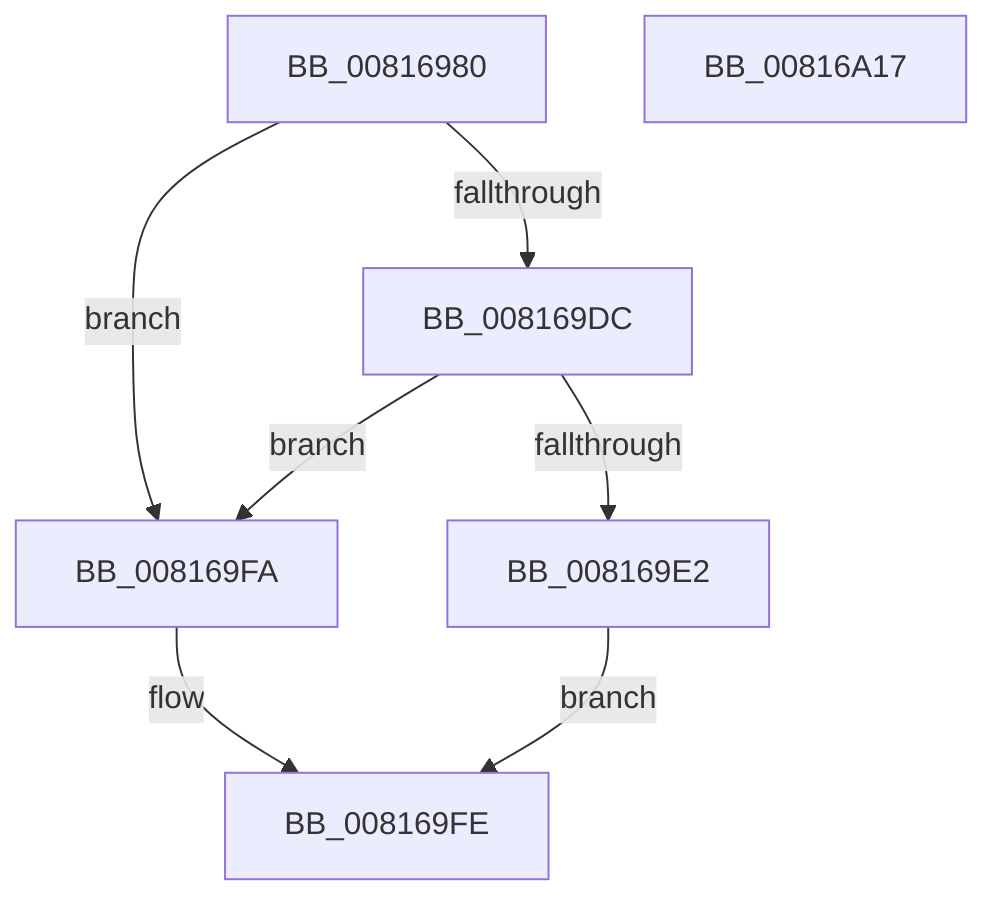

# SdbpMatchOne

- RVA: `0x00816980`–`0x00816A18` (길이 `152` bytes)
- VA: `0x0000000140816980`
- 실행 섹션: `PAGE`
- PDB 이름 있음: `예`; PDB Function 태그: `아니요`
- unwind 정보 RVA: `0x000D99C4`
- 디코드: `46`개 명령, `152/152` bytes 표시
- 미해석 바이트: `0` (있으면 어셈블리에 `.byte`로 보존)

> 이 문서는 커널 이미지의 기계어와 PDB 기호를 분석해 생성했습니다. 4번과 5번은 함수 원형과 자료형을 바이너리 사용 방식에서 추정한 C 해석이며 원본 소스 복구 결과는 아닙니다.

## 1. Dependencies

- 직접 호출 지점: **2**; 고유 호출 대상: **2**
- 직접 호출자로 확인된 함수: **0**
- RIP 상대 이미지 참조: **0**

### Outgoing calls
- `0x008169D1` → [SdbpMatchList](SdbpMatchList_function_00816734.md) (function, `0x00816734`)
- `0x008169EE` → [SdbFindFirstTag](../95/SdbFindFirstTag_function_0095E34C.md) (function, `0x0095E34C`)

### Direct callers
- 이 함수 시작 RVA로 연결되는 직접 call은 확인되지 않았습니다. 간접 호출은 완전히 역산할 수 없습니다.

### Static image references
- 디코드된 RIP-relative 메모리 참조가 없습니다.

## 2. Other-region calls and transfers

- 다른 실행 섹션으로 향하는 call: **0**
- 별도 외부 분기/꼬리 이동을 확인하지 못했습니다.

## 3. Assembly (complete function range)

```asm
00816980  4C 8B DC                        mov r11, rsp
00816983  49 89 5B 10                     mov qword ptr [r11 + 0x10], rbx
00816987  49 89 6B 18                     mov qword ptr [r11 + 0x18], rbp
0081698B  56                              push rsi
0081698C  57                              push rdi
0081698D  41 56                           push r14
0081698F  48 83 EC 50                     sub rsp, 0x50
00816993  48 8B 84 24 98 00 00 00         mov rax, qword ptr [rsp + 0x98]
0081699B  49 8B E8                        mov rbp, r8
0081699E  44 8B B4 24 90 00 00 00         mov r14d, dword ptr [rsp + 0x90]
008169A6  4D 8B C8                        mov r9, r8
008169A9  4C 8B C2                        mov r8, rdx
008169AC  C7 44 24 30 01 00 00 00         mov dword ptr [rsp + 0x30], 1
008169B4  48 8B F1                        mov rsi, rcx
008169B7  49 89 43 C0                     mov qword ptr [r11 - 0x40], rax
008169BB  33 DB                           xor ebx, ebx
008169BD  45 89 73 B8                     mov dword ptr [r11 - 0x48], r14d
008169C1  49 8D 53 08                     lea rdx, [r11 + 8]
008169C5  89 5C 24 40                     mov dword ptr [rsp + 0x40], ebx
008169C9  49 8D 4B D8                     lea rcx, [r11 - 0x28]
008169CD  89 5C 24 70                     mov dword ptr [rsp + 0x70], ebx
008169D1  E8 5E FD FF FF                  call 0x140816734
008169D6  8B F8                           mov edi, eax
008169D8  85 C0                           test eax, eax
008169DA  74 1E                           je 0x1408169fa
008169DC  39 5C 24 70                     cmp dword ptr [rsp + 0x70], ebx
008169E0  75 18                           jne 0x1408169fa
008169E2  41 B8 03 10 00 00               mov r8d, 0x1003
008169E8  41 8B D6                        mov edx, r14d
008169EB  48 8B CD                        mov rcx, rbp
008169EE  E8 59 79 14 00                  call 0x14095e34c
008169F3  85 C0                           test eax, eax
008169F5  0F 94 C3                        sete bl
008169F8  EB 04                           jmp 0x1408169fe
008169FA  8B 5C 24 40                     mov ebx, dword ptr [rsp + 0x40]
008169FE  4C 8D 5C 24 50                  lea r11, [rsp + 0x50]
00816A03  89 1E                           mov dword ptr [rsi], ebx
00816A05  49 8B 5B 28                     mov rbx, qword ptr [r11 + 0x28]
00816A09  8B C7                           mov eax, edi
00816A0B  49 8B 6B 30                     mov rbp, qword ptr [r11 + 0x30]
00816A0F  49 8B E3                        mov rsp, r11
00816A12  41 5E                           pop r14
00816A14  5F                              pop rdi
00816A15  5E                              pop rsi
00816A16  C3                              ret
00816A17  CC                              int3
```

## 4. C-style interpretation (structured pseudocode)

```c
__int64 __fastcall SdbpMatchOne(__int64 a1, __int64 a2, __int64 a3, __int64 a4, unsigned int a5, __int64 a6)
{
    __int64 result;
    __int64 v_rbx;
    __int64 v_rsp;
    unsigned __int64 v_stack_m18;
    unsigned int v_stack_m28;
    unsigned int v_stack_m38;
    unsigned int v_stack_p8;

    *(unsigned __int64 *)(v_rsp + 16) = v_rbx;
    *(unsigned __int64 *)(v_rsp + 24) = v_rbp;
    v_rsp = (v_rsp) - (80);
    v_stack_m38 = 1;
    *(unsigned __int64 *)(v_rsp - 64) = a6;
    v_rbx = 0;
    *(unsigned int *)(v_rsp - 72) = (unsigned int)((unsigned int)(a5));
    v_stack_m28 = 0;
    v_stack_p8 = 0;
    result = SdbpMatchList(v_rsp - 40, v_rsp + 8, a2, a3);
    if ((unsigned int)(result) == 0) goto loc_008169FA;
    if (v_stack_p8 != 0) goto loc_008169FA;
    result = SdbFindFirstTag(a3, (unsigned int)((unsigned int)((unsigned int)(a5))), (unsigned int)(0x1003ULL), a3);
    v_rbx = ((unsigned int)(result) == 0) ? 1 : 0;
    goto loc_008169FE;
loc_008169FA:
loc_008169FE:
    *(unsigned int *)(a1) = (unsigned int)((unsigned int)(v_stack_m28));
    return (unsigned int)((unsigned int)((unsigned int)((unsigned int)(result))));
}
```

## 5. (Beta) C Style

```c
int64_t SdbpMatchOne(void *Arg1, int64_t Arg2, int64_t Arg3, int64_t Arg4, uint32_t Arg5, int64_t Arg6)
{
    uint8_t *arg1 = (uint8_t *)Arg1;

    int64_t result;
    int64_t local_rbx;
    int64_t local_rsp;
    uint64_t v_stack_m18;
    uint32_t v_stack_m28;
    uint32_t v_stack_m38;
    uint32_t v_stack_p8;

    *(uint64_t *)(local_rsp + 0x10) = local_rbx;
    *(uint64_t *)(local_rsp + 0x18) = local_rbp;
    local_rsp = (local_rsp) - (80);
    v_stack_m38 = 1;
    *(uint64_t *)(local_rsp - 0x40) = Arg6;
    local_rbx = 0;
    *(uint32_t *)(local_rsp - 0x48) = (uint32_t)((uint32_t)(Arg5));
    v_stack_m28 = 0;
    v_stack_p8 = 0;
    result = SdbpMatchList(local_rsp - 40, local_rsp + 8, Arg2, Arg3);
    if ((uint32_t)(result) == 0) goto loc_008169FA;
    if (v_stack_p8 != 0) goto loc_008169FA;
    result = SdbFindFirstTag(Arg3, (uint32_t)((uint32_t)((uint32_t)(Arg5))), (uint32_t)(0x1003ULL), Arg3);
    local_rbx = ((uint32_t)(result) == 0) ? 1 : 0;
    goto loc_008169FE;
loc_008169FA:
loc_008169FE:
    *(uint32_t *)(arg1) = (uint32_t)((uint32_t)(v_stack_m28));
    return (uint32_t)((uint32_t)((uint32_t)((uint32_t)(result))));
}
```

### 관측된 메모리 오프셋

구조체 형식이 확인되지 않은 접근은 인자 기준의 오프셋으로만 기록했습니다.

| 기준 인자 | 오프셋 표현 | 폭 (bit) | 접근 |
|---|---:|---:|---|
| `Arg1` | `+ 0x0` | `32` | `W` |

## 6. Execution-region graph

[열기: 2D/3D 그래프와 함수 탐색 컨트롤 패널](../../../control-panel.html?section=page&rva=0x00816980&view=graph)

- 2D 그래프는 위에서 아래로 흐르고, 3D 그래프는 빈 공간을 드래그해 회전합니다. Shift+드래그는 이동, 휠은 확대·축소, 함수 노드 선택은 대상 보고서 이동입니다.

### Static fallback


