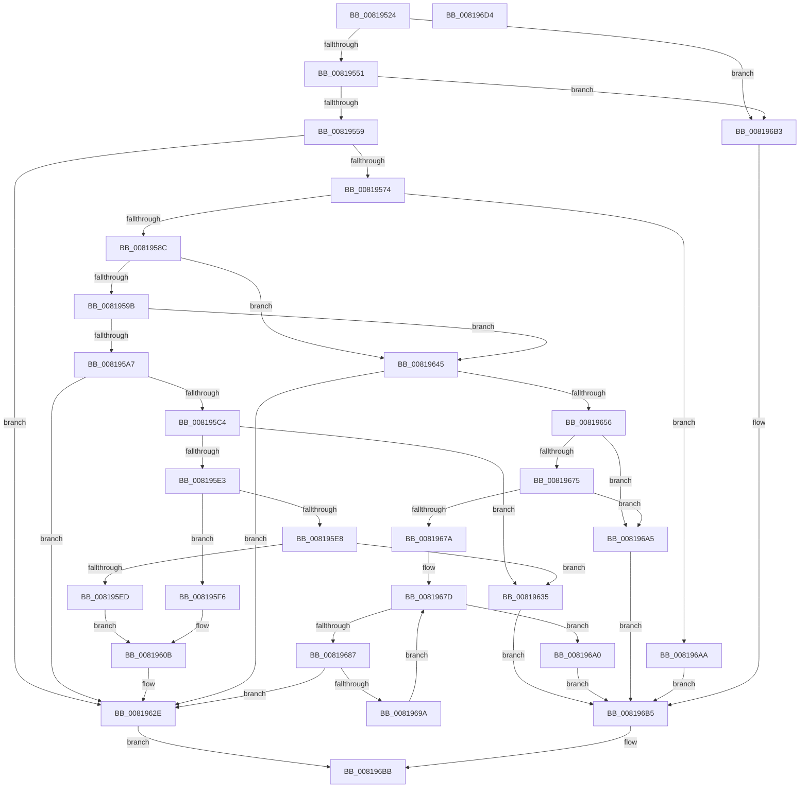

# SdbpMergeAreTagValuesEqual

- RVA: `0x00819524`–`0x008196D5` (길이 `433` bytes)
- VA: `0x0000000140819524`
- 실행 섹션: `PAGE`
- PDB 이름 있음: `예`; PDB Function 태그: `아니요`
- unwind 정보 RVA: `0x00084C9C`
- 디코드: `125`개 명령, `433/433` bytes 표시
- 미해석 바이트: `0` (있으면 어셈블리에 `.byte`로 보존)

> 이 문서는 커널 이미지의 기계어와 PDB 기호를 분석해 생성했습니다. 4번과 5번은 함수 원형과 자료형을 바이너리 사용 방식에서 추정한 C 해석이며 원본 소스 복구 결과는 아닙니다.

## 1. Dependencies

- 직접 호출 지점: **12**; 고유 호출 대상: **7**
- 직접 호출자로 확인된 함수: **1**
- RIP 상대 이미지 참조: **5**

### Outgoing calls
- `0x00819559` → [SdbGetTagFromTagID](../95/SdbGetTagFromTagID_function_0095E3C0.md) (function, `0x0095E3C0`)
- `0x00819566` → [SdbGetTagFromTagID](../95/SdbGetTagFromTagID_function_0095E3C0.md) (function, `0x0095E3C0`)
- `0x008195AC` → [SdbGetTagDataSize](../95/SdbGetTagDataSize_function_0095E230.md) (function, `0x0095E230`)
- `0x008195B8` → [SdbGetTagDataSize](../95/SdbGetTagDataSize_function_0095E230.md) (function, `0x0095E230`)
- `0x008195C9` → [SdbpGetMappedTagData](../95/SdbpGetMappedTagData_function_0095DD24.md) (function, `0x0095DD24`)
- `0x008195D6` → [SdbpGetMappedTagData](../95/SdbpGetMappedTagData_function_0095DD24.md) (function, `0x0095DD24`)
- `0x00819629` → [AslLogCallPrintf](../95/AslLogCallPrintf_function_0095E4EC.md) (function, `0x0095E4EC`)
- `0x0081963B` → [RtlCompareMemory](../../text/6B/RtlCompareMemory_function_006BA670.md) (function, `0x006BA670`)
- `0x0081965B` → [SdbGetStringTagPtr](../95/SdbGetStringTagPtr_function_0095DDA8.md) (function, `0x0095DDA8`)
- `0x00819668` → [SdbGetStringTagPtr](../95/SdbGetStringTagPtr_function_0095DDA8.md) (function, `0x0095DDA8`)
- `0x00819687` → [toupper](../../text/50/toupper_function_00501870.md) (function, `0x00501870`)
- `0x00819691` → [toupper](../../text/50/toupper_function_00501870.md) (function, `0x00501870`)

### Direct callers
- [SdbMergeIsEntryUpdated](SdbMergeIsEntryUpdated_function_00819158.md) at `0x008192C7`
- [SdbMergeIsEntryUpdated](SdbMergeIsEntryUpdated_function_00819158.md) at `0x008194D3`

### Static image references
- `0x008195ED` → RVA `0x0003E418` (`.rdata`; read)
- `0x008195F9` → RVA `0x0003E408` (`.rdata`; read)
- `0x00819600` → RVA `0x0003E3F8` (`.rdata`; read)
- `0x0081960B` → RVA `0x0003E430` (`.rdata`; read)
- `0x0081961D` → RVA `0x0003E490` (`.rdata`; read)

## 2. Other-region calls and transfers

- 다른 실행 섹션으로 향하는 call: **3**
  - `0x0081963B` → [RtlCompareMemory](../../text/6B/RtlCompareMemory_function_006BA670.md) (`PAGE` → `.text`)
  - `0x00819687` → [toupper](../../text/50/toupper_function_00501870.md) (`PAGE` → `.text`)
  - `0x00819691` → [toupper](../../text/50/toupper_function_00501870.md) (`PAGE` → `.text`)
- 별도 외부 분기/꼬리 이동을 확인하지 못했습니다.

## 3. Assembly (complete function range)

```asm
00819524  48 89 5C 24 08                  mov qword ptr [rsp + 8], rbx
00819529  48 89 6C 24 10                  mov qword ptr [rsp + 0x10], rbp
0081952E  48 89 74 24 18                  mov qword ptr [rsp + 0x18], rsi
00819533  57                              push rdi
00819534  41 56                           push r14
00819536  41 57                           push r15
00819538  48 83 EC 30                     sub rsp, 0x30
0081953C  33 FF                           xor edi, edi
0081953E  41 8B D9                        mov ebx, r9d
00819541  4D 8B F0                        mov r14, r8
00819544  8B F2                           mov esi, edx
00819546  4C 8B F9                        mov r15, rcx
00819549  85 D2                           test edx, edx
0081954B  0F 84 62 01 00 00               je 0x1408196b3
00819551  85 DB                           test ebx, ebx
00819553  0F 84 5A 01 00 00               je 0x1408196b3
00819559  E8 62 4E 14 00                  call 0x14095e3c0
0081955E  8B D3                           mov edx, ebx
00819560  0F B7 E8                        movzx ebp, ax
00819563  49 8B CE                        mov rcx, r14
00819566  E8 55 4E 14 00                  call 0x14095e3c0
0081956B  66 3B E8                        cmp bp, ax
0081956E  0F 85 BA 00 00 00               jne 0x14081962e
00819574  8B CD                           mov ecx, ebp
00819576  BA 00 F0 00 00                  mov edx, 0xf000
0081957B  23 CA                           and ecx, edx
0081957D  41 B8 00 10 00 00               mov r8d, 0x1000
00819583  41 3B C8                        cmp ecx, r8d
00819586  0F 84 1E 01 00 00               je 0x1408196aa
0081958C  41 B8 00 60 00 00               mov r8d, 0x6000
00819592  41 3B C8                        cmp ecx, r8d
00819595  0F 84 AA 00 00 00               je 0x140819645
0081959B  81 F9 00 80 00 00               cmp ecx, 0x8000
008195A1  0F 84 9E 00 00 00               je 0x140819645
008195A7  8B D6                           mov edx, esi
008195A9  49 8B CF                        mov rcx, r15
008195AC  E8 7F 4C 14 00                  call 0x14095e230
008195B1  8B D3                           mov edx, ebx
008195B3  8B E8                           mov ebp, eax
008195B5  49 8B CE                        mov rcx, r14
008195B8  E8 73 4C 14 00                  call 0x14095e230
008195BD  8B C0                           mov eax, eax
008195BF  48 3B E8                        cmp rbp, rax
008195C2  75 6A                           jne 0x14081962e
008195C4  8B D6                           mov edx, esi
008195C6  49 8B CF                        mov rcx, r15
008195C9  E8 56 47 14 00                  call 0x14095dd24
008195CE  8B D3                           mov edx, ebx
008195D0  49 8B CE                        mov rcx, r14
008195D3  48 8B F0                        mov rsi, rax
008195D6  E8 49 47 14 00                  call 0x14095dd24
008195DB  48 8B D0                        mov rdx, rax
008195DE  48 85 ED                        test rbp, rbp
008195E1  74 52                           je 0x140819635
008195E3  48 85 F6                        test rsi, rsi
008195E6  74 0E                           je 0x1408195f6
008195E8  48 85 C0                        test rax, rax
008195EB  75 48                           jne 0x140819635
008195ED  48 8D 05 24 4E 82 FF            lea rax, [rip - 0x7db1dc]
008195F4  EB 15                           jmp 0x14081960b
008195F6  48 85 D2                        test rdx, rdx
008195F9  48 8D 0D 08 4E 82 FF            lea rcx, [rip - 0x7db1f8]
00819600  48 8D 05 F1 4D 82 FF            lea rax, [rip - 0x7db20f]
00819607  48 0F 45 C1                     cmovne rax, rcx
0081960B  4C 8D 0D 1E 4E 82 FF            lea r9, [rip - 0x7db1e2]
00819612  48 89 44 24 20                  mov qword ptr [rsp + 0x20], rax
00819617  41 B8 79 03 00 00               mov r8d, 0x379
0081961D  48 8D 15 6C 4E 82 FF            lea rdx, [rip - 0x7db194]
00819624  B9 01 00 00 00                  mov ecx, 1
00819629  E8 BE 4E 14 00                  call 0x14095e4ec
0081962E  33 C0                           xor eax, eax
00819630  E9 86 00 00 00                  jmp 0x1408196bb
00819635  4C 8B C5                        mov r8, rbp
00819638  48 8B CE                        mov rcx, rsi
0081963B  E8 30 10 EA FF                  call 0x1406ba670
00819640  48 3B E8                        cmp rbp, rax
00819643  EB 70                           jmp 0x1408196b5
00819645  66 23 C2                        and ax, dx
00819648  B9 FF DF 00 00                  mov ecx, 0xdfff
0081964D  66 41 2B C0                     sub ax, r8w
00819651  66 85 C1                        test cx, ax
00819654  75 D8                           jne 0x14081962e
00819656  8B D6                           mov edx, esi
00819658  49 8B CF                        mov rcx, r15
0081965B  E8 48 47 14 00                  call 0x14095dda8
00819660  8B D3                           mov edx, ebx
00819662  49 8B CE                        mov rcx, r14
00819665  48 8B F0                        mov rsi, rax
00819668  E8 3B 47 14 00                  call 0x14095dda8
0081966D  4C 8B F0                        mov r14, rax
00819670  48 85 F6                        test rsi, rsi
00819673  74 30                           je 0x1408196a5
00819675  48 85 C0                        test rax, rax
00819678  74 2B                           je 0x1408196a5
0081967A  4C 2B F6                        sub r14, rsi
0081967D  41 0F B7 0C 36                  movzx ecx, word ptr [r14 + rsi]
00819682  66 39 3E                        cmp word ptr [rsi], di
00819685  74 19                           je 0x1408196a0
00819687  E8 E4 81 CE FF                  call 0x140501870
0081968C  0F B7 0E                        movzx ecx, word ptr [rsi]
0081968F  8B D8                           mov ebx, eax
00819691  E8 DA 81 CE FF                  call 0x140501870
00819696  3B C3                           cmp eax, ebx
00819698  75 94                           jne 0x14081962e
0081969A  48 83 C6 02                     add rsi, 2
0081969E  EB DD                           jmp 0x14081967d
008196A0  66 85 C9                        test cx, cx
008196A3  EB 10                           jmp 0x1408196b5
008196A5  49 3B F6                        cmp rsi, r14
008196A8  EB 0B                           jmp 0x1408196b5
008196AA  66 23 C2                        and ax, dx
008196AD  66 41 3B C0                     cmp ax, r8w
008196B1  EB 02                           jmp 0x1408196b5
008196B3  3B F3                           cmp esi, ebx
008196B5  40 0F 94 C7                     sete dil
008196B9  8B C7                           mov eax, edi
008196BB  48 8B 5C 24 50                  mov rbx, qword ptr [rsp + 0x50]
008196C0  48 8B 6C 24 58                  mov rbp, qword ptr [rsp + 0x58]
008196C5  48 8B 74 24 60                  mov rsi, qword ptr [rsp + 0x60]
008196CA  48 83 C4 30                     add rsp, 0x30
008196CE  41 5F                           pop r15
008196D0  41 5E                           pop r14
008196D2  5F                              pop rdi
008196D3  C3                              ret
008196D4  CC                              int3
```

## 4. C-style interpretation (structured pseudocode)

```c
__int64 __fastcall SdbpMergeAreTagValuesEqual(__int64 a1, int a2, __int64 a3, int a4)
{
    __int64 result;
    __int64 v_r14;
    __int64 v_rdi;
    __int64 v_rsi;
    __int64 v_rsp;
    unsigned __int64 v_stack_m28;
    unsigned __int64 v_stack_p10;
    unsigned __int64 v_stack_p18;
    unsigned __int64 v_stack_p8;

    v_stack_p8 = v_rbx;
    v_stack_p10 = v_rbp;
    v_stack_p18 = v_rsi;
    v_rsp = (v_rsp) - (48);
    v_rdi = 0;
    if (a2 == 0) goto loc_008196B3;
    if ((unsigned int)((unsigned int)(a4)) == 0) goto loc_008196B3;
    result = SdbGetTagFromTagID(a1, a2, a3, a4);
    result = SdbGetTagFromTagID(a3, (unsigned int)((unsigned int)((unsigned int)(a4))), a3, a4);
    if (((unsigned __int16)((unsigned __int16)(result))) != ((unsigned __int16)(result))) goto loc_0081962E;
    a1 = (unsigned int)(((unsigned int)((unsigned int)((unsigned __int16)(result)))) & ((unsigned int)((unsigned int)(0xF000ULL))));
    if (((unsigned int)(a1)) == ((unsigned int)((unsigned int)(0x1000ULL)))) goto loc_008196AA;
    if (((unsigned int)(a1)) == ((unsigned int)((unsigned int)(0x6000ULL)))) goto loc_00819645;
    if (((unsigned int)(a1)) == 0x8000ULL) goto loc_00819645;
    result = SdbGetTagDataSize(a1, (unsigned int)((unsigned int)((unsigned int)(a2))), (unsigned int)(0x6000ULL), a4);
    result = SdbGetTagDataSize(a3, (unsigned int)((unsigned int)((unsigned int)(a4))), (unsigned int)(0x6000ULL), a4);
    if (((unsigned int)((unsigned int)(result))) != ((unsigned int)((unsigned int)(result)))) goto loc_0081962E;
    result = SdbpGetMappedTagData(a1, (unsigned int)((unsigned int)((unsigned int)(a2))), (unsigned int)(0x6000ULL), a4);
    result = SdbpGetMappedTagData(a3, (unsigned int)((unsigned int)((unsigned int)(a4))), (unsigned int)(0x6000ULL), a4);
    if ((unsigned int)((unsigned int)(result)) == 0) goto loc_00819635;
    if (result == 0) goto loc_008195F6;
    if (result != 0) goto loc_00819635;
    goto loc_0081960B;
loc_008195F6:
    result = v_rip - 8237583;
    if (result != 0) { result = v_rip - 8237560; }
loc_0081960B:
    v_stack_m28 = result;
    result = AslLogCallPrintf(1, v_rip - 8237460, 889, v_rip - 8237538);
loc_0081962E:
    result = 0;
    goto loc_008196BB;
loc_00819635:
    result = RtlCompareMemory(0, v_rip - 8237460, (unsigned int)((unsigned int)(result)), v_rip - 8237538);
    goto loc_008196B5;
loc_00819645:
    result = (unsigned __int16)((result) & ((unsigned __int16)(v_rip - 8237460)));
    result = (unsigned __int16)((result) - ((unsigned __int16)((unsigned int)((unsigned int)(result)))));
    if ((((unsigned __int16)((unsigned int)(0xDFFFULL))) & ((unsigned __int16)(result))) != 0) goto loc_0081962E;
    result = SdbGetStringTagPtr(a1, (unsigned int)((unsigned int)(result)), (unsigned int)((unsigned int)(result)), v_rip - 8237538);
    result = SdbGetStringTagPtr(a3, (unsigned int)((unsigned int)((unsigned int)(a4))), (unsigned int)((unsigned int)(result)), v_rip - 8237538);
    if (result == 0) goto loc_008196A5;
    if (result == 0) goto loc_008196A5;
    v_r14 = (result) - (result);
loc_0081967D:
    if ((*(unsigned __int16 *)(result)) == 0) goto loc_008196A0;
    result = toupper(*(unsigned __int16 *)(v_r14 + result * 1), (unsigned int)((unsigned int)((unsigned int)(a4))), (unsigned int)((unsigned int)(result)), v_rip - 8237538);
    result = toupper(*(unsigned __int16 *)(result), (unsigned int)((unsigned int)((unsigned int)(a4))), (unsigned int)((unsigned int)(result)), v_rip - 8237538);
    if (((unsigned int)(result)) != ((unsigned int)((unsigned int)((unsigned int)(result))))) goto loc_0081962E;
    v_rsi = (result) + (2);
    goto loc_0081967D;
loc_008196A0:
    goto loc_008196B5;
loc_008196A5:
    goto loc_008196B5;
loc_008196AA:
    result = (unsigned __int16)((result) & ((unsigned __int16)((unsigned int)((unsigned int)((unsigned int)(a4))))));
    goto loc_008196B5;
loc_008196B3:
loc_008196B5:
    v_rdi = (((unsigned int)(v_rsi)) == ((unsigned int)((unsigned int)((unsigned int)(result))))) ? 1 : 0;
loc_008196BB:
    v_rsp = (v_rsp) + (48);
    return (unsigned int)((unsigned int)(v_rdi));
}
```

## 5. (Beta) C Style

```c
int64_t SdbpMergeAreTagValuesEqual(int64_t Arg1, int32_t Arg2, int64_t Arg3, int32_t Arg4)
{
    int64_t result;
    int64_t local_r14;
    int64_t local_rdi;
    int64_t local_rsi;
    int64_t local_rsp;
    uint64_t v_stack_m28;
    uint64_t v_stack_p10;
    uint64_t v_stack_p18;
    uint64_t v_stack_p8;

    v_stack_p8 = local_rbx;
    v_stack_p10 = local_rbp;
    v_stack_p18 = local_rsi;
    local_rsp = (local_rsp) - (48);
    local_rdi = 0;
    if (Arg2 == 0) goto loc_008196B3;
    if ((uint32_t)((uint32_t)(Arg4)) == 0) goto loc_008196B3;
    result = SdbGetTagFromTagID(Arg1, Arg2, Arg3, Arg4);
    result = SdbGetTagFromTagID(Arg3, (uint32_t)((uint32_t)((uint32_t)(Arg4))), Arg3, Arg4);
    if (((uint16_t)((uint16_t)(result))) != ((uint16_t)(result))) goto loc_0081962E;
    Arg1 = (uint32_t)(((uint32_t)((uint32_t)((uint16_t)(result)))) & ((uint32_t)((uint32_t)(0xF000ULL))));
    if (((uint32_t)(Arg1)) == ((uint32_t)((uint32_t)(0x1000ULL)))) goto loc_008196AA;
    if (((uint32_t)(Arg1)) == ((uint32_t)((uint32_t)(0x6000ULL)))) goto loc_00819645;
    if (((uint32_t)(Arg1)) == 0x8000ULL) goto loc_00819645;
    result = SdbGetTagDataSize(Arg1, (uint32_t)((uint32_t)((uint32_t)(Arg2))), (uint32_t)(0x6000ULL), Arg4);
    result = SdbGetTagDataSize(Arg3, (uint32_t)((uint32_t)((uint32_t)(Arg4))), (uint32_t)(0x6000ULL), Arg4);
    if (((uint32_t)((uint32_t)(result))) != ((uint32_t)((uint32_t)(result)))) goto loc_0081962E;
    result = SdbpGetMappedTagData(Arg1, (uint32_t)((uint32_t)((uint32_t)(Arg2))), (uint32_t)(0x6000ULL), Arg4);
    result = SdbpGetMappedTagData(Arg3, (uint32_t)((uint32_t)((uint32_t)(Arg4))), (uint32_t)(0x6000ULL), Arg4);
    if ((uint32_t)((uint32_t)(result)) == 0) goto loc_00819635;
    if (result == 0) goto loc_008195F6;
    if (result != 0) goto loc_00819635;
    goto loc_0081960B;
loc_008195F6:
    result = v_rip - 8237583;
    if (result != 0) { result = v_rip - 8237560; }
loc_0081960B:
    v_stack_m28 = result;
    result = AslLogCallPrintf(1, v_rip - 8237460, 889, v_rip - 8237538);
loc_0081962E:
    result = 0;
    goto loc_008196BB;
loc_00819635:
    result = RtlCompareMemory(0, v_rip - 8237460, (uint32_t)((uint32_t)(result)), v_rip - 8237538);
    goto loc_008196B5;
loc_00819645:
    result = (uint16_t)((result) & ((uint16_t)(v_rip - 8237460)));
    result = (uint16_t)((result) - ((uint16_t)((uint32_t)((uint32_t)(result)))));
    if ((((uint16_t)((uint32_t)(0xDFFFULL))) & ((uint16_t)(result))) != 0) goto loc_0081962E;
    result = SdbGetStringTagPtr(Arg1, (uint32_t)((uint32_t)(result)), (uint32_t)((uint32_t)(result)), v_rip - 8237538);
    result = SdbGetStringTagPtr(Arg3, (uint32_t)((uint32_t)((uint32_t)(Arg4))), (uint32_t)((uint32_t)(result)), v_rip - 8237538);
    if (result == 0) goto loc_008196A5;
    if (result == 0) goto loc_008196A5;
    local_r14 = (result) - (result);
loc_0081967D:
    if ((*(uint16_t *)(result)) == 0) goto loc_008196A0;
    result = toupper(*(uint16_t *)(local_r14 + result * 1), (uint32_t)((uint32_t)((uint32_t)(Arg4))), (uint32_t)((uint32_t)(result)), v_rip - 8237538);
    result = toupper(*(uint16_t *)(result), (uint32_t)((uint32_t)((uint32_t)(Arg4))), (uint32_t)((uint32_t)(result)), v_rip - 8237538);
    if (((uint32_t)(result)) != ((uint32_t)((uint32_t)((uint32_t)(result))))) goto loc_0081962E;
    local_rsi = (result) + (2);
    goto loc_0081967D;
loc_008196A0:
    goto loc_008196B5;
loc_008196A5:
    goto loc_008196B5;
loc_008196AA:
    result = (uint16_t)((result) & ((uint16_t)((uint32_t)((uint32_t)((uint32_t)(Arg4))))));
    goto loc_008196B5;
loc_008196B3:
loc_008196B5:
    local_rdi = (((uint32_t)(local_rsi)) == ((uint32_t)((uint32_t)((uint32_t)(result))))) ? 1 : 0;
loc_008196BB:
    local_rsp = (local_rsp) + (48);
    return (uint32_t)((uint32_t)(local_rdi));
}
```

## 6. Execution-region graph

[열기: 2D/3D 그래프와 함수 탐색 컨트롤 패널](../../../control-panel.html?section=page&rva=0x00819524&view=graph)

- 2D 그래프는 위에서 아래로 흐르고, 3D 그래프는 빈 공간을 드래그해 회전합니다. Shift+드래그는 이동, 휠은 확대·축소, 함수 노드 선택은 대상 보고서 이동입니다.

### Static fallback


