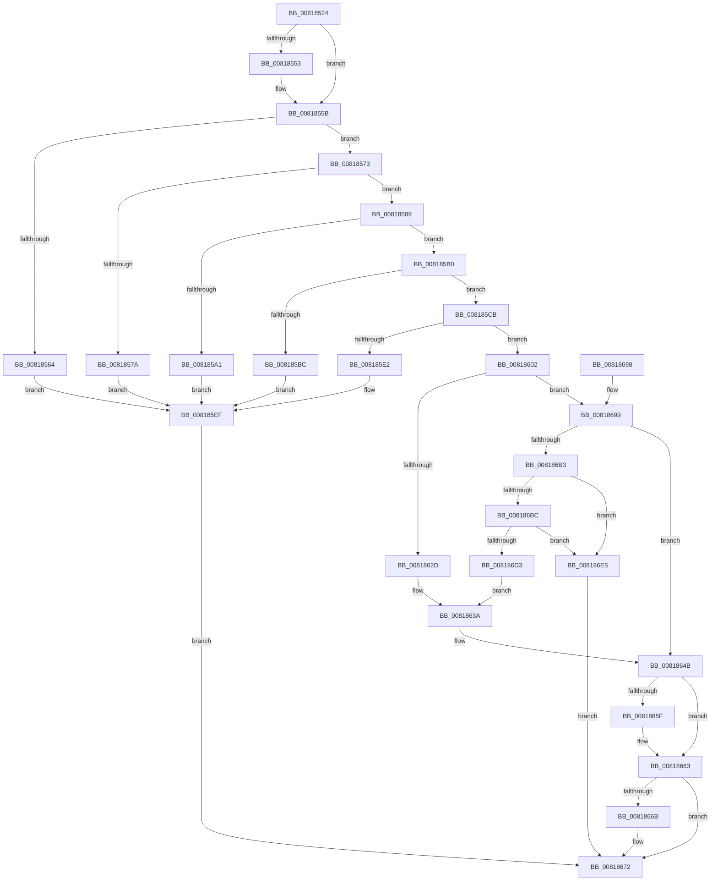

# SdbpOpenCompressedDatabase

- RVA: `0x00818524`–`0x008186FB` (길이 `471` bytes)
- VA: `0x0000000140818524`
- 실행 섹션: `PAGE`
- PDB 이름 있음: `예`; PDB Function 태그: `아니요`
- unwind 정보 RVA: `0x000D9B98`
- 디코드: `123`개 명령, `471/471` bytes 표시
- 미해석 바이트: `0` (있으면 어셈블리에 `.byte`로 보존)

> 이 문서는 커널 이미지의 기계어와 PDB 기호를 분석해 생성했습니다. 4번과 5번은 함수 원형과 자료형을 바이너리 사용 방식에서 추정한 C 해석이며 원본 소스 복구 결과는 아닙니다.

## 1. Dependencies

- 직접 호출 지점: **9**; 고유 호출 대상: **7**
- 직접 호출자로 확인된 함수: **1**
- RIP 상대 이미지 참조: **10**

### Outgoing calls
- `0x008185D5` → [AslAlloc](../95/AslAlloc_function_0095BD34.md) (function, `0x0095BD34`)
- `0x008185FB` → [AslLogCallPrintf](../95/AslLogCallPrintf_function_0095E4EC.md) (function, `0x0095E4EC`)
- `0x00818624` → [guard_dispatch_icall](../../text/6B/guard_dispatch_icall_function_006BAAD0.md) (function, `0x006BAAD0`)
- `0x00818646` → [AslLogCallPrintf](../95/AslLogCallPrintf_function_0095E4EC.md) (function, `0x0095E4EC`)
- `0x0081864E` → [AslFree](../95/AslFree_function_0095B674.md) (function, `0x0095B674`)
- `0x0081866B` → [SdbCloseDatabaseRead](../95/SdbCloseDatabaseRead_function_0095A728.md) (function, `0x0095A728`)
- `0x00818675` → [SdbCloseDatabaseRead](../95/SdbCloseDatabaseRead_function_0095A728.md) (function, `0x0095A728`)
- `0x008186A6` → [SdbpOpenDatabaseInMemory](../95/SdbpOpenDatabaseInMemory_function_0095A574.md) (function, `0x0095A574`)
- `0x008186CA` → [SdbpReadMappedData](../95/SdbpReadMappedData_function_0095E460.md) (function, `0x0095E460`)

### Direct callers
- [SdbOpenDatabaseEx](SdbOpenDatabaseEx_function_00812284.md) at `0x008124CE`

### Static image references
- `0x0081855B` → RVA `0x00EF0DB0` (`.data`; read)
- `0x00818564` → RVA `0x0003E000` (`.rdata`; read)
- `0x0081857A` → RVA `0x0003E058` (`.rdata`; read)
- `0x008185A1` → RVA `0x0003E078` (`.rdata`; read)
- `0x008185B0` → RVA `0x00EF0DB8` (`.data`; read)
- `0x008185BC` → RVA `0x0003E090` (`.rdata`; read)
- `0x008185E2` → RVA `0x0003E0D0` (`.rdata`; read)
- `0x008185EF` → RVA `0x0003E038` (`.rdata`; read)
- `0x0081862D` → RVA `0x0003E120` (`.rdata`; read)
- `0x008186D3` → RVA `0x0003E148` (`.rdata`; read)

## 2. Other-region calls and transfers

- 다른 실행 섹션으로 향하는 call: **1**
  - `0x00818624` → [guard_dispatch_icall](../../text/6B/guard_dispatch_icall_function_006BAAD0.md) (`PAGE` → `.text`)
- 별도 외부 분기/꼬리 이동을 확인하지 못했습니다.

## 3. Assembly (complete function range)

```asm
00818524  48 8B C4                        mov rax, rsp
00818527  48 89 58 10                     mov qword ptr [rax + 0x10], rbx
0081852B  48 89 68 18                     mov qword ptr [rax + 0x18], rbp
0081852F  56                              push rsi
00818530  57                              push rdi
00818531  41 54                           push r12
00818533  41 56                           push r14
00818535  41 57                           push r15
00818537  48 83 EC 50                     sub rsp, 0x50
0081853B  4C 8B 39                        mov r15, qword ptr [rcx]
0081853E  33 FF                           xor edi, edi
00818540  21 78 08                        and dword ptr [rax + 8], edi
00818543  33 DB                           xor ebx, ebx
00818545  45 8B E0                        mov r12d, r8d
00818548  48 8B F2                        mov rsi, rdx
0081854B  4C 8B F1                        mov r14, rcx
0081854E  48 85 D2                        test rdx, rdx
00818551  74 08                           je 0x14081855b
00818553  33 C0                           xor eax, eax
00818555  48 89 02                        mov qword ptr [rdx], rax
00818558  89 42 08                        mov dword ptr [rdx + 8], eax
0081855B  48 39 1D 4E 88 6D 00            cmp qword ptr [rip + 0x6d884e], rbx
00818562  75 0F                           jne 0x140818573
00818564  4C 8D 0D 95 5A 82 FF            lea r9, [rip - 0x7da56b]
0081856B  41 B8 AF 00 00 00               mov r8d, 0xaf
00818571  EB 7C                           jmp 0x1408185ef
00818573  41 83 7F 14 14                  cmp dword ptr [r15 + 0x14], 0x14
00818578  73 0F                           jae 0x140818589
0081857A  4C 8D 0D D7 5A 82 FF            lea r9, [rip - 0x7da529]
00818581  41 B8 B4 00 00 00               mov r8d, 0xb4
00818587  EB 66                           jmp 0x1408185ef
00818589  49 8B 47 08                     mov rax, qword ptr [r15 + 8]
0081858D  81 78 08 7A 64 62 66            cmp dword ptr [rax + 8], 0x6662647a
00818594  0F 10 00                        movups xmm0, xmmword ptr [rax]
00818597  8B 48 10                        mov ecx, dword ptr [rax + 0x10]
0081859A  0F 11 44 24 30                  movups xmmword ptr [rsp + 0x30], xmm0
0081859F  74 0F                           je 0x1408185b0
008185A1  4C 8D 0D D0 5A 82 FF            lea r9, [rip - 0x7da530]
008185A8  41 B8 BB 00 00 00               mov r8d, 0xbb
008185AE  EB 3F                           jmp 0x1408185ef
008185B0  8B 05 02 88 6D 00               mov eax, dword ptr [rip + 0x6d8802]
008185B6  39 44 24 3C                     cmp dword ptr [rsp + 0x3c], eax
008185BA  74 0F                           je 0x1408185cb
008185BC  4C 8D 0D CD 5A 82 FF            lea r9, [rip - 0x7da533]
008185C3  41 B8 C0 00 00 00               mov r8d, 0xc0
008185C9  EB 24                           jmp 0x1408185ef
008185CB  48 8B D1                        mov rdx, rcx
008185CE  89 8C 24 80 00 00 00            mov dword ptr [rsp + 0x80], ecx
008185D5  E8 5A 37 14 00                  call 0x14095bd34
008185DA  48 8B E8                        mov rbp, rax
008185DD  48 85 C0                        test rax, rax
008185E0  75 20                           jne 0x140818602
008185E2  4C 8D 0D E7 5A 82 FF            lea r9, [rip - 0x7da519]
008185E9  41 B8 D3 00 00 00               mov r8d, 0xd3
008185EF  48 8D 15 42 5A 82 FF            lea rdx, [rip - 0x7da5be]
008185F6  B9 01 00 00 00                  mov ecx, 1
008185FB  E8 EC 5E 14 00                  call 0x14095e4ec
00818600  EB 70                           jmp 0x140818672
00818602  4D 8B 47 08                     mov r8, qword ptr [r15 + 8]
00818606  48 8D 94 24 80 00 00 00         lea rdx, [rsp + 0x80]
0081860E  45 8B 4F 14                     mov r9d, dword ptr [r15 + 0x14]
00818612  49 83 C0 14                     add r8, 0x14
00818616  48 8B 05 93 87 6D 00            mov rax, qword ptr [rip + 0x6d8793]
0081861D  41 83 E9 14                     sub r9d, 0x14
00818621  48 8B CD                        mov rcx, rbp
00818624  E8 A7 24 EA FF                  call 0x1406baad0
00818629  85 C0                           test eax, eax
0081862B  75 6C                           jne 0x140818699
0081862D  4C 8D 0D EC 5A 82 FF            lea r9, [rip - 0x7da514]
00818634  41 B8 DD 00 00 00               mov r8d, 0xdd
0081863A  48 8D 15 F7 59 82 FF            lea rdx, [rip - 0x7da609]
00818641  B9 01 00 00 00                  mov ecx, 1
00818646  E8 A1 5E 14 00                  call 0x14095e4ec
0081864B  48 8B D5                        mov rdx, rbp
0081864E  E8 21 30 14 00                  call 0x14095b674
00818653  21 BC 24 80 00 00 00            and dword ptr [rsp + 0x80], edi
0081865A  48 85 DB                        test rbx, rbx
0081865D  74 04                           je 0x140818663
0081865F  48 21 7B 08                     and qword ptr [rbx + 8], rdi
00818663  48 8B CB                        mov rcx, rbx
00818666  48 85 DB                        test rbx, rbx
00818669  74 07                           je 0x140818672
0081866B  E8 B8 20 14 00                  call 0x14095a728
00818670  33 DB                           xor ebx, ebx
00818672  49 8B 0E                        mov rcx, qword ptr [r14]
00818675  E8 AE 20 14 00                  call 0x14095a728
0081867A  4C 8D 5C 24 50                  lea r11, [rsp + 0x50]
0081867F  49 89 1E                        mov qword ptr [r14], rbx
00818682  49 8B 5B 38                     mov rbx, qword ptr [r11 + 0x38]
00818686  8B C7                           mov eax, edi
00818688  49 8B 6B 40                     mov rbp, qword ptr [r11 + 0x40]
0081868C  49 8B E3                        mov rsp, r11
0081868F  41 5F                           pop r15
00818691  41 5E                           pop r14
00818693  41 5C                           pop r12
00818695  5F                              pop rdi
00818696  5E                              pop rsi
00818697  C3                              ret
00818698  CC                              int3
00818699  8B 94 24 80 00 00 00            mov edx, dword ptr [rsp + 0x80]
008186A0  45 8B C4                        mov r8d, r12d
008186A3  48 8B CD                        mov rcx, rbp
008186A6  E8 C9 1E 14 00                  call 0x14095a574
008186AB  48 8B D8                        mov rbx, rax
008186AE  48 85 C0                        test rax, rax
008186B1  74 98                           je 0x14081864b
008186B3  83 48 18 04                     or dword ptr [rax + 0x18], 4
008186B7  48 85 F6                        test rsi, rsi
008186BA  74 29                           je 0x1408186e5
008186BC  41 B9 0C 00 00 00               mov r9d, 0xc
008186C2  4C 8B C6                        mov r8, rsi
008186C5  33 D2                           xor edx, edx
008186C7  48 8B C8                        mov rcx, rax
008186CA  E8 91 5D 14 00                  call 0x14095e460
008186CF  85 C0                           test eax, eax
008186D1  75 12                           jne 0x1408186e5
008186D3  4C 8D 0D 6E 5A 82 FF            lea r9, [rip - 0x7da592]
008186DA  41 B8 EE 00 00 00               mov r8d, 0xee
008186E0  E9 55 FF FF FF                  jmp 0x14081863a
008186E5  83 4B 18 08                     or dword ptr [rbx + 0x18], 8
008186E9  BF 01 00 00 00                  mov edi, 1
008186EE  83 A4 24 80 00 00 00 00         and dword ptr [rsp + 0x80], 0
008186F6  E9 77 FF FF FF                  jmp 0x140818672
```

## 4. C-style interpretation (structured pseudocode)

```c
__int64 __fastcall SdbpOpenCompressedDatabase(__int64 a1, __int64 a2, int a3)
{
    __int64 result;
    __int64 v_rbx;
    __int64 v_rdi;
    __int64 v_rsp;
    unsigned __int64 v_stack_m28;
    unsigned int v_stack_m3C;
    unsigned __int64 v_stack_m48;
    unsigned int v_stack_p30;
    unsigned int v_stack_p8;

    *(unsigned __int64 *)(v_rsp + 16) = v_rbx;
    *(unsigned __int64 *)(v_rsp + 24) = v_rbp;
    v_rsp = (v_rsp) - (80);
    v_rdi = 0;
    v_rbx = 0;
    result = v_rsp;
    if (a2 != 0) {
        result = 0;
        *(unsigned __int64 *)(a2) = 0;
        *(unsigned int *)(a2 + 8) = 0;
    }
    if ((*(unsigned __int64 *)(v_rip + 7178318)) != 0) goto loc_00818573;
    goto loc_008185EF;
loc_00818573:
    if ((*(unsigned int *)(*(unsigned __int64 *)(a1) + 20)) >= 20) goto loc_00818589;
    goto loc_008185EF;
loc_00818589:
    v_stack_m48 = v_xmm0;
    if ((*(unsigned int *)(*(unsigned __int64 *)(*(unsigned __int64 *)(a1) + 8) + 8)) == 0x6662647AULL) goto loc_008185B0;
    goto loc_008185EF;
loc_008185B0:
    if (v_stack_m3C == ((unsigned int)((unsigned int)(*(unsigned int *)(v_rip + 7178242))))) goto loc_008185CB;
    goto loc_008185EF;
loc_008185CB:
    v_stack_p8 = (unsigned int)((unsigned int)(*(unsigned int *)(*(unsigned __int64 *)(*(unsigned __int64 *)(a1) + 8) + 16)));
    result = AslAlloc((unsigned int)(*(unsigned int *)(*(unsigned __int64 *)(*(unsigned __int64 *)(a1) + 8) + 16)), (unsigned int)(*(unsigned int *)(*(unsigned __int64 *)(*(unsigned __int64 *)(a1) + 8) + 16)), 192, v_rip - 8234291);
    if (result != 0) goto loc_00818602;
loc_008185EF:
    result = AslLogCallPrintf(1, v_rip - 8234430, 211, v_rip - 8234265);
    goto loc_00818672;
loc_00818602:
    a3 = (*(unsigned __int64 *)(*(unsigned __int64 *)(a1) + 8)) + (20);
    a4 = (unsigned int)(((unsigned int)(*(unsigned int *)(*(unsigned __int64 *)(a1) + 20))) - (20));
    result = guard_dispatch_icall(result, v_stack_p8, a3, a4);
    if ((unsigned int)(result) != 0) goto loc_00818699;
loc_0081863A:
    result = AslLogCallPrintf(1, v_rip - 8234505, 221, v_rip - 8234260);
loc_0081864B:
    result = AslFree(1, result, 221, v_rip - 8234260);
    if (0 != 0) {
    }
    if (0 != 0) {
        result = SdbCloseDatabaseRead(0, result, 221, v_rip - 8234260);
        v_rbx = 0;
    }
    result = SdbCloseDatabaseRead(*(unsigned __int64 *)(a1), result, 221, v_rip - 8234260);
    *(unsigned __int64 *)(a1) = 0;
    return 0;
loc_00818699:
    result = SdbpOpenDatabaseInMemory(*(unsigned __int64 *)(v_stack_m28 + 64), (unsigned int)(v_stack_p30), (unsigned int)((unsigned int)((unsigned int)(a3))), v_rip - 8234260);
    if (result == 0) goto loc_0081864B;
    if (a2 == 0) goto loc_008186E5;
    a2 = 0;
    result = SdbpReadMappedData(result, a2, a2, 12);
    if ((unsigned int)(result) != 0) goto loc_008186E5;
    goto loc_0081863A;
loc_008186E5:
    goto loc_00818672;
}
```

## 5. (Beta) C Style

```c
int64_t SdbpOpenCompressedDatabase(void *Arg1, int64_t Arg2, int32_t Arg3)
{
    uint8_t *arg1 = (uint8_t *)Arg1;

    int64_t result;
    int64_t local_rbx;
    int64_t local_rdi;
    int64_t local_rsp;
    uint64_t v_stack_m28;
    uint32_t v_stack_m3C;
    uint64_t v_stack_m48;
    uint32_t v_stack_p30;
    uint32_t v_stack_p8;

    *(uint64_t *)(local_rsp + 0x10) = local_rbx;
    *(uint64_t *)(local_rsp + 0x18) = local_rbp;
    local_rsp = (local_rsp) - (80);
    local_rdi = 0;
    local_rbx = 0;
    result = local_rsp;
    if (Arg2 != 0) {
        result = 0;
        *(uint64_t *)(Arg2) = 0;
        *(uint32_t *)(Arg2 + 0x8) = 0;
    }
    if ((*(uint64_t *)(v_rip + 0x6D884E)) != 0) goto loc_00818573;
    goto loc_008185EF;
loc_00818573:
    if ((*(uint32_t *)(*(uint64_t *)(arg1) + 0x14)) >= 20) goto loc_00818589;
    goto loc_008185EF;
loc_00818589:
    v_stack_m48 = v_xmm0;
    if ((*(uint32_t *)(*(uint64_t *)(*(uint64_t *)(arg1) + 0x8) + 0x8)) == 0x6662647AULL) goto loc_008185B0;
    goto loc_008185EF;
loc_008185B0:
    if (v_stack_m3C == ((uint32_t)((uint32_t)(*(uint32_t *)(v_rip + 0x6D8802))))) goto loc_008185CB;
    goto loc_008185EF;
loc_008185CB:
    v_stack_p8 = (uint32_t)((uint32_t)(*(uint32_t *)(*(uint64_t *)(*(uint64_t *)(arg1) + 0x8) + 0x10)));
    result = AslAlloc((uint32_t)(*(uint32_t *)(*(uint64_t *)(*(uint64_t *)(arg1) + 0x8) + 0x10)), (uint32_t)(*(uint32_t *)(*(uint64_t *)(*(uint64_t *)(arg1) + 0x8) + 0x10)), 192, v_rip - 8234291);
    if (result != 0) goto loc_00818602;
loc_008185EF:
    result = AslLogCallPrintf(1, v_rip - 8234430, 211, v_rip - 8234265);
    goto loc_00818672;
loc_00818602:
    Arg3 = (*(uint64_t *)(*(uint64_t *)(arg1) + 0x8)) + (20);
    a4 = (uint32_t)(((uint32_t)(*(uint32_t *)(*(uint64_t *)(arg1) + 0x14))) - (20));
    result = guard_dispatch_icall(result, v_stack_p8, Arg3, a4);
    if ((uint32_t)(result) != 0) goto loc_00818699;
loc_0081863A:
    result = AslLogCallPrintf(1, v_rip - 8234505, 221, v_rip - 8234260);
loc_0081864B:
    result = AslFree(1, result, 221, v_rip - 8234260);
    if (0 != 0) {
    }
    if (0 != 0) {
        result = SdbCloseDatabaseRead(0, result, 221, v_rip - 8234260);
        local_rbx = 0;
    }
    result = SdbCloseDatabaseRead(*(uint64_t *)(arg1), result, 221, v_rip - 8234260);
    *(uint64_t *)(arg1) = 0;
    return 0;
loc_00818699:
    result = SdbpOpenDatabaseInMemory(*(uint64_t *)(v_stack_m28 + 0x40), (uint32_t)(v_stack_p30), (uint32_t)((uint32_t)((uint32_t)(Arg3))), v_rip - 8234260);
    if (result == 0) goto loc_0081864B;
    if (Arg2 == 0) goto loc_008186E5;
    Arg2 = 0;
    result = SdbpReadMappedData(result, Arg2, Arg2, 12);
    if ((uint32_t)(result) != 0) goto loc_008186E5;
    goto loc_0081863A;
loc_008186E5:
    goto loc_00818672;
}
```

### 관측된 메모리 오프셋

구조체 형식이 확인되지 않은 접근은 인자 기준의 오프셋으로만 기록했습니다.

| 기준 인자 | 오프셋 표현 | 폭 (bit) | 접근 |
|---|---:|---:|---|
| `Arg1` | `+ 0x0` | `64` | `R` |
| `Arg1` | `+ 0x0` | `64` | `W` |

## 6. Execution-region graph

[열기: 2D/3D 그래프와 함수 탐색 컨트롤 패널](../../../control-panel.html?section=page&rva=0x00818524&view=graph)

- 2D 그래프는 위에서 아래로 흐르고, 3D 그래프는 빈 공간을 드래그해 회전합니다. Shift+드래그는 이동, 휠은 확대·축소, 함수 노드 선택은 대상 보고서 이동입니다.

### Static fallback


