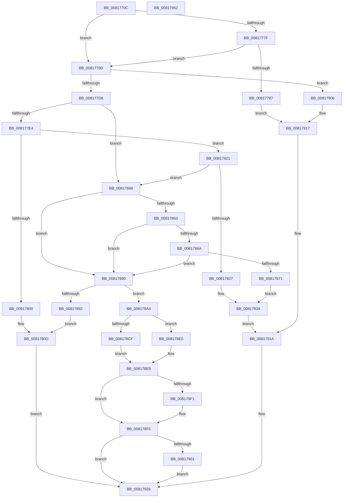

# SdbpOpenLocalDatabaseEx

- RVA: `0x0081770C`–`0x00817953` (길이 `583` bytes)
- VA: `0x000000014081770C`
- 실행 섹션: `PAGE`
- PDB 이름 있음: `예`; PDB Function 태그: `아니요`
- unwind 정보 RVA: `0x000D9AF8`
- 디코드: `148`개 명령, `583/583` bytes 표시
- 미해석 바이트: `0` (있으면 어셈블리에 `.byte`로 보존)

> 이 문서는 커널 이미지의 기계어와 PDB 기호를 분석해 생성했습니다. 4번과 5번은 함수 원형과 자료형을 바이너리 사용 방식에서 추정한 C 해석이며 원본 소스 복구 결과는 아닙니다.

## 1. Dependencies

- 직접 호출 지점: **8**; 고유 호출 대상: **7**
- 직접 호출자로 확인된 함수: **1**
- RIP 상대 이미지 참조: **8**

### Outgoing calls
- `0x008177A3` → [SdbpCloseLocalDatabaseEx](SdbpCloseLocalDatabaseEx_function_00817624.md) (function, `0x00817624`)
- `0x008177C2` → [SdbResolveDatabaseEx](SdbResolveDatabaseEx_function_00817A54.md) (function, `0x00817A54`)
- `0x008177F7` → [SdbpCheckRuntimePlatformImpl](SdbpCheckRuntimePlatformImpl_function_008154B8.md) (function, `0x008154B8`)
- `0x00817817` → [AslLogCallPrintf](../95/AslLogCallPrintf_function_0095E4EC.md) (function, `0x0095E4EC`)
- `0x0081785A` → [SdbpGetFileTimestamp](SdbpGetFileTimestamp_function_00812558.md) (function, `0x00812558`)
- `0x00817885` → [SdbOpenDatabaseEx](SdbOpenDatabaseEx_function_00812284.md) (function, `0x00812284`)
- `0x00817921` → [AslLogCallPrintf](../95/AslLogCallPrintf_function_0095E4EC.md) (function, `0x0095E4EC`)
- `0x00817932` → [_security_check_cookie](../../text/6A/_security_check_cookie_function_006AC640.md) (function, `0x006AC640`)

### Direct callers
- [SdbTagRefToTagID](SdbTagRefToTagID_function_0081717C.md) at `0x00817207`

### Static image references
- `0x0081772B` → RVA `0x00E0A740` (`.data`; read)
- `0x0081778B` → RVA `0x0003D738` (`.rdata`; read)
- `0x00817800` → RVA `0x0003D780` (`.rdata`; read)
- `0x0081780D` → RVA `0x0003D720` (`.rdata`; read)
- `0x00817827` → RVA `0x0003D7C0` (`.rdata`; read)
- `0x00817871` → RVA `0x0003D7F8` (`.rdata`; read)
- `0x00817892` → RVA `0x0003D820` (`.rdata`; read)
- `0x0081790A` → RVA `0x0003D748` (`.rdata`; read)

## 2. Other-region calls and transfers

- 다른 실행 섹션으로 향하는 call: **1**
  - `0x00817932` → [_security_check_cookie](../../text/6A/_security_check_cookie_function_006AC640.md) (`PAGE` → `.text`)
- 별도 외부 분기/꼬리 이동을 확인하지 못했습니다.

## 3. Assembly (complete function range)

```asm
0081770C  48 89 5C 24 18                  mov qword ptr [rsp + 0x18], rbx
00817711  55                              push rbp
00817712  56                              push rsi
00817713  57                              push rdi
00817714  41 54                           push r12
00817716  41 55                           push r13
00817718  41 56                           push r14
0081771A  41 57                           push r15
0081771C  48 8D AC 24 90 FE FF FF         lea rbp, [rsp - 0x170]
00817724  48 81 EC 70 02 00 00            sub rsp, 0x270
0081772B  48 8B 05 0E 30 5F 00            mov rax, qword ptr [rip + 0x5f300e]
00817732  48 33 C4                        xor rax, rsp
00817735  48 89 85 60 01 00 00            mov qword ptr [rbp + 0x160], rax
0081773C  4C 8B A5 D0 01 00 00            mov r12, qword ptr [rbp + 0x1d0]
00817743  48 8B D9                        mov rbx, rcx
00817746  4C 8B FA                        mov r15, rdx
00817749  0F 57 C0                        xorps xmm0, xmm0
0081774C  33 D2                           xor edx, edx
0081774E  4D 8B F1                        mov r14, r9
00817751  0F 11 44 24 40                  movups xmmword ptr [rsp + 0x40], xmm0
00817756  41 8B 0C 24                     mov ecx, dword ptr [r12]
0081775A  8B F2                           mov esi, edx
0081775C  8B F9                           mov edi, ecx
0081775E  89 54 24 38                     mov dword ptr [rsp + 0x38], edx
00817762  C1 EF 1C                        shr edi, 0x1c
00817765  44 8D 6A 01                     lea r13d, [rdx + 1]
00817769  F7 C1 00 00 00 F0               test ecx, 0xf0000000
0081776F  89 54 24 30                     mov dword ptr [rsp + 0x30], edx
00817773  89 54 24 34                     mov dword ptr [rsp + 0x34], edx
00817777  0F 44 F9                        cmove edi, ecx
0081777A  41 3B FD                        cmp edi, r13d
0081777D  74 1E                           je 0x14081779d
0081777F  8D 47 FD                        lea eax, [rdi - 3]
00817782  83 F8 0C                        cmp eax, 0xc
00817785  76 16                           jbe 0x14081779d
00817787  89 7C 24 20                     mov dword ptr [rsp + 0x20], edi
0081778B  4C 8D 0D A6 5F 82 FF            lea r9, [rip - 0x7da05a]
00817792  41 B8 51 04 00 00               mov r8d, 0x451
00817798  E9 7A 01 00 00                  jmp 0x140817917
0081779D  44 8B C7                        mov r8d, edi
008177A0  48 8B CB                        mov rcx, rbx
008177A3  E8 7C FE FF FF                  call 0x140817624
008177A8  48 8D 44 24 50                  lea rax, [rsp + 0x50]
008177AD  49 8B D7                        mov rdx, r15
008177B0  4C 8D 4C 24 30                  lea r9, [rsp + 0x30]
008177B5  48 89 44 24 20                  mov qword ptr [rsp + 0x20], rax
008177BA  4C 8D 44 24 38                  lea r8, [rsp + 0x38]
008177BF  48 8B CB                        mov rcx, rbx
008177C2  E8 8D 02 00 00                  call 0x140817a54
008177C7  8B C8                           mov ecx, eax
008177C9  FF C8                           dec eax
008177CB  3D 02 01 00 00                  cmp eax, 0x102
008177D0  0F 87 30 01 00 00               ja 0x140817906
008177D6  B8 FF 7F 00 00                  mov eax, 0x7fff
008177DB  66 39 83 48 02 00 00            cmp word ptr [rbx + 0x248], ax
008177E2  74 64                           je 0x140817848
008177E4  44 8B 83 28 02 00 00            mov r8d, dword ptr [rbx + 0x228]
008177EB  48 8D 4C 24 34                  lea rcx, [rsp + 0x34]
008177F0  44 8B 4C 24 30                  mov r9d, dword ptr [rsp + 0x30]
008177F5  33 D2                           xor edx, edx
008177F7  E8 BC DC FF FF                  call 0x1408154b8
008177FC  85 C0                           test eax, eax
008177FE  75 21                           jne 0x140817821
00817800  4C 8D 0D 79 5F 82 FF            lea r9, [rip - 0x7da087]
00817807  41 B8 84 04 00 00               mov r8d, 0x484
0081780D  48 8D 15 0C 5F 82 FF            lea rdx, [rip - 0x7da0f4]
00817814  41 8B CD                        mov ecx, r13d
00817817  E8 D0 6C 14 00                  call 0x14095e4ec
0081781C  E9 05 01 00 00                  jmp 0x140817926
00817821  39 74 24 34                     cmp dword ptr [rsp + 0x34], esi
00817825  75 21                           jne 0x140817848
00817827  4C 8D 0D 92 5F 82 FF            lea r9, [rip - 0x7da06e]
0081782E  41 B8 88 04 00 00               mov r8d, 0x488
00817834  48 8D 44 24 50                  lea rax, [rsp + 0x50]
00817839  B9 03 00 00 00                  mov ecx, 3
0081783E  48 89 44 24 20                  mov qword ptr [rsp + 0x20], rax
00817843  E9 D2 00 00 00                  jmp 0x14081791a
00817848  48 21 74 24 38                  and qword ptr [rsp + 0x38], rsi
0081784D  48 8D 54 24 50                  lea rdx, [rsp + 0x50]
00817852  45 33 C0                        xor r8d, r8d
00817855  48 8D 4C 24 38                  lea rcx, [rsp + 0x38]
0081785A  E8 F9 AC FF FF                  call 0x140812558
0081785F  85 C0                           test eax, eax
00817861  79 1D                           jns 0x140817880
00817863  3D 22 00 00 C0                  cmp eax, 0xc0000022
00817868  74 16                           je 0x140817880
0081786A  3D 43 00 00 C0                  cmp eax, 0xc0000043
0081786F  74 0F                           je 0x140817880
00817871  4C 8D 0D 80 5F 82 FF            lea r9, [rip - 0x7da080]
00817878  41 B8 9A 04 00 00               mov r8d, 0x49a
0081787E  EB B4                           jmp 0x140817834
00817880  48 8D 4C 24 50                  lea rcx, [rsp + 0x50]
00817885  E8 FA A9 FF FF                  call 0x140812284
0081788A  48 8B D0                        mov rdx, rax
0081788D  48 85 C0                        test rax, rax
00817890  75 12                           jne 0x1408178a4
00817892  4C 8D 0D 87 5F 82 FF            lea r9, [rip - 0x7da079]
00817899  41 B8 A0 04 00 00               mov r8d, 0x4a0
0081789F  E9 69 FF FF FF                  jmp 0x14081780d
008178A4  44 8B C7                        mov r8d, edi
008178A7  4C 8D 4F 02                     lea r9, [rdi + 2]
008178AB  49 C1 E0 05                     shl r8, 5
008178AF  8B CF                           mov ecx, edi
008178B1  49 C1 E1 05                     shl r9, 5
008178B5  41 8B C5                        mov eax, r13d
008178B8  D3 E0                           shl eax, cl
008178BA  49 89 54 18 38                  mov qword ptr [r8 + rbx + 0x38], rdx
008178BF  41 C7 04 19 02 00 00 00         mov dword ptr [r9 + rbx], 2
008178C7  09 43 24                        or dword ptr [rbx + 0x24], eax
008178CA  4D 85 FF                        test r15, r15
008178CD  74 11                           je 0x1408178e0
008178CF  41 0F 10 07                     movups xmm0, xmmword ptr [r15]
008178D3  45 09 2C 19                     or dword ptr [r9 + rbx], r13d
008178D7  F3 41 0F 7F 44 18 28            movdqu xmmword ptr [r8 + rbx + 0x28], xmm0
008178DE  EB 09                           jmp 0x1408178e9
008178E0  0F 57 C0                        xorps xmm0, xmm0
008178E3  41 0F 11 44 18 28               movups xmmword ptr [r8 + rbx + 0x28], xmm0
008178E9  41 8B F5                        mov esi, r13d
008178EC  41 3B FD                        cmp edi, r13d
008178EF  75 04                           jne 0x1408178f5
008178F1  48 89 53 18                     mov qword ptr [rbx + 0x18], rdx
008178F5  C1 E7 1C                        shl edi, 0x1c
008178F8  41 89 3C 24                     mov dword ptr [r12], edi
008178FC  4D 85 F6                        test r14, r14
008178FF  74 25                           je 0x140817926
00817901  49 89 16                        mov qword ptr [r14], rdx
00817904  EB 20                           jmp 0x140817926
00817906  89 4C 24 20                     mov dword ptr [rsp + 0x20], ecx
0081790A  4C 8D 0D 37 5E 82 FF            lea r9, [rip - 0x7da1c9]
00817911  41 B8 73 04 00 00               mov r8d, 0x473
00817917  41 8B CD                        mov ecx, r13d
0081791A  48 8D 15 FF 5D 82 FF            lea rdx, [rip - 0x7da201]
00817921  E8 C6 6B 14 00                  call 0x14095e4ec
00817926  8B C6                           mov eax, esi
00817928  48 8B 8D 60 01 00 00            mov rcx, qword ptr [rbp + 0x160]
0081792F  48 33 CC                        xor rcx, rsp
00817932  E8 09 4D E9 FF                  call 0x1406ac640
00817937  48 8B 9C 24 C0 02 00 00         mov rbx, qword ptr [rsp + 0x2c0]
0081793F  48 81 C4 70 02 00 00            add rsp, 0x270
00817946  41 5F                           pop r15
00817948  41 5E                           pop r14
0081794A  41 5D                           pop r13
0081794C  41 5C                           pop r12
0081794E  5F                              pop rdi
0081794F  5E                              pop rsi
00817950  5D                              pop rbp
00817951  C3                              ret
00817952  CC                              int3
```

## 4. C-style interpretation (structured pseudocode)

```c
__int64 __fastcall SdbpOpenLocalDatabaseEx(__int64 a1, __int64 a2, __int64 a3, __int64 a4, __int64 a5)
{
    __int64 result;
    __int64 v_rdi;
    __int64 v_rsp;
    unsigned __int64 v_stack_m1A8;
    unsigned __int64 v_stack_m258;
    unsigned __int64 v_stack_m268;
    unsigned int v_stack_m270;
    unsigned int v_stack_m274;
    unsigned int v_stack_m278;
    unsigned int v_stack_m288;
    unsigned __int64 v_stack_m48;
    unsigned __int64 v_stack_p18;

    v_stack_p18 = v_rbx;
    v_rsp = (v_rsp) - (624);
    result = (*(unsigned __int64 *)(v_rip + 6238222)) ^ (v_rsp);
    v_stack_m48 = result;
    a2 = 0;
    v_stack_m268 = v_xmm0;
    v_stack_m270 = 0;
    v_rdi = (unsigned int)(((unsigned int)((unsigned int)((unsigned int)(*(unsigned int *)(a5))))) >> (28));
    v_stack_m278 = 0;
    v_stack_m274 = 0;
    if ((((unsigned int)((unsigned int)(*(unsigned int *)(a5)))) & (0xF0000000ULL)) == 0) { v_rdi = (unsigned int)((unsigned int)(*(unsigned int *)(a5))); }
    if (((unsigned int)(v_rdi)) == ((unsigned int)(a2 + 1))) goto loc_0081779D;
    if (((unsigned int)(v_rdi - 3)) <= 12) goto loc_0081779D;
    v_stack_m288 = (unsigned int)(v_rdi);
    goto loc_00817917;
loc_0081779D:
    result = SdbpCloseLocalDatabaseEx(a1, a2, (unsigned int)((unsigned int)(v_rdi)), v_rip - 8233050);
    v_stack_m288 = v_stack_m258;
    result = SdbResolveDatabaseEx(a1, 0, v_stack_m270, v_stack_m278);
    result = (unsigned int)((result) - 1);
    if (((unsigned int)(result)) > 258) goto loc_00817906;
    if ((*(unsigned __int16 *)(a1 + 584)) == ((unsigned __int16)((unsigned int)(0x7FFFULL)))) goto loc_00817848;
    a2 = 0;
    result = SdbpCheckRuntimePlatformImpl(v_stack_m274, a2, (unsigned int)(*(unsigned int *)(a1 + 552)), (unsigned int)(v_stack_m278));
    if ((unsigned int)(result) != 0) goto loc_00817821;
loc_0081780D:
    result = AslLogCallPrintf((unsigned int)((unsigned int)(a2 + 1)), v_rip - 8233204, (unsigned int)(0x484ULL), v_rip - 8233095);
    goto loc_00817926;
loc_00817821:
    if (v_stack_m274 != 0) goto loc_00817848;
loc_00817834:
    v_stack_m288 = v_stack_m258;
    goto loc_0081791A;
loc_00817848:
    a3 = 0;
    result = SdbpGetFileTimestamp(v_stack_m270, v_stack_m258, a3, v_rip - 8233070);
    if (!sign_flag) goto loc_00817880;
    if (((unsigned int)(result)) == 0xC0000022ULL) goto loc_00817880;
    if (((unsigned int)(result)) == 0xC0000043ULL) goto loc_00817880;
    goto loc_00817834;
loc_00817880:
    result = SdbOpenDatabaseEx(v_stack_m258, v_stack_m258, (unsigned int)(0x49AULL), v_rip - 8233088);
    if (result != 0) goto loc_008178A4;
    goto loc_0081780D;
loc_008178A4:
    a3 = ((unsigned int)((unsigned int)(v_rdi))) << (5);
    a4 = (v_rdi + 2) << (5);
    result = (unsigned int)(((unsigned int)((unsigned int)(a2 + 1))) << ((unsigned __int8)((unsigned int)((unsigned int)(v_rdi)))));
    *(unsigned __int64 *)(a3 + a1 * 1 + 56) = result;
    *(unsigned int *)(a4 + a1 * 1) = 2;
    if (0 == 0) goto loc_008178E0;
    *(unsigned __int64 *)(a3 + a1 * 1 + 40) = v_xmm0;
    goto loc_008178E9;
loc_008178E0:
    *(unsigned __int64 *)(a3 + a1 * 1 + 40) = v_xmm0;
loc_008178E9:
    if (((unsigned int)(v_rdi)) == ((unsigned int)(a2 + 1))) {
        *(unsigned __int64 *)(a1 + 24) = result;
    }
    v_rdi = (unsigned int)((v_rdi) << (28));
    *(unsigned int *)(a5) = (unsigned int)(v_rdi);
    if (a4 == 0) goto loc_00817926;
    *(unsigned __int64 *)(a4) = result;
    goto loc_00817926;
loc_00817906:
    v_stack_m288 = (unsigned int)((unsigned int)((unsigned int)(v_rdi)));
loc_00817917:
loc_0081791A:
    result = AslLogCallPrintf((unsigned int)((unsigned int)(a2 + 1)), v_rip - 8233473, (unsigned int)(0x473ULL), v_rip - 8233417);
loc_00817926:
    a1 = (v_stack_m48) ^ (v_rsp);
    result = _security_check_cookie(a1, v_rip - 8233473, (unsigned int)(0x473ULL), v_rip - 8233417);
    v_rsp = (v_rsp) + (624);
    return result;
}
```

## 5. (Beta) C Style

```c
int64_t SdbpOpenLocalDatabaseEx(void *Arg1, int64_t Arg2, int64_t Arg3, int64_t Arg4, void *Arg5)
{
    uint8_t *arg1 = (uint8_t *)Arg1;
    uint8_t *arg5 = (uint8_t *)Arg5;

    int64_t result;
    int64_t local_rdi;
    int64_t local_rsp;
    uint64_t v_stack_m1A8;
    uint64_t v_stack_m258;
    uint64_t v_stack_m268;
    uint32_t v_stack_m270;
    uint32_t v_stack_m274;
    uint32_t v_stack_m278;
    uint32_t v_stack_m288;
    uint64_t v_stack_m48;
    uint64_t v_stack_p18;

    v_stack_p18 = local_rbx;
    local_rsp = (local_rsp) - (624);
    result = (*(uint64_t *)(v_rip + 0x5F300E)) ^ (local_rsp);
    v_stack_m48 = result;
    Arg2 = 0;
    v_stack_m268 = v_xmm0;
    v_stack_m270 = 0;
    local_rdi = (uint32_t)(((uint32_t)((uint32_t)((uint32_t)(*(uint32_t *)(arg5))))) >> (28));
    v_stack_m278 = 0;
    v_stack_m274 = 0;
    if ((((uint32_t)((uint32_t)(*(uint32_t *)(arg5)))) & (0xF0000000ULL)) == 0) { local_rdi = (uint32_t)((uint32_t)(*(uint32_t *)(arg5))); }
    if (((uint32_t)(local_rdi)) == ((uint32_t)(Arg2 + 1))) goto loc_0081779D;
    if (((uint32_t)(local_rdi - 3)) <= 12) goto loc_0081779D;
    v_stack_m288 = (uint32_t)(local_rdi);
    goto loc_00817917;
loc_0081779D:
    result = SdbpCloseLocalDatabaseEx(Arg1, Arg2, (uint32_t)((uint32_t)(local_rdi)), v_rip - 8233050);
    v_stack_m288 = v_stack_m258;
    result = SdbResolveDatabaseEx(Arg1, 0, v_stack_m270, v_stack_m278);
    result = (uint32_t)((result) - 1);
    if (((uint32_t)(result)) > 258) goto loc_00817906;
    if ((*(uint16_t *)(arg1 + 0x248)) == ((uint16_t)((uint32_t)(0x7FFFULL)))) goto loc_00817848;
    Arg2 = 0;
    result = SdbpCheckRuntimePlatformImpl(v_stack_m274, Arg2, (uint32_t)(*(uint32_t *)(arg1 + 0x228)), (uint32_t)(v_stack_m278));
    if ((uint32_t)(result) != 0) goto loc_00817821;
loc_0081780D:
    result = AslLogCallPrintf((uint32_t)((uint32_t)(Arg2 + 1)), v_rip - 8233204, (uint32_t)(0x484ULL), v_rip - 8233095);
    goto loc_00817926;
loc_00817821:
    if (v_stack_m274 != 0) goto loc_00817848;
loc_00817834:
    v_stack_m288 = v_stack_m258;
    goto loc_0081791A;
loc_00817848:
    Arg3 = 0;
    result = SdbpGetFileTimestamp(v_stack_m270, v_stack_m258, Arg3, v_rip - 8233070);
    if (!sign_flag) goto loc_00817880;
    if (((uint32_t)(result)) == 0xC0000022ULL) goto loc_00817880;
    if (((uint32_t)(result)) == 0xC0000043ULL) goto loc_00817880;
    goto loc_00817834;
loc_00817880:
    result = SdbOpenDatabaseEx(v_stack_m258, v_stack_m258, (uint32_t)(0x49AULL), v_rip - 8233088);
    if (result != 0) goto loc_008178A4;
    goto loc_0081780D;
loc_008178A4:
    Arg3 = ((uint32_t)((uint32_t)(local_rdi))) << (5);
    Arg4 = (local_rdi + 2) << (5);
    result = (uint32_t)(((uint32_t)((uint32_t)(Arg2 + 1))) << ((uint8_t)((uint32_t)((uint32_t)(local_rdi)))));
    *(uint64_t *)(Arg3 + arg1 * 1 + 0x38) = result;
    *(uint32_t *)(Arg4 + arg1 * 1) = 2;
    if (0 == 0) goto loc_008178E0;
    *(uint64_t *)(Arg3 + arg1 * 1 + 0x28) = v_xmm0;
    goto loc_008178E9;
loc_008178E0:
    *(uint64_t *)(Arg3 + arg1 * 1 + 0x28) = v_xmm0;
loc_008178E9:
    if (((uint32_t)(local_rdi)) == ((uint32_t)(Arg2 + 1))) {
        *(uint64_t *)(arg1 + 0x18) = result;
    }
    local_rdi = (uint32_t)((local_rdi) << (28));
    *(uint32_t *)(arg5) = (uint32_t)(local_rdi);
    if (Arg4 == 0) goto loc_00817926;
    *(uint64_t *)(Arg4) = result;
    goto loc_00817926;
loc_00817906:
    v_stack_m288 = (uint32_t)((uint32_t)((uint32_t)(local_rdi)));
loc_00817917:
loc_0081791A:
    result = AslLogCallPrintf((uint32_t)((uint32_t)(Arg2 + 1)), v_rip - 8233473, (uint32_t)(0x473ULL), v_rip - 8233417);
loc_00817926:
    Arg1 = (v_stack_m48) ^ (local_rsp);
    result = _security_check_cookie(Arg1, v_rip - 8233473, (uint32_t)(0x473ULL), v_rip - 8233417);
    local_rsp = (local_rsp) + (624);
    return result;
}
```

### 관측된 메모리 오프셋

구조체 형식이 확인되지 않은 접근은 인자 기준의 오프셋으로만 기록했습니다.

| 기준 인자 | 오프셋 표현 | 폭 (bit) | 접근 |
|---|---:|---:|---|
| `Arg1` | `+ 0x18` | `64` | `W` |
| `Arg1` | `+ 0x24` | `32` | `R/W` |
| `Arg1` | `+ 0x228` | `32` | `R` |
| `Arg1` | `+ 0x248` | `16` | `R` |
| `Arg5` | `+ 0x0` | `32` | `R` |
| `Arg5` | `+ 0x0` | `32` | `W` |

## 6. Execution-region graph

[열기: 2D/3D 그래프와 함수 탐색 컨트롤 패널](../../../control-panel.html?section=page&rva=0x0081770C&view=graph)

- 2D 그래프는 위에서 아래로 흐르고, 3D 그래프는 빈 공간을 드래그해 회전합니다. Shift+드래그는 이동, 휠은 확대·축소, 함수 노드 선택은 대상 보고서 이동입니다.

### Static fallback


