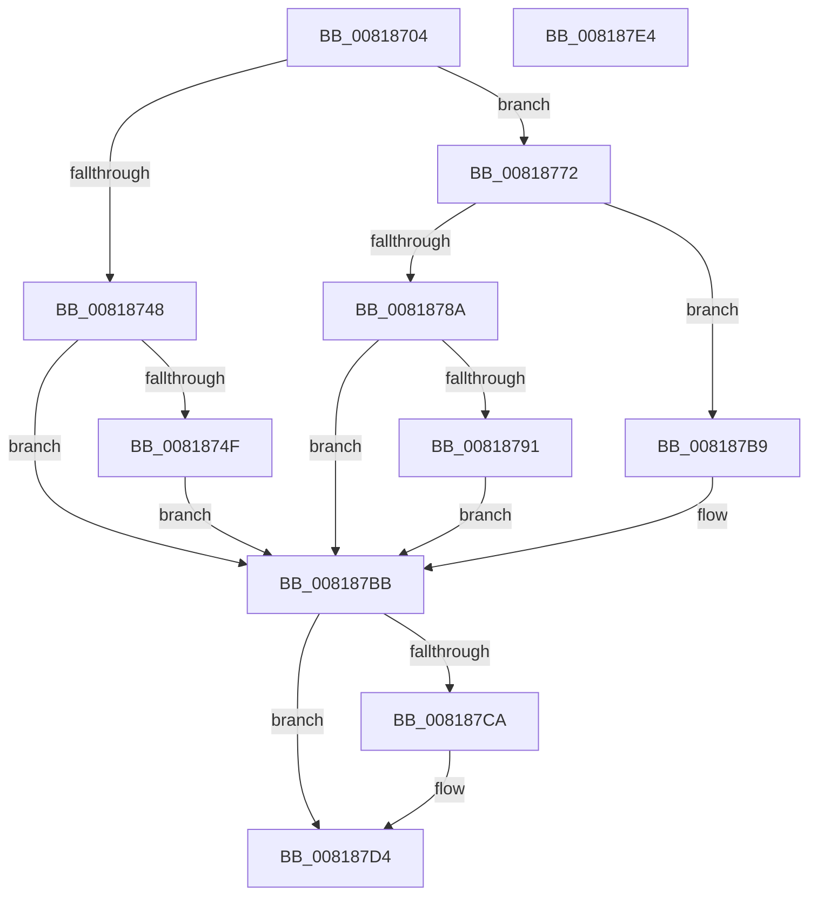

# SdbpQueryAppCompatFlagsByExeID

- RVA: `0x00818704`–`0x008187E5` (길이 `225` bytes)
- VA: `0x0000000140818704`
- 실행 섹션: `PAGE`
- PDB 이름 있음: `예`; PDB Function 태그: `아니요`
- unwind 정보 RVA: `0x000D9BB4`
- 디코드: `61`개 명령, `225/225` bytes 표시
- 미해석 바이트: `0` (있으면 어셈블리에 `.byte`로 보존)

> 이 문서는 커널 이미지의 기계어와 PDB 기호를 분석해 생성했습니다. 4번과 5번은 함수 원형과 자료형을 바이너리 사용 방식에서 추정한 C 해석이며 원본 소스 복구 결과는 아닙니다.

## 1. Dependencies

- 직접 호출 지점: **5**; 고유 호출 대상: **4**
- 직접 호출자로 확인된 함수: **1**
- RIP 상대 이미지 참조: **4**

### Outgoing calls
- `0x0081873D` → [AslRegistryGetKey](AslRegistryGetKey_function_00819F64.md) (function, `0x00819F64`)
- `0x0081876B` → [AslLogCallPrintf](../95/AslLogCallPrintf_function_0095E4EC.md) (function, `0x0095E4EC`)
- `0x0081877F` → [AslRegistryGetUInt32](AslRegistryGetUInt32_function_0081A228.md) (function, `0x0081A228`)
- `0x008187B2` → [AslLogCallPrintf](../95/AslLogCallPrintf_function_0095E4EC.md) (function, `0x0095E4EC`)
- `0x008187CF` → [ZwClose](../../text/6A/ZwClose_function_006AD2B0.md) (function, `0x006AD2B0`)

### Direct callers
- [SdbGetEntryFlags](../AB/SdbGetEntryFlags_function_00ABD3E0.md) at `0x00ABD44F`
- [SdbGetEntryFlags](../AB/SdbGetEntryFlags_function_00ABD3E0.md) at `0x00ABD470`

### Static image references
- `0x0081871B` → RVA `0x0003DBE0` (`.rdata`; read)
- `0x00818759` → RVA `0x0003E170` (`.rdata`; read)
- `0x00818760` → RVA `0x0003E190` (`.rdata`; read)
- `0x0081879B` → RVA `0x0003E1B0` (`.rdata`; read)

## 2. Other-region calls and transfers

- 다른 실행 섹션으로 향하는 call: **1**
  - `0x008187CF` → [ZwClose](../../text/6A/ZwClose_function_006AD2B0.md) (`PAGE` → `.text`)
- 별도 외부 분기/꼬리 이동을 확인하지 못했습니다.

## 3. Assembly (complete function range)

```asm
00818704  48 8B C4                        mov rax, rsp
00818707  48 89 58 10                     mov qword ptr [rax + 0x10], rbx
0081870B  48 89 48 08                     mov qword ptr [rax + 8], rcx
0081870F  55                              push rbp
00818710  56                              push rsi
00818711  41 56                           push r14
00818713  48 83 EC 30                     sub rsp, 0x30
00818717  83 60 08 00                     and dword ptr [rax + 8], 0
0081871B  48 8D 2D BE 54 82 FF            lea rbp, [rip - 0x7dab42]
00818722  48 83 60 20 00                  and qword ptr [rax + 0x20], 0
00818727  48 8D 48 20                     lea rcx, [rax + 0x20]
0081872B  4D 8B F1                        mov r14, r9
0081872E  48 8B F2                        mov rsi, rdx
00818731  45 8B C8                        mov r9d, r8d
00818734  48 8B D5                        mov rdx, rbp
00818737  41 B8 00 01 00 80               mov r8d, 0x80000100
0081873D  E8 22 18 00 00                  call 0x140819f64
00818742  8B D8                           mov ebx, eax
00818744  85 C0                           test eax, eax
00818746  79 2A                           jns 0x140818772
00818748  3D 34 00 00 C0                  cmp eax, 0xc0000034
0081874D  74 6C                           je 0x1408187bb
0081874F  41 B8 40 00 00 00               mov r8d, 0x40
00818755  89 44 24 20                     mov dword ptr [rsp + 0x20], eax
00818759  4C 8D 0D 10 5A 82 FF            lea r9, [rip - 0x7da5f0]
00818760  48 8D 15 29 5A 82 FF            lea rdx, [rip - 0x7da5d7]
00818767  41 8D 48 C1                     lea ecx, [r8 - 0x3f]
0081876B  E8 7C 5D 14 00                  call 0x14095e4ec
00818770  EB 49                           jmp 0x1408187bb
00818772  48 8B 54 24 68                  mov rdx, qword ptr [rsp + 0x68]
00818777  48 8D 4C 24 50                  lea rcx, [rsp + 0x50]
0081877C  4C 8B C6                        mov r8, rsi
0081877F  E8 A4 1A 00 00                  call 0x14081a228
00818784  8B D8                           mov ebx, eax
00818786  85 C0                           test eax, eax
00818788  79 2F                           jns 0x1408187b9
0081878A  3D 34 00 00 C0                  cmp eax, 0xc0000034
0081878F  74 2A                           je 0x1408187bb
00818791  41 B8 4B 00 00 00               mov r8d, 0x4b
00818797  89 44 24 28                     mov dword ptr [rsp + 0x28], eax
0081879B  4C 8D 0D 0E 5A 82 FF            lea r9, [rip - 0x7da5f2]
008187A2  48 89 6C 24 20                  mov qword ptr [rsp + 0x20], rbp
008187A7  48 8D 15 E2 59 82 FF            lea rdx, [rip - 0x7da61e]
008187AE  41 8D 48 B6                     lea ecx, [r8 - 0x4a]
008187B2  E8 35 5D 14 00                  call 0x14095e4ec
008187B7  EB 02                           jmp 0x1408187bb
008187B9  33 DB                           xor ebx, ebx
008187BB  48 83 7C 24 68 00               cmp qword ptr [rsp + 0x68], 0
008187C1  8B 44 24 50                     mov eax, dword ptr [rsp + 0x50]
008187C5  41 89 06                        mov dword ptr [r14], eax
008187C8  74 0A                           je 0x1408187d4
008187CA  48 8B 4C 24 68                  mov rcx, qword ptr [rsp + 0x68]
008187CF  E8 DC 4A E9 FF                  call 0x1406ad2b0
008187D4  8B C3                           mov eax, ebx
008187D6  48 8B 5C 24 58                  mov rbx, qword ptr [rsp + 0x58]
008187DB  48 83 C4 30                     add rsp, 0x30
008187DF  41 5E                           pop r14
008187E1  5E                              pop rsi
008187E2  5D                              pop rbp
008187E3  C3                              ret
008187E4  CC                              int3
```

## 4. C-style interpretation (structured pseudocode)

```c
__int64 __fastcall SdbpQueryAppCompatFlagsByExeID(__int64 a1, __int64 a2, int a3, __int64 a4)
{
    __int64 result;
    __int64 v_rbx;
    __int64 v_rsp;
    unsigned int v_stack_m20;
    unsigned int v_stack_m28;
    unsigned __int64 v_stack_p10;
    unsigned __int64 v_stack_p20;
    unsigned __int64 v_stack_p8;

    *(unsigned __int64 *)(v_rsp + 16) = v_rbx;
    *(unsigned __int64 *)(v_rsp + 8) = a1;
    v_rsp = (v_rsp) - (48);
    result = AslRegistryGetKey(v_rsp + 32, v_rip - 8235842, (unsigned int)(0x80000100ULL), (unsigned int)(a3));
    if (!sign_flag) goto loc_00818772;
    if (((unsigned int)(result)) == 0xC0000034ULL) goto loc_008187BB;
    v_stack_m28 = (unsigned int)(result);
    result = AslLogCallPrintf(64 - 63, v_rip - 8234455, 64, v_rip - 8234480);
    goto loc_008187BB;
loc_00818772:
    result = AslRegistryGetUInt32(v_stack_p8, v_stack_p20, a2, v_rip - 8234480);
    if (!sign_flag) goto loc_008187B9;
    if (((unsigned int)(result)) == 0xC0000034ULL) goto loc_008187BB;
    v_stack_m20 = (unsigned int)(result);
    v_stack_m28 = v_rip - 8235842;
    result = AslLogCallPrintf(75 - 74, v_rip - 8234526, 75, v_rip - 8234482);
    goto loc_008187BB;
loc_008187B9:
    v_rbx = 0;
loc_008187BB:
    *(unsigned int *)(a4) = (unsigned int)((unsigned int)(v_stack_p8));
    result = (unsigned int)(v_stack_p8);
    if (v_stack_p20 != 0) {
        a1 = v_stack_p20;
        result = ZwClose(a1, v_rip - 8234526, 75, v_rip - 8234482);
    }
    v_rsp = (v_rsp) + (48);
    return 0;
}
```

## 5. (Beta) C Style

```c
int64_t SdbpQueryAppCompatFlagsByExeID(int64_t Arg1, int64_t Arg2, int32_t Arg3, void *Arg4)
{
    uint8_t *arg4 = (uint8_t *)Arg4;

    int64_t result;
    int64_t local_rbx;
    int64_t local_rsp;
    uint32_t v_stack_m20;
    uint32_t v_stack_m28;
    uint64_t v_stack_p10;
    uint64_t v_stack_p20;
    uint64_t v_stack_p8;

    *(uint64_t *)(local_rsp + 0x10) = local_rbx;
    *(uint64_t *)(local_rsp + 0x8) = Arg1;
    local_rsp = (local_rsp) - (48);
    result = AslRegistryGetKey(local_rsp + 32, v_rip - 8235842, (uint32_t)(0x80000100ULL), (uint32_t)(Arg3));
    if (!sign_flag) goto loc_00818772;
    if (((uint32_t)(result)) == 0xC0000034ULL) goto loc_008187BB;
    v_stack_m28 = (uint32_t)(result);
    result = AslLogCallPrintf(64 - 63, v_rip - 8234455, 64, v_rip - 8234480);
    goto loc_008187BB;
loc_00818772:
    result = AslRegistryGetUInt32(v_stack_p8, v_stack_p20, Arg2, v_rip - 8234480);
    if (!sign_flag) goto loc_008187B9;
    if (((uint32_t)(result)) == 0xC0000034ULL) goto loc_008187BB;
    v_stack_m20 = (uint32_t)(result);
    v_stack_m28 = v_rip - 8235842;
    result = AslLogCallPrintf(75 - 74, v_rip - 8234526, 75, v_rip - 8234482);
    goto loc_008187BB;
loc_008187B9:
    local_rbx = 0;
loc_008187BB:
    *(uint32_t *)(arg4) = (uint32_t)((uint32_t)(v_stack_p8));
    result = (uint32_t)(v_stack_p8);
    if (v_stack_p20 != 0) {
        Arg1 = v_stack_p20;
        result = ZwClose(Arg1, v_rip - 8234526, 75, v_rip - 8234482);
    }
    local_rsp = (local_rsp) + (48);
    return 0;
}
```

### 관측된 메모리 오프셋

구조체 형식이 확인되지 않은 접근은 인자 기준의 오프셋으로만 기록했습니다.

| 기준 인자 | 오프셋 표현 | 폭 (bit) | 접근 |
|---|---:|---:|---|
| `Arg4` | `+ 0x0` | `32` | `W` |

## 6. Execution-region graph

[열기: 2D/3D 그래프와 함수 탐색 컨트롤 패널](../../../control-panel.html?section=page&rva=0x00818704&view=graph)

- 2D 그래프는 위에서 아래로 흐르고, 3D 그래프는 빈 공간을 드래그해 회전합니다. Shift+드래그는 이동, 휠은 확대·축소, 함수 노드 선택은 대상 보고서 이동입니다.

### Static fallback


