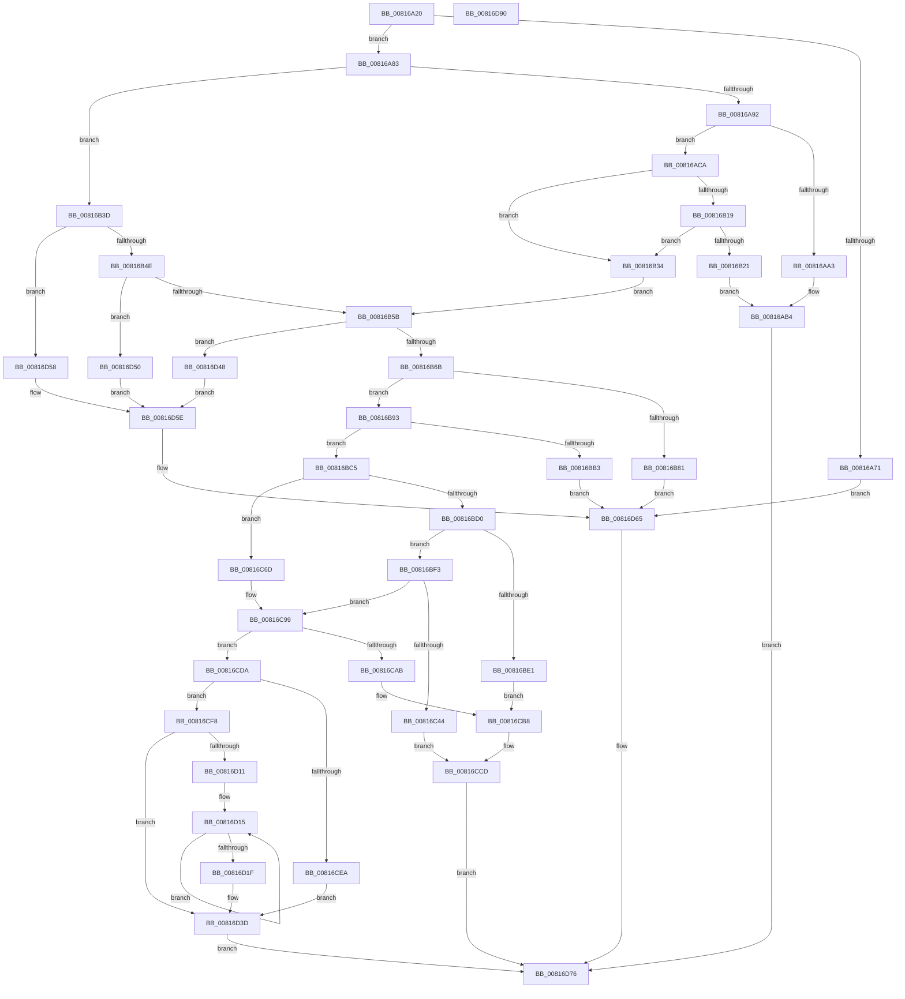

# SdbpResolveMatchingFile

- RVA: `0x00816A20`–`0x00816D91` (길이 `881` bytes)
- VA: `0x0000000140816A20`
- 실행 섹션: `PAGE`
- PDB 이름 있음: `예`; PDB Function 태그: `아니요`
- unwind 정보 RVA: `0x000D9A4C`
- 디코드: `219`개 명령, `881/881` bytes 표시
- 미해석 바이트: `0` (있으면 어셈블리에 `.byte`로 보존)

> 이 문서는 커널 이미지의 기계어와 PDB 기호를 분석해 생성했습니다. 4번과 5번은 함수 원형과 자료형을 바이너리 사용 방식에서 추정한 C 해석이며 원본 소스 복구 결과는 아닙니다.

## 1. Dependencies

- 직접 호출 지점: **20**; 고유 호출 대상: **11**
- 직접 호출자로 확인된 함수: **4**
- RIP 상대 이미지 참조: **10**

### Outgoing calls
- `0x00816A9A` → [AslEnvGetProcessWowInfo](AslEnvGetProcessWowInfo_function_0081D0A8.md) (function, `0x0081D0A8`)
- `0x00816AC0` → [AslLogCallPrintf](../95/AslLogCallPrintf_function_0095E4EC.md) (function, `0x0095E4EC`)
- `0x00816AD1` → [AslImageFileToArchitecture](AslImageFileToArchitecture_function_0081D5D0.md) (function, `0x0081D5D0`)
- `0x00816B07` → [AslEnvExpandStrings2](AslEnvExpandStrings2_function_0081CECC.md) (function, `0x0081CECC`)
- `0x00816B78` → [RtlULongLongMult](../../text/43/RtlULongLongMult_function_0043E530.md) (function, `0x0043E530`)
- `0x00816BA6` → [AslAlloc](../95/AslAlloc_function_0095BD34.md) (function, `0x0095BD34`)
- `0x00816BD8` → [AslEnvGetProcessWowInfo](AslEnvGetProcessWowInfo_function_0081D0A8.md) (function, `0x0081D0A8`)
- `0x00816BFE` → [AslImageFileToArchitecture](AslImageFileToArchitecture_function_0081D5D0.md) (function, `0x0081D5D0`)
- `0x00816C3B` → [AslEnvExpandStrings2](AslEnvExpandStrings2_function_0081CECC.md) (function, `0x0081CECC`)
- `0x00816C66` → [AslLogCallPrintf](../95/AslLogCallPrintf_function_0095E4EC.md) (function, `0x0095E4EC`)
- `0x00816C7A` → [memcpy](../../text/6C/memcpy_function_006C6840.md) (function, `0x006C6840`)
- `0x00816C91` → [memcpy](../../text/6C/memcpy_function_006C6840.md) (function, `0x006C6840`)
- `0x00816CA2` → [AslPathClean](AslPathClean_function_0081AB9C.md) (function, `0x0081AB9C`)
- `0x00816CC8` → [AslLogCallPrintf](../95/AslLogCallPrintf_function_0095E4EC.md) (function, `0x0095E4EC`)
- `0x00816CD0` → [AslFree](../95/AslFree_function_0095B674.md) (function, `0x0095B674`)
- `0x00816CE1` → [AslPathToNetworkPathNt](AslPathToNetworkPathNt_function_0081B2A4.md) (function, `0x0081B2A4`)
- `0x00816CED` → [AslFree](../95/AslFree_function_0095B674.md) (function, `0x0095B674`)
- `0x00816D08` → [wcsnicmp](../../text/50/wcsnicmp_function_005001C0.md) (function, `0x005001C0`)
- `0x00816D2E` → [memcpy](../../text/6C/memcpy_function_006C6840.md) (function, `0x006C6840`)
- `0x00816D71` → [AslLogCallPrintf](../95/AslLogCallPrintf_function_0095E4EC.md) (function, `0x0095E4EC`)

### Direct callers
- [SdbpCheckMatchingDir](SdbpCheckMatchingDir_function_00813EF0.md) at `0x00813FEB`
- [SdbpCheckMatchingFiles](SdbpCheckMatchingFiles_function_00814080.md) at `0x008141FB`
- [SdbpCheckMatchingTextEntry](SdbpCheckMatchingTextEntry_function_00814A70.md) at `0x00814B4D`
- [SdbpCheckMatchingWildcardFiles](SdbpCheckMatchingWildcardFiles_function_00814E30.md) at `0x00814F7B`

### Static image references
- `0x00816A71` → RVA `0x0003C0B0` (`.rdata`; read)
- `0x00816AA7` → RVA `0x0003C070` (`.rdata`; read)
- `0x00816AB4` → RVA `0x0003C098` (`.rdata`; read)
- `0x00816B25` → RVA `0x0003C048` (`.rdata`; read)
- `0x00816B81` → RVA `0x0003C018` (`.rdata`; read)
- `0x00816BB3` → RVA `0x000129E0` (`.rdata`; read)
- `0x00816C48` → RVA `0x0003C718` (`.rdata`; read)
- `0x00816CAB` → RVA `0x0003C6F8` (`.rdata`; read)
- `0x00816CFE` → RVA `0x0001BAC0` (`.rdata`; read)
- `0x00816D5E` → RVA `0x0003C030` (`.rdata`; read)

## 2. Other-region calls and transfers

- 다른 실행 섹션으로 향하는 call: **5**
  - `0x00816B78` → [RtlULongLongMult](../../text/43/RtlULongLongMult_function_0043E530.md) (`PAGE` → `.text`)
  - `0x00816C7A` → [memcpy](../../text/6C/memcpy_function_006C6840.md) (`PAGE` → `.text`)
  - `0x00816C91` → [memcpy](../../text/6C/memcpy_function_006C6840.md) (`PAGE` → `.text`)
  - `0x00816D08` → [wcsnicmp](../../text/50/wcsnicmp_function_005001C0.md) (`PAGE` → `.text`)
  - `0x00816D2E` → [memcpy](../../text/6C/memcpy_function_006C6840.md) (`PAGE` → `.text`)
- 별도 외부 분기/꼬리 이동을 확인하지 못했습니다.

## 3. Assembly (complete function range)

```asm
00816A20  48 89 5C 24 18                  mov qword ptr [rsp + 0x18], rbx
00816A25  48 89 54 24 10                  mov qword ptr [rsp + 0x10], rdx
00816A2A  48 89 4C 24 08                  mov qword ptr [rsp + 8], rcx
00816A2F  55                              push rbp
00816A30  56                              push rsi
00816A31  57                              push rdi
00816A32  41 54                           push r12
00816A34  41 55                           push r13
00816A36  41 56                           push r14
00816A38  41 57                           push r15
00816A3A  48 8B EC                        mov rbp, rsp
00816A3D  48 83 EC 50                     sub rsp, 0x50
00816A41  4C 8B 65 68                     mov r12, qword ptr [rbp + 0x68]
00816A45  33 FF                           xor edi, edi
00816A47  45 8B E9                        mov r13d, r9d
00816A4A  B8 FF FF 00 00                  mov eax, 0xffff
00816A4F  48 89 7D F0                     mov qword ptr [rbp - 0x10], rdi
00816A53  4D 8B F0                        mov r14, r8
00816A56  48 89 7D F8                     mov qword ptr [rbp - 8], rdi
00816A5A  48 8B DA                        mov rbx, rdx
00816A5D  49 89 3C 24                     mov qword ptr [r12], rdi
00816A61  48 8B F1                        mov rsi, rcx
00816A64  66 89 45 58                     mov word ptr [rbp + 0x58], ax
00816A68  66 89 45 68                     mov word ptr [rbp + 0x68], ax
00816A6C  45 85 C9                        test r9d, r9d
00816A6F  75 12                           jne 0x140816a83
00816A71  4C 8D 0D 38 56 82 FF            lea r9, [rip - 0x7da9c8]
00816A78  41 B8 1E 03 00 00               mov r8d, 0x31e
00816A7E  E9 E2 02 00 00                  jmp 0x140816d65
00816A83  66 41 83 38 25                  cmp word ptr [r8], 0x25
00816A88  4C 8B 7D 60                     mov r15, qword ptr [rbp + 0x60]
00816A8C  0F 85 AB 00 00 00               jne 0x140816b3d
00816A92  48 8D 55 58                     lea rdx, [rbp + 0x58]
00816A96  48 8D 4D 68                     lea rcx, [rbp + 0x68]
00816A9A  E8 09 66 00 00                  call 0x14081d0a8
00816A9F  85 C0                           test eax, eax
00816AA1  79 27                           jns 0x140816aca
00816AA3  89 44 24 20                     mov dword ptr [rsp + 0x20], eax
00816AA7  4C 8D 0D C2 55 82 FF            lea r9, [rip - 0x7daa3e]
00816AAE  41 B8 33 03 00 00               mov r8d, 0x333
00816AB4  48 8D 15 DD 55 82 FF            lea rdx, [rip - 0x7daa23]
00816ABB  B9 01 00 00 00                  mov ecx, 1
00816AC0  E8 27 7A 14 00                  call 0x14095e4ec
00816AC5  E9 AC 02 00 00                  jmp 0x140816d76
00816ACA  0F B7 8E 48 02 00 00            movzx ecx, word ptr [rsi + 0x248]
00816AD1  E8 FA 6A 00 00                  call 0x14081d5d0
00816AD6  B9 FF FF 00 00                  mov ecx, 0xffff
00816ADB  49 8B D6                        mov rdx, r14
00816ADE  66 3B C1                        cmp ax, cx
00816AE1  48 8B 4B 38                     mov rcx, qword ptr [rbx + 0x38]
00816AE5  66 0F 44 45 58                  cmove ax, word ptr [rbp + 0x58]
00816AEA  45 33 C9                        xor r9d, r9d
00816AED  66 89 44 24 30                  mov word ptr [rsp + 0x30], ax
00816AF2  45 33 C0                        xor r8d, r8d
00816AF5  0F B7 45 68                     movzx eax, word ptr [rbp + 0x68]
00816AF9  66 89 44 24 28                  mov word ptr [rsp + 0x28], ax
00816AFE  48 8D 45 F0                     lea rax, [rbp - 0x10]
00816B02  48 89 44 24 20                  mov qword ptr [rsp + 0x20], rax
00816B07  E8 C0 63 00 00                  call 0x14081cecc
00816B0C  BA 00 00 00 80                  mov edx, 0x80000000
00816B11  8B C8                           mov ecx, eax
00816B13  03 C2                           add eax, edx
00816B15  85 C2                           test edx, eax
00816B17  75 1B                           jne 0x140816b34
00816B19  81 F9 23 00 00 C0               cmp ecx, 0xc0000023
00816B1F  74 13                           je 0x140816b34
00816B21  89 4C 24 20                     mov dword ptr [rsp + 0x20], ecx
00816B25  4C 8D 0D 1C 55 82 FF            lea r9, [rip - 0x7daae4]
00816B2C  41 B8 44 03 00 00               mov r8d, 0x344
00816B32  EB 80                           jmp 0x140816ab4
00816B34  48 8B 45 F0                     mov rax, qword ptr [rbp - 0x10]
00816B38  48 03 C0                        add rax, rax
00816B3B  EB 1E                           jmp 0x140816b5b
00816B3D  41 8B 4F 08                     mov ecx, dword ptr [r15 + 8]
00816B41  4A 8D 14 29                     lea rdx, [rcx + r13]
00816B45  48 3B D1                        cmp rdx, rcx
00816B48  0F 82 0A 02 00 00               jb 0x140816d58
00816B4E  48 8D 42 01                     lea rax, [rdx + 1]
00816B52  48 3B C2                        cmp rax, rdx
00816B55  0F 82 F5 01 00 00               jb 0x140816d50
00816B5B  48 8D 48 14                     lea rcx, [rax + 0x14]
00816B5F  48 8B D0                        mov rdx, rax
00816B62  48 3B C8                        cmp rcx, rax
00816B65  0F 82 DD 01 00 00               jb 0x140816d48
00816B6B  4C 8D 45 F0                     lea r8, [rbp - 0x10]
00816B6F  48 89 4D F0                     mov qword ptr [rbp - 0x10], rcx
00816B73  BA 02 00 00 00                  mov edx, 2
00816B78  E8 B3 79 C2 FF                  call 0x14043e530
00816B7D  85 C0                           test eax, eax
00816B7F  79 12                           jns 0x140816b93
00816B81  4C 8D 0D 90 54 82 FF            lea r9, [rip - 0x7dab70]
00816B88  41 B8 61 03 00 00               mov r8d, 0x361
00816B8E  E9 D2 01 00 00                  jmp 0x140816d65
00816B93  48 8B 75 F0                     mov rsi, qword ptr [rbp - 0x10]
00816B97  B8 08 02 00 00                  mov eax, 0x208
00816B9C  48 3B F0                        cmp rsi, rax
00816B9F  48 0F 42 F0                     cmovb rsi, rax
00816BA3  48 8B D6                        mov rdx, rsi
00816BA6  E8 89 51 14 00                  call 0x14095bd34
00816BAB  48 8B D8                        mov rbx, rax
00816BAE  48 85 C0                        test rax, rax
00816BB1  75 12                           jne 0x140816bc5
00816BB3  4C 8D 0D 26 BE 7F FF            lea r9, [rip - 0x8041da]
00816BBA  41 B8 69 03 00 00               mov r8d, 0x369
00816BC0  E9 A0 01 00 00                  jmp 0x140816d65
00816BC5  66 41 83 3E 25                  cmp word ptr [r14], 0x25
00816BCA  0F 85 9D 00 00 00               jne 0x140816c6d
00816BD0  48 8D 55 58                     lea rdx, [rbp + 0x58]
00816BD4  48 8D 4D 68                     lea rcx, [rbp + 0x68]
00816BD8  E8 CB 64 00 00                  call 0x14081d0a8
00816BDD  85 C0                           test eax, eax
00816BDF  79 12                           jns 0x140816bf3
00816BE1  4C 8D 0D 88 54 82 FF            lea r9, [rip - 0x7dab78]
00816BE8  41 B8 75 03 00 00               mov r8d, 0x375
00816BEE  E9 C5 00 00 00                  jmp 0x140816cb8
00816BF3  48 8B 4D 40                     mov rcx, qword ptr [rbp + 0x40]
00816BF7  0F B7 89 48 02 00 00            movzx ecx, word ptr [rcx + 0x248]
00816BFE  E8 CD 69 00 00                  call 0x14081d5d0
00816C03  B9 FF FF 00 00                  mov ecx, 0xffff
00816C08  4C 8B C3                        mov r8, rbx
00816C0B  66 3B C1                        cmp ax, cx
00816C0E  49 8B D6                        mov rdx, r14
00816C11  48 8B 4D 48                     mov rcx, qword ptr [rbp + 0x48]
00816C15  66 0F 44 45 58                  cmove ax, word ptr [rbp + 0x58]
00816C1A  66 89 44 24 30                  mov word ptr [rsp + 0x30], ax
00816C1F  0F B7 45 68                     movzx eax, word ptr [rbp + 0x68]
00816C23  48 8B 49 38                     mov rcx, qword ptr [rcx + 0x38]
00816C27  66 89 44 24 28                  mov word ptr [rsp + 0x28], ax
00816C2C  48 8D 45 F0                     lea rax, [rbp - 0x10]
00816C30  48 D1 EE                        shr rsi, 1
00816C33  4C 8B CE                        mov r9, rsi
00816C36  48 89 44 24 20                  mov qword ptr [rsp + 0x20], rax
00816C3B  E8 8C 62 00 00                  call 0x14081cecc
00816C40  85 C0                           test eax, eax
00816C42  79 55                           jns 0x140816c99
00816C44  89 44 24 28                     mov dword ptr [rsp + 0x28], eax
00816C48  4C 8D 0D C9 5A 82 FF            lea r9, [rip - 0x7da537]
00816C4F  41 B8 86 03 00 00               mov r8d, 0x386
00816C55  4C 89 74 24 20                  mov qword ptr [rsp + 0x20], r14
00816C5A  48 8D 15 37 54 82 FF            lea rdx, [rip - 0x7dabc9]
00816C61  B9 01 00 00 00                  mov ecx, 1
00816C66  E8 81 78 14 00                  call 0x14095e4ec
00816C6B  EB 60                           jmp 0x140816ccd
00816C6D  45 8B 47 08                     mov r8d, dword ptr [r15 + 8]
00816C71  48 8B CB                        mov rcx, rbx
00816C74  49 8B 17                        mov rdx, qword ptr [r15]
00816C77  4D 03 C0                        add r8, r8
00816C7A  E8 C1 FB EA FF                  call 0x1406c6840
00816C7F  41 8B 47 08                     mov eax, dword ptr [r15 + 8]
00816C83  45 8D 45 01                     lea r8d, [r13 + 1]
00816C87  4D 03 C0                        add r8, r8
00816C8A  49 8B D6                        mov rdx, r14
00816C8D  48 8D 0C 43                     lea rcx, [rbx + rax*2]
00816C91  E8 AA FB EA FF                  call 0x1406c6840
00816C96  48 D1 EE                        shr rsi, 1
00816C99  4C 8B C6                        mov r8, rsi
00816C9C  48 8B D3                        mov rdx, rbx
00816C9F  48 8B CB                        mov rcx, rbx
00816CA2  E8 F5 3E 00 00                  call 0x14081ab9c
00816CA7  85 C0                           test eax, eax
00816CA9  79 2F                           jns 0x140816cda
00816CAB  4C 8D 0D 46 5A 82 FF            lea r9, [rip - 0x7da5ba]
00816CB2  41 B8 9F 03 00 00               mov r8d, 0x39f
00816CB8  48 8D 15 D9 53 82 FF            lea rdx, [rip - 0x7dac27]
00816CBF  89 44 24 20                     mov dword ptr [rsp + 0x20], eax
00816CC3  B9 01 00 00 00                  mov ecx, 1
00816CC8  E8 1F 78 14 00                  call 0x14095e4ec
00816CCD  48 8B D3                        mov rdx, rbx
00816CD0  E8 9F 49 14 00                  call 0x14095b674
00816CD5  E9 9C 00 00 00                  jmp 0x140816d76
00816CDA  48 8B D3                        mov rdx, rbx
00816CDD  48 8D 4D F8                     lea rcx, [rbp - 8]
00816CE1  E8 BE 45 00 00                  call 0x14081b2a4
00816CE6  85 C0                           test eax, eax
00816CE8  78 0E                           js 0x140816cf8
00816CEA  48 8B D3                        mov rdx, rbx
00816CED  E8 82 49 14 00                  call 0x14095b674
00816CF2  48 8B 5D F8                     mov rbx, qword ptr [rbp - 8]
00816CF6  EB 45                           jmp 0x140816d3d
00816CF8  41 B8 04 00 00 00               mov r8d, 4
00816CFE  48 8D 15 BB 4D 80 FF            lea rdx, [rip - 0x7fb245]
00816D05  48 8B CB                        mov rcx, rbx
00816D08  E8 B3 94 CE FF                  call 0x1405001c0
00816D0D  85 C0                           test eax, eax
00816D0F  74 2C                           je 0x140816d3d
00816D11  49 83 C8 FF                     or r8, 0xffffffffffffffff
00816D15  49 FF C0                        inc r8
00816D18  66 42 39 3C 43                  cmp word ptr [rbx + r8*2], di
00816D1D  75 F6                           jne 0x140816d15
00816D1F  4E 8D 04 45 02 00 00 00         lea r8, [r8*2 + 2]
00816D27  48 8B D3                        mov rdx, rbx
00816D2A  48 8D 4B 08                     lea rcx, [rbx + 8]
00816D2E  E8 0D FB EA FF                  call 0x1406c6840
00816D33  48 8B 05 86 4D 80 FF            mov rax, qword ptr [rip - 0x7fb27a]
00816D3A  48 89 03                        mov qword ptr [rbx], rax
00816D3D  49 89 1C 24                     mov qword ptr [r12], rbx
00816D41  BF 01 00 00 00                  mov edi, 1
00816D46  EB 2E                           jmp 0x140816d76
00816D48  41 B8 5C 03 00 00               mov r8d, 0x35c
00816D4E  EB 0E                           jmp 0x140816d5e
00816D50  41 B8 56 03 00 00               mov r8d, 0x356
00816D56  EB 06                           jmp 0x140816d5e
00816D58  41 B8 51 03 00 00               mov r8d, 0x351
00816D5E  4C 8D 0D CB 52 82 FF            lea r9, [rip - 0x7dad35]
00816D65  48 8D 15 2C 53 82 FF            lea rdx, [rip - 0x7dacd4]
00816D6C  B9 01 00 00 00                  mov ecx, 1
00816D71  E8 76 77 14 00                  call 0x14095e4ec
00816D76  48 8B 9C 24 A0 00 00 00         mov rbx, qword ptr [rsp + 0xa0]
00816D7E  8B C7                           mov eax, edi
00816D80  48 83 C4 50                     add rsp, 0x50
00816D84  41 5F                           pop r15
00816D86  41 5E                           pop r14
00816D88  41 5D                           pop r13
00816D8A  41 5C                           pop r12
00816D8C  5F                              pop rdi
00816D8D  5E                              pop rsi
00816D8E  5D                              pop rbp
00816D8F  C3                              ret
00816D90  CC                              int3
```

## 4. C-style interpretation (structured pseudocode)

```c
__int64 __fastcall SdbpResolveMatchingFile(__int64 a1, __int64 a2, __int64 a3, int a4, __int64 a5, unsigned __int16 a6)
{
    __int64 result;
    __int64 v_rdi;
    __int64 v_rsi;
    __int64 v_rsp;
    unsigned __int64 v_stack_m40;
    unsigned __int64 v_stack_m48;
    unsigned __int16 v_stack_m58;
    unsigned __int16 v_stack_m60;
    unsigned int v_stack_m68;
    unsigned __int64 v_stack_p10;
    unsigned __int64 v_stack_p18;
    unsigned __int16 v_stack_p20;
    unsigned __int16 v_stack_p30;
    unsigned __int64 v_stack_p8;

    v_stack_p18 = v_rbx;
    v_stack_p10 = a2;
    v_stack_p8 = a1;
    v_rsp = (v_rsp) - (80);
    v_rdi = 0;
    v_stack_m48 = 0;
    v_stack_m40 = 0;
    *(unsigned __int64 *)(a6) = 0;
    v_stack_p20 = (unsigned __int16)((unsigned int)(0xFFFFULL));
    v_stack_p30 = (unsigned __int16)((unsigned int)(0xFFFFULL));
    if (a4 != 0) goto loc_00816A83;
    goto loc_00816D65;
loc_00816A83:
    if ((*(unsigned __int16 *)(798)) != 37) goto loc_00816B3D;
    result = AslEnvGetProcessWowInfo(a6, v_stack_p20, 798, v_rip - 8235464);
    if (!sign_flag) goto loc_00816ACA;
    v_stack_m68 = (unsigned int)(result);
loc_00816AB4:
    result = AslLogCallPrintf(1, v_rip - 8235555, 819, v_rip - 8235582);
    goto loc_00816D76;
loc_00816ACA:
    result = AslImageFileToArchitecture(*(unsigned __int16 *)(a1 + 584), v_rip - 8235555, 819, v_rip - 8235582);
    if (((unsigned __int16)(result)) == ((unsigned __int16)((unsigned int)(0xFFFFULL)))) { result = v_stack_p20; }
    a4 = 0;
    v_stack_m58 = (unsigned __int16)(result);
    a3 = 0;
    v_stack_m60 = a6;
    v_stack_m68 = v_stack_m48;
    result = AslEnvExpandStrings2(*(unsigned __int64 *)(a2 + 56), a3, a3, a4);
    result = (unsigned int)((result) + ((unsigned int)((unsigned int)(0x80000000ULL))));
    if ((((unsigned int)((unsigned int)(0x80000000ULL))) & ((unsigned int)(result))) != 0) goto loc_00816B34;
    if (((unsigned int)((unsigned int)((unsigned int)(result)))) == 0xC0000023ULL) goto loc_00816B34;
    v_stack_m68 = (unsigned int)((unsigned int)((unsigned int)(result)));
    goto loc_00816AB4;
loc_00816B34:
    result = (v_stack_m48) + (v_stack_m48);
    goto loc_00816B5B;
loc_00816B3D:
    if (((unsigned int)(*(unsigned int *)(a5 + 8)) + (unsigned int)(a4) * 1) < ((unsigned int)(*(unsigned int *)(a5 + 8)))) goto loc_00816D58;
    if (((unsigned int)(*(unsigned int *)(a5 + 8)) + (unsigned int)(a4) * 1 + 1) < ((unsigned int)(*(unsigned int *)(a5 + 8)) + (unsigned int)(a4) * 1)) goto loc_00816D50;
loc_00816B5B:
    if (((unsigned int)(*(unsigned int *)(a5 + 8)) + (unsigned int)(a4) * 1 + 1 + 20) < ((unsigned int)(*(unsigned int *)(a5 + 8)) + (unsigned int)(a4) * 1 + 1)) goto loc_00816D48;
    v_stack_m48 = (unsigned int)(*(unsigned int *)(a5 + 8)) + (unsigned int)(a4) * 1 + 1 + 20;
    result = RtlULongLongMult((unsigned int)(*(unsigned int *)(a5 + 8)) + (unsigned int)(a4) * 1 + 1 + 20, 2, v_stack_m48, v_rip - 8235748);
    if (!sign_flag) goto loc_00816B93;
    goto loc_00816D65;
loc_00816B93:
    v_rsi = v_stack_m48;
    if (v_stack_m48 < 520) { v_rsi = 520; }
    result = AslAlloc((unsigned int)(*(unsigned int *)(a5 + 8)) + (unsigned int)(a4) * 1 + 1 + 20, v_rsi, 865, v_rip - 8235888);
    if (result != 0) goto loc_00816BC5;
    goto loc_00816D65;
loc_00816BC5:
    if ((*(unsigned __int16 *)(a3)) != 37) goto loc_00816C6D;
    result = AslEnvGetProcessWowInfo(a6, v_stack_p20, 873, v_rip - 8405466);
    if (!sign_flag) goto loc_00816BF3;
    goto loc_00816CB8;
loc_00816BF3:
    result = AslImageFileToArchitecture(*(unsigned __int16 *)(v_stack_p8 + 584), v_stack_p20, 885, v_rip - 8235896);
    if (((unsigned __int16)(result)) == ((unsigned __int16)((unsigned int)(0xFFFFULL)))) { result = v_stack_p20; }
    v_stack_m58 = (unsigned __int16)(result);
    v_stack_m60 = a6;
    v_rsi = (v_rsi) >> (1);
    v_stack_m68 = v_stack_m48;
    result = AslEnvExpandStrings2(*(unsigned __int64 *)(v_stack_p10 + 56), 0, result, v_rsi);
    if (!sign_flag) goto loc_00816C99;
    v_stack_m60 = (unsigned int)(result);
    v_stack_m68 = 0;
    result = AslLogCallPrintf(1, v_rip - 8235977, 902, v_rip - 8234295);
    goto loc_00816CCD;
loc_00816C6D:
    a3 = ((unsigned int)(*(unsigned int *)(a5 + 8))) + ((unsigned int)(*(unsigned int *)(a5 + 8)));
    result = memcpy(result, *(unsigned __int64 *)(a5), a3, v_rip - 8234295);
    a3 = ((unsigned int)(a4) + 1) + ((unsigned int)(a4) + 1);
    result = memcpy(result + (unsigned int)(*(unsigned int *)(a5 + 8)) * 2, a3, a3, v_rip - 8234295);
    v_rsi = (v_rsi) >> (1);
loc_00816C99:
    result = AslPathClean(result, result, v_rsi, v_rip - 8234295);
    if (!sign_flag) goto loc_00816CDA;
loc_00816CB8:
    v_stack_m68 = (unsigned int)(result);
    result = AslLogCallPrintf(1, v_rip - 8236071, 927, v_rip - 8234426);
loc_00816CCD:
    result = AslFree(1, result, 927, v_rip - 8234426);
    goto loc_00816D76;
loc_00816CDA:
    result = AslPathToNetworkPathNt(v_stack_m40, result, 927, v_rip - 8234426);
    if (sign_flag) goto loc_00816CF8;
    result = AslFree(v_stack_m40, result, 927, v_rip - 8234426);
    goto loc_00816D3D;
loc_00816CF8:
    result = wcsnicmp(v_stack_m40, v_rip - 8368709, 4, v_rip - 8234426);
    if ((unsigned int)(result) == 0) goto loc_00816D3D;
    a3 = (4) | (-1);
loc_00816D15:
    a3 = (a3) + 1;
    if ((*(unsigned __int16 *)(v_stack_m40 + a3 * 2)) != 0) goto loc_00816D15;
    result = memcpy(v_stack_m40 + 8, v_stack_m40, a3 * 2 + 2, v_rip - 8234426);
    *(unsigned __int64 *)(v_stack_m40) = *(unsigned __int64 *)(v_rip - 8368762);
loc_00816D3D:
    *(unsigned __int64 *)(a6) = v_stack_m40;
    goto loc_00816D76;
loc_00816D48:
    goto loc_00816D5E;
loc_00816D50:
    goto loc_00816D5E;
loc_00816D58:
loc_00816D5E:
loc_00816D65:
    result = AslLogCallPrintf(1, v_rip - 8236244, 849, v_rip - 8236341);
loc_00816D76:
    v_rsp = (v_rsp) + (80);
    return 1;
}
```

## 5. (Beta) C Style

```c
int64_t SdbpResolveMatchingFile(void *Arg1, void *Arg2, void *Arg3, void *Arg4, void *Arg5, void *Arg6)
{
    uint8_t *arg1 = (uint8_t *)Arg1;
    uint8_t *arg2 = (uint8_t *)Arg2;
    uint8_t *arg3 = (uint8_t *)Arg3;
    uint8_t *arg4 = (uint8_t *)Arg4;
    uint8_t *arg5 = (uint8_t *)Arg5;
    uint8_t *arg6 = (uint8_t *)Arg6;

    int64_t result;
    int64_t local_rdi;
    int64_t local_rsi;
    int64_t local_rsp;
    uint64_t v_stack_m40;
    uint64_t v_stack_m48;
    uint16_t v_stack_m58;
    uint16_t v_stack_m60;
    uint32_t v_stack_m68;
    uint64_t v_stack_p10;
    uint64_t v_stack_p18;
    uint16_t v_stack_p20;
    uint16_t v_stack_p30;
    uint64_t v_stack_p8;

    v_stack_p18 = local_rbx;
    v_stack_p10 = Arg2;
    v_stack_p8 = Arg1;
    local_rsp = (local_rsp) - (80);
    local_rdi = 0;
    v_stack_m48 = 0;
    v_stack_m40 = 0;
    *(uint64_t *)(arg6) = 0;
    v_stack_p20 = (uint16_t)((uint32_t)(0xFFFFULL));
    v_stack_p30 = (uint16_t)((uint32_t)(0xFFFFULL));
    if (Arg4 != NULL) goto loc_00816A83;
    goto loc_00816D65;
loc_00816A83:
    if ((*(uint16_t *)(798)) != 37) goto loc_00816B3D;
    result = AslEnvGetProcessWowInfo(Arg6, v_stack_p20, 798, v_rip - 8235464);
    if (!sign_flag) goto loc_00816ACA;
    v_stack_m68 = (uint32_t)(result);
loc_00816AB4:
    result = AslLogCallPrintf(1, v_rip - 8235555, 819, v_rip - 8235582);
    goto loc_00816D76;
loc_00816ACA:
    result = AslImageFileToArchitecture(*(uint16_t *)(arg1 + 0x248), v_rip - 8235555, 819, v_rip - 8235582);
    if (((uint16_t)(result)) == ((uint16_t)((uint32_t)(0xFFFFULL)))) { result = v_stack_p20; }
    Arg4 = 0;
    v_stack_m58 = (uint16_t)(result);
    Arg3 = 0;
    v_stack_m60 = Arg6;
    v_stack_m68 = v_stack_m48;
    result = AslEnvExpandStrings2(*(uint64_t *)(arg2 + 0x38), Arg3, Arg3, Arg4);
    result = (uint32_t)((result) + ((uint32_t)((uint32_t)(0x80000000ULL))));
    if ((((uint32_t)((uint32_t)(0x80000000ULL))) & ((uint32_t)(result))) != 0) goto loc_00816B34;
    if (((uint32_t)((uint32_t)((uint32_t)(result)))) == 0xC0000023ULL) goto loc_00816B34;
    v_stack_m68 = (uint32_t)((uint32_t)((uint32_t)(result)));
    goto loc_00816AB4;
loc_00816B34:
    result = (v_stack_m48) + (v_stack_m48);
    goto loc_00816B5B;
loc_00816B3D:
    if (((uint32_t)(*(uint32_t *)(arg5 + 0x8)) + (uint32_t)(Arg4) * 1) < ((uint32_t)(*(uint32_t *)(arg5 + 0x8)))) goto loc_00816D58;
    if (((uint32_t)(*(uint32_t *)(arg5 + 0x8)) + (uint32_t)(Arg4) * 1 + 1) < ((uint32_t)(*(uint32_t *)(arg5 + 0x8)) + (uint32_t)(Arg4) * 1)) goto loc_00816D50;
loc_00816B5B:
    if (((uint32_t)(*(uint32_t *)(arg5 + 0x8)) + (uint32_t)(Arg4) * 1 + 1 + 20) < ((uint32_t)(*(uint32_t *)(arg5 + 0x8)) + (uint32_t)(Arg4) * 1 + 1)) goto loc_00816D48;
    v_stack_m48 = (uint32_t)(*(uint32_t *)(arg5 + 0x8)) + (uint32_t)(Arg4) * 1 + 1 + 20;
    result = RtlULongLongMult((uint32_t)(*(uint32_t *)(arg5 + 0x8)) + (uint32_t)(Arg4) * 1 + 1 + 20, 2, v_stack_m48, v_rip - 8235748);
    if (!sign_flag) goto loc_00816B93;
    goto loc_00816D65;
loc_00816B93:
    local_rsi = v_stack_m48;
    if (v_stack_m48 < 520) { local_rsi = 520; }
    result = AslAlloc((uint32_t)(*(uint32_t *)(arg5 + 0x8)) + (uint32_t)(Arg4) * 1 + 1 + 20, local_rsi, 865, v_rip - 8235888);
    if (result != 0) goto loc_00816BC5;
    goto loc_00816D65;
loc_00816BC5:
    if ((*(uint16_t *)(arg3)) != 37) goto loc_00816C6D;
    result = AslEnvGetProcessWowInfo(Arg6, v_stack_p20, 873, v_rip - 8405466);
    if (!sign_flag) goto loc_00816BF3;
    goto loc_00816CB8;
loc_00816BF3:
    result = AslImageFileToArchitecture(*(uint16_t *)(v_stack_p8 + 0x248), v_stack_p20, 885, v_rip - 8235896);
    if (((uint16_t)(result)) == ((uint16_t)((uint32_t)(0xFFFFULL)))) { result = v_stack_p20; }
    v_stack_m58 = (uint16_t)(result);
    v_stack_m60 = Arg6;
    local_rsi = (local_rsi) >> (1);
    v_stack_m68 = v_stack_m48;
    result = AslEnvExpandStrings2(*(uint64_t *)(v_stack_p10 + 0x38), 0, result, local_rsi);
    if (!sign_flag) goto loc_00816C99;
    v_stack_m60 = (uint32_t)(result);
    v_stack_m68 = 0;
    result = AslLogCallPrintf(1, v_rip - 8235977, 902, v_rip - 8234295);
    goto loc_00816CCD;
loc_00816C6D:
    Arg3 = ((uint32_t)(*(uint32_t *)(arg5 + 0x8))) + ((uint32_t)(*(uint32_t *)(arg5 + 0x8)));
    result = memcpy(result, *(uint64_t *)(arg5), Arg3, v_rip - 8234295);
    Arg3 = ((uint32_t)(Arg4) + 1) + ((uint32_t)(Arg4) + 1);
    result = memcpy(result + (uint32_t)(*(uint32_t *)(arg5 + 0x8)) * 2, Arg3, Arg3, v_rip - 8234295);
    local_rsi = (local_rsi) >> (1);
loc_00816C99:
    result = AslPathClean(result, result, local_rsi, v_rip - 8234295);
    if (!sign_flag) goto loc_00816CDA;
loc_00816CB8:
    v_stack_m68 = (uint32_t)(result);
    result = AslLogCallPrintf(1, v_rip - 8236071, 927, v_rip - 8234426);
loc_00816CCD:
    result = AslFree(1, result, 927, v_rip - 8234426);
    goto loc_00816D76;
loc_00816CDA:
    result = AslPathToNetworkPathNt(v_stack_m40, result, 927, v_rip - 8234426);
    if (sign_flag) goto loc_00816CF8;
    result = AslFree(v_stack_m40, result, 927, v_rip - 8234426);
    goto loc_00816D3D;
loc_00816CF8:
    result = wcsnicmp(v_stack_m40, v_rip - 8368709, 4, v_rip - 8234426);
    if ((uint32_t)(result) == 0) goto loc_00816D3D;
    Arg3 = (4) | (-1);
loc_00816D15:
    Arg3 = (Arg3) + 1;
    if ((*(uint16_t *)(v_stack_m40 + arg3 * 2)) != 0) goto loc_00816D15;
    result = memcpy(v_stack_m40 + 8, v_stack_m40, Arg3 * 2 + 2, v_rip - 8234426);
    *(uint64_t *)(v_stack_m40) = *(uint64_t *)(v_rip - 0x7FB27A);
loc_00816D3D:
    *(uint64_t *)(arg6) = v_stack_m40;
    goto loc_00816D76;
loc_00816D48:
    goto loc_00816D5E;
loc_00816D50:
    goto loc_00816D5E;
loc_00816D58:
loc_00816D5E:
loc_00816D65:
    result = AslLogCallPrintf(1, v_rip - 8236244, 849, v_rip - 8236341);
loc_00816D76:
    local_rsp = (local_rsp) + (80);
    return 1;
}
```

### 관측된 메모리 오프셋

구조체 형식이 확인되지 않은 접근은 인자 기준의 오프셋으로만 기록했습니다.

| 기준 인자 | 오프셋 표현 | 폭 (bit) | 접근 |
|---|---:|---:|---|
| `Arg1` | `+ 0x248` | `16` | `R` |
| `Arg2` | `+ 0x38` | `64` | `R` |
| `Arg3` | `+ 0x0` | `16` | `R` |
| `Arg4` | `+ 0x1` | `32` | `R` |
| `Arg5` | `+ 0x0` | `64` | `R` |
| `Arg5` | `+ 0x8` | `32` | `R` |
| `Arg6` | `+ 0x0` | `64` | `W` |

## 6. Execution-region graph

[열기: 2D/3D 그래프와 함수 탐색 컨트롤 패널](../../../control-panel.html?section=page&rva=0x00816A20&view=graph)

- 2D 그래프는 위에서 아래로 흐르고, 3D 그래프는 빈 공간을 드래그해 회전합니다. Shift+드래그는 이동, 휠은 확대·축소, 함수 노드 선택은 대상 보고서 이동입니다.

### Static fallback


