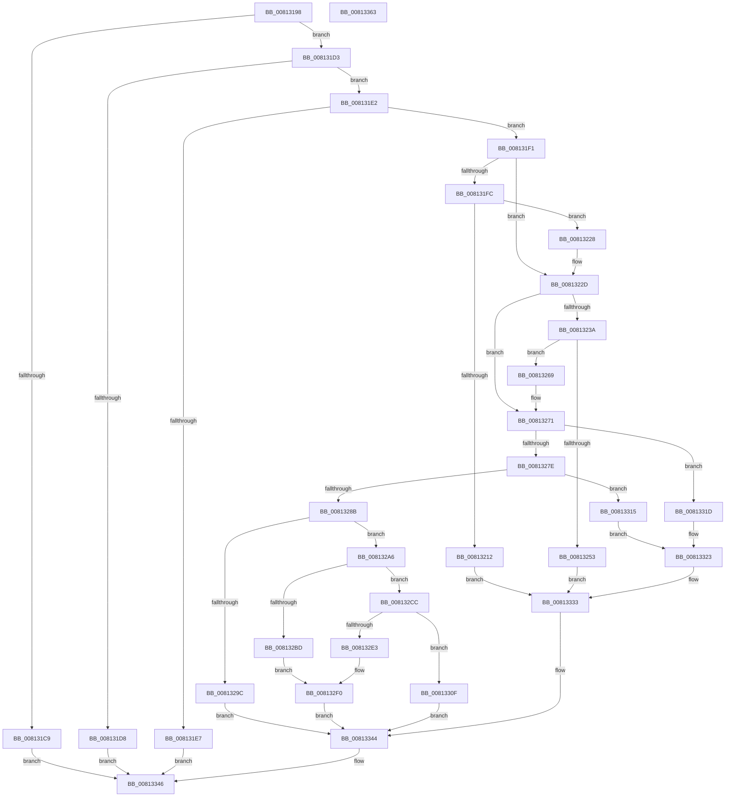

# SdbpSafeAllocAndConcatW

- RVA: `0x00813198`–`0x00813364` (길이 `460` bytes)
- VA: `0x0000000140813198`
- 실행 섹션: `PAGE`
- PDB 이름 있음: `예`; PDB Function 태그: `아니요`
- unwind 정보 RVA: `0x000BEBA0`
- 디코드: `121`개 명령, `460/460` bytes 표시
- 미해석 바이트: `0` (있으면 어셈블리에 `.byte`로 보존)

> 이 문서는 커널 이미지의 기계어와 PDB 기호를 분석해 생성했습니다. 4번과 5번은 함수 원형과 자료형을 바이너리 사용 방식에서 추정한 C 해석이며 원본 소스 복구 결과는 아닙니다.

## 1. Dependencies

- 직접 호출 지점: **8**; 고유 호출 대상: **6**
- 직접 호출자로 확인된 함수: **1**
- RIP 상대 이미지 참조: **5**

### Outgoing calls
- `0x00813207` → [RtlStringCchLengthW](../../text/43/RtlStringCchLengthW_function_00435A70.md) (function, `0x00435A70`)
- `0x00813248` → [RtlStringCchLengthW](../../text/43/RtlStringCchLengthW_function_00435A70.md) (function, `0x00435A70`)
- `0x0081328F` → [AslAlloc](../95/AslAlloc_function_0095BD34.md) (function, `0x0095BD34`)
- `0x008132B2` → [RtlStringCchCopyNW](../../text/47/RtlStringCchCopyNW_function_0047169C.md) (function, `0x0047169C`)
- `0x008132D8` → [RtlStringCchCatNW](../../text/60/RtlStringCchCatNW_function_00609E78.md) (function, `0x00609E78`)
- `0x00813300` → [AslLogCallPrintf](../95/AslLogCallPrintf_function_0095E4EC.md) (function, `0x0095E4EC`)
- `0x00813308` → [AslFree](../95/AslFree_function_0095B674.md) (function, `0x0095B674`)
- `0x0081333F` → [AslLogCallPrintf](../95/AslLogCallPrintf_function_0095E4EC.md) (function, `0x0095E4EC`)

### Direct callers
- [SdbpGetMergeRedirectPathInternal](SdbpGetMergeRedirectPathInternal_function_00812B00.md) at `0x00812C67`
- [SdbpGetMergeRedirectPathInternal](SdbpGetMergeRedirectPathInternal_function_00812B00.md) at `0x00812D6E`
- [SdbpGetMergeRedirectPathInternal](SdbpGetMergeRedirectPathInternal_function_00812B00.md) at `0x00812F53`

### Static image references
- `0x00813216` → RVA `0x0003B7B8` (`.rdata`; read)
- `0x008132C3` → RVA `0x0003B750` (`.rdata`; read)
- `0x008132E9` → RVA `0x0003B718` (`.rdata`; read)
- `0x008132F0` → RVA `0x0003B7A0` (`.rdata`; read)
- `0x00813328` → RVA `0x0003B788` (`.rdata`; read)

## 2. Other-region calls and transfers

- 다른 실행 섹션으로 향하는 call: **4**
  - `0x00813207` → [RtlStringCchLengthW](../../text/43/RtlStringCchLengthW_function_00435A70.md) (`PAGE` → `.text`)
  - `0x00813248` → [RtlStringCchLengthW](../../text/43/RtlStringCchLengthW_function_00435A70.md) (`PAGE` → `.text`)
  - `0x008132B2` → [RtlStringCchCopyNW](../../text/47/RtlStringCchCopyNW_function_0047169C.md) (`PAGE` → `.text`)
  - `0x008132D8` → [RtlStringCchCatNW](../../text/60/RtlStringCchCatNW_function_00609E78.md) (`PAGE` → `.text`)
- 별도 외부 분기/꼬리 이동을 확인하지 못했습니다.

## 3. Assembly (complete function range)

```asm
00813198  48 8B C4                        mov rax, rsp
0081319B  48 89 58 08                     mov qword ptr [rax + 8], rbx
0081319F  48 89 68 10                     mov qword ptr [rax + 0x10], rbp
008131A3  48 89 70 20                     mov qword ptr [rax + 0x20], rsi
008131A7  4C 89 40 18                     mov qword ptr [rax + 0x18], r8
008131AB  57                              push rdi
008131AC  41 54                           push r12
008131AE  41 55                           push r13
008131B0  41 56                           push r14
008131B2  41 57                           push r15
008131B4  48 83 EC 30                     sub rsp, 0x30
008131B8  4D 8B E1                        mov r12, r9
008131BB  49 8B F8                        mov rdi, r8
008131BE  4C 8B FA                        mov r15, rdx
008131C1  4C 8B E9                        mov r13, rcx
008131C4  48 85 C9                        test rcx, rcx
008131C7  75 0A                           jne 0x1408131d3
008131C9  B8 EF 00 00 C0                  mov eax, 0xc00000ef
008131CE  E9 73 01 00 00                  jmp 0x140813346
008131D3  4D 85 FF                        test r15, r15
008131D6  75 0A                           jne 0x1408131e2
008131D8  B8 F0 00 00 C0                  mov eax, 0xc00000f0
008131DD  E9 64 01 00 00                  jmp 0x140813346
008131E2  4D 85 E4                        test r12, r12
008131E5  75 0A                           jne 0x1408131f1
008131E7  B8 F2 00 00 C0                  mov eax, 0xc00000f2
008131EC  E9 55 01 00 00                  jmp 0x140813346
008131F1  41 BA FF FF FF 7F               mov r10d, 0x7fffffff
008131F7  4D 85 C0                        test r8, r8
008131FA  75 31                           jne 0x14081322d
008131FC  4C 8D 44 24 70                  lea r8, [rsp + 0x70]
00813201  41 8B D2                        mov edx, r10d
00813204  49 8B CF                        mov rcx, r15
00813207  E8 64 28 C2 FF                  call 0x140435a70
0081320C  8B D8                           mov ebx, eax
0081320E  85 C0                           test eax, eax
00813210  79 16                           jns 0x140813228
00813212  89 44 24 20                     mov dword ptr [rsp + 0x20], eax
00813216  4C 8D 0D 9B 85 82 FF            lea r9, [rip - 0x7d7a65]
0081321D  41 B8 48 06 00 00               mov r8d, 0x648
00813223  E9 0B 01 00 00                  jmp 0x140813333
00813228  48 8B 7C 24 70                  mov rdi, qword ptr [rsp + 0x70]
0081322D  48 8B B4 24 80 00 00 00         mov rsi, qword ptr [rsp + 0x80]
00813235  48 85 F6                        test rsi, rsi
00813238  75 37                           jne 0x140813271
0081323A  4C 8D 84 24 80 00 00 00         lea r8, [rsp + 0x80]
00813242  49 8B D2                        mov rdx, r10
00813245  49 8B CC                        mov rcx, r12
00813248  E8 23 28 C2 FF                  call 0x140435a70
0081324D  8B D8                           mov ebx, eax
0081324F  85 C0                           test eax, eax
00813251  79 16                           jns 0x140813269
00813253  89 44 24 20                     mov dword ptr [rsp + 0x20], eax
00813257  4C 8D 0D 5A 85 82 FF            lea r9, [rip - 0x7d7aa6]
0081325E  41 B8 50 06 00 00               mov r8d, 0x650
00813264  E9 CA 00 00 00                  jmp 0x140813333
00813269  48 8B B4 24 80 00 00 00         mov rsi, qword ptr [rsp + 0x80]
00813271  48 8D 04 37                     lea rax, [rdi + rsi]
00813275  48 3B C7                        cmp rax, rdi
00813278  0F 82 9F 00 00 00               jb 0x14081331d
0081327E  4C 8D 70 01                     lea r14, [rax + 1]
00813282  4C 3B F0                        cmp r14, rax
00813285  0F 82 8A 00 00 00               jb 0x140813315
0081328B  4B 8D 14 36                     lea rdx, [r14 + r14]
0081328F  E8 A0 8A 14 00                  call 0x14095bd34
00813294  48 8B E8                        mov rbp, rax
00813297  48 85 C0                        test rax, rax
0081329A  75 0A                           jne 0x1408132a6
0081329C  BB 17 00 00 C0                  mov ebx, 0xc0000017
008132A1  E9 9E 00 00 00                  jmp 0x140813344
008132A6  4C 8B CF                        mov r9, rdi
008132A9  4D 8B C7                        mov r8, r15
008132AC  49 8B D6                        mov rdx, r14
008132AF  48 8B CD                        mov rcx, rbp
008132B2  E8 E5 E3 C5 FF                  call 0x14047169c
008132B7  8B D8                           mov ebx, eax
008132B9  85 C0                           test eax, eax
008132BB  79 0F                           jns 0x1408132cc
008132BD  41 B8 70 06 00 00               mov r8d, 0x670
008132C3  4C 8D 0D 86 84 82 FF            lea r9, [rip - 0x7d7b7a]
008132CA  EB 24                           jmp 0x1408132f0
008132CC  4C 8B CE                        mov r9, rsi
008132CF  4D 8B C4                        mov r8, r12
008132D2  49 8B D6                        mov rdx, r14
008132D5  48 8B CD                        mov rcx, rbp
008132D8  E8 9B 6B DF FF                  call 0x140609e78
008132DD  8B D8                           mov ebx, eax
008132DF  85 C0                           test eax, eax
008132E1  79 2C                           jns 0x14081330f
008132E3  41 B8 79 06 00 00               mov r8d, 0x679
008132E9  4C 8D 0D 28 84 82 FF            lea r9, [rip - 0x7d7bd8]
008132F0  48 8D 15 A9 84 82 FF            lea rdx, [rip - 0x7d7b57]
008132F7  89 44 24 20                     mov dword ptr [rsp + 0x20], eax
008132FB  B9 01 00 00 00                  mov ecx, 1
00813300  E8 E7 B1 14 00                  call 0x14095e4ec
00813305  48 8B D5                        mov rdx, rbp
00813308  E8 67 83 14 00                  call 0x14095b674
0081330D  EB 35                           jmp 0x140813344
0081330F  49 89 6D 00                     mov qword ptr [r13], rbp
00813313  EB 2F                           jmp 0x140813344
00813315  41 B8 61 06 00 00               mov r8d, 0x661
0081331B  EB 06                           jmp 0x140813323
0081331D  41 B8 5A 06 00 00               mov r8d, 0x65a
00813323  BB 95 00 00 C0                  mov ebx, 0xc0000095
00813328  4C 8D 0D 59 84 82 FF            lea r9, [rip - 0x7d7ba7]
0081332F  89 5C 24 20                     mov dword ptr [rsp + 0x20], ebx
00813333  48 8D 15 66 84 82 FF            lea rdx, [rip - 0x7d7b9a]
0081333A  B9 01 00 00 00                  mov ecx, 1
0081333F  E8 A8 B1 14 00                  call 0x14095e4ec
00813344  8B C3                           mov eax, ebx
00813346  48 8B 5C 24 60                  mov rbx, qword ptr [rsp + 0x60]
0081334B  48 8B 6C 24 68                  mov rbp, qword ptr [rsp + 0x68]
00813350  48 8B 74 24 78                  mov rsi, qword ptr [rsp + 0x78]
00813355  48 83 C4 30                     add rsp, 0x30
00813359  41 5F                           pop r15
0081335B  41 5E                           pop r14
0081335D  41 5D                           pop r13
0081335F  41 5C                           pop r12
00813361  5F                              pop rdi
00813362  C3                              ret
00813363  CC                              int3
```

## 4. C-style interpretation (structured pseudocode)

```c
__int64 __fastcall SdbpSafeAllocAndConcatW(__int64 a1, __int64 a2, __int64 a3, __int64 a4, __int64 a5)
{
    __int64 result;
    __int64 v_rsp;
    unsigned int v_stack_m38;
    unsigned __int64 v_stack_p10;
    unsigned __int64 v_stack_p18;
    unsigned __int64 v_stack_p20;
    unsigned __int64 v_stack_p8;

    *(unsigned __int64 *)(v_rsp + 8) = v_rbx;
    *(unsigned __int64 *)(v_rsp + 16) = v_rbp;
    *(unsigned __int64 *)(v_rsp + 32) = v_rsi;
    *(unsigned __int64 *)(v_rsp + 24) = a3;
    v_rsp = (v_rsp) - (48);
    if (a1 != 0) goto loc_008131D3;
    goto loc_00813346;
loc_008131D3:
    if (a2 != 0) goto loc_008131E2;
    goto loc_00813346;
loc_008131E2:
    if (a4 != 0) goto loc_008131F1;
    goto loc_00813346;
loc_008131F1:
    if (a3 != 0) goto loc_0081322D;
    result = RtlStringCchLengthW(a2, (unsigned int)((unsigned int)((unsigned int)(0x7FFFFFFFULL))), v_stack_p18, a4);
    if (!sign_flag) goto loc_00813228;
    v_stack_m38 = (unsigned int)(result);
    goto loc_00813333;
loc_00813228:
loc_0081322D:
    if (a5 != 0) goto loc_00813271;
    result = RtlStringCchLengthW(a4, (unsigned int)(0x7FFFFFFFULL), a5, v_rip - 8223333);
    if (!sign_flag) goto loc_00813269;
    v_stack_m38 = (unsigned int)(result);
    goto loc_00813333;
loc_00813269:
loc_00813271:
    if ((v_stack_p18 + a5 * 1) < v_stack_p18) goto loc_0081331D;
    if ((v_stack_p18 + a5 * 1 + 1) < (v_stack_p18 + a5 * 1)) goto loc_00813315;
    result = AslAlloc(a4, v_stack_p18 + a5 * 1 + 1 + v_stack_p18 + a5 * 1 + 1 * 1, (unsigned int)(0x650ULL), v_rip - 8223398);
    if (result != 0) goto loc_008132A6;
    goto loc_00813344;
loc_008132A6:
    result = RtlStringCchCopyNW(result, v_stack_p18 + a5 * 1 + 1, a2, v_stack_p18);
    if (!sign_flag) goto loc_008132CC;
    goto loc_008132F0;
loc_008132CC:
    result = RtlStringCchCatNW(result, v_stack_p18 + a5 * 1 + 1, a4, a5);
    if (!sign_flag) goto loc_0081330F;
loc_008132F0:
    v_stack_m38 = (unsigned int)(result);
    result = AslLogCallPrintf(1, v_rip - 8223575, (unsigned int)(0x679ULL), v_rip - 8223704);
    result = AslFree(1, result, (unsigned int)(0x679ULL), v_rip - 8223704);
    goto loc_00813344;
loc_0081330F:
    *(unsigned __int64 *)(a1) = result;
    goto loc_00813344;
loc_00813315:
    goto loc_00813323;
loc_0081331D:
loc_00813323:
    v_stack_m38 = (unsigned int)((unsigned int)(0xC0000095ULL));
loc_00813333:
    result = AslLogCallPrintf(1, v_rip - 8223642, (unsigned int)(0x65AULL), v_rip - 8223655);
loc_00813344:
loc_00813346:
    v_rsp = (v_rsp) + (48);
    return (unsigned int)((unsigned int)((unsigned int)(0xC0000095ULL)));
}
```

## 5. (Beta) C Style

```c
int64_t SdbpSafeAllocAndConcatW(void *Arg1, int64_t Arg2, int64_t Arg3, int64_t Arg4, int64_t Arg5)
{
    uint8_t *arg1 = (uint8_t *)Arg1;

    int64_t result;
    int64_t local_rsp;
    uint32_t v_stack_m38;
    uint64_t v_stack_p10;
    uint64_t v_stack_p18;
    uint64_t v_stack_p20;
    uint64_t v_stack_p8;

    *(uint64_t *)(local_rsp + 0x8) = local_rbx;
    *(uint64_t *)(local_rsp + 0x10) = local_rbp;
    *(uint64_t *)(local_rsp + 0x20) = local_rsi;
    *(uint64_t *)(local_rsp + 0x18) = Arg3;
    local_rsp = (local_rsp) - (48);
    if (Arg1 != NULL) goto loc_008131D3;
    goto loc_00813346;
loc_008131D3:
    if (Arg2 != 0) goto loc_008131E2;
    goto loc_00813346;
loc_008131E2:
    if (Arg4 != 0) goto loc_008131F1;
    goto loc_00813346;
loc_008131F1:
    if (Arg3 != 0) goto loc_0081322D;
    result = RtlStringCchLengthW(Arg2, (uint32_t)((uint32_t)((uint32_t)(0x7FFFFFFFULL))), v_stack_p18, Arg4);
    if (!sign_flag) goto loc_00813228;
    v_stack_m38 = (uint32_t)(result);
    goto loc_00813333;
loc_00813228:
loc_0081322D:
    if (Arg5 != 0) goto loc_00813271;
    result = RtlStringCchLengthW(Arg4, (uint32_t)(0x7FFFFFFFULL), Arg5, v_rip - 8223333);
    if (!sign_flag) goto loc_00813269;
    v_stack_m38 = (uint32_t)(result);
    goto loc_00813333;
loc_00813269:
loc_00813271:
    if ((v_stack_p18 + Arg5 * 1) < v_stack_p18) goto loc_0081331D;
    if ((v_stack_p18 + Arg5 * 1 + 1) < (v_stack_p18 + Arg5 * 1)) goto loc_00813315;
    result = AslAlloc(Arg4, v_stack_p18 + Arg5 * 1 + 1 + v_stack_p18 + Arg5 * 1 + 1 * 1, (uint32_t)(0x650ULL), v_rip - 8223398);
    if (result != 0) goto loc_008132A6;
    goto loc_00813344;
loc_008132A6:
    result = RtlStringCchCopyNW(result, v_stack_p18 + Arg5 * 1 + 1, Arg2, v_stack_p18);
    if (!sign_flag) goto loc_008132CC;
    goto loc_008132F0;
loc_008132CC:
    result = RtlStringCchCatNW(result, v_stack_p18 + Arg5 * 1 + 1, Arg4, Arg5);
    if (!sign_flag) goto loc_0081330F;
loc_008132F0:
    v_stack_m38 = (uint32_t)(result);
    result = AslLogCallPrintf(1, v_rip - 8223575, (uint32_t)(0x679ULL), v_rip - 8223704);
    result = AslFree(1, result, (uint32_t)(0x679ULL), v_rip - 8223704);
    goto loc_00813344;
loc_0081330F:
    *(uint64_t *)(arg1) = result;
    goto loc_00813344;
loc_00813315:
    goto loc_00813323;
loc_0081331D:
loc_00813323:
    v_stack_m38 = (uint32_t)((uint32_t)(0xC0000095ULL));
loc_00813333:
    result = AslLogCallPrintf(1, v_rip - 8223642, (uint32_t)(0x65AULL), v_rip - 8223655);
loc_00813344:
loc_00813346:
    local_rsp = (local_rsp) + (48);
    return (uint32_t)((uint32_t)((uint32_t)(0xC0000095ULL)));
}
```

### 관측된 메모리 오프셋

구조체 형식이 확인되지 않은 접근은 인자 기준의 오프셋으로만 기록했습니다.

| 기준 인자 | 오프셋 표현 | 폭 (bit) | 접근 |
|---|---:|---:|---|
| `Arg1` | `+ 0x0` | `64` | `W` |

## 6. Execution-region graph

[열기: 2D/3D 그래프와 함수 탐색 컨트롤 패널](../../../control-panel.html?section=page&rva=0x00813198&view=graph)

- 2D 그래프는 위에서 아래로 흐르고, 3D 그래프는 빈 공간을 드래그해 회전합니다. Shift+드래그는 이동, 휠은 확대·축소, 함수 노드 선택은 대상 보고서 이동입니다.

### Static fallback


