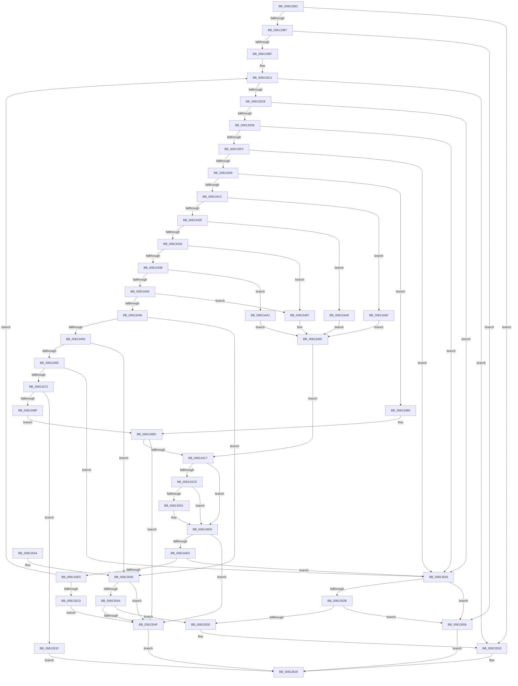

# SdbpValidateSdbSizeWithRootTags

- RVA: `0x0081336C`–`0x0081355D` (길이 `497` bytes)
- VA: `0x000000014081336C`
- 실행 섹션: `PAGE`
- PDB 이름 있음: `예`; PDB Function 태그: `아니요`
- unwind 정보 RVA: `0x000D98AC`
- 디코드: `141`개 명령, `497/497` bytes 표시
- 미해석 바이트: `0` (있으면 어셈블리에 `.byte`로 보존)

> 이 문서는 커널 이미지의 기계어와 PDB 기호를 분석해 생성했습니다. 4번과 5번은 함수 원형과 자료형을 바이너리 사용 방식에서 추정한 C 해석이며 원본 소스 복구 결과는 아닙니다.

## 1. Dependencies

- 직접 호출 지점: **2**; 고유 호출 대상: **1**
- 직접 호출자로 확인된 함수: **2**
- RIP 상대 이미지 참조: **0**

### Outgoing calls
- `0x008133E5` → [SdbpReadMappedData](../95/SdbpReadMappedData_function_0095E460.md) (function, `0x0095E460`)
- `0x0081347F` → [SdbpReadMappedData](../95/SdbpReadMappedData_function_0095E460.md) (function, `0x0095E460`)

### Direct callers
- [SdbpOpenDatabaseInMemory](../95/SdbpOpenDatabaseInMemory_function_0095A574.md) at `0x0095A68E`
- [SdbpValidateAndApplyCompatFlags](../AF/SdbpValidateAndApplyCompatFlags_function_00AF93D8.md) at `0x00AF944F`

### Static image references
- 디코드된 RIP-relative 메모리 참조가 없습니다.

## 2. Other-region calls and transfers

- 다른 실행 섹션으로 향하는 call: **0**
- 별도 외부 분기/꼬리 이동을 확인하지 못했습니다.

## 3. Assembly (complete function range)

```asm
0081336C  40 55                           push rbp
0081336E  53                              push rbx
0081336F  56                              push rsi
00813370  57                              push rdi
00813371  41 54                           push r12
00813373  41 56                           push r14
00813375  41 57                           push r15
00813377  48 8B EC                        mov rbp, rsp
0081337A  48 83 EC 20                     sub rsp, 0x20
0081337E  8B 41 14                        mov eax, dword ptr [rcx + 0x14]
00813381  45 33 C9                        xor r9d, r9d
00813384  48 8B D9                        mov rbx, rcx
00813387  44 89 4D 50                     mov dword ptr [rbp + 0x50], r9d
0081338B  8A 89 30 0A 00 00               mov cl, byte ptr [rcx + 0xa30]
00813391  BA 0C 00 00 00                  mov edx, 0xc
00813396  80 E1 01                        and cl, 1
00813399  66 44 89 4D 48                  mov word ptr [rbp + 0x48], r9w
0081339E  8B FA                           mov edi, edx
008133A0  44 89 4D 58                     mov dword ptr [rbp + 0x58], r9d
008133A4  41 8A F1                        mov sil, r9b
008133A7  88 4D 40                        mov byte ptr [rbp + 0x40], cl
008133AA  45 8A F1                        mov r14b, r9b
008133AD  44 39 4B 10                     cmp dword ptr [rbx + 0x10], r9d
008133B1  0F 85 7C 01 00 00               jne 0x140813533
008133B7  3B C2                           cmp eax, edx
008133B9  0F 82 97 01 00 00               jb 0x140813556
008133BF  44 8B E0                        mov r12d, eax
008133C2  49 3B D4                        cmp rdx, r12
008133C5  0F 84 68 01 00 00               je 0x140813533
008133CB  4C 8D 7A 02                     lea r15, [rdx + 2]
008133CF  4D 3B FC                        cmp r15, r12
008133D2  0F 87 4E 01 00 00               ja 0x140813526
008133D8  41 B9 02 00 00 00               mov r9d, 2
008133DE  4C 8D 45 48                     lea r8, [rbp + 0x48]
008133E2  48 8B CB                        mov rcx, rbx
008133E5  E8 76 B0 14 00                  call 0x14095e460
008133EA  45 33 C9                        xor r9d, r9d
008133ED  85 C0                           test eax, eax
008133EF  0F 84 31 01 00 00               je 0x140813526
008133F5  41 BA 00 10 00 00               mov r10d, 0x1000
008133FB  66 44 39 55 48                  cmp word ptr [rbp + 0x48], r10w
00813400  0F 86 20 01 00 00               jbe 0x140813526
00813406  0F B7 4D 48                     movzx ecx, word ptr [rbp + 0x48]
0081340A  49 8B D7                        mov rdx, r15
0081340D  81 E1 00 F0 00 00               and ecx, 0xf000
00813413  41 3B CA                        cmp ecx, r10d
00813416  0F 84 9A 00 00 00               je 0x1408134b6
0081341C  81 F9 00 20 00 00               cmp ecx, 0x2000
00813422  0F 84 87 00 00 00               je 0x1408134af
00813428  81 F9 00 30 00 00               cmp ecx, 0x3000
0081342E  74 78                           je 0x1408134a8
00813430  81 F9 00 40 00 00               cmp ecx, 0x4000
00813436  74 5F                           je 0x140813497
00813438  81 F9 00 50 00 00               cmp ecx, 0x5000
0081343E  74 61                           je 0x1408134a1
00813440  81 F9 00 60 00 00               cmp ecx, 0x6000
00813446  74 4F                           je 0x140813497
00813448  8D 81 00 90 FF FF               lea eax, [rcx - 0x7000]
0081344E  A9 FF CF FF FF                  test eax, 0xffffcfff
00813453  0F 85 EC 00 00 00               jne 0x140813545
00813459  81 F9 00 A0 00 00               cmp ecx, 0xa000
0081345F  0F 84 E0 00 00 00               je 0x140813545
00813465  49 83 C7 04                     add r15, 4
00813469  4D 3B FC                        cmp r15, r12
0081346C  0F 87 B4 00 00 00               ja 0x140813526
00813472  41 B9 04 00 00 00               mov r9d, 4
00813478  4C 8D 45 50                     lea r8, [rbp + 0x50]
0081347C  48 8B CB                        mov rcx, rbx
0081347F  E8 DC AF 14 00                  call 0x14095e460
00813484  45 33 C9                        xor r9d, r9d
00813487  85 C0                           test eax, eax
00813489  0F 84 90 00 00 00               je 0x14081351f
0081348F  8B 45 50                        mov eax, dword ptr [rbp + 0x50]
00813492  49 8B D7                        mov rdx, r15
00813495  EB 25                           jmp 0x1408134bc
00813497  B8 04 00 00 00                  mov eax, 4
0081349C  89 45 50                        mov dword ptr [rbp + 0x50], eax
0081349F  EB 26                           jmp 0x1408134c7
008134A1  B8 08 00 00 00                  mov eax, 8
008134A6  EB F4                           jmp 0x14081349c
008134A8  B8 02 00 00 00                  mov eax, 2
008134AD  EB ED                           jmp 0x14081349c
008134AF  B8 01 00 00 00                  mov eax, 1
008134B4  EB E6                           jmp 0x14081349c
008134B6  41 8B C1                        mov eax, r9d
008134B9  89 45 50                        mov dword ptr [rbp + 0x50], eax
008134BC  3D FF FF FF 0F                  cmp eax, 0xfffffff
008134C1  0F 83 88 00 00 00               jae 0x14081354f
008134C7  44 38 4D 40                     cmp byte ptr [rbp + 0x40], r9b
008134CB  75 09                           jne 0x1408134d6
008134CD  A8 01                           test al, 1
008134CF  74 05                           je 0x1408134d6
008134D1  FF C0                           inc eax
008134D3  89 45 50                        mov dword ptr [rbp + 0x50], eax
008134D6  48 03 D0                        add rdx, rax
008134D9  8B C7                           mov eax, edi
008134DB  48 3B D0                        cmp rdx, rax
008134DE  7E 6F                           jle 0x14081354f
008134E0  49 3B D4                        cmp rdx, r12
008134E3  7F 41                           jg 0x140813526
008134E5  44 8B 45 58                     mov r8d, dword ptr [rbp + 0x58]
008134E9  B8 01 70 00 00                  mov eax, 0x7001
008134EE  66 3B 45 48                     cmp ax, word ptr [rbp + 0x48]
008134F2  8B FA                           mov edi, edx
008134F4  0F 94 C0                        sete al
008134F7  44 0A F0                        or r14b, al
008134FA  B8 01 78 00 00                  mov eax, 0x7801
008134FF  66 3B 45 48                     cmp ax, word ptr [rbp + 0x48]
00813503  0F 94 C0                        sete al
00813506  41 FF C0                        inc r8d
00813509  40 0A F0                        or sil, al
0081350C  44 89 45 58                     mov dword ptr [rbp + 0x58], r8d
00813510  41 81 F8 00 01 00 00            cmp r8d, 0x100
00813517  0F 8E A5 FE FF FF               jle 0x1408133c2
0081351D  EB 30                           jmp 0x14081354f
0081351F  B8 58 01 00 C0                  mov eax, 0xc0000158
00813524  EB 0F                           jmp 0x140813535
00813526  45 84 F6                        test r14b, r14b
00813529  74 2B                           je 0x140813556
0081352B  40 84 F6                        test sil, sil
0081352E  74 26                           je 0x140813556
00813530  89 7B 14                        mov dword ptr [rbx + 0x14], edi
00813533  33 C0                           xor eax, eax
00813535  48 83 C4 20                     add rsp, 0x20
00813539  41 5F                           pop r15
0081353B  41 5E                           pop r14
0081353D  41 5C                           pop r12
0081353F  5F                              pop rdi
00813540  5E                              pop rsi
00813541  5B                              pop rbx
00813542  5D                              pop rbp
00813543  C3                              ret
00813544  CC                              int3
00813545  45 84 F6                        test r14b, r14b
00813548  74 05                           je 0x14081354f
0081354A  40 84 F6                        test sil, sil
0081354D  75 E1                           jne 0x140813530
0081354F  B8 E4 00 00 C0                  mov eax, 0xc00000e4
00813554  EB DF                           jmp 0x140813535
00813556  B8 1F 00 00 C0                  mov eax, 0xc000001f
0081355B  EB D8                           jmp 0x140813535
```

## 4. C-style interpretation (structured pseudocode)

```c
__int64 __fastcall SdbpValidateSdbSizeWithRootTags(__int64 a1, __int64 a2, __int64 a3, int a4)
{
    __int64 result;
    __int64 v_r14;
    __int64 v_r15;
    __int64 v_rsi;
    __int64 v_rsp;
    unsigned __int16 v_stack_p10;
    unsigned int v_stack_p18;
    unsigned int v_stack_p20;
    unsigned __int8 v_stack_p8;

    v_rsp = (v_rsp) - (32);
    a4 = 0;
    v_stack_p18 = 0;
    a1 = (unsigned __int8)((*(unsigned __int8 *)(a1 + 2608)) & (1));
    v_stack_p10 = 0;
    v_stack_p20 = 0;
    v_stack_p8 = (unsigned __int8)(a1);
    if ((*(unsigned int *)(a1 + 16)) != 0) goto loc_00813533;
    if (((unsigned int)((unsigned int)(*(unsigned int *)(a1 + 20)))) < 12) goto loc_00813556;
loc_008133C2:
    if (12 == ((unsigned int)((unsigned int)((unsigned int)(*(unsigned int *)(a1 + 20)))))) goto loc_00813533;
    if ((12 + 2) > ((unsigned int)((unsigned int)((unsigned int)(*(unsigned int *)(a1 + 20)))))) goto loc_00813526;
    result = SdbpReadMappedData(a1, 12, v_stack_p10, 2);
    a4 = 0;
    if ((unsigned int)(result) == 0) goto loc_00813526;
    if (v_stack_p10 <= ((unsigned __int16)((unsigned int)(0x1000ULL)))) goto loc_00813526;
    a1 = (unsigned int)((v_stack_p10) & (0xF000ULL));
    if (((unsigned int)(a1)) == ((unsigned int)((unsigned int)(0x1000ULL)))) goto loc_008134B6;
    if (((unsigned int)(a1)) == 0x2000ULL) goto loc_008134AF;
    if (((unsigned int)(a1)) == 0x3000ULL) goto loc_008134A8;
    if (((unsigned int)(a1)) == 0x4000ULL) goto loc_00813497;
    if (((unsigned int)(a1)) == 0x5000ULL) goto loc_008134A1;
    if (((unsigned int)(a1)) == 0x6000ULL) goto loc_00813497;
    if ((((unsigned int)(a1 - 28672)) & (0xFFFFCFFFULL)) != 0) goto loc_00813545;
    if (((unsigned int)(a1)) == 0xA000ULL) goto loc_00813545;
    v_r15 = (12 + 2) + (4);
    if (v_r15 > ((unsigned int)((unsigned int)((unsigned int)(*(unsigned int *)(a1 + 20)))))) goto loc_00813526;
    result = SdbpReadMappedData(a1, 12 + 2, v_stack_p18, 4);
    a4 = 0;
    if ((unsigned int)(result) == 0) goto loc_0081351F;
    goto loc_008134BC;
loc_00813497:
loc_0081349C:
    v_stack_p18 = 4;
    goto loc_008134C7;
loc_008134A1:
    goto loc_0081349C;
loc_008134A8:
    goto loc_0081349C;
loc_008134AF:
    goto loc_0081349C;
loc_008134B6:
    v_stack_p18 = 0;
loc_008134BC:
    if (0 >= 0xFFFFFFFULL) goto loc_0081354F;
loc_008134C7:
    if (v_stack_p8 != 0) goto loc_008134D6;
    result = 0;
    if (((0) & (1)) != 0) {
        result = (unsigned int)((0) + 1);
        v_stack_p18 = (unsigned int)(result);
    }
    a2 = (v_r15) + (result);
    if (a2 <= 12) goto loc_0081354F;
    if (a2 > ((unsigned int)((unsigned int)((unsigned int)(*(unsigned int *)(a1 + 20)))))) goto loc_00813526;
    result = (((unsigned __int16)((unsigned int)(0x7001ULL))) == v_stack_p10) ? 1 : 0;
    v_r14 = (unsigned __int8)((0) | ((unsigned __int8)(result)));
    result = (((unsigned __int16)((unsigned int)(0x7801ULL))) == v_stack_p10) ? 1 : 0;
    a3 = (unsigned int)(((unsigned int)(v_stack_p20)) + 1);
    v_rsi = (unsigned __int8)((0) | ((unsigned __int8)(result)));
    v_stack_p20 = (unsigned int)(a3);
    if (((unsigned int)(a3)) <= 256) goto loc_008133C2;
    goto loc_0081354F;
loc_0081351F:
    goto loc_00813535;
loc_00813526:
    if ((unsigned __int8)(v_r14) == 0) goto loc_00813556;
    if ((unsigned __int8)(v_rsi) == 0) goto loc_00813556;
loc_00813530:
    *(unsigned int *)(a1 + 20) = (unsigned int)((unsigned int)((unsigned int)(a2)));
loc_00813533:
    result = 0;
loc_00813535:
    v_rsp = (v_rsp) + (32);
    return result;
loc_00813545:
    if ((unsigned __int8)(v_r14) == 0) goto loc_0081354F;
    if ((unsigned __int8)(v_rsi) != 0) goto loc_00813530;
loc_0081354F:
    goto loc_00813535;
loc_00813556:
    goto loc_00813535;
}
```

## 5. (Beta) C Style

```c
int64_t SdbpValidateSdbSizeWithRootTags(void *Arg1, int64_t Arg2, int64_t Arg3, int32_t Arg4)
{
    uint8_t *arg1 = (uint8_t *)Arg1;

    int64_t result;
    int64_t local_r14;
    int64_t local_r15;
    int64_t local_rsi;
    int64_t local_rsp;
    uint16_t v_stack_p10;
    uint32_t v_stack_p18;
    uint32_t v_stack_p20;
    uint8_t v_stack_p8;

    local_rsp = (local_rsp) - (32);
    Arg4 = 0;
    v_stack_p18 = 0;
    Arg1 = (uint8_t)((*(uint8_t *)(arg1 + 0xA30)) & (1));
    v_stack_p10 = 0;
    v_stack_p20 = 0;
    v_stack_p8 = (uint8_t)(Arg1);
    if ((*(uint32_t *)(arg1 + 0x10)) != 0) goto loc_00813533;
    if (((uint32_t)((uint32_t)(*(uint32_t *)(arg1 + 0x14)))) < 12) goto loc_00813556;
loc_008133C2:
    if (12 == ((uint32_t)((uint32_t)((uint32_t)(*(uint32_t *)(arg1 + 0x14)))))) goto loc_00813533;
    if ((12 + 2) > ((uint32_t)((uint32_t)((uint32_t)(*(uint32_t *)(arg1 + 0x14)))))) goto loc_00813526;
    result = SdbpReadMappedData(Arg1, 12, v_stack_p10, 2);
    Arg4 = 0;
    if ((uint32_t)(result) == 0) goto loc_00813526;
    if (v_stack_p10 <= ((uint16_t)((uint32_t)(0x1000ULL)))) goto loc_00813526;
    Arg1 = (uint32_t)((v_stack_p10) & (0xF000ULL));
    if (((uint32_t)(Arg1)) == ((uint32_t)((uint32_t)(0x1000ULL)))) goto loc_008134B6;
    if (((uint32_t)(Arg1)) == 0x2000ULL) goto loc_008134AF;
    if (((uint32_t)(Arg1)) == 0x3000ULL) goto loc_008134A8;
    if (((uint32_t)(Arg1)) == 0x4000ULL) goto loc_00813497;
    if (((uint32_t)(Arg1)) == 0x5000ULL) goto loc_008134A1;
    if (((uint32_t)(Arg1)) == 0x6000ULL) goto loc_00813497;
    if ((((uint32_t)(Arg1 - 28672)) & (0xFFFFCFFFULL)) != 0) goto loc_00813545;
    if (((uint32_t)(Arg1)) == 0xA000ULL) goto loc_00813545;
    local_r15 = (12 + 2) + (4);
    if (local_r15 > ((uint32_t)((uint32_t)((uint32_t)(*(uint32_t *)(arg1 + 0x14)))))) goto loc_00813526;
    result = SdbpReadMappedData(Arg1, 12 + 2, v_stack_p18, 4);
    Arg4 = 0;
    if ((uint32_t)(result) == 0) goto loc_0081351F;
    goto loc_008134BC;
loc_00813497:
loc_0081349C:
    v_stack_p18 = 4;
    goto loc_008134C7;
loc_008134A1:
    goto loc_0081349C;
loc_008134A8:
    goto loc_0081349C;
loc_008134AF:
    goto loc_0081349C;
loc_008134B6:
    v_stack_p18 = 0;
loc_008134BC:
    if (0 >= 0xFFFFFFFULL) goto loc_0081354F;
loc_008134C7:
    if (v_stack_p8 != 0) goto loc_008134D6;
    result = 0;
    if (((0) & (1)) != 0) {
        result = (uint32_t)((0) + 1);
        v_stack_p18 = (uint32_t)(result);
    }
    Arg2 = (local_r15) + (result);
    if (Arg2 <= 12) goto loc_0081354F;
    if (Arg2 > ((uint32_t)((uint32_t)((uint32_t)(*(uint32_t *)(arg1 + 0x14)))))) goto loc_00813526;
    result = (((uint16_t)((uint32_t)(0x7001ULL))) == v_stack_p10) ? 1 : 0;
    local_r14 = (uint8_t)((0) | ((uint8_t)(result)));
    result = (((uint16_t)((uint32_t)(0x7801ULL))) == v_stack_p10) ? 1 : 0;
    Arg3 = (uint32_t)(((uint32_t)(v_stack_p20)) + 1);
    local_rsi = (uint8_t)((0) | ((uint8_t)(result)));
    v_stack_p20 = (uint32_t)(Arg3);
    if (((uint32_t)(Arg3)) <= 256) goto loc_008133C2;
    goto loc_0081354F;
loc_0081351F:
    goto loc_00813535;
loc_00813526:
    if ((uint8_t)(local_r14) == 0) goto loc_00813556;
    if ((uint8_t)(local_rsi) == 0) goto loc_00813556;
loc_00813530:
    *(uint32_t *)(arg1 + 0x14) = (uint32_t)((uint32_t)((uint32_t)(Arg2)));
loc_00813533:
    result = 0;
loc_00813535:
    local_rsp = (local_rsp) + (32);
    return result;
loc_00813545:
    if ((uint8_t)(local_r14) == 0) goto loc_0081354F;
    if ((uint8_t)(local_rsi) != 0) goto loc_00813530;
loc_0081354F:
    goto loc_00813535;
loc_00813556:
    goto loc_00813535;
}
```

### 관측된 메모리 오프셋

구조체 형식이 확인되지 않은 접근은 인자 기준의 오프셋으로만 기록했습니다.

| 기준 인자 | 오프셋 표현 | 폭 (bit) | 접근 |
|---|---:|---:|---|
| `Arg1` | `+ 0x10` | `32` | `R` |
| `Arg1` | `+ 0x14` | `32` | `R` |
| `Arg1` | `+ 0x14` | `32` | `W` |
| `Arg1` | `+ 0xA30` | `8` | `R` |

## 6. Execution-region graph

[열기: 2D/3D 그래프와 함수 탐색 컨트롤 패널](../../../control-panel.html?section=page&rva=0x0081336C&view=graph)

- 2D 그래프는 위에서 아래로 흐르고, 3D 그래프는 빈 공간을 드래그해 회전합니다. Shift+드래그는 이동, 휠은 확대·축소, 함수 노드 선택은 대상 보고서 이동입니다.

### Static fallback


