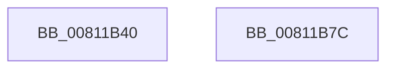

# UcpApcNormalRoutine

- RVA: `0x00811B40`–`0x00811B7D` (길이 `61` bytes)
- VA: `0x0000000140811B40`
- 실행 섹션: `PAGE`
- PDB 이름 있음: `예`; PDB Function 태그: `아니요`
- unwind 정보 RVA: `0x00064C80`
- 디코드: `19`개 명령, `61/61` bytes 표시
- 미해석 바이트: `0` (있으면 어셈블리에 `.byte`로 보존)

> 이 문서는 커널 이미지의 기계어와 PDB 기호를 분석해 생성했습니다. 4번과 5번은 함수 원형과 자료형을 바이너리 사용 방식에서 추정한 C 해석이며 원본 소스 복구 결과는 아닙니다.

## 1. Dependencies

- 직접 호출 지점: **2**; 고유 호출 대상: **2**
- 직접 호출자로 확인된 함수: **0**
- RIP 상대 이미지 참조: **0**

### Outgoing calls
- `0x00811B67` → [UcpLogEventGenerateDump](../../text/69/UcpLogEventGenerateDump_function_0069B2C0.md) (function, `0x0069B2C0`)
- `0x00811B71` → [ExFreePoolWithTag](../../poolcode/B8/ExFreePoolWithTag_function_00B82870.md) (function, `0x00B82870`)

### Direct callers
- 이 함수 시작 RVA로 연결되는 직접 call은 확인되지 않았습니다. 간접 호출은 완전히 역산할 수 없습니다.

### Static image references
- 디코드된 RIP-relative 메모리 참조가 없습니다.

## 2. Other-region calls and transfers

- 다른 실행 섹션으로 향하는 call: **2**
  - `0x00811B67` → [UcpLogEventGenerateDump](../../text/69/UcpLogEventGenerateDump_function_0069B2C0.md) (`PAGE` → `.text`)
  - `0x00811B71` → [ExFreePoolWithTag](../../poolcode/B8/ExFreePoolWithTag_function_00B82870.md) (`PAGE` → `POOLCODE`)
- 별도 외부 분기/꼬리 이동을 확인하지 못했습니다.

## 3. Assembly (complete function range)

```asm
00811B40  40 53                           push rbx
00811B42  48 83 EC 30                     sub rsp, 0x30
00811B46  8B 41 58                        mov eax, dword ptr [rcx + 0x58]
00811B49  48 8B D9                        mov rbx, rcx
00811B4C  48 8B 51 68                     mov rdx, qword ptr [rcx + 0x68]
00811B50  89 44 24 20                     mov dword ptr [rsp + 0x20], eax
00811B54  8B 41 5C                        mov eax, dword ptr [rcx + 0x5c]
00811B57  89 44 24 24                     mov dword ptr [rsp + 0x24], eax
00811B5B  8B 41 60                        mov eax, dword ptr [rcx + 0x60]
00811B5E  48 8D 4C 24 20                  lea rcx, [rsp + 0x20]
00811B63  89 44 24 28                     mov dword ptr [rsp + 0x28], eax
00811B67  E8 54 97 E8 FF                  call 0x14069b2c0
00811B6C  33 D2                           xor edx, edx
00811B6E  48 8B CB                        mov rcx, rbx
00811B71  E8 FA 0C 37 00                  call 0x140b82870
00811B76  48 83 C4 30                     add rsp, 0x30
00811B7A  5B                              pop rbx
00811B7B  C3                              ret
00811B7C  CC                              int3
```

## 4. C-style interpretation (structured pseudocode)

```c
__int64 __fastcall UcpApcNormalRoutine(__int64 a1)
{
    __int64 result;
    __int64 v_rsp;
    unsigned int v_stack_m10;
    unsigned int v_stack_m14;
    unsigned int v_stack_m18;

    v_rsp = (v_rsp) - (48);
    v_stack_m18 = (unsigned int)((unsigned int)(*(unsigned int *)(a1 + 88)));
    v_stack_m14 = (unsigned int)((unsigned int)(*(unsigned int *)(a1 + 92)));
    v_stack_m10 = (unsigned int)((unsigned int)(*(unsigned int *)(a1 + 96)));
    result = UcpLogEventGenerateDump(v_stack_m18, *(unsigned __int64 *)(a1 + 104), a3, a4);
    a2 = 0;
    result = ExFreePoolWithTag(a1, a2, a3, a4);
    v_rsp = (v_rsp) + (48);
    return result;
}
```

## 5. (Beta) C Style

```c
int64_t UcpApcNormalRoutine(void *Arg1)
{
    uint8_t *arg1 = (uint8_t *)Arg1;

    int64_t result;
    int64_t local_rsp;
    uint32_t v_stack_m10;
    uint32_t v_stack_m14;
    uint32_t v_stack_m18;

    local_rsp = (local_rsp) - (48);
    v_stack_m18 = (uint32_t)((uint32_t)(*(uint32_t *)(arg1 + 0x58)));
    v_stack_m14 = (uint32_t)((uint32_t)(*(uint32_t *)(arg1 + 0x5C)));
    v_stack_m10 = (uint32_t)((uint32_t)(*(uint32_t *)(arg1 + 0x60)));
    result = UcpLogEventGenerateDump(v_stack_m18, *(uint64_t *)(arg1 + 0x68), a3, a4);
    a2 = 0;
    result = ExFreePoolWithTag(Arg1, a2, a3, a4);
    local_rsp = (local_rsp) + (48);
    return result;
}
```

### 관측된 메모리 오프셋

구조체 형식이 확인되지 않은 접근은 인자 기준의 오프셋으로만 기록했습니다.

| 기준 인자 | 오프셋 표현 | 폭 (bit) | 접근 |
|---|---:|---:|---|
| `Arg1` | `+ 0x58` | `32` | `R` |
| `Arg1` | `+ 0x5C` | `32` | `R` |
| `Arg1` | `+ 0x60` | `32` | `R` |
| `Arg1` | `+ 0x68` | `64` | `R` |

## 6. Execution-region graph

[열기: 2D/3D 그래프와 함수 탐색 컨트롤 패널](../../../control-panel.html?section=page&rva=0x00811B40&view=graph)

- 2D 그래프는 위에서 아래로 흐르고, 3D 그래프는 빈 공간을 드래그해 회전합니다. Shift+드래그는 이동, 휠은 확대·축소, 함수 노드 선택은 대상 보고서 이동입니다.

### Static fallback


