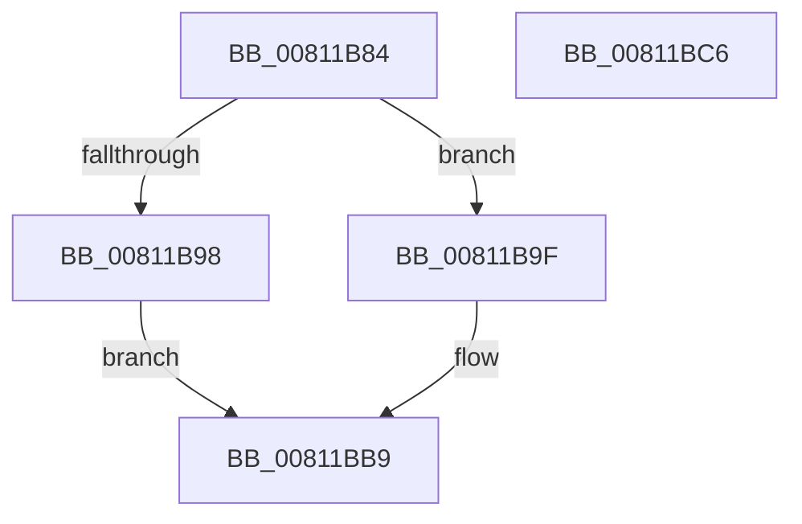

# sub_00811B84

- RVA: `0x00811B84`–`0x00811BC7` (길이 `67` bytes)
- VA: `0x0000000140811B84`
- 실행 섹션: `PAGE`
- PDB 이름 있음: `아니요`; PDB Function 태그: `아니요`
- unwind 정보 RVA: `0x00068D5C`
- 디코드: `21`개 명령, `67/67` bytes 표시
- 미해석 바이트: `0` (있으면 어셈블리에 `.byte`로 보존)

> 이 문서는 커널 이미지의 기계어와 PDB 기호를 분석해 생성했습니다. 4번과 5번은 함수 원형과 자료형을 바이너리 사용 방식에서 추정한 C 해석이며 원본 소스 복구 결과는 아닙니다.

## 1. Dependencies

- 직접 호출 지점: **1**; 고유 호출 대상: **1**
- 직접 호출자로 확인된 함수: **1**
- RIP 상대 이미지 참조: **0**

### Outgoing calls
- `0x00811BAC` → [sub_00811BD0](Unknown_function_00811BD0.md) (function, `0x00811BD0`)

### Direct callers
- [sub_00966DF0](../96/Unknown_function_00966DF0.md) at `0x00966F25`

### Static image references
- 디코드된 RIP-relative 메모리 참조가 없습니다.

## 2. Other-region calls and transfers

- 다른 실행 섹션으로 향하는 call: **0**
- 별도 외부 분기/꼬리 이동을 확인하지 못했습니다.

## 3. Assembly (complete function range)

```asm
00811B84  48 89 5C 24 10                  mov qword ptr [rsp + 0x10], rbx
00811B89  57                              push rdi
00811B8A  48 83 EC 20                     sub rsp, 0x20
00811B8E  33 DB                           xor ebx, ebx
00811B90  48 8B F9                        mov rdi, rcx
00811B93  48 85 C9                        test rcx, rcx
00811B96  75 07                           jne 0x140811b9f
00811B98  BB 0D 00 00 C0                  mov ebx, 0xc000000d
00811B9D  EB 1A                           jmp 0x140811bb9
00811B9F  48 8B 09                        mov rcx, qword ptr [rcx]
00811BA2  48 89 4C 24 30                  mov qword ptr [rsp + 0x30], rcx
00811BA7  48 8D 4C 24 30                  lea rcx, [rsp + 0x30]
00811BAC  E8 1F 00 00 00                  call 0x140811bd0
00811BB1  48 8B 4C 24 30                  mov rcx, qword ptr [rsp + 0x30]
00811BB6  48 89 0F                        mov qword ptr [rdi], rcx
00811BB9  8B C3                           mov eax, ebx
00811BBB  48 8B 5C 24 38                  mov rbx, qword ptr [rsp + 0x38]
00811BC0  48 83 C4 20                     add rsp, 0x20
00811BC4  5F                              pop rdi
00811BC5  C3                              ret
00811BC6  CC                              int3
```

## 4. C-style interpretation (structured pseudocode)

```c
__int64 __fastcall sub_00811B84(__int64 a1)
{
    __int64 result;
    __int64 v_rbx;
    __int64 v_rsp;
    unsigned __int64 v_stack_p10;
    unsigned __int64 v_stack_p8;

    v_stack_p10 = v_rbx;
    v_rsp = (v_rsp) - (32);
    v_rbx = 0;
    if (a1 != 0) goto loc_00811B9F;
    goto loc_00811BB9;
loc_00811B9F:
    v_stack_p8 = *(unsigned __int64 *)(a1);
    result = sub_00811BD0(v_stack_p8, a2, a3, a4);
    *(unsigned __int64 *)(a1) = v_stack_p8;
loc_00811BB9:
    v_rsp = (v_rsp) + (32);
    return (unsigned int)((unsigned int)((unsigned int)(0xC000000DULL)));
}
```

## 5. (Beta) C Style

```c
int64_t sub_00811B84(void *Arg1)
{
    uint8_t *arg1 = (uint8_t *)Arg1;

    int64_t result;
    int64_t local_rbx;
    int64_t local_rsp;
    uint64_t v_stack_p10;
    uint64_t v_stack_p8;

    v_stack_p10 = local_rbx;
    local_rsp = (local_rsp) - (32);
    local_rbx = 0;
    if (Arg1 != NULL) goto loc_00811B9F;
    goto loc_00811BB9;
loc_00811B9F:
    v_stack_p8 = *(uint64_t *)(arg1);
    result = sub_00811BD0(v_stack_p8, a2, a3, a4);
    *(uint64_t *)(arg1) = v_stack_p8;
loc_00811BB9:
    local_rsp = (local_rsp) + (32);
    return (uint32_t)((uint32_t)((uint32_t)(0xC000000DULL)));
}
```

### 관측된 메모리 오프셋

구조체 형식이 확인되지 않은 접근은 인자 기준의 오프셋으로만 기록했습니다.

| 기준 인자 | 오프셋 표현 | 폭 (bit) | 접근 |
|---|---:|---:|---|
| `Arg1` | `+ 0x0` | `64` | `W` |

## 6. Execution-region graph

[열기: 2D/3D 그래프와 함수 탐색 컨트롤 패널](../../../control-panel.html?section=page&rva=0x00811B84&view=graph)

- 2D 그래프는 위에서 아래로 흐르고, 3D 그래프는 빈 공간을 드래그해 회전합니다. Shift+드래그는 이동, 휠은 확대·축소, 함수 노드 선택은 대상 보고서 이동입니다.

### Static fallback


