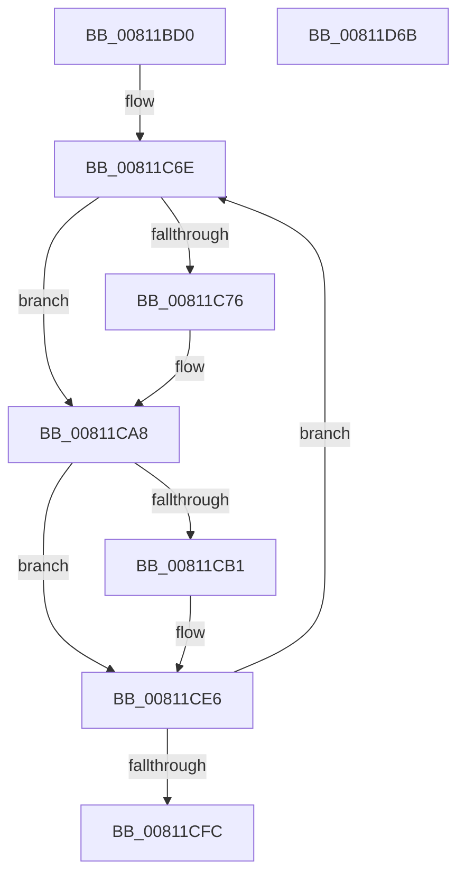

# sub_00811BD0

- RVA: `0x00811BD0`–`0x00811D6C` (길이 `412` bytes)
- VA: `0x0000000140811BD0`
- 실행 섹션: `PAGE`
- PDB 이름 있음: `아니요`; PDB Function 태그: `아니요`
- unwind 정보 RVA: `0x000D0410`
- 디코드: `117`개 명령, `412/412` bytes 표시
- 미해석 바이트: `0` (있으면 어셈블리에 `.byte`로 보존)

> 이 문서는 커널 이미지의 기계어와 PDB 기호를 분석해 생성했습니다. 4번과 5번은 함수 원형과 자료형을 바이너리 사용 방식에서 추정한 C 해석이며 원본 소스 복구 결과는 아닙니다.

## 1. Dependencies

- 직접 호출 지점: **3**; 고유 호출 대상: **2**
- 직접 호출자로 확인된 함수: **1**
- RIP 상대 이미지 참조: **5**

### Outgoing calls
- `0x00811CA1` → [guard_dispatch_icall](../../text/6B/guard_dispatch_icall_function_006BAAD0.md) (function, `0x006BAAD0`)
- `0x00811CDF` → [guard_dispatch_icall](../../text/6B/guard_dispatch_icall_function_006BAAD0.md) (function, `0x006BAAD0`)
- `0x00811D48` → [_security_check_cookie](../../text/6A/_security_check_cookie_function_006AC640.md) (function, `0x006AC640`)

### Direct callers
- [sub_00811B84](Unknown_function_00811B84.md) at `0x00811BAC`

### Static image references
- `0x00811BEF` → RVA `0x00E0A740` (`.data`; read)
- `0x00811C00` → RVA `0x00FD8D10` (`PAGEDATA`; read)
- `0x00811C07` → RVA `0x00FD8290` (`PAGEDATA`; read)
- `0x00811C0E` → RVA `0x00FD8C92` (`PAGEDATA`; read)
- `0x00811C19` → RVA `0x00FD84C0` (`PAGEDATA`; read)

## 2. Other-region calls and transfers

- 다른 실행 섹션으로 향하는 call: **3**
  - `0x00811CA1` → [guard_dispatch_icall](../../text/6B/guard_dispatch_icall_function_006BAAD0.md) (`PAGE` → `.text`)
  - `0x00811CDF` → [guard_dispatch_icall](../../text/6B/guard_dispatch_icall_function_006BAAD0.md) (`PAGE` → `.text`)
  - `0x00811D48` → [_security_check_cookie](../../text/6A/_security_check_cookie_function_006AC640.md) (`PAGE` → `.text`)
- 별도 외부 분기/꼬리 이동을 확인하지 못했습니다.

## 3. Assembly (complete function range)

```asm
00811BD0  48 89 5C 24 10                  mov qword ptr [rsp + 0x10], rbx
00811BD5  48 89 74 24 18                  mov qword ptr [rsp + 0x18], rsi
00811BDA  48 89 7C 24 20                  mov qword ptr [rsp + 0x20], rdi
00811BDF  55                              push rbp
00811BE0  41 54                           push r12
00811BE2  41 55                           push r13
00811BE4  41 56                           push r14
00811BE6  41 57                           push r15
00811BE8  48 8B EC                        mov rbp, rsp
00811BEB  48 83 EC 60                     sub rsp, 0x60
00811BEF  48 8B 05 4A 8B 5F 00            mov rax, qword ptr [rip + 0x5f8b4a]
00811BF6  48 33 C4                        xor rax, rsp
00811BF9  48 89 45 F8                     mov qword ptr [rbp - 8], rax
00811BFD  48 8B 01                        mov rax, qword ptr [rcx]
00811C00  4C 8D 35 09 71 7C 00            lea r14, [rip + 0x7c7109]
00811C07  48 8B 15 82 66 7C 00            mov rdx, qword ptr [rip + 0x7c6682]
00811C0E  48 8D 35 7D 70 7C 00            lea rsi, [rip + 0x7c707d]
00811C15  48 89 45 F0                     mov qword ptr [rbp - 0x10], rax
00811C19  4C 8D 2D A0 68 7C 00            lea r13, [rip + 0x7c68a0]
00811C20  0F B6 5D F4                     movzx ebx, byte ptr [rbp - 0xc]
00811C24  C1 E3 08                        shl ebx, 8
00811C27  0F B6 F8                        movzx edi, al
00811C2A  0F B6 45 F1                     movzx eax, byte ptr [rbp - 0xf]
00811C2E  C1 E7 08                        shl edi, 8
00811C31  0B F8                           or edi, eax
00811C33  48 89 4D E0                     mov qword ptr [rbp - 0x20], rcx
00811C37  0F B6 4D F6                     movzx ecx, byte ptr [rbp - 0xa]
00811C3B  0F B6 45 F2                     movzx eax, byte ptr [rbp - 0xe]
00811C3F  C1 E7 08                        shl edi, 8
00811C42  0B F8                           or edi, eax
00811C44  48 89 55 E8                     mov qword ptr [rbp - 0x18], rdx
00811C48  0F B6 55 F5                     movzx edx, byte ptr [rbp - 0xb]
00811C4C  0F B6 45 F3                     movzx eax, byte ptr [rbp - 0xd]
00811C50  0B DA                           or ebx, edx
00811C52  C1 E3 08                        shl ebx, 8
00811C55  0B D9                           or ebx, ecx
00811C57  C1 E7 08                        shl edi, 8
00811C5A  0F B6 4D F7                     movzx ecx, byte ptr [rbp - 9]
00811C5E  0B F8                           or edi, eax
00811C60  C1 E3 08                        shl ebx, 8
00811C63  0B D9                           or ebx, ecx
00811C65  45 33 FF                        xor r15d, r15d
00811C68  F7 D3                           not ebx
00811C6A  45 8D 67 10                     lea r12d, [r15 + 0x10]
00811C6E  41 0F B6 06                     movzx eax, byte ptr [r14]
00811C72  3C 1F                           cmp al, 0x1f
00811C74  73 32                           jae 0x140811ca8
00811C76  0F B6 4E 01                     movzx ecx, byte ptr [rsi + 1]
00811C7A  4C 8D 55 E8                     lea r10, [rbp - 0x18]
00811C7E  49 8B 44 C5 00                  mov rax, qword ptr [r13 + rax*8]
00811C83  44 0F B6 0E                     movzx r9d, byte ptr [rsi]
00811C87  44 0F B6 46 FF                  movzx r8d, byte ptr [rsi - 1]
00811C8C  0F B6 56 FE                     movzx edx, byte ptr [rsi - 2]
00811C90  89 5C 24 30                     mov dword ptr [rsp + 0x30], ebx
00811C94  4C 89 54 24 28                  mov qword ptr [rsp + 0x28], r10
00811C99  48 89 4C 24 20                  mov qword ptr [rsp + 0x20], rcx
00811C9E  49 8B CF                        mov rcx, r15
00811CA1  E8 2A 8E EA FF                  call 0x1406baad0
00811CA6  33 F8                           xor edi, eax
00811CA8  41 0F B6 46 01                  movzx eax, byte ptr [r14 + 1]
00811CAD  3C 1F                           cmp al, 0x1f
00811CAF  73 35                           jae 0x140811ce6
00811CB1  44 0F B6 56 05                  movzx r10d, byte ptr [rsi + 5]
00811CB6  4C 8D 5D E8                     lea r11, [rbp - 0x18]
00811CBA  49 8B 44 C5 00                  mov rax, qword ptr [r13 + rax*8]
00811CBF  49 8D 4F 01                     lea rcx, [r15 + 1]
00811CC3  44 0F B6 4E 04                  movzx r9d, byte ptr [rsi + 4]
00811CC8  44 0F B6 46 03                  movzx r8d, byte ptr [rsi + 3]
00811CCD  0F B6 56 02                     movzx edx, byte ptr [rsi + 2]
00811CD1  89 7C 24 30                     mov dword ptr [rsp + 0x30], edi
00811CD5  4C 89 5C 24 28                  mov qword ptr [rsp + 0x28], r11
00811CDA  4C 89 54 24 20                  mov qword ptr [rsp + 0x20], r10
00811CDF  E8 EC 8D EA FF                  call 0x1406baad0
00811CE4  33 D8                           xor ebx, eax
00811CE6  49 83 C7 02                     add r15, 2
00811CEA  49 83 C6 02                     add r14, 2
00811CEE  48 83 C6 08                     add rsi, 8
00811CF2  49 83 EC 01                     sub r12, 1
00811CF6  0F 85 72 FF FF FF               jne 0x140811c6e
00811CFC  4C 8B 6D E0                     mov r13, qword ptr [rbp - 0x20]
00811D00  8B C3                           mov eax, ebx
00811D02  C1 E0 18                        shl eax, 0x18
00811D05  8B CF                           mov ecx, edi
00811D07  C1 E1 18                        shl ecx, 0x18
00811D0A  40 88 7D F3                     mov byte ptr [rbp - 0xd], dil
00811D0E  C1 EF 08                        shr edi, 8
00811D11  0B CF                           or ecx, edi
00811D13  88 5D F7                        mov byte ptr [rbp - 9], bl
00811D16  88 4D F2                        mov byte ptr [rbp - 0xe], cl
00811D19  C1 C9 08                        ror ecx, 8
00811D1C  C1 EB 08                        shr ebx, 8
00811D1F  0B C3                           or eax, ebx
00811D21  88 4D F1                        mov byte ptr [rbp - 0xf], cl
00811D24  88 45 F6                        mov byte ptr [rbp - 0xa], al
00811D27  C1 C8 08                        ror eax, 8
00811D2A  C1 C9 08                        ror ecx, 8
00811D2D  88 45 F5                        mov byte ptr [rbp - 0xb], al
00811D30  C1 C8 08                        ror eax, 8
00811D33  88 45 F4                        mov byte ptr [rbp - 0xc], al
00811D36  88 4D F0                        mov byte ptr [rbp - 0x10], cl
00811D39  48 8B 45 F0                     mov rax, qword ptr [rbp - 0x10]
00811D3D  49 89 45 00                     mov qword ptr [r13], rax
00811D41  48 8B 4D F8                     mov rcx, qword ptr [rbp - 8]
00811D45  48 33 CC                        xor rcx, rsp
00811D48  E8 F3 A8 E9 FF                  call 0x1406ac640
00811D4D  4C 8D 5C 24 60                  lea r11, [rsp + 0x60]
00811D52  49 8B 5B 38                     mov rbx, qword ptr [r11 + 0x38]
00811D56  49 8B 73 40                     mov rsi, qword ptr [r11 + 0x40]
00811D5A  49 8B 7B 48                     mov rdi, qword ptr [r11 + 0x48]
00811D5E  49 8B E3                        mov rsp, r11
00811D61  41 5F                           pop r15
00811D63  41 5E                           pop r14
00811D65  41 5D                           pop r13
00811D67  41 5C                           pop r12
00811D69  5D                              pop rbp
00811D6A  C3                              ret
00811D6B  CC                              int3
```

## 4. C-style interpretation (structured pseudocode)

```c
__int64 __fastcall sub_00811BD0(__int64 a1)
{
    __int64 result;
    __int64 v_r10;
    __int64 v_r11;
    __int64 v_r12;
    __int64 v_r14;
    __int64 v_r15;
    __int64 v_rbx;
    __int64 v_rdi;
    __int64 v_rsi;
    __int64 v_rsp;
    unsigned __int64 v_stack_m28;
    unsigned __int64 v_stack_m30;
    unsigned __int8 v_stack_m31;
    unsigned __int8 v_stack_m32;
    unsigned __int8 v_stack_m33;
    unsigned __int8 v_stack_m34;
    unsigned __int8 v_stack_m35;
    unsigned __int8 v_stack_m36;
    unsigned __int8 v_stack_m37;
    unsigned __int64 v_stack_m38;
    unsigned __int64 v_stack_m40;
    unsigned __int64 v_stack_m48;
    unsigned int v_stack_m58;
    unsigned __int64 v_stack_m60;
    unsigned __int64 v_stack_m68;
    unsigned __int64 v_stack_p10;
    unsigned __int64 v_stack_p18;
    unsigned __int64 v_stack_p20;

    v_stack_p10 = v_rbx;
    v_stack_p18 = v_rsi;
    v_stack_p20 = v_rdi;
    v_rsp = (v_rsp) - (96);
    result = (*(unsigned __int64 *)(v_rip + 6261578)) ^ (v_rsp);
    v_stack_m30 = result;
    v_stack_m38 = *(unsigned __int64 *)(a1);
    v_rbx = (unsigned int)((v_stack_m34) << (8));
    v_rdi = (unsigned int)(((unsigned __int8)(*(unsigned __int64 *)(a1))) << (8));
    v_rdi = (unsigned int)((v_rdi) | ((unsigned int)(v_stack_m37)));
    v_stack_m48 = a1;
    v_rdi = (unsigned int)((v_rdi) << (8));
    v_rdi = (unsigned int)((v_rdi) | ((unsigned int)(v_stack_m36)));
    v_stack_m40 = *(unsigned __int64 *)(v_rip + 8152706);
    v_rbx = (unsigned int)((v_rbx) | ((unsigned int)(v_stack_m33)));
    v_rbx = (unsigned int)((v_rbx) << (8));
    v_rbx = (unsigned int)((v_rbx) | ((unsigned int)(v_stack_m32)));
    v_rdi = (unsigned int)((v_rdi) << (8));
    v_rdi = (unsigned int)((v_rdi) | ((unsigned int)(v_stack_m35)));
    v_rbx = (unsigned int)((v_rbx) << (8));
    v_rbx = (unsigned int)((v_rbx) | ((unsigned int)(v_stack_m31)));
    v_r15 = 0;
    v_rbx = (unsigned int)(~(v_rbx));
loc_00811C6E:
    result = *(unsigned __int8 *)(v_rip + 8155401);
    if (((unsigned __int8)(*(unsigned __int8 *)(v_rip + 8155401))) < 31) {
        a1 = *(unsigned __int8 *)(v_rip + 8155261 + 1);
        v_r10 = v_stack_m40;
        result = *(unsigned __int64 *)(v_rip + 8153248 + *(unsigned __int8 *)(v_rip + 8155401) * 8);
        a4 = *(unsigned __int8 *)(v_rip + 8155261);
        a3 = *(unsigned __int8 *)(v_rip + 8155261 - 1);
        a2 = *(unsigned __int8 *)(v_rip + 8155261 - 2);
        v_stack_m58 = (unsigned int)(v_rbx);
        v_stack_m60 = v_r10;
        v_stack_m68 = a1;
        a1 = 0;
        result = guard_dispatch_icall(a1, a2, a3, a4);
        v_rdi = (unsigned int)((v_rdi) ^ ((unsigned int)(result)));
    }
    result = *(unsigned __int8 *)(v_rip + 8155401 + 1);
    if (((unsigned __int8)(*(unsigned __int8 *)(v_rip + 8155401 + 1))) < 31) {
        v_r10 = *(unsigned __int8 *)(v_rip + 8155261 + 5);
        v_r11 = v_stack_m40;
        result = *(unsigned __int64 *)(v_rip + 8153248 + *(unsigned __int8 *)(v_rip + 8155401 + 1) * 8);
        a1 = v_r15 + 1;
        a4 = *(unsigned __int8 *)(v_rip + 8155261 + 4);
        a3 = *(unsigned __int8 *)(v_rip + 8155261 + 3);
        a2 = *(unsigned __int8 *)(v_rip + 8155261 + 2);
        v_stack_m58 = (unsigned int)(v_rdi);
        v_stack_m60 = v_r11;
        v_stack_m68 = v_r10;
        result = guard_dispatch_icall(a1, a2, a3, a4);
        v_rbx = (unsigned int)((v_rbx) ^ ((unsigned int)(result)));
    }
    v_r15 = (v_r15) + (2);
    v_r14 = (v_rip + 8155401) + (2);
    v_rsi = (v_rip + 8155261) + (8);
    v_r12 = (v_r15 + 16) - (1);
    if (condition_is_not_equal) goto loc_00811C6E;
    result = (unsigned int)(((unsigned int)((unsigned int)(v_rbx))) << (24));
    a1 = (unsigned int)(((unsigned int)((unsigned int)(v_rdi))) << (24));
    v_stack_m35 = (unsigned __int8)(v_rdi);
    v_rdi = (unsigned int)((v_rdi) >> (8));
    a1 = (unsigned int)((a1) | ((unsigned int)(v_rdi)));
    v_stack_m31 = (unsigned __int8)(v_rbx);
    v_stack_m36 = (unsigned __int8)(a1);
    v_rbx = (unsigned int)((v_rbx) >> (8));
    result = (unsigned int)((result) | ((unsigned int)(v_rbx)));
    v_stack_m37 = (unsigned __int8)(a1);
    v_stack_m32 = (unsigned __int8)(result);
    v_stack_m33 = (unsigned __int8)(result);
    v_stack_m34 = (unsigned __int8)(result);
    v_stack_m38 = (unsigned __int8)(a1);
    *(unsigned __int64 *)(v_stack_m48) = v_stack_m38;
    a1 = (v_stack_m30) ^ (v_rsp);
    result = _security_check_cookie(a1, a2, a3, a4);
    return result;
}
```

## 5. (Beta) C Style

```c
int64_t sub_00811BD0(void *Arg1)
{
    uint8_t *arg1 = (uint8_t *)Arg1;

    int64_t result;
    int64_t local_r10;
    int64_t local_r11;
    int64_t local_r12;
    int64_t local_r14;
    int64_t local_r15;
    int64_t local_rbx;
    int64_t local_rdi;
    int64_t local_rsi;
    int64_t local_rsp;
    uint64_t v_stack_m28;
    uint64_t v_stack_m30;
    uint8_t v_stack_m31;
    uint8_t v_stack_m32;
    uint8_t v_stack_m33;
    uint8_t v_stack_m34;
    uint8_t v_stack_m35;
    uint8_t v_stack_m36;
    uint8_t v_stack_m37;
    uint64_t v_stack_m38;
    uint64_t v_stack_m40;
    uint64_t v_stack_m48;
    uint32_t v_stack_m58;
    uint64_t v_stack_m60;
    uint64_t v_stack_m68;
    uint64_t v_stack_p10;
    uint64_t v_stack_p18;
    uint64_t v_stack_p20;

    v_stack_p10 = local_rbx;
    v_stack_p18 = local_rsi;
    v_stack_p20 = local_rdi;
    local_rsp = (local_rsp) - (96);
    result = (*(uint64_t *)(v_rip + 0x5F8B4A)) ^ (local_rsp);
    v_stack_m30 = result;
    v_stack_m38 = *(uint64_t *)(arg1);
    local_rbx = (uint32_t)((v_stack_m34) << (8));
    local_rdi = (uint32_t)(((uint8_t)(*(uint64_t *)(arg1))) << (8));
    local_rdi = (uint32_t)((local_rdi) | ((uint32_t)(v_stack_m37)));
    v_stack_m48 = Arg1;
    local_rdi = (uint32_t)((local_rdi) << (8));
    local_rdi = (uint32_t)((local_rdi) | ((uint32_t)(v_stack_m36)));
    v_stack_m40 = *(uint64_t *)(v_rip + 0x7C6682);
    local_rbx = (uint32_t)((local_rbx) | ((uint32_t)(v_stack_m33)));
    local_rbx = (uint32_t)((local_rbx) << (8));
    local_rbx = (uint32_t)((local_rbx) | ((uint32_t)(v_stack_m32)));
    local_rdi = (uint32_t)((local_rdi) << (8));
    local_rdi = (uint32_t)((local_rdi) | ((uint32_t)(v_stack_m35)));
    local_rbx = (uint32_t)((local_rbx) << (8));
    local_rbx = (uint32_t)((local_rbx) | ((uint32_t)(v_stack_m31)));
    local_r15 = 0;
    local_rbx = (uint32_t)(~(local_rbx));
loc_00811C6E:
    result = *(uint8_t *)(v_rip + 0x7C7109);
    if (((uint8_t)(*(uint8_t *)(v_rip + 0x7C7109))) < 31) {
        Arg1 = *(uint8_t *)(v_rip + 0x7C707D + 0x1);
        local_r10 = v_stack_m40;
        result = *(uint64_t *)(v_rip + 0x7C68A0 + *(uint8_t *)(v_rip + 0x7C7109) * 8);
        a4 = *(uint8_t *)(v_rip + 0x7C707D);
        a3 = *(uint8_t *)(v_rip + 0x7C707D - 0x1);
        a2 = *(uint8_t *)(v_rip + 0x7C707D - 0x2);
        v_stack_m58 = (uint32_t)(local_rbx);
        v_stack_m60 = local_r10;
        v_stack_m68 = Arg1;
        Arg1 = 0;
        result = guard_dispatch_icall(Arg1, a2, a3, a4);
        local_rdi = (uint32_t)((local_rdi) ^ ((uint32_t)(result)));
    }
    result = *(uint8_t *)(v_rip + 0x7C7109 + 0x1);
    if (((uint8_t)(*(uint8_t *)(v_rip + 0x7C7109 + 0x1))) < 31) {
        local_r10 = *(uint8_t *)(v_rip + 0x7C707D + 0x5);
        local_r11 = v_stack_m40;
        result = *(uint64_t *)(v_rip + 0x7C68A0 + *(uint8_t *)(v_rip + 0x7C7109 + 0x1) * 8);
        Arg1 = local_r15 + 1;
        a4 = *(uint8_t *)(v_rip + 0x7C707D + 0x4);
        a3 = *(uint8_t *)(v_rip + 0x7C707D + 0x3);
        a2 = *(uint8_t *)(v_rip + 0x7C707D + 0x2);
        v_stack_m58 = (uint32_t)(local_rdi);
        v_stack_m60 = local_r11;
        v_stack_m68 = local_r10;
        result = guard_dispatch_icall(Arg1, a2, a3, a4);
        local_rbx = (uint32_t)((local_rbx) ^ ((uint32_t)(result)));
    }
    local_r15 = (local_r15) + (2);
    local_r14 = (v_rip + 8155401) + (2);
    local_rsi = (v_rip + 8155261) + (8);
    local_r12 = (local_r15 + 16) - (1);
    if (condition_is_not_equal) goto loc_00811C6E;
    result = (uint32_t)(((uint32_t)((uint32_t)(local_rbx))) << (24));
    Arg1 = (uint32_t)(((uint32_t)((uint32_t)(local_rdi))) << (24));
    v_stack_m35 = (uint8_t)(local_rdi);
    local_rdi = (uint32_t)((local_rdi) >> (8));
    Arg1 = (uint32_t)((Arg1) | ((uint32_t)(local_rdi)));
    v_stack_m31 = (uint8_t)(local_rbx);
    v_stack_m36 = (uint8_t)(Arg1);
    local_rbx = (uint32_t)((local_rbx) >> (8));
    result = (uint32_t)((result) | ((uint32_t)(local_rbx)));
    v_stack_m37 = (uint8_t)(Arg1);
    v_stack_m32 = (uint8_t)(result);
    v_stack_m33 = (uint8_t)(result);
    v_stack_m34 = (uint8_t)(result);
    v_stack_m38 = (uint8_t)(Arg1);
    *(uint64_t *)(v_stack_m48) = v_stack_m38;
    Arg1 = (v_stack_m30) ^ (local_rsp);
    result = _security_check_cookie(Arg1, a2, a3, a4);
    return result;
}
```

### 관측된 메모리 오프셋

구조체 형식이 확인되지 않은 접근은 인자 기준의 오프셋으로만 기록했습니다.

| 기준 인자 | 오프셋 표현 | 폭 (bit) | 접근 |
|---|---:|---:|---|
| `Arg1` | `+ 0x0` | `64` | `R` |

## 6. Execution-region graph

[열기: 2D/3D 그래프와 함수 탐색 컨트롤 패널](../../../control-panel.html?section=page&rva=0x00811BD0&view=graph)

- 2D 그래프는 위에서 아래로 흐르고, 3D 그래프는 빈 공간을 드래그해 회전합니다. Shift+드래그는 이동, 휠은 확대·축소, 함수 노드 선택은 대상 보고서 이동입니다.

### Static fallback


