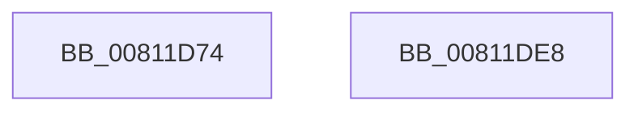

# sub_00811D74

- RVA: `0x00811D74`–`0x00811DE9` (길이 `117` bytes)
- VA: `0x0000000140811D74`
- 실행 섹션: `PAGE`
- PDB 이름 있음: `아니요`; PDB Function 태그: `아니요`
- unwind 정보 RVA: `0x0005C788`
- 디코드: `20`개 명령, `117/117` bytes 표시
- 미해석 바이트: `0` (있으면 어셈블리에 `.byte`로 보존)

> 이 문서는 커널 이미지의 기계어와 PDB 기호를 분석해 생성했습니다. 4번과 5번은 함수 원형과 자료형을 바이너리 사용 방식에서 추정한 C 해석이며 원본 소스 복구 결과는 아닙니다.

## 1. Dependencies

- 직접 호출 지점: **1**; 고유 호출 대상: **1**
- 직접 호출자로 확인된 함수: **1**
- RIP 상대 이미지 참조: **12**

### Outgoing calls
- `0x00811DDE` → [BCryptOpenAlgorithmProvider](../AB/BCryptOpenAlgorithmProvider_function_00ABF200.md) (function, `0x00ABF200`)

### Direct callers
- [ClipInitHandles](../../text/65/ClipInitHandles_function_00657600.md) at `0x00657651`

### Static image references
- `0x00811D7A` → RVA `0x00E3EA58` (`.data`; write)
- `0x00811D85` → RVA `0x00E3EA48` (`.data`; write)
- `0x00811D8C` → RVA `0x008D3ED0` (`PAGE`; read)
- `0x00811D93` → RVA `0x00E3EA74` (`.data`; write)
- `0x00811D9A` → RVA `0x0003B048` (`.rdata`; read)
- `0x00811DA1` → RVA `0x00E3EA7C` (`.data`; write)
- `0x00811DAA` → RVA `0x00E3EA50` (`.data`; write)
- `0x00811DB4` → RVA `0x00E3EA68` (`.data`; write)
- `0x00811DBB` → RVA `0x00E3EA78` (`.data`; read)
- `0x00811DC2` → RVA `0x00E3EA70` (`.data`; write)
- `0x00811DCC` → RVA `0x00E3EA40` (`.data`; write)
- `0x00811DD7` → RVA `0x00E3EA60` (`.data`; write)

## 2. Other-region calls and transfers

- 다른 실행 섹션으로 향하는 call: **0**
- 별도 외부 분기/꼬리 이동을 확인하지 못했습니다.

## 3. Assembly (complete function range)

```asm
00811D74  48 83 EC 28                     sub rsp, 0x28
00811D78  33 C9                           xor ecx, ecx
00811D7A  48 C7 05 D3 CC 62 00 0A 00 00 00  mov qword ptr [rip + 0x62ccd3], 0xa
00811D85  48 89 0D BC CC 62 00            mov qword ptr [rip + 0x62ccbc], rcx
00811D8C  48 8D 05 3D 21 0C 00            lea rax, [rip + 0xc213d]
00811D93  48 89 0D DA CC 62 00            mov qword ptr [rip + 0x62ccda], rcx
00811D9A  48 8D 15 A7 92 82 FF            lea rdx, [rip - 0x7d6d59]
00811DA1  89 0D D5 CC 62 00               mov dword ptr [rip + 0x62ccd5], ecx
00811DA7  45 33 C9                        xor r9d, r9d
00811DAA  48 89 0D 9F CC 62 00            mov qword ptr [rip + 0x62cc9f], rcx
00811DB1  45 33 C0                        xor r8d, r8d
00811DB4  48 89 0D AD CC 62 00            mov qword ptr [rip + 0x62ccad], rcx
00811DBB  48 8D 0D B6 CC 62 00            lea rcx, [rip + 0x62ccb6]
00811DC2  C7 05 A4 CC 62 00 36 00 00 00   mov dword ptr [rip + 0x62cca4], 0x36
00811DCC  48 C7 05 69 CC 62 00 08 00 00 00  mov qword ptr [rip + 0x62cc69], 8
00811DD7  48 89 05 82 CC 62 00            mov qword ptr [rip + 0x62cc82], rax
00811DDE  E8 1D D4 2A 00                  call 0x140abf200
00811DE3  48 83 C4 28                     add rsp, 0x28
00811DE7  C3                              ret
00811DE8  CC                              int3
```

## 4. C-style interpretation (structured pseudocode)

```c
__int64 __fastcall sub_00811D74(int a1, __int64 a2, int a3, int a4)
{
    __int64 result;
    __int64 v_rsp;

    v_rsp = (v_rsp) - (40);
    a1 = 0;
    *(unsigned __int64 *)(v_rip + 6474963) = 10;
    *(unsigned __int64 *)(v_rip + 6474940) = 0;
    *(unsigned __int64 *)(v_rip + 6474970) = 0;
    *(unsigned int *)(v_rip + 6474965) = 0;
    a4 = 0;
    *(unsigned __int64 *)(v_rip + 6474911) = 0;
    a3 = 0;
    *(unsigned __int64 *)(v_rip + 6474925) = 0;
    *(unsigned int *)(v_rip + 6474916) = 54;
    *(unsigned __int64 *)(v_rip + 6474857) = 8;
    *(unsigned __int64 *)(v_rip + 6474882) = v_rip + 794941;
    result = BCryptOpenAlgorithmProvider(v_rip + 6474934, v_rip - 8219993, a3, a4);
    v_rsp = (v_rsp) + (40);
    return result;
}
```

## 5. (Beta) C Style

```c
int64_t sub_00811D74(int32_t Arg1, int64_t Arg2, int32_t Arg3, int32_t Arg4)
{
    int64_t result;
    int64_t local_rsp;

    local_rsp = (local_rsp) - (40);
    Arg1 = 0;
    *(uint64_t *)(v_rip + 0x62CCD3) = 10;
    *(uint64_t *)(v_rip + 0x62CCBC) = 0;
    *(uint64_t *)(v_rip + 0x62CCDA) = 0;
    *(uint32_t *)(v_rip + 0x62CCD5) = 0;
    Arg4 = 0;
    *(uint64_t *)(v_rip + 0x62CC9F) = 0;
    Arg3 = 0;
    *(uint64_t *)(v_rip + 0x62CCAD) = 0;
    *(uint32_t *)(v_rip + 0x62CCA4) = 54;
    *(uint64_t *)(v_rip + 0x62CC69) = 8;
    *(uint64_t *)(v_rip + 0x62CC82) = v_rip + 794941;
    result = BCryptOpenAlgorithmProvider(v_rip + 6474934, v_rip - 8219993, Arg3, Arg4);
    local_rsp = (local_rsp) + (40);
    return result;
}
```

## 6. Execution-region graph

[열기: 2D/3D 그래프와 함수 탐색 컨트롤 패널](../../../control-panel.html?section=page&rva=0x00811D74&view=graph)

- 2D 그래프는 위에서 아래로 흐르고, 3D 그래프는 빈 공간을 드래그해 회전합니다. Shift+드래그는 이동, 휠은 확대·축소, 함수 노드 선택은 대상 보고서 이동입니다.

### Static fallback


