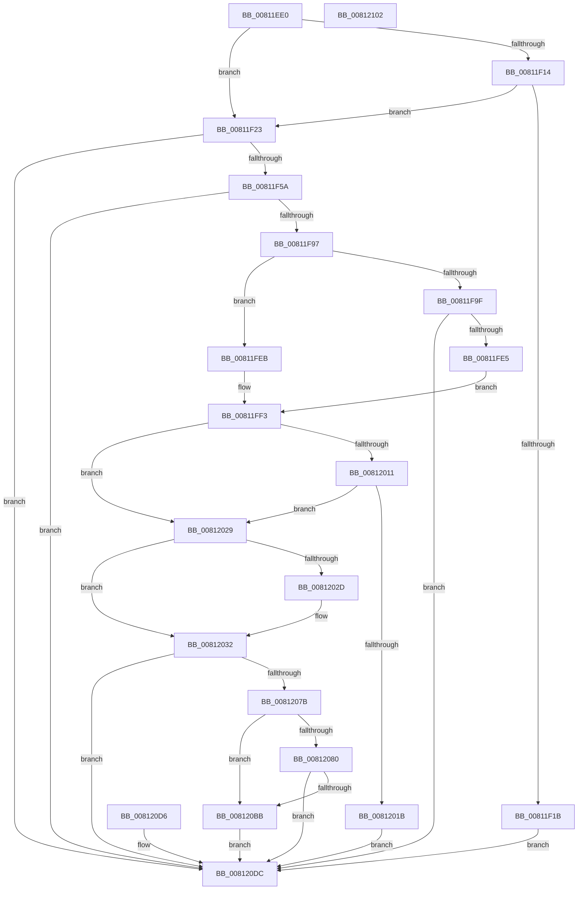

# sub_00811EE0

- RVA: `0x00811EE0`–`0x00812103` (길이 `547` bytes)
- VA: `0x0000000140811EE0`
- 실행 섹션: `PAGE`
- PDB 이름 있음: `아니요`; PDB Function 태그: `아니요`
- unwind 정보 RVA: `0x000D9860`
- 디코드: `158`개 명령, `547/547` bytes 표시
- 미해석 바이트: `0` (있으면 어셈블리에 `.byte`로 보존)

> 이 문서는 커널 이미지의 기계어와 PDB 기호를 분석해 생성했습니다. 4번과 5번은 함수 원형과 자료형을 바이너리 사용 방식에서 추정한 C 해석이며 원본 소스 복구 결과는 아닙니다.

## 1. Dependencies

- 직접 호출 지점: **8**; 고유 호출 대상: **7**
- 직접 호출자로 확인된 함수: **1**
- RIP 상대 이미지 참조: **0**

### Outgoing calls
- `0x00811F4B` → [sub_009A13B8](../9A/Unknown_function_009A13B8.md) (function, `0x009A13B8`)
- `0x00811F84` → [sub_009A14C8](../9A/Unknown_function_009A14C8.md) (function, `0x009A14C8`)
- `0x00811FD2` → [sub_00486B70](../../text/48/Unknown_function_00486B70.md) (function, `0x00486B70`)
- `0x00812005` → [memcpy](../../text/6C/memcpy_function_006C6840.md) (function, `0x006C6840`)
- `0x0081206C` → [sub_00A34F4C](../A3/Unknown_function_00A34F4C.md) (function, `0x00A34F4C`)
- `0x008120AC` → [sub_00486B70](../../text/48/Unknown_function_00486B70.md) (function, `0x00486B70`)
- `0x008120CD` → [ZwFlushInstructionCache](../../text/6A/ZwFlushInstructionCache_function_006AEEF0.md) (function, `0x006AEEF0`)
- `0x008120E1` → [sub_009A1390](../9A/Unknown_function_009A1390.md) (function, `0x009A1390`)

### Direct callers
- [sub_009A0DF0](../9A/Unknown_function_009A0DF0.md) at `0x009A0EB6`

### Static image references
- 디코드된 RIP-relative 메모리 참조가 없습니다.

## 2. Other-region calls and transfers

- 다른 실행 섹션으로 향하는 call: **4**
  - `0x00811FD2` → [sub_00486B70](../../text/48/Unknown_function_00486B70.md) (`PAGE` → `.text`)
  - `0x00812005` → [memcpy](../../text/6C/memcpy_function_006C6840.md) (`PAGE` → `.text`)
  - `0x008120AC` → [sub_00486B70](../../text/48/Unknown_function_00486B70.md) (`PAGE` → `.text`)
  - `0x008120CD` → [ZwFlushInstructionCache](../../text/6A/ZwFlushInstructionCache_function_006AEEF0.md) (`PAGE` → `.text`)
- 별도 외부 분기/꼬리 이동을 확인하지 못했습니다.

## 3. Assembly (complete function range)

```asm
00811EE0  48 8B C4                        mov rax, rsp
00811EE3  48 89 58 08                     mov qword ptr [rax + 8], rbx
00811EE7  48 89 70 18                     mov qword ptr [rax + 0x18], rsi
00811EEB  57                              push rdi
00811EEC  41 54                           push r12
00811EEE  41 55                           push r13
00811EF0  41 56                           push r14
00811EF2  41 57                           push r15
00811EF4  48 83 EC 70                     sub rsp, 0x70
00811EF8  49 8B F8                        mov rdi, r8
00811EFB  44 8B EA                        mov r13d, edx
00811EFE  4C 8B F1                        mov r14, rcx
00811F01  45 33 FF                        xor r15d, r15d
00811F04  4C 89 78 20                     mov qword ptr [rax + 0x20], r15
00811F08  4C 89 78 C0                     mov qword ptr [rax - 0x40], r15
00811F0C  44 88 78 10                     mov byte ptr [rax + 0x10], r15b
00811F10  85 D2                           test edx, edx
00811F12  74 0F                           je 0x140811f23
00811F14  41 8B 00                        mov eax, dword ptr [r8]
00811F17  A8 01                           test al, 1
00811F19  74 08                           je 0x140811f23
00811F1B  41 8B DF                        mov ebx, r15d
00811F1E  E9 B9 01 00 00                  jmp 0x1408120dc
00811F23  45 8B 60 04                     mov r12d, dword ptr [r8 + 4]
00811F27  B8 FF FF FF 0F                  mov eax, 0xfffffff
00811F2C  4C 23 E0                        and r12, rax
00811F2F  4C 03 61 20                     add r12, qword ptr [rcx + 0x20]
00811F33  49 8D 70 08                     lea rsi, [r8 + 8]
00811F37  45 8B 00                        mov r8d, dword ptr [r8]
00811F3A  41 D1 E8                        shr r8d, 1
00811F3D  41 F7 D0                        not r8d
00811F40  41 83 E0 01                     and r8d, 1
00811F44  8B 16                           mov edx, dword ptr [rsi]
00811F46  23 D0                           and edx, eax
00811F48  49 8B CC                        mov rcx, r12
00811F4B  E8 68 F4 18 00                  call 0x1409a13b8
00811F50  8B D8                           mov ebx, eax
00811F52  85 C0                           test eax, eax
00811F54  0F 88 82 01 00 00               js 0x1408120dc
00811F5A  44 8B 07                        mov r8d, dword ptr [rdi]
00811F5D  41 D1 E8                        shr r8d, 1
00811F60  41 F7 D0                        not r8d
00811F63  41 83 E0 01                     and r8d, 1
00811F67  8B 16                           mov edx, dword ptr [rsi]
00811F69  81 E2 FF FF FF 0F               and edx, 0xfffffff
00811F6F  48 8D 84 24 B8 00 00 00         lea rax, [rsp + 0xb8]
00811F77  48 89 44 24 20                  mov qword ptr [rsp + 0x20], rax
00811F7C  4C 8D 4C 24 58                  lea r9, [rsp + 0x58]
00811F81  49 8B CC                        mov rcx, r12
00811F84  E8 3F F5 18 00                  call 0x1409a14c8
00811F89  8B D8                           mov ebx, eax
00811F8B  89 44 24 54                     mov dword ptr [rsp + 0x54], eax
00811F8F  85 C0                           test eax, eax
00811F91  0F 88 45 01 00 00               js 0x1408120dc
00811F97  4C 8B FE                        mov r15, rsi
00811F9A  45 85 ED                        test r13d, r13d
00811F9D  74 4C                           je 0x140811feb
00811F9F  49 8B 56 38                     mov rdx, qword ptr [r14 + 0x38]
00811FA3  4D 8B 46 20                     mov r8, qword ptr [r14 + 0x20]
00811FA7  8B 06                           mov eax, dword ptr [rsi]
00811FA9  25 FF FF FF 0F                  and eax, 0xfffffff
00811FAE  4C 8B 4A 38                     mov r9, qword ptr [rdx + 0x38]
00811FB2  4D 2B C8                        sub r9, r8
00811FB5  89 44 24 30                     mov dword ptr [rsp + 0x30], eax
00811FB9  48 8B B4 24 B8 00 00 00         mov rsi, qword ptr [rsp + 0xb8]
00811FC1  48 89 74 24 28                  mov qword ptr [rsp + 0x28], rsi
00811FC6  4C 89 64 24 20                  mov qword ptr [rsp + 0x20], r12
00811FCB  8B 52 30                        mov edx, dword ptr [rdx + 0x30]
00811FCE  49 8B 4E 28                     mov rcx, qword ptr [r14 + 0x28]
00811FD2  E8 99 4B C7 FF                  call 0x140486b70
00811FD7  8B D8                           mov ebx, eax
00811FD9  89 44 24 54                     mov dword ptr [rsp + 0x54], eax
00811FDD  85 C0                           test eax, eax
00811FDF  0F 88 F7 00 00 00               js 0x1408120dc
00811FE5  4C 8D 7F 08                     lea r15, [rdi + 8]
00811FE9  EB 08                           jmp 0x140811ff3
00811FEB  48 8B B4 24 B8 00 00 00         mov rsi, qword ptr [rsp + 0xb8]
00811FF3  44 8B 47 08                     mov r8d, dword ptr [rdi + 8]
00811FF7  BB FF FF FF 0F                  mov ebx, 0xfffffff
00811FFC  4C 23 C3                        and r8, rbx
00811FFF  49 8B D4                        mov rdx, r12
00812002  48 8B CE                        mov rcx, rsi
00812005  E8 36 48 EB FF                  call 0x1406c6840
0081200A  8B 0F                           mov ecx, dword ptr [rdi]
0081200C  83 E1 02                        and ecx, 2
0081200F  75 18                           jne 0x140812029
00812011  41 8B 07                        mov eax, dword ptr [r15]
00812014  23 C3                           and eax, ebx
00812016  83 F8 04                        cmp eax, 4
00812019  73 0E                           jae 0x140812029
0081201B  BB 0D 00 00 C0                  mov ebx, 0xc000000d
00812020  89 5C 24 54                     mov dword ptr [rsp + 0x54], ebx
00812024  E9 B3 00 00 00                  jmp 0x1408120dc
00812029  85 C9                           test ecx, ecx
0081202B  75 05                           jne 0x140812032
0081202D  8B 47 0C                        mov eax, dword ptr [rdi + 0xc]
00812030  89 06                           mov dword ptr [rsi], eax
00812032  49 8B 46 38                     mov rax, qword ptr [r14 + 0x38]
00812036  48 8D 48 50                     lea rcx, [rax + 0x50]
0081203A  8B 57 04                        mov edx, dword ptr [rdi + 4]
0081203D  23 D3                           and edx, ebx
0081203F  48 83 C0 48                     add rax, 0x48
00812043  45 8B 0F                        mov r9d, dword ptr [r15]
00812046  44 23 CB                        and r9d, ebx
00812049  4C 8D 84 24 A8 00 00 00         lea r8, [rsp + 0xa8]
00812051  4C 89 44 24 40                  mov qword ptr [rsp + 0x40], r8
00812056  48 89 4C 24 30                  mov qword ptr [rsp + 0x30], rcx
0081205B  89 54 24 28                     mov dword ptr [rsp + 0x28], edx
0081205F  48 89 44 24 20                  mov qword ptr [rsp + 0x20], rax
00812064  4C 8B C6                        mov r8, rsi
00812067  48 8B D6                        mov rdx, rsi
0081206A  33 C9                           xor ecx, ecx
0081206C  E8 DB 2E 22 00                  call 0x140a34f4c
00812071  8B D8                           mov ebx, eax
00812073  89 44 24 54                     mov dword ptr [rsp + 0x54], eax
00812077  85 C0                           test eax, eax
00812079  78 61                           js 0x1408120dc
0081207B  45 85 ED                        test r13d, r13d
0081207E  74 3B                           je 0x1408120bb
00812080  49 8B 56 38                     mov rdx, qword ptr [r14 + 0x38]
00812084  4D 8B 46 20                     mov r8, qword ptr [r14 + 0x20]
00812088  41 8B 07                        mov eax, dword ptr [r15]
0081208B  25 FF FF FF 0F                  and eax, 0xfffffff
00812090  4D 8B C8                        mov r9, r8
00812093  4C 2B 4A 38                     sub r9, qword ptr [rdx + 0x38]
00812097  89 44 24 30                     mov dword ptr [rsp + 0x30], eax
0081209B  48 89 74 24 28                  mov qword ptr [rsp + 0x28], rsi
008120A0  4C 89 64 24 20                  mov qword ptr [rsp + 0x20], r12
008120A5  8B 52 30                        mov edx, dword ptr [rdx + 0x30]
008120A8  49 8B 4E 28                     mov rcx, qword ptr [r14 + 0x28]
008120AC  E8 BF 4A C7 FF                  call 0x140486b70
008120B1  8B D8                           mov ebx, eax
008120B3  89 44 24 54                     mov dword ptr [rsp + 0x54], eax
008120B7  85 C0                           test eax, eax
008120B9  78 21                           js 0x1408120dc
008120BB  44 8B 47 08                     mov r8d, dword ptr [rdi + 8]
008120BF  41 81 E0 FF FF FF 0F            and r8d, 0xfffffff
008120C6  49 8B D4                        mov rdx, r12
008120C9  48 83 C9 FF                     or rcx, 0xffffffffffffffff
008120CD  E8 1E CE E9 FF                  call 0x1406aeef0
008120D2  8B D8                           mov ebx, eax
008120D4  EB 06                           jmp 0x1408120dc
008120D6  8B D8                           mov ebx, eax
008120D8  89 44 24 54                     mov dword ptr [rsp + 0x54], eax
008120DC  48 8B 4C 24 58                  mov rcx, qword ptr [rsp + 0x58]
008120E1  E8 AA F2 18 00                  call 0x1409a1390
008120E6  8B C3                           mov eax, ebx
008120E8  4C 8D 5C 24 70                  lea r11, [rsp + 0x70]
008120ED  49 8B 5B 30                     mov rbx, qword ptr [r11 + 0x30]
008120F1  49 8B 73 40                     mov rsi, qword ptr [r11 + 0x40]
008120F5  49 8B E3                        mov rsp, r11
008120F8  41 5F                           pop r15
008120FA  41 5E                           pop r14
008120FC  41 5D                           pop r13
008120FE  41 5C                           pop r12
00812100  5F                              pop rdi
00812101  C3                              ret
00812102  CC                              int3
```

## 4. C-style interpretation (structured pseudocode)

```c
__int64 __fastcall sub_00811EE0(__int64 a1, int a2, __int64 a3)
{
    __int64 result;
    __int64 v_r12;
    __int64 v_r15;
    __int64 v_rsp;
    unsigned __int64 v_stack_m28;
    unsigned __int64 v_stack_m40;
    unsigned int v_stack_m44;
    unsigned __int64 v_stack_m58;
    unsigned int v_stack_m68;
    unsigned __int64 v_stack_m70;
    unsigned __int64 v_stack_m78;
    unsigned __int64 v_stack_p10;
    unsigned __int64 v_stack_p20;

    *(unsigned __int64 *)(v_rsp + 8) = v_rbx;
    *(unsigned __int64 *)(v_rsp + 24) = v_rsi;
    v_rsp = (v_rsp) - (112);
    v_r15 = 0;
    *(unsigned __int64 *)(v_rsp + 32) = 0;
    *(unsigned __int64 *)(v_rsp - 64) = 0;
    *(unsigned __int8 *)(v_rsp + 16) = 0;
    if (a2 == 0) goto loc_00811F23;
    if ((((unsigned __int8)((unsigned int)(*(unsigned int *)(a3)))) & (1)) == 0) goto loc_00811F23;
    goto loc_008120DC;
loc_00811F23:
    v_r12 = ((unsigned int)(*(unsigned int *)(a3 + 4))) & ((unsigned int)(0xFFFFFFFULL));
    v_r12 = (v_r12) + (*(unsigned __int64 *)(a1 + 32));
    a3 = (unsigned int)(((unsigned int)(*(unsigned int *)(a3))) >> (1));
    a3 = (unsigned int)(~(a3));
    a3 = (unsigned int)((a3) & (1));
    a2 = (unsigned int)(((unsigned int)(*(unsigned int *)(a3 + 8))) & ((unsigned int)((unsigned int)(0xFFFFFFFULL))));
    result = sub_009A13B8(v_r12, a2, a3, a4);
    if (sign_flag) goto loc_008120DC;
    a3 = (unsigned int)(((unsigned int)(*(unsigned int *)(a3))) >> (1));
    a3 = (unsigned int)(~(a3));
    a3 = (unsigned int)((a3) & (1));
    a2 = (unsigned int)(((unsigned int)(*(unsigned int *)(a3 + 8))) & (0xFFFFFFFULL));
    v_stack_m78 = v_stack_p20;
    result = sub_009A14C8(v_r12, a2, a3, v_stack_m40);
    v_stack_m44 = (unsigned int)(result);
    if (sign_flag) goto loc_008120DC;
    if ((unsigned int)((unsigned int)(a2)) == 0) goto loc_00811FEB;
    result = (unsigned int)(((unsigned int)(*(unsigned int *)(a3 + 8))) & (0xFFFFFFFULL));
    a4 = (*(unsigned __int64 *)(*(unsigned __int64 *)(a1 + 56) + 56)) - (*(unsigned __int64 *)(a1 + 32));
    v_stack_m68 = (unsigned int)(result);
    v_stack_m70 = v_stack_p20;
    v_stack_m78 = v_r12;
    result = sub_00486B70(*(unsigned __int64 *)(a1 + 40), (unsigned int)(*(unsigned int *)(*(unsigned __int64 *)(a1 + 56) + 48)), *(unsigned __int64 *)(a1 + 32), a4);
    v_stack_m44 = (unsigned int)(result);
    if (sign_flag) goto loc_008120DC;
    goto loc_00811FF3;
loc_00811FEB:
loc_00811FF3:
    a3 = ((unsigned int)(*(unsigned int *)(a3 + 8))) & ((unsigned int)(0xFFFFFFFULL));
    result = memcpy(v_stack_p20, v_r12, a3, a4);
    a1 = (unsigned int)(((unsigned int)(*(unsigned int *)(a3))) & (2));
    if (condition_is_not_equal) goto loc_00812029;
    result = (unsigned int)(((unsigned int)(*(unsigned int *)(a3 + 8))) & ((unsigned int)((unsigned int)(0xFFFFFFFULL))));
    if (((unsigned int)(result)) >= 4) goto loc_00812029;
    v_stack_m44 = (unsigned int)((unsigned int)(0xC000000DULL));
    goto loc_008120DC;
loc_00812029:
    if ((unsigned int)(a1) == 0) {
        result = *(unsigned int *)(a3 + 12);
        *(unsigned int *)(v_stack_p20) = (unsigned int)(result);
    }
    a2 = (unsigned int)(((unsigned int)(*(unsigned int *)(a3 + 4))) & ((unsigned int)((unsigned int)(0xC000000DULL))));
    result = (*(unsigned __int64 *)(a1 + 56)) + (72);
    a4 = (unsigned int)(((unsigned int)(*(unsigned int *)(a3 + 8))) & ((unsigned int)((unsigned int)(0xC000000DULL))));
    v_stack_m58 = v_stack_p10;
    v_stack_m68 = *(unsigned __int64 *)(a1 + 56) + 80;
    v_stack_m70 = a2;
    v_stack_m78 = result;
    a1 = 0;
    result = sub_00A34F4C(a1, v_stack_p20, v_stack_p20, a4);
    v_stack_m44 = (unsigned int)(result);
    if (sign_flag) goto loc_008120DC;
    if ((unsigned int)((unsigned int)(a2)) == 0) goto loc_008120BB;
    result = (unsigned int)(((unsigned int)(*(unsigned int *)(a3 + 8))) & (0xFFFFFFFULL));
    a4 = (*(unsigned __int64 *)(a1 + 32)) - (*(unsigned __int64 *)(*(unsigned __int64 *)(a1 + 56) + 56));
    v_stack_m68 = (unsigned int)(result);
    v_stack_m70 = v_stack_p20;
    v_stack_m78 = v_r12;
    result = sub_00486B70(*(unsigned __int64 *)(a1 + 40), (unsigned int)(*(unsigned int *)(*(unsigned __int64 *)(a1 + 56) + 48)), *(unsigned __int64 *)(a1 + 32), a4);
    v_stack_m44 = (unsigned int)(result);
    if (sign_flag) goto loc_008120DC;
loc_008120BB:
    a3 = (unsigned int)(((unsigned int)(*(unsigned int *)(a3 + 8))) & (0xFFFFFFFULL));
    a1 = (*(unsigned __int64 *)(a1 + 40)) | (-1);
    result = ZwFlushInstructionCache(a1, v_r12, a3, a4);
    goto loc_008120DC;
loc_008120DC:
    result = sub_009A1390(v_stack_m40, v_r12, a3, a4);
    return (unsigned int)((unsigned int)((unsigned int)((unsigned int)(result))));
}
```

## 5. (Beta) C Style

```c
int64_t sub_00811EE0(void *Arg1, int32_t Arg2, void *Arg3)
{
    uint8_t *arg1 = (uint8_t *)Arg1;
    uint8_t *arg3 = (uint8_t *)Arg3;

    int64_t result;
    int64_t local_r12;
    int64_t local_r15;
    int64_t local_rsp;
    uint64_t v_stack_m28;
    uint64_t v_stack_m40;
    uint32_t v_stack_m44;
    uint64_t v_stack_m58;
    uint32_t v_stack_m68;
    uint64_t v_stack_m70;
    uint64_t v_stack_m78;
    uint64_t v_stack_p10;
    uint64_t v_stack_p20;

    *(uint64_t *)(local_rsp + 0x8) = local_rbx;
    *(uint64_t *)(local_rsp + 0x18) = local_rsi;
    local_rsp = (local_rsp) - (112);
    local_r15 = 0;
    *(uint64_t *)(local_rsp + 0x20) = 0;
    *(uint64_t *)(local_rsp - 0x40) = 0;
    *(uint8_t *)(local_rsp + 0x10) = 0;
    if (Arg2 == 0) goto loc_00811F23;
    if ((((uint8_t)((uint32_t)(*(uint32_t *)(arg3)))) & (1)) == 0) goto loc_00811F23;
    goto loc_008120DC;
loc_00811F23:
    local_r12 = ((uint32_t)(*(uint32_t *)(arg3 + 0x4))) & ((uint32_t)(0xFFFFFFFULL));
    local_r12 = (local_r12) + (*(uint64_t *)(arg1 + 0x20));
    Arg3 = (uint32_t)(((uint32_t)(*(uint32_t *)(arg3))) >> (1));
    Arg3 = (uint32_t)(~(Arg3));
    Arg3 = (uint32_t)((Arg3) & (1));
    Arg2 = (uint32_t)(((uint32_t)(*(uint32_t *)(arg3 + 0x8))) & ((uint32_t)((uint32_t)(0xFFFFFFFULL))));
    result = sub_009A13B8(local_r12, Arg2, Arg3, a4);
    if (sign_flag) goto loc_008120DC;
    Arg3 = (uint32_t)(((uint32_t)(*(uint32_t *)(arg3))) >> (1));
    Arg3 = (uint32_t)(~(Arg3));
    Arg3 = (uint32_t)((Arg3) & (1));
    Arg2 = (uint32_t)(((uint32_t)(*(uint32_t *)(arg3 + 0x8))) & (0xFFFFFFFULL));
    v_stack_m78 = v_stack_p20;
    result = sub_009A14C8(local_r12, Arg2, Arg3, v_stack_m40);
    v_stack_m44 = (uint32_t)(result);
    if (sign_flag) goto loc_008120DC;
    if ((uint32_t)((uint32_t)(Arg2)) == 0) goto loc_00811FEB;
    result = (uint32_t)(((uint32_t)(*(uint32_t *)(arg3 + 0x8))) & (0xFFFFFFFULL));
    a4 = (*(uint64_t *)(*(uint64_t *)(arg1 + 0x38) + 0x38)) - (*(uint64_t *)(arg1 + 0x20));
    v_stack_m68 = (uint32_t)(result);
    v_stack_m70 = v_stack_p20;
    v_stack_m78 = local_r12;
    result = sub_00486B70(*(uint64_t *)(arg1 + 0x28), (uint32_t)(*(uint32_t *)(*(uint64_t *)(arg1 + 0x38) + 0x30)), *(uint64_t *)(arg1 + 0x20), a4);
    v_stack_m44 = (uint32_t)(result);
    if (sign_flag) goto loc_008120DC;
    goto loc_00811FF3;
loc_00811FEB:
loc_00811FF3:
    Arg3 = ((uint32_t)(*(uint32_t *)(arg3 + 0x8))) & ((uint32_t)(0xFFFFFFFULL));
    result = memcpy(v_stack_p20, local_r12, Arg3, a4);
    Arg1 = (uint32_t)(((uint32_t)(*(uint32_t *)(arg3))) & (2));
    if (condition_is_not_equal) goto loc_00812029;
    result = (uint32_t)(((uint32_t)(*(uint32_t *)(arg3 + 0x8))) & ((uint32_t)((uint32_t)(0xFFFFFFFULL))));
    if (((uint32_t)(result)) >= 4) goto loc_00812029;
    v_stack_m44 = (uint32_t)((uint32_t)(0xC000000DULL));
    goto loc_008120DC;
loc_00812029:
    if ((uint32_t)(Arg1) == 0) {
        result = *(uint32_t *)(arg3 + 0xC);
        *(uint32_t *)(v_stack_p20) = (uint32_t)(result);
    }
    Arg2 = (uint32_t)(((uint32_t)(*(uint32_t *)(arg3 + 0x4))) & ((uint32_t)((uint32_t)(0xC000000DULL))));
    result = (*(uint64_t *)(arg1 + 0x38)) + (72);
    a4 = (uint32_t)(((uint32_t)(*(uint32_t *)(arg3 + 0x8))) & ((uint32_t)((uint32_t)(0xC000000DULL))));
    v_stack_m58 = v_stack_p10;
    v_stack_m68 = *(uint64_t *)(arg1 + 0x38) + 80;
    v_stack_m70 = Arg2;
    v_stack_m78 = result;
    Arg1 = 0;
    result = sub_00A34F4C(Arg1, v_stack_p20, v_stack_p20, a4);
    v_stack_m44 = (uint32_t)(result);
    if (sign_flag) goto loc_008120DC;
    if ((uint32_t)((uint32_t)(Arg2)) == 0) goto loc_008120BB;
    result = (uint32_t)(((uint32_t)(*(uint32_t *)(arg3 + 0x8))) & (0xFFFFFFFULL));
    a4 = (*(uint64_t *)(arg1 + 0x20)) - (*(uint64_t *)(*(uint64_t *)(arg1 + 0x38) + 0x38));
    v_stack_m68 = (uint32_t)(result);
    v_stack_m70 = v_stack_p20;
    v_stack_m78 = local_r12;
    result = sub_00486B70(*(uint64_t *)(arg1 + 0x28), (uint32_t)(*(uint32_t *)(*(uint64_t *)(arg1 + 0x38) + 0x30)), *(uint64_t *)(arg1 + 0x20), a4);
    v_stack_m44 = (uint32_t)(result);
    if (sign_flag) goto loc_008120DC;
loc_008120BB:
    Arg3 = (uint32_t)(((uint32_t)(*(uint32_t *)(arg3 + 0x8))) & (0xFFFFFFFULL));
    Arg1 = (*(uint64_t *)(arg1 + 0x28)) | (-1);
    result = ZwFlushInstructionCache(Arg1, local_r12, Arg3, a4);
    goto loc_008120DC;
loc_008120DC:
    result = sub_009A1390(v_stack_m40, local_r12, Arg3, a4);
    return (uint32_t)((uint32_t)((uint32_t)((uint32_t)(result))));
}
```

### 관측된 메모리 오프셋

구조체 형식이 확인되지 않은 접근은 인자 기준의 오프셋으로만 기록했습니다.

| 기준 인자 | 오프셋 표현 | 폭 (bit) | 접근 |
|---|---:|---:|---|
| `Arg1` | `+ 0x20` | `64` | `R` |
| `Arg1` | `+ 0x28` | `64` | `R` |
| `Arg1` | `+ 0x38` | `64` | `R` |
| `Arg3` | `+ 0x0` | `32` | `R` |
| `Arg3` | `+ 0x4` | `32` | `R` |
| `Arg3` | `+ 0x8` | `32` | `R` |
| `Arg3` | `+ 0x8` | `64` | `R` |
| `Arg3` | `+ 0xC` | `32` | `R` |

## 6. Execution-region graph

[열기: 2D/3D 그래프와 함수 탐색 컨트롤 패널](../../../control-panel.html?section=page&rva=0x00811EE0&view=graph)

- 2D 그래프는 위에서 아래로 흐르고, 3D 그래프는 빈 공간을 드래그해 회전합니다. Shift+드래그는 이동, 휠은 확대·축소, 함수 노드 선택은 대상 보고서 이동입니다.

### Static fallback


