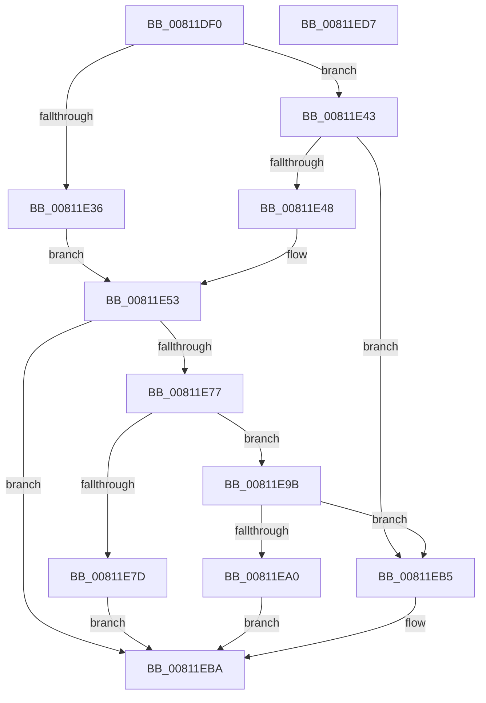

# WbGetWowTrapFrame

- RVA: `0x00811DF0`–`0x00811ED8` (길이 `232` bytes)
- VA: `0x0000000140811DF0`
- 실행 섹션: `PAGE`
- PDB 이름 있음: `예`; PDB Function 태그: `아니요`
- unwind 정보 RVA: `0x0005E6B4`
- 디코드: `62`개 명령, `232/232` bytes 표시
- 미해석 바이트: `0` (있으면 어셈블리에 `.byte`로 보존)

> 이 문서는 커널 이미지의 기계어와 PDB 기호를 분석해 생성했습니다. 4번과 5번은 함수 원형과 자료형을 바이너리 사용 방식에서 추정한 C 해석이며 원본 소스 복구 결과는 아닙니다.

## 1. Dependencies

- 직접 호출 지점: **2**; 고유 호출 대상: **2**
- 직접 호출자로 확인된 함수: **1**
- RIP 상대 이미지 참조: **0**

### Outgoing calls
- `0x00811E1F` → [PsWow64GetProcessMachine](../8D/PsWow64GetProcessMachine_function_008D2130.md) (function, `0x008D2130`)
- `0x00811E6C` → [PspWow64GetContextThread](../A1/PspWow64GetContextThread_function_00A11E90.md) (function, `0x00A11E90`)

### Direct callers
- [sub_008D2B19](../8D/Unknown_function_008D2B19.md) at `0x008D2B36`

### Static image references
- 디코드된 RIP-relative 메모리 참조가 없습니다.

## 2. Other-region calls and transfers

- 다른 실행 섹션으로 향하는 call: **0**
- 별도 외부 분기/꼬리 이동을 확인하지 못했습니다.

## 3. Assembly (complete function range)

```asm
00811DF0  48 8B C4                        mov rax, rsp
00811DF3  48 89 58 08                     mov qword ptr [rax + 8], rbx
00811DF7  48 89 68 10                     mov qword ptr [rax + 0x10], rbp
00811DFB  48 89 70 18                     mov qword ptr [rax + 0x18], rsi
00811DFF  48 89 78 20                     mov qword ptr [rax + 0x20], rdi
00811E03  41 56                           push r14
00811E05  48 83 EC 20                     sub rsp, 0x20
00811E09  48 8B D9                        mov rbx, rcx
00811E0C  48 8B FA                        mov rdi, rdx
00811E0F  65 48 8B 0C 25 88 01 00 00      mov rcx, qword ptr gs:[0x188]
00811E18  48 8B 89 B8 00 00 00            mov rcx, qword ptr [rcx + 0xb8]
00811E1F  E8 0C 03 0C 00                  call 0x1408d2130
00811E24  BD C4 01 00 00                  mov ebp, 0x1c4
00811E29  0F B7 F0                        movzx esi, ax
00811E2C  44 8D 75 88                     lea r14d, [rbp - 0x78]
00811E30  66 41 3B C6                     cmp ax, r14w
00811E34  75 0D                           jne 0x140811e43
00811E36  B9 01 00 01 00                  mov ecx, 0x10001
00811E3B  41 B8 CC 02 00 00               mov r8d, 0x2cc
00811E41  EB 10                           jmp 0x140811e53
00811E43  66 3B F5                        cmp si, bp
00811E46  75 6D                           jne 0x140811eb5
00811E48  B9 01 00 20 00                  mov ecx, 0x200001
00811E4D  41 B8 A0 01 00 00               mov r8d, 0x1a0
00811E53  B8 30 00 00 00                  mov eax, 0x30
00811E58  48 8B D3                        mov rdx, rbx
00811E5B  48 03 D0                        add rdx, rax
00811E5E  45 33 C9                        xor r9d, r9d
00811E61  89 0A                           mov dword ptr [rdx], ecx
00811E63  65 48 8B 0C 25 88 01 00 00      mov rcx, qword ptr gs:[0x188]
00811E6C  E8 1F 00 20 00                  call 0x140a11e90
00811E71  8B D0                           mov edx, eax
00811E73  85 C0                           test eax, eax
00811E75  78 43                           js 0x140811eba
00811E77  66 41 3B F6                     cmp si, r14w
00811E7B  75 1E                           jne 0x140811e9b
00811E7D  8B 8B E8 00 00 00               mov ecx, dword ptr [rbx + 0xe8]
00811E83  48 89 4F 08                     mov qword ptr [rdi + 8], rcx
00811E87  8B 8B F4 00 00 00               mov ecx, dword ptr [rbx + 0xf4]
00811E8D  48 89 0F                        mov qword ptr [rdi], rcx
00811E90  8B 8B F0 00 00 00               mov ecx, dword ptr [rbx + 0xf0]
00811E96  89 4F 10                        mov dword ptr [rdi + 0x10], ecx
00811E99  EB 1F                           jmp 0x140811eba
00811E9B  66 3B F5                        cmp si, bp
00811E9E  75 15                           jne 0x140811eb5
00811EA0  8B 43 70                        mov eax, dword ptr [rbx + 0x70]
00811EA3  48 89 47 08                     mov qword ptr [rdi + 8], rax
00811EA7  8B 43 68                        mov eax, dword ptr [rbx + 0x68]
00811EAA  48 89 07                        mov qword ptr [rdi], rax
00811EAD  8B 43 74                        mov eax, dword ptr [rbx + 0x74]
00811EB0  89 47 10                        mov dword ptr [rdi + 0x10], eax
00811EB3  EB 05                           jmp 0x140811eba
00811EB5  BA BB 00 00 C0                  mov edx, 0xc00000bb
00811EBA  48 8B 5C 24 30                  mov rbx, qword ptr [rsp + 0x30]
00811EBF  8B C2                           mov eax, edx
00811EC1  48 8B 6C 24 38                  mov rbp, qword ptr [rsp + 0x38]
00811EC6  48 8B 74 24 40                  mov rsi, qword ptr [rsp + 0x40]
00811ECB  48 8B 7C 24 48                  mov rdi, qword ptr [rsp + 0x48]
00811ED0  48 83 C4 20                     add rsp, 0x20
00811ED4  41 5E                           pop r14
00811ED6  C3                              ret
00811ED7  CC                              int3
```

## 4. C-style interpretation (structured pseudocode)

```c
__int64 __fastcall WbGetWowTrapFrame(__int64 a1, __int64 a2, __int64 a3, int a4)
{
    __int64 result;
    __int64 v_rsp;
    unsigned __int64 v_stack_p10;
    unsigned __int64 v_stack_p18;
    unsigned __int64 v_stack_p20;
    unsigned __int64 v_stack_p8;

    *(unsigned __int64 *)(v_rsp + 8) = v_rbx;
    *(unsigned __int64 *)(v_rsp + 16) = v_rbp;
    *(unsigned __int64 *)(v_rsp + 24) = v_rsi;
    *(unsigned __int64 *)(v_rsp + 32) = v_rdi;
    v_rsp = (v_rsp) - (32);
    result = PsWow64GetProcessMachine(*(unsigned __int64 *)(*(unsigned __int64 *)(gs_base + (0 + 392)) + 184), a2, a3, a4);
    if (((unsigned __int16)(result)) != ((unsigned __int16)(452 - 120))) goto loc_00811E43;
    goto loc_00811E53;
loc_00811E43:
    if (((unsigned __int16)((unsigned __int16)(result))) != 452) goto loc_00811EB5;
loc_00811E53:
    a2 = (a1) + (48);
    a4 = 0;
    *(unsigned int *)(a2) = (unsigned int)((unsigned int)(0x200001ULL));
    result = PspWow64GetContextThread(*(unsigned __int64 *)(gs_base + (0 + 392)), a2, 416, a4);
    if (sign_flag) goto loc_00811EBA;
    if (((unsigned __int16)((unsigned __int16)(result))) != ((unsigned __int16)(452 - 120))) goto loc_00811E9B;
    *(unsigned __int64 *)(a2 + 8) = (unsigned int)(*(unsigned int *)(a1 + 232));
    *(unsigned __int64 *)(a2) = (unsigned int)(*(unsigned int *)(a1 + 244));
    *(unsigned int *)(a2 + 16) = (unsigned int)((unsigned int)(*(unsigned int *)(a1 + 240)));
    goto loc_00811EBA;
loc_00811E9B:
    if (((unsigned __int16)((unsigned __int16)(result))) != 452) goto loc_00811EB5;
    *(unsigned __int64 *)(a2 + 8) = (unsigned int)(*(unsigned int *)(a1 + 112));
    *(unsigned __int64 *)(a2) = (unsigned int)(*(unsigned int *)(a1 + 104));
    *(unsigned int *)(a2 + 16) = (unsigned int)((unsigned int)(*(unsigned int *)(a1 + 116)));
    goto loc_00811EBA;
loc_00811EB5:
loc_00811EBA:
    v_rsp = (v_rsp) + (32);
    return (unsigned int)((unsigned int)((unsigned int)(0xC00000BBULL)));
}
```

## 5. (Beta) C Style

```c
int64_t WbGetWowTrapFrame(void *Arg1, void *Arg2, int64_t Arg3, int32_t Arg4)
{
    uint8_t *arg1 = (uint8_t *)Arg1;
    uint8_t *arg2 = (uint8_t *)Arg2;

    int64_t result;
    int64_t local_rsp;
    uint64_t v_stack_p10;
    uint64_t v_stack_p18;
    uint64_t v_stack_p20;
    uint64_t v_stack_p8;

    *(uint64_t *)(local_rsp + 0x8) = local_rbx;
    *(uint64_t *)(local_rsp + 0x10) = local_rbp;
    *(uint64_t *)(local_rsp + 0x18) = local_rsi;
    *(uint64_t *)(local_rsp + 0x20) = local_rdi;
    local_rsp = (local_rsp) - (32);
    result = PsWow64GetProcessMachine(*(uint64_t *)(*(uint64_t *)(gs_base + (0 + 0x188)) + 0xB8), Arg2, Arg3, Arg4);
    if (((uint16_t)(result)) != ((uint16_t)(452 - 120))) goto loc_00811E43;
    goto loc_00811E53;
loc_00811E43:
    if (((uint16_t)((uint16_t)(result))) != 452) goto loc_00811EB5;
loc_00811E53:
    Arg2 = (Arg1) + (48);
    Arg4 = 0;
    *(uint32_t *)(arg2) = (uint32_t)((uint32_t)(0x200001ULL));
    result = PspWow64GetContextThread(*(uint64_t *)(gs_base + (0 + 0x188)), Arg2, 416, Arg4);
    if (sign_flag) goto loc_00811EBA;
    if (((uint16_t)((uint16_t)(result))) != ((uint16_t)(452 - 120))) goto loc_00811E9B;
    *(uint64_t *)(arg2 + 0x8) = (uint32_t)(*(uint32_t *)(arg1 + 0xE8));
    *(uint64_t *)(arg2) = (uint32_t)(*(uint32_t *)(arg1 + 0xF4));
    *(uint32_t *)(arg2 + 0x10) = (uint32_t)((uint32_t)(*(uint32_t *)(arg1 + 0xF0)));
    goto loc_00811EBA;
loc_00811E9B:
    if (((uint16_t)((uint16_t)(result))) != 452) goto loc_00811EB5;
    *(uint64_t *)(arg2 + 0x8) = (uint32_t)(*(uint32_t *)(arg1 + 0x70));
    *(uint64_t *)(arg2) = (uint32_t)(*(uint32_t *)(arg1 + 0x68));
    *(uint32_t *)(arg2 + 0x10) = (uint32_t)((uint32_t)(*(uint32_t *)(arg1 + 0x74)));
    goto loc_00811EBA;
loc_00811EB5:
loc_00811EBA:
    local_rsp = (local_rsp) + (32);
    return (uint32_t)((uint32_t)((uint32_t)(0xC00000BBULL)));
}
```

### 관측된 메모리 오프셋

구조체 형식이 확인되지 않은 접근은 인자 기준의 오프셋으로만 기록했습니다.

| 기준 인자 | 오프셋 표현 | 폭 (bit) | 접근 |
|---|---:|---:|---|
| `Arg1` | `+ 0x0` | `32` | `W` |
| `Arg1` | `+ 0x68` | `32` | `R` |
| `Arg1` | `+ 0x70` | `32` | `R` |
| `Arg1` | `+ 0x74` | `32` | `R` |
| `Arg1` | `+ 0xE8` | `32` | `R` |
| `Arg1` | `+ 0xF0` | `32` | `R` |
| `Arg1` | `+ 0xF4` | `32` | `R` |
| `Arg2` | `+ 0x0` | `64` | `W` |
| `Arg2` | `+ 0x8` | `64` | `W` |
| `Arg2` | `+ 0x10` | `32` | `W` |

## 6. Execution-region graph

[열기: 2D/3D 그래프와 함수 탐색 컨트롤 패널](../../../control-panel.html?section=page&rva=0x00811DF0&view=graph)

- 2D 그래프는 위에서 아래로 흐르고, 3D 그래프는 빈 공간을 드래그해 회전합니다. Shift+드래그는 이동, 휠은 확대·축소, 함수 노드 선택은 대상 보고서 이동입니다.

### Static fallback


