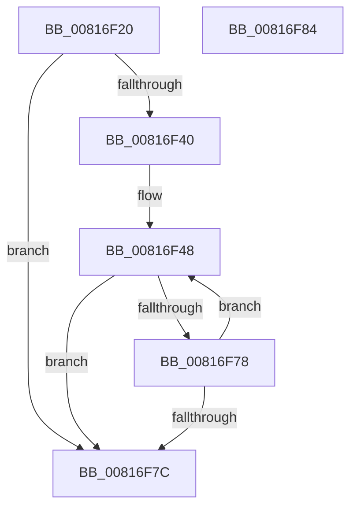

# _SdbpFindTagFromAncestors

- RVA: `0x00816F20`–`0x00816F85` (길이 `101` bytes)
- VA: `0x0000000140816F20`
- 실행 섹션: `PAGE`
- PDB 이름 있음: `예`; PDB Function 태그: `아니요`
- unwind 정보 RVA: `0x000D9AA4`
- 디코드: `37`개 명령, `101/101` bytes 표시
- 미해석 바이트: `0` (있으면 어셈블리에 `.byte`로 보존)

> 이 문서는 커널 이미지의 기계어와 PDB 기호를 분석해 생성했습니다. 4번과 5번은 함수 원형과 자료형을 바이너리 사용 방식에서 추정한 C 해석이며 원본 소스 복구 결과는 아닙니다.

## 1. Dependencies

- 직접 호출 지점: **1**; 고유 호출 대상: **1**
- 직접 호출자로 확인된 함수: **1**
- RIP 상대 이미지 참조: **0**

### Outgoing calls
- `0x00816F60` → [SdbFindFirstTag](../95/SdbFindFirstTag_function_0095E34C.md) (function, `0x0095E34C`)

### Direct callers
- [SdbMergeIsEntryUpdated](SdbMergeIsEntryUpdated_function_00819158.md) at `0x0081927A`

### Static image references
- 디코드된 RIP-relative 메모리 참조가 없습니다.

## 2. Other-region calls and transfers

- 다른 실행 섹션으로 향하는 call: **0**
- 별도 외부 분기/꼬리 이동을 확인하지 못했습니다.

## 3. Assembly (complete function range)

```asm
00816F20  4C 8B DC                        mov r11, rsp
00816F23  49 89 53 10                     mov qword ptr [r11 + 0x10], rdx
00816F27  4D 89 43 18                     mov qword ptr [r11 + 0x18], r8
00816F2B  4D 89 4B 20                     mov qword ptr [r11 + 0x20], r9
00816F2F  53                              push rbx
00816F30  56                              push rsi
00816F31  57                              push rdi
00816F32  48 83 EC 30                     sub rsp, 0x30
00816F36  33 C0                           xor eax, eax
00816F38  48 8B F1                        mov rsi, rcx
00816F3B  48 85 D2                        test rdx, rdx
00816F3E  74 3C                           je 0x140816f7c
00816F40  49 8D 7B 18                     lea rdi, [r11 + 0x18]
00816F44  48 83 C7 F8                     add rdi, -8
00816F48  48 FF CA                        dec rdx
00816F4B  48 8D 7F 08                     lea rdi, [rdi + 8]
00816F4F  0F B7 1F                        movzx ebx, word ptr [rdi]
00816F52  48 8B CE                        mov rcx, rsi
00816F55  48 89 54 24 58                  mov qword ptr [rsp + 0x58], rdx
00816F5A  44 0F B7 C3                     movzx r8d, bx
00816F5E  8B D0                           mov edx, eax
00816F60  E8 E7 73 14 00                  call 0x14095e34c
00816F65  48 8B 54 24 58                  mov rdx, qword ptr [rsp + 0x58]
00816F6A  66 F7 DB                        neg bx
00816F6D  1B C9                           sbb ecx, ecx
00816F6F  23 C8                           and ecx, eax
00816F71  8B C1                           mov eax, ecx
00816F73  48 85 D2                        test rdx, rdx
00816F76  74 04                           je 0x140816f7c
00816F78  85 C9                           test ecx, ecx
00816F7A  75 CC                           jne 0x140816f48
00816F7C  48 83 C4 30                     add rsp, 0x30
00816F80  5F                              pop rdi
00816F81  5E                              pop rsi
00816F82  5B                              pop rbx
00816F83  C3                              ret
00816F84  CC                              int3
```

## 4. C-style interpretation (structured pseudocode)

```c
__int64 __fastcall _SdbpFindTagFromAncestors(__int64 a1, __int64 a2, __int64 a3, __int64 a4)
{
    __int64 result;
    __int64 v_rbx;
    __int64 v_rdi;
    __int64 v_rsp;
    unsigned __int64 v_stack_p10;

    *(unsigned __int64 *)(v_rsp + 16) = a2;
    *(unsigned __int64 *)(v_rsp + 24) = a3;
    *(unsigned __int64 *)(v_rsp + 32) = a4;
    v_rsp = (v_rsp) - (48);
    result = 0;
    if (a2 == 0) goto loc_00816F7C;
    v_rdi = (v_rsp + 24) + (-8);
loc_00816F48:
    a2 = (a2) - 1;
    v_stack_p10 = a2;
    result = SdbFindFirstTag(a1, 0, (unsigned __int16)(*(unsigned __int16 *)(v_rdi + 8)), a4);
    v_rbx = (unsigned __int16)(-(*(unsigned __int16 *)(v_rdi + 8)));
    a1 = (unsigned int)((a1) & ((unsigned int)(result)));
    if (v_stack_p10 == 0) goto loc_00816F7C;
    if ((unsigned int)(a1) != 0) goto loc_00816F48;
loc_00816F7C:
    v_rsp = (v_rsp) + (48);
    return (unsigned int)((unsigned int)(a1));
}
```

## 5. (Beta) C Style

```c
int64_t _SdbpFindTagFromAncestors(int64_t Arg1, int64_t Arg2, int64_t Arg3, int64_t Arg4)
{
    int64_t result;
    int64_t local_rbx;
    int64_t local_rdi;
    int64_t local_rsp;
    uint64_t v_stack_p10;

    *(uint64_t *)(local_rsp + 0x10) = Arg2;
    *(uint64_t *)(local_rsp + 0x18) = Arg3;
    *(uint64_t *)(local_rsp + 0x20) = Arg4;
    local_rsp = (local_rsp) - (48);
    result = 0;
    if (Arg2 == 0) goto loc_00816F7C;
    local_rdi = (local_rsp + 24) + (-8);
loc_00816F48:
    Arg2 = (Arg2) - 1;
    v_stack_p10 = Arg2;
    result = SdbFindFirstTag(Arg1, 0, (uint16_t)(*(uint16_t *)(local_rdi + 0x8)), Arg4);
    local_rbx = (uint16_t)(-(*(uint16_t *)(local_rdi + 0x8)));
    Arg1 = (uint32_t)((Arg1) & ((uint32_t)(result)));
    if (v_stack_p10 == 0) goto loc_00816F7C;
    if ((uint32_t)(Arg1) != 0) goto loc_00816F48;
loc_00816F7C:
    local_rsp = (local_rsp) + (48);
    return (uint32_t)((uint32_t)(Arg1));
}
```

## 6. Execution-region graph

[열기: 2D/3D 그래프와 함수 탐색 컨트롤 패널](../../../control-panel.html?section=page&rva=0x00816F20&view=graph)

- 2D 그래프는 위에서 아래로 흐르고, 3D 그래프는 빈 공간을 드래그해 회전합니다. Shift+드래그는 이동, 휠은 확대·축소, 함수 노드 선택은 대상 보고서 이동입니다.

### Static fallback


