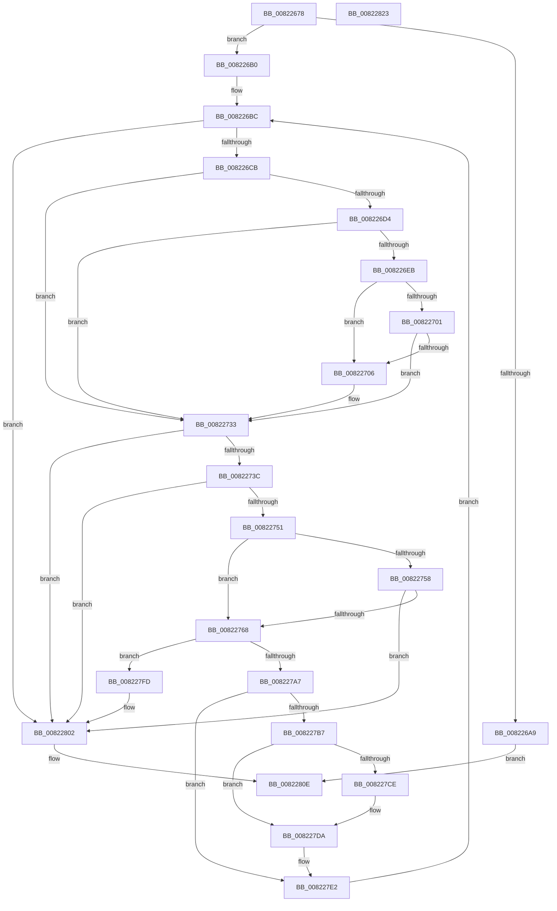

# AdtpAppendString

- RVA: `0x00822678`–`0x00822824` (길이 `428` bytes)
- VA: `0x0000000140822678`
- 실행 섹션: `PAGE`
- PDB 이름 있음: `예`; PDB Function 태그: `아니요`
- unwind 정보 RVA: `0x00097FE8`
- 디코드: `118`개 명령, `428/428` bytes 표시
- 미해석 바이트: `0` (있으면 어셈블리에 `.byte`로 보존)

> 이 문서는 커널 이미지의 기계어와 PDB 기호를 분석해 생성했습니다. 4번과 5번은 함수 원형과 자료형을 바이너리 사용 방식에서 추정한 C 해석이며 원본 소스 복구 결과는 아닙니다.

## 1. Dependencies

- 직접 호출 지점: **4**; 고유 호출 대상: **4**
- 직접 호출자로 확인된 함수: **2**
- RIP 상대 이미지 참조: **0**

### Outgoing calls
- `0x00822728` → [RtlAppendUnicodeStringToString](../../text/40/RtlAppendUnicodeStringToString_function_0040FA50.md) (function, `0x0040FA50`)
- `0x00822792` → [ExAllocatePool2](../../poolcode/B8/ExAllocatePool2_function_00B820F0.md) (function, `0x00B820F0`)
- `0x008227C3` → [memcpy](../../text/6C/memcpy_function_006C6840.md) (function, `0x006C6840`)
- `0x008227D5` → [ExFreePoolWithTag](../../poolcode/B8/ExFreePoolWithTag_function_00B82870.md) (function, `0x00B82870`)

### Direct callers
- [AdtpAppendZString](AdtpAppendZString_function_0082282C.md) at `0x00822866`
- [AdtpBuildObjectTypeStrings](../AD/AdtpBuildObjectTypeStrings_function_00AD0B38.md) at `0x00AD0C47`
- [AdtpBuildObjectTypeStrings](../AD/AdtpBuildObjectTypeStrings_function_00AD0B38.md) at `0x00AD0CD9`

### Static image references
- 디코드된 RIP-relative 메모리 참조가 없습니다.

## 2. Other-region calls and transfers

- 다른 실행 섹션으로 향하는 call: **4**
  - `0x00822728` → [RtlAppendUnicodeStringToString](../../text/40/RtlAppendUnicodeStringToString_function_0040FA50.md) (`PAGE` → `.text`)
  - `0x00822792` → [ExAllocatePool2](../../poolcode/B8/ExAllocatePool2_function_00B820F0.md) (`PAGE` → `POOLCODE`)
  - `0x008227C3` → [memcpy](../../text/6C/memcpy_function_006C6840.md) (`PAGE` → `.text`)
  - `0x008227D5` → [ExFreePoolWithTag](../../poolcode/B8/ExFreePoolWithTag_function_00B82870.md) (`PAGE` → `POOLCODE`)
- 별도 외부 분기/꼬리 이동을 확인하지 못했습니다.

## 3. Assembly (complete function range)

```asm
00822678  48 89 5C 24 08                  mov qword ptr [rsp + 8], rbx
0082267D  4C 89 4C 24 20                  mov qword ptr [rsp + 0x20], r9
00822682  55                              push rbp
00822683  56                              push rsi
00822684  57                              push rdi
00822685  41 54                           push r12
00822687  41 55                           push r13
00822689  41 56                           push r14
0082268B  41 57                           push r15
0082268D  48 83 EC 30                     sub rsp, 0x30
00822691  41 0F 10 00                     movups xmm0, xmmword ptr [r8]
00822695  41 8B 39                        mov edi, dword ptr [r9]
00822698  4C 8B EA                        mov r13, rdx
0082269B  48 8B E9                        mov rbp, rcx
0082269E  F3 0F 7F 44 24 20               movdqu xmmword ptr [rsp + 0x20], xmm0
008226A4  83 FF 01                        cmp edi, 1
008226A7  72 07                           jb 0x1408226b0
008226A9  33 C0                           xor eax, eax
008226AB  E9 5E 01 00 00                  jmp 0x14082280e
008226B0  4C 8B 7C 24 28                  mov r15, qword ptr [rsp + 0x28]
008226B5  33 DB                           xor ebx, ebx
008226B7  0F B7 74 24 20                  movzx esi, word ptr [rsp + 0x20]
008226BC  41 B8 FE FF 00 00               mov r8d, 0xfffe
008226C2  66 85 F6                        test si, si
008226C5  0F 84 37 01 00 00               je 0x140822802
008226CB  48 8B C7                        mov rax, rdi
008226CE  42 38 1C 2F                     cmp byte ptr [rdi + r13], bl
008226D2  74 5F                           je 0x140822733
008226D4  48 03 C0                        add rax, rax
008226D7  48 8D 0C C5 00 00 00 00         lea rcx, [rax*8]
008226DF  48 03 CD                        add rcx, rbp
008226E2  0F B7 01                        movzx eax, word ptr [rcx]
008226E5  66 41 3B C0                     cmp ax, r8w
008226E9  74 48                           je 0x140822733
008226EB  0F B7 51 02                     movzx edx, word ptr [rcx + 2]
008226EF  0F 57 C0                        xorps xmm0, xmm0
008226F2  66 2B D0                        sub dx, ax
008226F5  66 41 83 3F 25                  cmp word ptr [r15], 0x25
008226FA  0F 11 44 24 20                  movups xmmword ptr [rsp + 0x20], xmm0
008226FF  75 05                           jne 0x140822706
00822701  66 3B D6                        cmp dx, si
00822704  72 2D                           jb 0x140822733
00822706  66 3B D6                        cmp dx, si
00822709  4C 89 7C 24 28                  mov qword ptr [rsp + 0x28], r15
0082270E  0F B7 C6                        movzx eax, si
00822711  66 0F 42 C2                     cmovb ax, dx
00822715  48 8D 54 24 20                  lea rdx, [rsp + 0x20]
0082271A  66 89 44 24 20                  mov word ptr [rsp + 0x20], ax
0082271F  66 2B F0                        sub si, ax
00822722  0F B7 C0                        movzx eax, ax
00822725  4C 03 F8                        add r15, rax
00822728  E8 23 D3 BE FF                  call 0x14040fa50
0082272D  41 B8 FE FF 00 00               mov r8d, 0xfffe
00822733  66 85 F6                        test si, si
00822736  0F 84 C6 00 00 00               je 0x140822802
0082273C  48 8B D7                        mov rdx, rdi
0082273F  48 03 D2                        add rdx, rdx
00822742  0F B7 44 D5 00                  movzx eax, word ptr [rbp + rdx*8]
00822747  66 41 3B C0                     cmp ax, r8w
0082274B  0F 83 B1 00 00 00               jae 0x140822802
00822751  66 41 83 3F 25                  cmp word ptr [r15], 0x25
00822756  75 10                           jne 0x140822768
00822758  8B C8                           mov ecx, eax
0082275A  0F B7 C6                        movzx eax, si
0082275D  03 C8                           add ecx, eax
0082275F  41 3B C8                        cmp ecx, r8d
00822762  0F 83 9A 00 00 00               jae 0x140822802
00822768  0F B7 44 D5 02                  movzx eax, word ptr [rbp + rdx*8 + 2]
0082276D  B9 00 01 00 00                  mov ecx, 0x100
00822772  05 00 04 00 00                  add eax, 0x400
00822777  44 0F B7 E6                     movzx r12d, si
0082277B  41 3B C4                        cmp eax, r12d
0082277E  44 0F 47 E0                     cmova r12d, eax
00822782  45 3B E0                        cmp r12d, r8d
00822785  45 0F 43 E0                     cmovae r12d, r8d
00822789  41 B8 53 65 41 6B               mov r8d, 0x6b416553
0082278F  41 8B D4                        mov edx, r12d
00822792  E8 59 F9 35 00                  call 0x140b820f0
00822797  48 89 84 24 80 00 00 00         mov qword ptr [rsp + 0x80], rax
0082279F  48 8B C8                        mov rcx, rax
008227A2  48 85 C0                        test rax, rax
008227A5  74 56                           je 0x1408227fd
008227A7  4C 8B F7                        mov r14, rdi
008227AA  4D 03 F6                        add r14, r14
008227AD  4A 8B 54 F5 08                  mov rdx, qword ptr [rbp + r14*8 + 8]
008227B2  48 85 D2                        test rdx, rdx
008227B5  74 2B                           je 0x1408227e2
008227B7  48 8B C7                        mov rax, rdi
008227BA  48 03 C0                        add rax, rax
008227BD  44 0F B7 44 C5 00               movzx r8d, word ptr [rbp + rax*8]
008227C3  E8 78 40 EA FF                  call 0x1406c6840
008227C8  42 38 1C 2F                     cmp byte ptr [rdi + r13], bl
008227CC  74 0C                           je 0x1408227da
008227CE  4A 8B 4C F5 08                  mov rcx, qword ptr [rbp + r14*8 + 8]
008227D3  33 D2                           xor edx, edx
008227D5  E8 96 00 36 00                  call 0x140b82870
008227DA  48 8B 8C 24 80 00 00 00         mov rcx, qword ptr [rsp + 0x80]
008227E2  48 8B C7                        mov rax, rdi
008227E5  4A 89 4C F5 08                  mov qword ptr [rbp + r14*8 + 8], rcx
008227EA  48 03 C0                        add rax, rax
008227ED  66 44 89 64 C5 02               mov word ptr [rbp + rax*8 + 2], r12w
008227F3  42 C6 04 2F 01                  mov byte ptr [rdi + r13], 1
008227F8  E9 BF FE FF FF                  jmp 0x1408226bc
008227FD  BB 17 00 00 C0                  mov ebx, 0xc0000017
00822802  48 8B 8C 24 88 00 00 00         mov rcx, qword ptr [rsp + 0x88]
0082280A  8B C3                           mov eax, ebx
0082280C  89 39                           mov dword ptr [rcx], edi
0082280E  48 8B 5C 24 70                  mov rbx, qword ptr [rsp + 0x70]
00822813  48 83 C4 30                     add rsp, 0x30
00822817  41 5F                           pop r15
00822819  41 5E                           pop r14
0082281B  41 5D                           pop r13
0082281D  41 5C                           pop r12
0082281F  5F                              pop rdi
00822820  5E                              pop rsi
00822821  5D                              pop rbp
00822822  C3                              ret
00822823  CC                              int3
```

## 4. C-style interpretation (structured pseudocode)

```c
__int64 __fastcall AdtpAppendString(__int64 a1, __int64 a2, __int64 a3, __int64 a4)
{
    __int64 result;
    __int64 v_r12;
    __int64 v_r14;
    __int64 v_r15;
    __int64 v_rbx;
    __int64 v_rsi;
    __int64 v_rsp;
    unsigned __int64 v_stack_m40;
    unsigned __int64 v_stack_m48;
    unsigned __int64 v_stack_p18;
    unsigned __int64 v_stack_p20;
    unsigned __int64 v_stack_p8;

    v_stack_p8 = v_rbx;
    v_stack_p20 = a4;
    v_rsp = (v_rsp) - (48);
    v_stack_m48 = v_xmm0;
    if (((unsigned int)((unsigned int)(*(unsigned int *)(a4)))) < 1) goto loc_008226B0;
    result = 0;
    goto loc_0082280E;
loc_008226B0:
    v_rbx = 0;
loc_008226BC:
    if ((unsigned __int16)(v_stack_m48) == 0) goto loc_00822802;
    if ((*(unsigned __int8 *)((unsigned int)(*(unsigned int *)(a4)) + a2 * 1)) == 0) goto loc_00822733;
    result = ((unsigned int)(*(unsigned int *)(a4))) + ((unsigned int)(*(unsigned int *)(a4)));
    a1 = (result * 8) + (a1);
    if (((unsigned __int16)(*(unsigned __int16 *)(a1))) == ((unsigned __int16)((unsigned int)(0xFFFEULL)))) goto loc_00822733;
    a2 = (unsigned __int16)((*(unsigned __int16 *)(a1 + 2)) - ((unsigned __int16)(*(unsigned __int16 *)(a1))));
    v_stack_m48 = v_xmm0;
    if ((*(unsigned __int16 *)(v_stack_m40)) != 37) goto loc_00822706;
    result = *(unsigned __int16 *)(a1);
    v_rsi = v_stack_m48;
    v_r15 = v_stack_m40;
    if (((unsigned __int16)(a2)) >= ((unsigned __int16)(v_stack_m48))) {
        v_stack_m40 = v_stack_m40;
        result = (unsigned __int16)(v_stack_m48);
        if (((unsigned __int16)(a2)) < ((unsigned __int16)(v_stack_m48))) { result = (unsigned __int16)(a2); }
        a2 = v_stack_m48;
        v_stack_m48 = (unsigned __int16)(result);
        v_rsi = (unsigned __int16)((v_stack_m48) - ((unsigned __int16)(result)));
        result = (unsigned __int16)(result);
        v_r15 = (v_stack_m40) + (result);
        result = RtlAppendUnicodeStringToString(a1, a2, (unsigned int)(0xFFFEULL), a4);
        a3 = 0xFFFEULL;
    }
    if ((unsigned __int16)(v_rsi) == 0) goto loc_00822802;
    a2 = ((unsigned int)(*(unsigned int *)(a4))) + ((unsigned int)(*(unsigned int *)(a4)));
    if (((unsigned __int16)(*(unsigned __int16 *)(a1 + a2 * 8))) >= ((unsigned __int16)(a3))) goto loc_00822802;
    if ((*(unsigned __int16 *)(v_r15)) != 37) goto loc_00822768;
    a1 = (unsigned int)(((unsigned int)((unsigned int)(*(unsigned __int16 *)(a1 + a2 * 8)))) + ((unsigned int)((unsigned __int16)(v_rsi))));
    if (((unsigned int)(a1)) >= ((unsigned int)(a3))) goto loc_00822802;
loc_00822768:
    result = (unsigned int)((*(unsigned __int16 *)(a1 + a2 * 8 + 2)) + (0x400ULL));
    v_r12 = (unsigned __int16)(v_rsi);
    if (((unsigned int)(result)) > ((unsigned int)((unsigned __int16)(v_rsi)))) { v_r12 = (unsigned int)(result); }
    if (((unsigned int)(v_r12)) >= ((unsigned int)(a3))) { v_r12 = (unsigned int)(a3); }
    result = ExAllocatePool2(256, (unsigned int)((unsigned int)(v_r12)), (unsigned int)(0x6B416553ULL), a4);
    v_stack_p18 = result;
    if (result == 0) goto loc_008227FD;
    v_r14 = ((unsigned int)(*(unsigned int *)(a4))) + ((unsigned int)(*(unsigned int *)(a4)));
    if (*(unsigned __int64 *)(a1 + v_r14 * 8 + 8) == 0) goto loc_008227E2;
    result = ((unsigned int)(*(unsigned int *)(a4))) + ((unsigned int)(*(unsigned int *)(a4)));
    result = memcpy(result, *(unsigned __int64 *)(a1 + v_r14 * 8 + 8), *(unsigned __int16 *)(a1 + result * 8), a4);
    if ((*(unsigned __int8 *)((unsigned int)(*(unsigned int *)(a4)) + a2 * 1)) != 0) {
        a1 = *(unsigned __int64 *)(a1 + v_r14 * 8 + 8);
        a2 = 0;
        result = ExFreePoolWithTag(a1, a2, *(unsigned __int16 *)(a1 + result * 8), a4);
    }
loc_008227E2:
    *(unsigned __int64 *)(a1 + v_r14 * 8 + 8) = v_stack_p18;
    result = ((unsigned int)(*(unsigned int *)(a4))) + ((unsigned int)(*(unsigned int *)(a4)));
    *(unsigned __int16 *)(a1 + result * 8 + 2) = (unsigned __int16)(v_r12);
    *(unsigned __int8 *)((unsigned int)(*(unsigned int *)(a4)) + a2 * 1) = 1;
    goto loc_008226BC;
loc_008227FD:
loc_00822802:
    *(unsigned int *)(v_stack_p20) = (unsigned int)((unsigned int)(*(unsigned int *)(a4)));
loc_0082280E:
    v_rsp = (v_rsp) + (48);
    return (unsigned int)((unsigned int)((unsigned int)(0xC0000017ULL)));
}
```

## 5. (Beta) C Style

```c
int64_t AdtpAppendString(void *Arg1, int64_t Arg2, void *Arg3, void *Arg4)
{
    uint8_t *arg1 = (uint8_t *)Arg1;
    uint8_t *arg3 = (uint8_t *)Arg3;
    uint8_t *arg4 = (uint8_t *)Arg4;

    int64_t result;
    int64_t local_r12;
    int64_t local_r14;
    int64_t local_r15;
    int64_t local_rbx;
    int64_t local_rsi;
    int64_t local_rsp;
    uint64_t v_stack_m40;
    uint64_t v_stack_m48;
    uint64_t v_stack_p18;
    uint64_t v_stack_p20;
    uint64_t v_stack_p8;

    v_stack_p8 = local_rbx;
    v_stack_p20 = Arg4;
    local_rsp = (local_rsp) - (48);
    v_stack_m48 = v_xmm0;
    if (((uint32_t)((uint32_t)(*(uint32_t *)(arg4)))) < 1) goto loc_008226B0;
    result = 0;
    goto loc_0082280E;
loc_008226B0:
    local_rbx = 0;
loc_008226BC:
    if ((uint16_t)(v_stack_m48) == 0) goto loc_00822802;
    if ((*(uint8_t *)((uint32_t)(*(uint32_t *)(arg4)) + Arg2 * 1)) == 0) goto loc_00822733;
    result = ((uint32_t)(*(uint32_t *)(arg4))) + ((uint32_t)(*(uint32_t *)(arg4)));
    Arg1 = (result * 8) + (Arg1);
    if (((uint16_t)(*(uint16_t *)(arg1))) == ((uint16_t)((uint32_t)(0xFFFEULL)))) goto loc_00822733;
    Arg2 = (uint16_t)((*(uint16_t *)(arg1 + 0x2)) - ((uint16_t)(*(uint16_t *)(arg1))));
    v_stack_m48 = v_xmm0;
    if ((*(uint16_t *)(v_stack_m40)) != 37) goto loc_00822706;
    result = *(uint16_t *)(arg1);
    local_rsi = v_stack_m48;
    local_r15 = v_stack_m40;
    if (((uint16_t)(Arg2)) >= ((uint16_t)(v_stack_m48))) {
        v_stack_m40 = v_stack_m40;
        result = (uint16_t)(v_stack_m48);
        if (((uint16_t)(Arg2)) < ((uint16_t)(v_stack_m48))) { result = (uint16_t)(Arg2); }
        Arg2 = v_stack_m48;
        v_stack_m48 = (uint16_t)(result);
        local_rsi = (uint16_t)((v_stack_m48) - ((uint16_t)(result)));
        result = (uint16_t)(result);
        local_r15 = (v_stack_m40) + (result);
        result = RtlAppendUnicodeStringToString(Arg1, Arg2, (uint32_t)(0xFFFEULL), Arg4);
        Arg3 = 0xFFFEULL;
    }
    if ((uint16_t)(local_rsi) == 0) goto loc_00822802;
    Arg2 = ((uint32_t)(*(uint32_t *)(arg4))) + ((uint32_t)(*(uint32_t *)(arg4)));
    if (((uint16_t)(*(uint16_t *)(arg1 + Arg2 * 8))) >= ((uint16_t)(Arg3))) goto loc_00822802;
    if ((*(uint16_t *)(local_r15)) != 37) goto loc_00822768;
    Arg1 = (uint32_t)(((uint32_t)((uint32_t)(*(uint16_t *)(arg1 + Arg2 * 8)))) + ((uint32_t)((uint16_t)(local_rsi))));
    if (((uint32_t)(Arg1)) >= ((uint32_t)(Arg3))) goto loc_00822802;
loc_00822768:
    result = (uint32_t)((*(uint16_t *)(arg1 + Arg2 * 8 + 0x2)) + (0x400ULL));
    local_r12 = (uint16_t)(local_rsi);
    if (((uint32_t)(result)) > ((uint32_t)((uint16_t)(local_rsi)))) { local_r12 = (uint32_t)(result); }
    if (((uint32_t)(local_r12)) >= ((uint32_t)(Arg3))) { local_r12 = (uint32_t)(Arg3); }
    result = ExAllocatePool2(256, (uint32_t)((uint32_t)(local_r12)), (uint32_t)(0x6B416553ULL), Arg4);
    v_stack_p18 = result;
    if (result == 0) goto loc_008227FD;
    local_r14 = ((uint32_t)(*(uint32_t *)(arg4))) + ((uint32_t)(*(uint32_t *)(arg4)));
    if (*(uint64_t *)(arg1 + local_r14 * 8 + 0x8) == 0) goto loc_008227E2;
    result = ((uint32_t)(*(uint32_t *)(arg4))) + ((uint32_t)(*(uint32_t *)(arg4)));
    result = memcpy(result, *(uint64_t *)(arg1 + local_r14 * 8 + 0x8), *(uint16_t *)(arg1 + result * 8), Arg4);
    if ((*(uint8_t *)((uint32_t)(*(uint32_t *)(arg4)) + Arg2 * 1)) != 0) {
        Arg1 = *(uint64_t *)(arg1 + local_r14 * 8 + 0x8);
        Arg2 = 0;
        result = ExFreePoolWithTag(Arg1, Arg2, *(uint16_t *)(arg1 + result * 8), Arg4);
    }
loc_008227E2:
    *(uint64_t *)(arg1 + local_r14 * 8 + 0x8) = v_stack_p18;
    result = ((uint32_t)(*(uint32_t *)(arg4))) + ((uint32_t)(*(uint32_t *)(arg4)));
    *(uint16_t *)(arg1 + result * 8 + 0x2) = (uint16_t)(local_r12);
    *(uint8_t *)((uint32_t)(*(uint32_t *)(arg4)) + Arg2 * 1) = 1;
    goto loc_008226BC;
loc_008227FD:
loc_00822802:
    *(uint32_t *)(v_stack_p20) = (uint32_t)((uint32_t)(*(uint32_t *)(arg4)));
loc_0082280E:
    local_rsp = (local_rsp) + (48);
    return (uint32_t)((uint32_t)((uint32_t)(0xC0000017ULL)));
}
```

### 관측된 메모리 오프셋

구조체 형식이 확인되지 않은 접근은 인자 기준의 오프셋으로만 기록했습니다.

| 기준 인자 | 오프셋 표현 | 폭 (bit) | 접근 |
|---|---:|---:|---|
| `Arg1` | `+ 0x0 + rax*8` | `16` | `R` |
| `Arg1` | `+ 0x0 + rdx*8` | `16` | `R` |
| `Arg1` | `+ 0x2 + rax*8` | `16` | `W` |
| `Arg1` | `+ 0x2 + rdx*8` | `16` | `R` |
| `Arg1` | `+ 0x8 + r14*8` | `64` | `R` |
| `Arg1` | `+ 0x8 + r14*8` | `64` | `W` |
| `Arg3` | `+ 0x0` | `128` | `R` |
| `Arg4` | `+ 0x0` | `32` | `R` |

## 6. Execution-region graph

[열기: 2D/3D 그래프와 함수 탐색 컨트롤 패널](../../../control-panel.html?section=page&rva=0x00822678&view=graph)

- 2D 그래프는 위에서 아래로 흐르고, 3D 그래프는 빈 공간을 드래그해 회전합니다. Shift+드래그는 이동, 휠은 확대·축소, 함수 노드 선택은 대상 보고서 이동입니다.

### Static fallback


