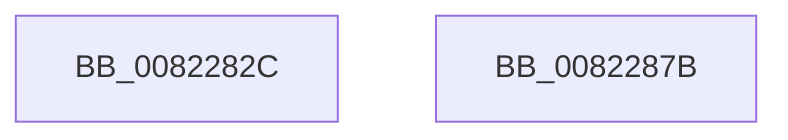

# AdtpAppendZString

- RVA: `0x0082282C`–`0x0082287C` (길이 `80` bytes)
- VA: `0x000000014082282C`
- 실행 섹션: `PAGE`
- PDB 이름 있음: `예`; PDB Function 태그: `아니요`
- unwind 정보 RVA: `0x000733E4`
- 디코드: `24`개 명령, `80/80` bytes 표시
- 미해석 바이트: `0` (있으면 어셈블리에 `.byte`로 보존)

> 이 문서는 커널 이미지의 기계어와 PDB 기호를 분석해 생성했습니다. 4번과 5번은 함수 원형과 자료형을 바이너리 사용 방식에서 추정한 C 해석이며 원본 소스 복구 결과는 아닙니다.

## 1. Dependencies

- 직접 호출 지점: **2**; 고유 호출 대상: **2**
- 직접 호출자로 확인된 함수: **1**
- RIP 상대 이미지 참조: **0**

### Outgoing calls
- `0x00822853` → [RtlInitUnicodeString](../../text/42/RtlInitUnicodeString_function_0042A780.md) (function, `0x0042A780`)
- `0x00822866` → [AdtpAppendString](AdtpAppendString_function_00822678.md) (function, `0x00822678`)

### Direct callers
- [AdtpBuildObjectTypeStrings](../AD/AdtpBuildObjectTypeStrings_function_00AD0B38.md) at `0x00AD0C99`
- [AdtpBuildObjectTypeStrings](../AD/AdtpBuildObjectTypeStrings_function_00AD0B38.md) at `0x00AD0D01`

### Static image references
- 디코드된 RIP-relative 메모리 참조가 없습니다.

## 2. Other-region calls and transfers

- 다른 실행 섹션으로 향하는 call: **1**
  - `0x00822853` → [RtlInitUnicodeString](../../text/42/RtlInitUnicodeString_function_0042A780.md) (`PAGE` → `.text`)
- 별도 외부 분기/꼬리 이동을 확인하지 못했습니다.

## 3. Assembly (complete function range)

```asm
0082282C  48 8B C4                        mov rax, rsp
0082282F  48 89 58 08                     mov qword ptr [rax + 8], rbx
00822833  48 89 70 10                     mov qword ptr [rax + 0x10], rsi
00822837  57                              push rdi
00822838  48 83 EC 30                     sub rsp, 0x30
0082283C  48 8B FA                        mov rdi, rdx
0082283F  48 8B F1                        mov rsi, rcx
00822842  0F 57 C0                        xorps xmm0, xmm0
00822845  48 8D 48 E8                     lea rcx, [rax - 0x18]
00822849  49 8B D0                        mov rdx, r8
0082284C  49 8B D9                        mov rbx, r9
0082284F  0F 11 40 E8                     movups xmmword ptr [rax - 0x18], xmm0
00822853  E8 28 7F C0 FF                  call 0x14042a780
00822858  4C 8B CB                        mov r9, rbx
0082285B  4C 8D 44 24 20                  lea r8, [rsp + 0x20]
00822860  48 8B D7                        mov rdx, rdi
00822863  48 8B CE                        mov rcx, rsi
00822866  E8 0D FE FF FF                  call 0x140822678
0082286B  48 8B 5C 24 40                  mov rbx, qword ptr [rsp + 0x40]
00822870  48 8B 74 24 48                  mov rsi, qword ptr [rsp + 0x48]
00822875  48 83 C4 30                     add rsp, 0x30
00822879  5F                              pop rdi
0082287A  C3                              ret
0082287B  CC                              int3
```

## 4. C-style interpretation (structured pseudocode)

```c
__int64 __fastcall AdtpAppendZString(__int64 a1, __int64 a2, __int64 a3, __int64 a4)
{
    __int64 result;
    __int64 v_rsp;
    unsigned __int64 v_stack_m18;
    unsigned __int64 v_stack_p10;
    unsigned __int64 v_stack_p8;

    *(unsigned __int64 *)(v_rsp + 8) = v_rbx;
    *(unsigned __int64 *)(v_rsp + 16) = v_rsi;
    v_rsp = (v_rsp) - (48);
    *(unsigned __int64 *)(v_rsp - 24) = v_xmm0;
    result = RtlInitUnicodeString(v_rsp - 24, a3, a3, a4);
    result = AdtpAppendString(a1, a2, v_stack_m18, a4);
    v_rsp = (v_rsp) + (48);
    return result;
}
```

## 5. (Beta) C Style

```c
int64_t AdtpAppendZString(int64_t Arg1, int64_t Arg2, int64_t Arg3, int64_t Arg4)
{
    int64_t result;
    int64_t local_rsp;
    uint64_t v_stack_m18;
    uint64_t v_stack_p10;
    uint64_t v_stack_p8;

    *(uint64_t *)(local_rsp + 0x8) = local_rbx;
    *(uint64_t *)(local_rsp + 0x10) = local_rsi;
    local_rsp = (local_rsp) - (48);
    *(uint64_t *)(local_rsp - 0x18) = v_xmm0;
    result = RtlInitUnicodeString(local_rsp - 24, Arg3, Arg3, Arg4);
    result = AdtpAppendString(Arg1, Arg2, v_stack_m18, Arg4);
    local_rsp = (local_rsp) + (48);
    return result;
}
```

## 6. Execution-region graph

[열기: 2D/3D 그래프와 함수 탐색 컨트롤 패널](../../../control-panel.html?section=page&rva=0x0082282C&view=graph)

- 2D 그래프는 위에서 아래로 흐르고, 3D 그래프는 빈 공간을 드래그해 회전합니다. Shift+드래그는 이동, 휠은 확대·축소, 함수 노드 선택은 대상 보고서 이동입니다.

### Static fallback


