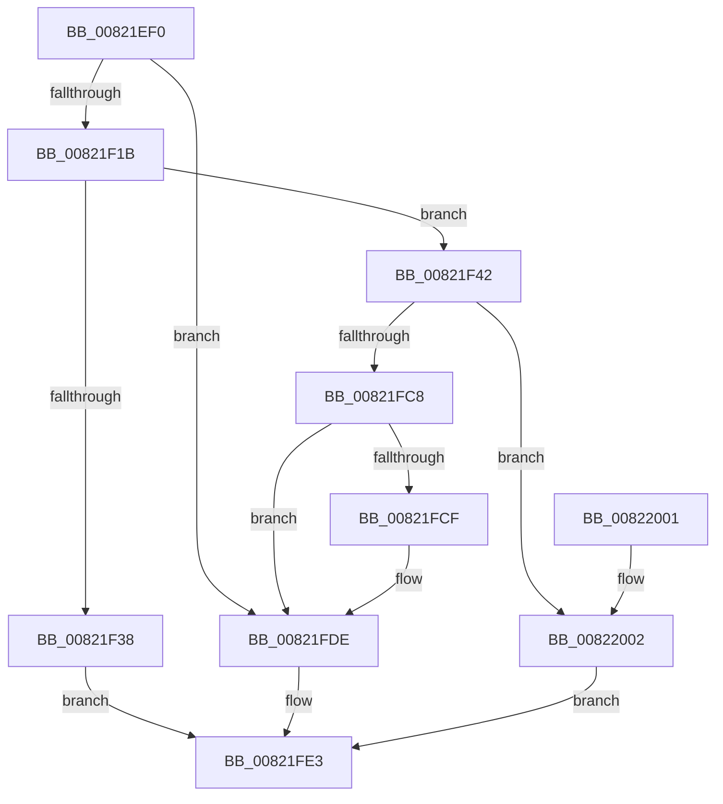

# AdtpBuildGuidString

- RVA: `0x00821EF0`–`0x00822011` (길이 `289` bytes)
- VA: `0x0000000140821EF0`
- 실행 섹션: `PAGE`
- PDB 이름 있음: `예`; PDB Function 태그: `아니요`
- unwind 정보 RVA: `0x000DA1C8`
- 디코드: `74`개 명령, `289/289` bytes 표시
- 미해석 바이트: `0` (있으면 어셈블리에 `.byte`로 보존)

> 이 문서는 커널 이미지의 기계어와 PDB 기호를 분석해 생성했습니다. 4번과 5번은 함수 원형과 자료형을 바이너리 사용 방식에서 추정한 C 해석이며 원본 소스 복구 결과는 아닙니다.

## 1. Dependencies

- 직접 호출 지점: **3**; 고유 호출 대상: **3**
- 직접 호출자로 확인된 함수: **1**
- RIP 상대 이미지 참조: **1**

### Outgoing calls
- `0x00821F2B` → [ExAllocatePool2](../../poolcode/B8/ExAllocatePool2_function_00B820F0.md) (function, `0x00B820F0`)
- `0x00821FBF` → [StringCchPrintfW](../../text/47/StringCchPrintfW_function_0047BAD0.md) (function, `0x0047BAD0`)
- `0x00821FD4` → [ExFreePoolWithTag](../../poolcode/B8/ExFreePoolWithTag_function_00B82870.md) (function, `0x00B82870`)

### Direct callers
- [AdtpBuildObjectTypeStrings](../AD/AdtpBuildObjectTypeStrings_function_00AD0B38.md) at `0x00AD0CBF`

### Static image references
- `0x00821F9A` → RVA `0x00041920` (`.rdata`; read)

## 2. Other-region calls and transfers

- 다른 실행 섹션으로 향하는 call: **3**
  - `0x00821F2B` → [ExAllocatePool2](../../poolcode/B8/ExAllocatePool2_function_00B820F0.md) (`PAGE` → `POOLCODE`)
  - `0x00821FBF` → [StringCchPrintfW](../../text/47/StringCchPrintfW_function_0047BAD0.md) (`PAGE` → `.text`)
  - `0x00821FD4` → [ExFreePoolWithTag](../../poolcode/B8/ExFreePoolWithTag_function_00B82870.md) (`PAGE` → `POOLCODE`)
- 별도 외부 분기/꼬리 이동을 확인하지 못했습니다.

## 3. Assembly (complete function range)

```asm
00821EF0  48 89 5C 24 08                  mov qword ptr [rsp + 8], rbx
00821EF5  48 89 6C 24 10                  mov qword ptr [rsp + 0x10], rbp
00821EFA  48 89 74 24 18                  mov qword ptr [rsp + 0x18], rsi
00821EFF  57                              push rdi
00821F00  41 54                           push r12
00821F02  41 55                           push r13
00821F04  41 56                           push r14
00821F06  41 57                           push r15
00821F08  48 83 EC 70                     sub rsp, 0x70
00821F0C  4C 8B F2                        mov r14, rdx
00821F0F  4C 8B F9                        mov r15, rcx
00821F12  48 85 D2                        test rdx, rdx
00821F15  0F 84 C3 00 00 00               je 0x140821fde
00821F1B  BA 4E 00 00 00                  mov edx, 0x4e
00821F20  B9 00 01 00 00                  mov ecx, 0x100
00821F25  41 B8 53 65 41 6B               mov r8d, 0x6b416553
00821F2B  E8 C0 01 36 00                  call 0x140b820f0
00821F30  48 8B E8                        mov rbp, rax
00821F33  48 85 C0                        test rax, rax
00821F36  75 0A                           jne 0x140821f42
00821F38  B8 17 00 00 C0                  mov eax, 0xc0000017
00821F3D  E9 A1 00 00 00                  jmp 0x140821fe3
00821F42  4C 8B A4 24 C8 00 00 00         mov r12, qword ptr [rsp + 0xc8]
00821F4A  41 C6 04 24 01                  mov byte ptr [r12], 1
00821F4F  41 0F B6 4F 0E                  movzx ecx, byte ptr [r15 + 0xe]
00821F54  41 0F B6 57 0D                  movzx edx, byte ptr [r15 + 0xd]
00821F59  45 0F B6 47 0C                  movzx r8d, byte ptr [r15 + 0xc]
00821F5E  45 0F B6 4F 0B                  movzx r9d, byte ptr [r15 + 0xb]
00821F63  41 0F B6 47 0F                  movzx eax, byte ptr [r15 + 0xf]
00821F68  45 0F B6 57 0A                  movzx r10d, byte ptr [r15 + 0xa]
00821F6D  45 0F B6 5F 09                  movzx r11d, byte ptr [r15 + 9]
00821F72  41 0F B6 5F 08                  movzx ebx, byte ptr [r15 + 8]
00821F77  41 0F B7 7F 06                  movzx edi, word ptr [r15 + 6]
00821F7C  41 0F B7 77 04                  movzx esi, word ptr [r15 + 4]
00821F81  89 44 24 68                     mov dword ptr [rsp + 0x68], eax
00821F85  89 4C 24 60                     mov dword ptr [rsp + 0x60], ecx
00821F89  48 8B CD                        mov rcx, rbp
00821F8C  89 54 24 58                     mov dword ptr [rsp + 0x58], edx
00821F90  BA 27 00 00 00                  mov edx, 0x27
00821F95  44 89 44 24 50                  mov dword ptr [rsp + 0x50], r8d
00821F9A  4C 8D 05 7F F9 81 FF            lea r8, [rip - 0x7e0681]
00821FA1  44 89 4C 24 48                  mov dword ptr [rsp + 0x48], r9d
00821FA6  45 8B 0F                        mov r9d, dword ptr [r15]
00821FA9  44 89 54 24 40                  mov dword ptr [rsp + 0x40], r10d
00821FAE  44 89 5C 24 38                  mov dword ptr [rsp + 0x38], r11d
00821FB3  89 5C 24 30                     mov dword ptr [rsp + 0x30], ebx
00821FB7  89 7C 24 28                     mov dword ptr [rsp + 0x28], edi
00821FBB  89 74 24 20                     mov dword ptr [rsp + 0x20], esi
00821FBF  E8 0C 9B C5 FF                  call 0x14047bad0
00821FC4  85 C0                           test eax, eax
00821FC6  79 3A                           jns 0x140822002
00821FC8  41 80 3C 24 01                  cmp byte ptr [r12], 1
00821FCD  75 0F                           jne 0x140821fde
00821FCF  33 D2                           xor edx, edx
00821FD1  48 8B CD                        mov rcx, rbp
00821FD4  E8 97 08 36 00                  call 0x140b82870
00821FD9  41 C6 04 24 00                  mov byte ptr [r12], 0
00821FDE  B8 0D 00 00 C0                  mov eax, 0xc000000d
00821FE3  4C 8D 5C 24 70                  lea r11, [rsp + 0x70]
00821FE8  49 8B 5B 30                     mov rbx, qword ptr [r11 + 0x30]
00821FEC  49 8B 6B 38                     mov rbp, qword ptr [r11 + 0x38]
00821FF0  49 8B 73 40                     mov rsi, qword ptr [r11 + 0x40]
00821FF4  49 8B E3                        mov rsp, r11
00821FF7  41 5F                           pop r15
00821FF9  41 5E                           pop r14
00821FFB  41 5D                           pop r13
00821FFD  41 5C                           pop r12
00821FFF  5F                              pop rdi
00822000  C3                              ret
00822001  CC                              int3
00822002  41 C7 06 4C 00 4E 00            mov dword ptr [r14], 0x4e004c
00822009  33 C0                           xor eax, eax
0082200B  49 89 6E 08                     mov qword ptr [r14 + 8], rbp
0082200F  EB D2                           jmp 0x140821fe3
```

## 4. C-style interpretation (structured pseudocode)

```c
__int64 __fastcall AdtpBuildGuidString(__int64 a1, __int64 a2, __int64 a3, __int64 a4, __int64 a5, __int64 a6)
{
    __int64 result;
    __int64 v_rsp;
    unsigned __int64 v_stack_m28;
    unsigned int v_stack_m30;
    unsigned int v_stack_m38;
    unsigned int v_stack_m40;
    unsigned int v_stack_m48;
    unsigned int v_stack_m50;
    unsigned int v_stack_m58;
    unsigned int v_stack_m60;
    unsigned int v_stack_m68;
    unsigned int v_stack_m70;
    unsigned int v_stack_m78;
    unsigned __int64 v_stack_p10;
    unsigned __int64 v_stack_p18;
    unsigned __int64 v_stack_p8;

    v_stack_p8 = v_rbx;
    v_stack_p10 = v_rbp;
    v_stack_p18 = v_rsi;
    v_rsp = (v_rsp) - (112);
    if (a2 == 0) goto loc_00821FDE;
    result = ExAllocatePool2(256, 78, (unsigned int)(0x6B416553ULL), a4);
    if (result != 0) goto loc_00821F42;
    goto loc_00821FE3;
loc_00821F42:
    *(unsigned __int8 *)(a6) = 1;
    v_stack_m30 = (unsigned int)(*(unsigned __int8 *)(a1 + 15));
    v_stack_m38 = (unsigned int)(*(unsigned __int8 *)(a1 + 14));
    v_stack_m40 = (unsigned int)(*(unsigned __int8 *)(a1 + 13));
    v_stack_m48 = (unsigned int)(*(unsigned __int8 *)(a1 + 12));
    v_stack_m50 = (unsigned int)(*(unsigned __int8 *)(a1 + 11));
    v_stack_m58 = (unsigned int)(*(unsigned __int8 *)(a1 + 10));
    v_stack_m60 = (unsigned int)(*(unsigned __int8 *)(a1 + 9));
    v_stack_m68 = (unsigned int)(*(unsigned __int8 *)(a1 + 8));
    v_stack_m70 = (unsigned int)(*(unsigned __int16 *)(a1 + 6));
    v_stack_m78 = (unsigned int)(*(unsigned __int16 *)(a1 + 4));
    result = StringCchPrintfW(result, 39, v_rip - 8259201, (unsigned int)(*(unsigned int *)(a1)));
    if (!sign_flag) goto loc_00822002;
    if ((*(unsigned __int8 *)(a6)) == 1) {
        a2 = 0;
        a1 = result;
        result = ExFreePoolWithTag(a1, a2, v_rip - 8259201, (unsigned int)(*(unsigned int *)(a1)));
        *(unsigned __int8 *)(a6) = 0;
    }
loc_00821FE3:
    return (unsigned int)(0xC000000DULL);
loc_00822002:
    *(unsigned int *)(a2) = 0x4E004CULL;
    result = 0;
    *(unsigned __int64 *)(a2 + 8) = *(unsigned __int64 *)(v_stack_m28 + 56);
    goto loc_00821FE3;
}
```

## 5. (Beta) C Style

```c
int64_t AdtpBuildGuidString(void *Arg1, void *Arg2, int64_t Arg3, int64_t Arg4, uint64_t Arg5, void *Arg6)
{
    uint8_t *arg1 = (uint8_t *)Arg1;
    uint8_t *arg2 = (uint8_t *)Arg2;
    uint8_t *arg6 = (uint8_t *)Arg6;

    int64_t result;
    int64_t local_rsp;
    uint64_t v_stack_m28;
    uint32_t v_stack_m30;
    uint32_t v_stack_m38;
    uint32_t v_stack_m40;
    uint32_t v_stack_m48;
    uint32_t v_stack_m50;
    uint32_t v_stack_m58;
    uint32_t v_stack_m60;
    uint32_t v_stack_m68;
    uint32_t v_stack_m70;
    uint32_t v_stack_m78;
    uint64_t v_stack_p10;
    uint64_t v_stack_p18;
    uint64_t v_stack_p8;

    v_stack_p8 = local_rbx;
    v_stack_p10 = local_rbp;
    v_stack_p18 = local_rsi;
    local_rsp = (local_rsp) - (112);
    if (Arg2 == NULL) goto loc_00821FDE;
    result = ExAllocatePool2(256, 78, (uint32_t)(0x6B416553ULL), Arg4);
    if (result != 0) goto loc_00821F42;
    goto loc_00821FE3;
loc_00821F42:
    *(uint8_t *)(arg6) = 1;
    v_stack_m30 = (uint32_t)(*(uint8_t *)(arg1 + 0xF));
    v_stack_m38 = (uint32_t)(*(uint8_t *)(arg1 + 0xE));
    v_stack_m40 = (uint32_t)(*(uint8_t *)(arg1 + 0xD));
    v_stack_m48 = (uint32_t)(*(uint8_t *)(arg1 + 0xC));
    v_stack_m50 = (uint32_t)(*(uint8_t *)(arg1 + 0xB));
    v_stack_m58 = (uint32_t)(*(uint8_t *)(arg1 + 0xA));
    v_stack_m60 = (uint32_t)(*(uint8_t *)(arg1 + 0x9));
    v_stack_m68 = (uint32_t)(*(uint8_t *)(arg1 + 0x8));
    v_stack_m70 = (uint32_t)(*(uint16_t *)(arg1 + 0x6));
    v_stack_m78 = (uint32_t)(*(uint16_t *)(arg1 + 0x4));
    result = StringCchPrintfW(result, 39, v_rip - 8259201, (uint32_t)(*(uint32_t *)(arg1)));
    if (!sign_flag) goto loc_00822002;
    if ((*(uint8_t *)(arg6)) == 1) {
        Arg2 = 0;
        Arg1 = result;
        result = ExFreePoolWithTag(Arg1, Arg2, v_rip - 8259201, (uint32_t)(*(uint32_t *)(arg1)));
        *(uint8_t *)(arg6) = 0;
    }
loc_00821FE3:
    return (uint32_t)(0xC000000DULL);
loc_00822002:
    *(uint32_t *)(arg2) = 0x4E004CULL;
    result = 0;
    *(uint64_t *)(arg2 + 0x8) = *(uint64_t *)(v_stack_m28 + 0x38);
    goto loc_00821FE3;
}
```

### 관측된 메모리 오프셋

구조체 형식이 확인되지 않은 접근은 인자 기준의 오프셋으로만 기록했습니다.

| 기준 인자 | 오프셋 표현 | 폭 (bit) | 접근 |
|---|---:|---:|---|
| `Arg1` | `+ 0x0` | `32` | `R` |
| `Arg1` | `+ 0x4` | `16` | `R` |
| `Arg1` | `+ 0x6` | `16` | `R` |
| `Arg1` | `+ 0x8` | `8` | `R` |
| `Arg1` | `+ 0x9` | `8` | `R` |
| `Arg1` | `+ 0xA` | `8` | `R` |
| `Arg1` | `+ 0xB` | `8` | `R` |
| `Arg1` | `+ 0xC` | `8` | `R` |
| `Arg1` | `+ 0xD` | `8` | `R` |
| `Arg1` | `+ 0xE` | `8` | `R` |
| `Arg1` | `+ 0xF` | `8` | `R` |
| `Arg2` | `+ 0x0` | `32` | `W` |
| `Arg2` | `+ 0x8` | `64` | `W` |
| `Arg6` | `+ 0x0` | `8` | `R` |
| `Arg6` | `+ 0x0` | `8` | `W` |

## 6. Execution-region graph

[열기: 2D/3D 그래프와 함수 탐색 컨트롤 패널](../../../control-panel.html?section=page&rva=0x00821EF0&view=graph)

- 2D 그래프는 위에서 아래로 흐르고, 3D 그래프는 빈 공간을 드래그해 회전합니다. Shift+드래그는 이동, 휠은 확대·축소, 함수 노드 선택은 대상 보고서 이동입니다.

### Static fallback


