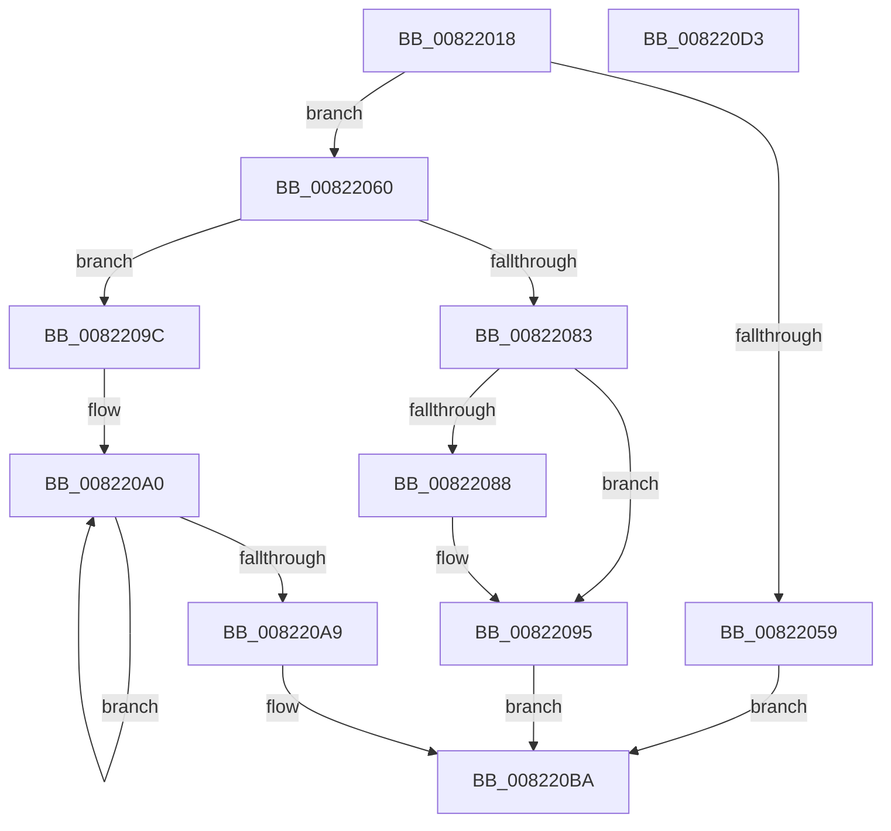

# AdtpBuildHexInt64String

- RVA: `0x00822018`–`0x008220D4` (길이 `188` bytes)
- VA: `0x0000000140822018`
- 실행 섹션: `PAGE`
- PDB 이름 있음: `예`; PDB Function 태그: `아니요`
- unwind 정보 RVA: `0x00060300`
- 디코드: `55`개 명령, `188/188` bytes 표시
- 미해석 바이트: `0` (있으면 어셈블리에 `.byte`로 보존)

> 이 문서는 커널 이미지의 기계어와 PDB 기호를 분석해 생성했습니다. 4번과 5번은 함수 원형과 자료형을 바이너리 사용 방식에서 추정한 C 해석이며 원본 소스 복구 결과는 아닙니다.

## 1. Dependencies

- 직접 호출 지점: **3**; 고유 호출 대상: **3**
- 직접 호출자로 확인된 함수: **1**
- RIP 상대 이미지 참조: **1**

### Outgoing calls
- `0x0082204A` → [ExAllocatePool2](../../poolcode/B8/ExAllocatePool2_function_00B820F0.md) (function, `0x00B820F0`)
- `0x0082207A` → [StringCchPrintfW](../../text/47/StringCchPrintfW_function_0047BAD0.md) (function, `0x0047BAD0`)
- `0x0082208D` → [ExFreePoolWithTag](../../poolcode/B8/ExFreePoolWithTag_function_00B82870.md) (function, `0x00B82870`)

### Direct callers
- [AdtpBuildRegistryValueString](AdtpBuildRegistryValueString_function_00822194.md) at `0x00822228`

### Static image references
- `0x00822065` → RVA `0x0003FA40` (`.rdata`; read)

## 2. Other-region calls and transfers

- 다른 실행 섹션으로 향하는 call: **3**
  - `0x0082204A` → [ExAllocatePool2](../../poolcode/B8/ExAllocatePool2_function_00B820F0.md) (`PAGE` → `POOLCODE`)
  - `0x0082207A` → [StringCchPrintfW](../../text/47/StringCchPrintfW_function_0047BAD0.md) (`PAGE` → `.text`)
  - `0x0082208D` → [ExFreePoolWithTag](../../poolcode/B8/ExFreePoolWithTag_function_00B82870.md) (`PAGE` → `POOLCODE`)
- 별도 외부 분기/꼬리 이동을 확인하지 못했습니다.

## 3. Assembly (complete function range)

```asm
00822018  48 89 5C 24 08                  mov qword ptr [rsp + 8], rbx
0082201D  48 89 6C 24 10                  mov qword ptr [rsp + 0x10], rbp
00822022  48 89 74 24 18                  mov qword ptr [rsp + 0x18], rsi
00822027  57                              push rdi
00822028  41 56                           push r14
0082202A  41 57                           push r15
0082202C  48 83 EC 20                     sub rsp, 0x20
00822030  48 8B F2                        mov rsi, rdx
00822033  4C 8B F1                        mov r14, rcx
00822036  41 BF 26 00 00 00               mov r15d, 0x26
0082203C  41 B8 53 65 41 6B               mov r8d, 0x6b416553
00822042  41 8B D7                        mov edx, r15d
00822045  B9 00 01 00 00                  mov ecx, 0x100
0082204A  E8 A1 00 36 00                  call 0x140b820f0
0082204F  33 ED                           xor ebp, ebp
00822051  48 8B D8                        mov rbx, rax
00822054  48 85 C0                        test rax, rax
00822057  75 07                           jne 0x140822060
00822059  B8 17 00 00 C0                  mov eax, 0xc0000017
0082205E  EB 5A                           jmp 0x1408220ba
00822060  48 8B 7C 24 68                  mov rdi, qword ptr [rsp + 0x68]
00822065  4C 8D 05 D4 D9 81 FF            lea r8, [rip - 0x7e262c]
0082206C  BA 13 00 00 00                  mov edx, 0x13
00822071  48 8B CB                        mov rcx, rbx
00822074  C6 07 01                        mov byte ptr [rdi], 1
00822077  4D 8B 0E                        mov r9, qword ptr [r14]
0082207A  E8 51 9A C5 FF                  call 0x14047bad0
0082207F  85 C0                           test eax, eax
00822081  79 19                           jns 0x14082209c
00822083  80 3F 01                        cmp byte ptr [rdi], 1
00822086  75 0D                           jne 0x140822095
00822088  33 D2                           xor edx, edx
0082208A  48 8B CB                        mov rcx, rbx
0082208D  E8 DE 07 36 00                  call 0x140b82870
00822092  40 88 2F                        mov byte ptr [rdi], bpl
00822095  B8 0D 00 00 C0                  mov eax, 0xc000000d
0082209A  EB 1E                           jmp 0x1408220ba
0082209C  48 83 C8 FF                     or rax, 0xffffffffffffffff
008220A0  48 FF C0                        inc rax
008220A3  66 39 2C 43                     cmp word ptr [rbx + rax*2], bp
008220A7  75 F7                           jne 0x1408220a0
008220A9  66 03 C0                        add ax, ax
008220AC  66 44 89 7E 02                  mov word ptr [rsi + 2], r15w
008220B1  66 89 06                        mov word ptr [rsi], ax
008220B4  33 C0                           xor eax, eax
008220B6  48 89 5E 08                     mov qword ptr [rsi + 8], rbx
008220BA  48 8B 5C 24 40                  mov rbx, qword ptr [rsp + 0x40]
008220BF  48 8B 6C 24 48                  mov rbp, qword ptr [rsp + 0x48]
008220C4  48 8B 74 24 50                  mov rsi, qword ptr [rsp + 0x50]
008220C9  48 83 C4 20                     add rsp, 0x20
008220CD  41 5F                           pop r15
008220CF  41 5E                           pop r14
008220D1  5F                              pop rdi
008220D2  C3                              ret
008220D3  CC                              int3
```

## 4. C-style interpretation (structured pseudocode)

```c
__int64 __fastcall AdtpBuildHexInt64String(__int64 a1, __int64 a2, __int64 a3, __int64 a4, __int64 a5, __int64 a6)
{
    __int64 result;
    __int64 v_rbp;
    __int64 v_rsp;
    unsigned __int64 v_stack_p10;
    unsigned __int64 v_stack_p18;
    unsigned __int64 v_stack_p8;

    v_stack_p8 = v_rbx;
    v_stack_p10 = v_rbp;
    v_stack_p18 = v_rsi;
    v_rsp = (v_rsp) - (32);
    result = ExAllocatePool2(256, 38, (unsigned int)(0x6B416553ULL), a4);
    v_rbp = 0;
    if (result != 0) goto loc_00822060;
    goto loc_008220BA;
loc_00822060:
    *(unsigned __int8 *)(a6) = 1;
    result = StringCchPrintfW(result, 19, v_rip - 8267308, *(unsigned __int64 *)(a1));
    if (!sign_flag) goto loc_0082209C;
    if ((*(unsigned __int8 *)(a6)) == 1) {
        a2 = 0;
        a1 = result;
        result = ExFreePoolWithTag(a1, a2, v_rip - 8267308, *(unsigned __int64 *)(a1));
        *(unsigned __int8 *)(a6) = 0;
    }
    goto loc_008220BA;
loc_0082209C:
    result = ((unsigned int)(0xC000000DULL)) | (-1);
loc_008220A0:
    result = (result) + 1;
    if ((*(unsigned __int16 *)(result + result * 2)) != 0) goto loc_008220A0;
    result = (unsigned __int16)((result) + ((unsigned __int16)(result)));
    *(unsigned __int16 *)(a2 + 2) = 38;
    *(unsigned __int16 *)(a2) = (unsigned __int16)(result);
    result = 0;
    *(unsigned __int64 *)(a2 + 8) = 0;
loc_008220BA:
    v_rsp = (v_rsp) + (32);
    return result;
}
```

## 5. (Beta) C Style

```c
int64_t AdtpBuildHexInt64String(void *Arg1, void *Arg2, int64_t Arg3, int64_t Arg4, uint64_t Arg5, void *Arg6)
{
    uint8_t *arg1 = (uint8_t *)Arg1;
    uint8_t *arg2 = (uint8_t *)Arg2;
    uint8_t *arg6 = (uint8_t *)Arg6;

    int64_t result;
    int64_t local_rbp;
    int64_t local_rsp;
    uint64_t v_stack_p10;
    uint64_t v_stack_p18;
    uint64_t v_stack_p8;

    v_stack_p8 = local_rbx;
    v_stack_p10 = local_rbp;
    v_stack_p18 = local_rsi;
    local_rsp = (local_rsp) - (32);
    result = ExAllocatePool2(256, 38, (uint32_t)(0x6B416553ULL), Arg4);
    local_rbp = 0;
    if (result != 0) goto loc_00822060;
    goto loc_008220BA;
loc_00822060:
    *(uint8_t *)(arg6) = 1;
    result = StringCchPrintfW(result, 19, v_rip - 8267308, *(uint64_t *)(arg1));
    if (!sign_flag) goto loc_0082209C;
    if ((*(uint8_t *)(arg6)) == 1) {
        Arg2 = 0;
        Arg1 = result;
        result = ExFreePoolWithTag(Arg1, Arg2, v_rip - 8267308, *(uint64_t *)(arg1));
        *(uint8_t *)(arg6) = 0;
    }
    goto loc_008220BA;
loc_0082209C:
    result = ((uint32_t)(0xC000000DULL)) | (-1);
loc_008220A0:
    result = (result) + 1;
    if ((*(uint16_t *)(result + result * 2)) != 0) goto loc_008220A0;
    result = (uint16_t)((result) + ((uint16_t)(result)));
    *(uint16_t *)(arg2 + 0x2) = 38;
    *(uint16_t *)(arg2) = (uint16_t)(result);
    result = 0;
    *(uint64_t *)(arg2 + 0x8) = 0;
loc_008220BA:
    local_rsp = (local_rsp) + (32);
    return result;
}
```

### 관측된 메모리 오프셋

구조체 형식이 확인되지 않은 접근은 인자 기준의 오프셋으로만 기록했습니다.

| 기준 인자 | 오프셋 표현 | 폭 (bit) | 접근 |
|---|---:|---:|---|
| `Arg1` | `+ 0x0` | `64` | `R` |
| `Arg2` | `+ 0x0` | `16` | `W` |
| `Arg2` | `+ 0x2` | `16` | `W` |
| `Arg2` | `+ 0x8` | `64` | `W` |
| `Arg6` | `+ 0x0` | `8` | `R` |
| `Arg6` | `+ 0x0` | `8` | `W` |

## 6. Execution-region graph

[열기: 2D/3D 그래프와 함수 탐색 컨트롤 패널](../../../control-panel.html?section=page&rva=0x00822018&view=graph)

- 2D 그래프는 위에서 아래로 흐르고, 3D 그래프는 빈 공간을 드래그해 회전합니다. Shift+드래그는 이동, 휠은 확대·축소, 함수 노드 선택은 대상 보고서 이동입니다.

### Static fallback


