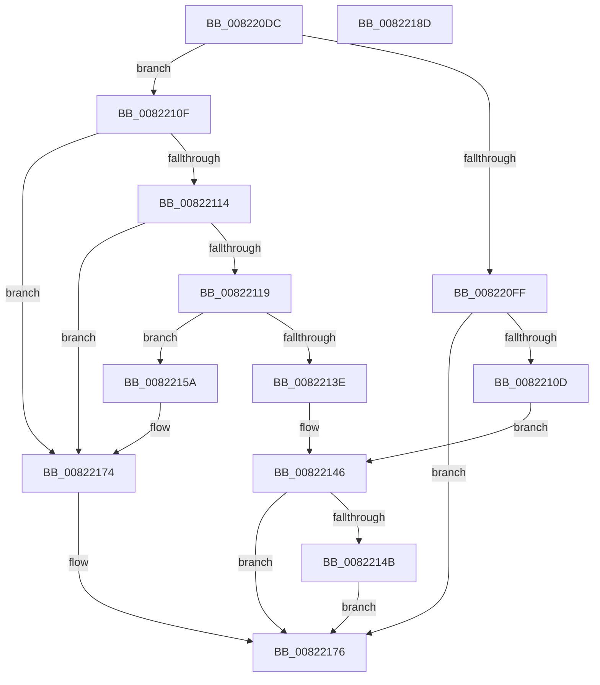

# AdtpBuildMacStrings

- RVA: `0x008220DC`–`0x0082218E` (길이 `178` bytes)
- VA: `0x00000001408220DC`
- 실행 섹션: `PAGE`
- PDB 이름 있음: `예`; PDB Function 태그: `아니요`
- unwind 정보 RVA: `0x0006C8E8`
- 디코드: `54`개 명령, `178/178` bytes 표시
- 미해석 바이트: `0` (있으면 어셈블리에 `.byte`로 보존)

> 이 문서는 커널 이미지의 기계어와 PDB 기호를 분석해 생성했습니다. 4번과 5번은 함수 원형과 자료형을 바이너리 사용 방식에서 추정한 C 해석이며 원본 소스 복구 결과는 아닙니다.

## 1. Dependencies

- 직접 호출 지점: **3**; 고유 호출 대상: **3**
- 직접 호출자로 확인된 함수: **1**
- RIP 상대 이미지 참조: **0**

### Outgoing calls
- `0x0082212D` → [ExAllocatePool2](../../poolcode/B8/ExAllocatePool2_function_00B820F0.md) (function, `0x00B820F0`)
- `0x00822153` → [ExFreePoolWithTag](../../poolcode/B8/ExFreePoolWithTag_function_00B82870.md) (function, `0x00B82870`)
- `0x00822164` → [RtlEthernetAddressToStringW](../../text/4D/RtlEthernetAddressToStringW_function_004D4710.md) (function, `0x004D4710`)

### Direct callers
- [AdtpBuildSockAddrString](../A2/AdtpBuildSockAddrString_function_00A2B53C.md) at `0x00A2B5B8`

### Static image references
- 디코드된 RIP-relative 메모리 참조가 없습니다.

## 2. Other-region calls and transfers

- 다른 실행 섹션으로 향하는 call: **3**
  - `0x0082212D` → [ExAllocatePool2](../../poolcode/B8/ExAllocatePool2_function_00B820F0.md) (`PAGE` → `POOLCODE`)
  - `0x00822153` → [ExFreePoolWithTag](../../poolcode/B8/ExFreePoolWithTag_function_00B82870.md) (`PAGE` → `POOLCODE`)
  - `0x00822164` → [RtlEthernetAddressToStringW](../../text/4D/RtlEthernetAddressToStringW_function_004D4710.md) (`PAGE` → `.text`)
- 별도 외부 분기/꼬리 이동을 확인하지 못했습니다.

## 3. Assembly (complete function range)

```asm
008220DC  48 89 5C 24 10                  mov qword ptr [rsp + 0x10], rbx
008220E1  48 89 6C 24 18                  mov qword ptr [rsp + 0x18], rbp
008220E6  48 89 74 24 20                  mov qword ptr [rsp + 0x20], rsi
008220EB  57                              push rdi
008220EC  48 83 EC 20                     sub rsp, 0x20
008220F0  66 83 39 21                     cmp word ptr [rcx], 0x21
008220F4  49 8B F8                        mov rdi, r8
008220F7  48 8B DA                        mov rbx, rdx
008220FA  48 8B E9                        mov rbp, rcx
008220FD  74 10                           je 0x14082210f
008220FF  48 8D 4A 08                     lea rcx, [rdx + 8]
00822103  BB 41 01 00 C0                  mov ebx, 0xc0000141
00822108  4D 85 C0                        test r8, r8
0082210B  74 69                           je 0x140822176
0082210D  EB 37                           jmp 0x140822146
0082210F  48 85 DB                        test rbx, rbx
00822112  74 60                           je 0x140822174
00822114  48 85 FF                        test rdi, rdi
00822117  74 5B                           je 0x140822174
00822119  BA 24 00 00 00                  mov edx, 0x24
0082211E  B9 00 01 00 00                  mov ecx, 0x100
00822123  41 B8 53 65 41 6B               mov r8d, 0x6b416553
00822129  66 89 53 02                     mov word ptr [rbx + 2], dx
0082212D  E8 BE FF 35 00                  call 0x140b820f0
00822132  48 8D 73 08                     lea rsi, [rbx + 8]
00822136  48 89 06                        mov qword ptr [rsi], rax
00822139  48 85 C0                        test rax, rax
0082213C  75 1C                           jne 0x14082215a
0082213E  BB 17 00 00 C0                  mov ebx, 0xc0000017
00822143  48 8B CE                        mov rcx, rsi
00822146  80 3F 00                        cmp byte ptr [rdi], 0
00822149  74 2B                           je 0x140822176
0082214B  C6 07 00                        mov byte ptr [rdi], 0
0082214E  33 D2                           xor edx, edx
00822150  48 8B 09                        mov rcx, qword ptr [rcx]
00822153  E8 18 07 36 00                  call 0x140b82870
00822158  EB 1C                           jmp 0x140822176
0082215A  C6 07 01                        mov byte ptr [rdi], 1
0082215D  48 8D 4D 02                     lea rcx, [rbp + 2]
00822161  48 8B 16                        mov rdx, qword ptr [rsi]
00822164  E8 A7 25 CB FF                  call 0x1404d4710
00822169  2B 06                           sub eax, dword ptr [rsi]
0082216B  48 D1 F8                        sar rax, 1
0082216E  66 03 C0                        add ax, ax
00822171  66 89 03                        mov word ptr [rbx], ax
00822174  33 DB                           xor ebx, ebx
00822176  48 8B 6C 24 40                  mov rbp, qword ptr [rsp + 0x40]
0082217B  8B C3                           mov eax, ebx
0082217D  48 8B 5C 24 38                  mov rbx, qword ptr [rsp + 0x38]
00822182  48 8B 74 24 48                  mov rsi, qword ptr [rsp + 0x48]
00822187  48 83 C4 20                     add rsp, 0x20
0082218B  5F                              pop rdi
0082218C  C3                              ret
0082218D  CC                              int3
```

## 4. C-style interpretation (structured pseudocode)

```c
__int64 __fastcall AdtpBuildMacStrings(__int64 a1, __int64 a2, __int64 a3)
{
    __int64 result;
    __int64 v_rbx;
    __int64 v_rsp;
    unsigned __int64 v_stack_p10;
    unsigned __int64 v_stack_p18;
    unsigned __int64 v_stack_p20;

    v_stack_p10 = v_rbx;
    v_stack_p18 = v_rbp;
    v_stack_p20 = v_rsi;
    v_rsp = (v_rsp) - (32);
    if ((*(unsigned __int16 *)(a1)) == 33) goto loc_0082210F;
    if (a3 == 0) goto loc_00822176;
    goto loc_00822146;
loc_0082210F:
    if ((unsigned int)(0xC0000141ULL) == 0) goto loc_00822174;
    if (a3 == 0) goto loc_00822174;
    *(unsigned __int16 *)((unsigned int)(0xC0000141ULL) + 2) = 36;
    result = ExAllocatePool2(256, 36, (unsigned int)(0x6B416553ULL), a4);
    *(unsigned __int64 *)((unsigned int)(0xC0000141ULL) + 8) = result;
    if (result != 0) goto loc_0082215A;
loc_00822146:
    if ((*(unsigned __int8 *)(a3)) == 0) goto loc_00822176;
    *(unsigned __int8 *)(a3) = 0;
    a2 = 0;
    result = ExFreePoolWithTag(*(unsigned __int64 *)((unsigned int)(0xC0000141ULL) + 8), a2, (unsigned int)(0x6B416553ULL), a4);
    goto loc_00822176;
loc_0082215A:
    *(unsigned __int8 *)(a3) = 1;
    result = RtlEthernetAddressToStringW(a1 + 2, *(unsigned __int64 *)((unsigned int)(0xC0000141ULL) + 8), (unsigned int)(0x6B416553ULL), a4);
    result = (unsigned int)((result) - (*(unsigned int *)((unsigned int)(0xC0000141ULL) + 8)));
    result = (result) >> (1);
    result = (unsigned __int16)((result) + ((unsigned __int16)(result)));
    *(unsigned __int16 *)((unsigned int)(0xC0000017ULL)) = (unsigned __int16)(result);
loc_00822174:
    v_rbx = 0;
loc_00822176:
    v_rsp = (v_rsp) + (32);
    return 0;
}
```

## 5. (Beta) C Style

```c
int64_t AdtpBuildMacStrings(void *Arg1, void *Arg2, int64_t Arg3)
{
    uint8_t *arg1 = (uint8_t *)Arg1;
    uint8_t *arg2 = (uint8_t *)Arg2;

    int64_t result;
    int64_t local_rbx;
    int64_t local_rsp;
    uint64_t v_stack_p10;
    uint64_t v_stack_p18;
    uint64_t v_stack_p20;

    v_stack_p10 = local_rbx;
    v_stack_p18 = local_rbp;
    v_stack_p20 = local_rsi;
    local_rsp = (local_rsp) - (32);
    if ((*(uint16_t *)(arg1)) == 33) goto loc_0082210F;
    if (Arg3 == 0) goto loc_00822176;
    goto loc_00822146;
loc_0082210F:
    if ((uint32_t)(0xC0000141ULL) == 0) goto loc_00822174;
    if (Arg3 == 0) goto loc_00822174;
    *(uint16_t *)((uint32_t)(0xC0000141ULL) + 0x2) = 36;
    result = ExAllocatePool2(256, 36, (uint32_t)(0x6B416553ULL), a4);
    *(uint64_t *)((uint32_t)(0xC0000141ULL) + 0x8) = result;
    if (result != 0) goto loc_0082215A;
loc_00822146:
    if ((*(uint8_t *)(Arg3)) == 0) goto loc_00822176;
    *(uint8_t *)(Arg3) = 0;
    Arg2 = 0;
    result = ExFreePoolWithTag(*(uint64_t *)((uint32_t)(0xC0000141ULL) + 0x8), Arg2, (uint32_t)(0x6B416553ULL), a4);
    goto loc_00822176;
loc_0082215A:
    *(uint8_t *)(Arg3) = 1;
    result = RtlEthernetAddressToStringW(Arg1 + 2, *(uint64_t *)((uint32_t)(0xC0000141ULL) + 0x8), (uint32_t)(0x6B416553ULL), a4);
    result = (uint32_t)((result) - (*(uint32_t *)((uint32_t)(0xC0000141ULL) + 0x8)));
    result = (result) >> (1);
    result = (uint16_t)((result) + ((uint16_t)(result)));
    *(uint16_t *)((uint32_t)(0xC0000017ULL)) = (uint16_t)(result);
loc_00822174:
    local_rbx = 0;
loc_00822176:
    local_rsp = (local_rsp) + (32);
    return 0;
}
```

### 관측된 메모리 오프셋

구조체 형식이 확인되지 않은 접근은 인자 기준의 오프셋으로만 기록했습니다.

| 기준 인자 | 오프셋 표현 | 폭 (bit) | 접근 |
|---|---:|---:|---|
| `Arg1` | `+ 0x0` | `16` | `R` |
| `Arg1` | `+ 0x2` | `64` | `R` |
| `Arg2` | `+ 0x8` | `64` | `R` |

## 6. Execution-region graph

[열기: 2D/3D 그래프와 함수 탐색 컨트롤 패널](../../../control-panel.html?section=page&rva=0x008220DC&view=graph)

- 2D 그래프는 위에서 아래로 흐르고, 3D 그래프는 빈 공간을 드래그해 회전합니다. Shift+드래그는 이동, 휠은 확대·축소, 함수 노드 선택은 대상 보고서 이동입니다.

### Static fallback


