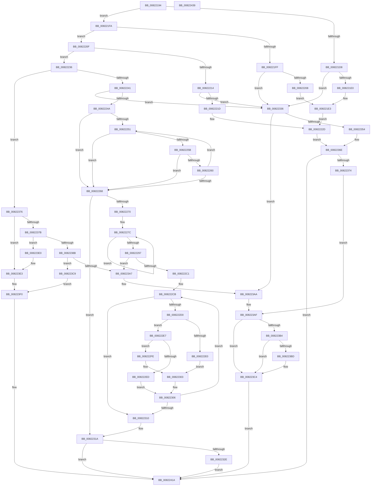

# AdtpBuildRegistryValueString

- RVA: `0x00822194`–`0x0082243A` (길이 `678` bytes)
- VA: `0x0000000140822194`
- 실행 섹션: `PAGE`
- PDB 이름 있음: `예`; PDB Function 태그: `아니요`
- unwind 정보 RVA: `0x0008C20C`
- 디코드: `200`개 명령, `678/678` bytes 표시
- 미해석 바이트: `0` (있으면 어셈블리에 `.byte`로 보존)

> 이 문서는 커널 이미지의 기계어와 PDB 기호를 분석해 생성했습니다. 4번과 5번은 함수 원형과 자료형을 바이너리 사용 방식에서 추정한 C 해석이며 원본 소스 복구 결과는 아닙니다.

## 1. Dependencies

- 직접 호출 지점: **10**; 고유 호출 대상: **7**
- 직접 호출자로 확인된 함수: **1**
- RIP 상대 이미지 참조: **0**

### Outgoing calls
- `0x008221F3` → [AdtpBuildUlongString](../AB/AdtpBuildUlongString_function_00AB3BA4.md) (function, `0x00AB3BA4`)
- `0x00822228` → [AdtpBuildHexInt64String](AdtpBuildHexInt64String_function_00822018.md) (function, `0x00822018`)
- `0x008222AD` → [ExAllocatePool2](../../poolcode/B8/ExAllocatePool2_function_00B820F0.md) (function, `0x00B820F0`)
- `0x00822320` → [RtlInitUnicodeString](../../text/42/RtlInitUnicodeString_function_0042A780.md) (function, `0x0042A780`)
- `0x00822346` → [ExAllocatePool2](../../poolcode/B8/ExAllocatePool2_function_00B820F0.md) (function, `0x00B820F0`)
- `0x00822365` → [AdtpBuildReplacementString](AdtpBuildReplacementString_function_00822884.md) (function, `0x00822884`)
- `0x0082239A` → [ExAllocatePool2](../../poolcode/B8/ExAllocatePool2_function_00B820F0.md) (function, `0x00B820F0`)
- `0x008223BF` → [ExFreePoolWithTag](../../poolcode/B8/ExFreePoolWithTag_function_00B82870.md) (function, `0x00B82870`)
- `0x008223D2` → [memcpy](../../text/6C/memcpy_function_006C6840.md) (function, `0x006C6840`)
- `0x008223F6` → [RtlInitUnicodeString](../../text/42/RtlInitUnicodeString_function_0042A780.md) (function, `0x0042A780`)

### Direct callers
- [SeAdtRegistryValueChangedAuditAlarm](../79/SeAdtRegistryValueChangedAuditAlarm_function_0079DDD4.md) at `0x0079DFED`
- [SeAdtRegistryValueChangedAuditAlarm](../79/SeAdtRegistryValueChangedAuditAlarm_function_0079DDD4.md) at `0x0079E093`

### Static image references
- 디코드된 RIP-relative 메모리 참조가 없습니다.

## 2. Other-region calls and transfers

- 다른 실행 섹션으로 향하는 call: **7**
  - `0x008222AD` → [ExAllocatePool2](../../poolcode/B8/ExAllocatePool2_function_00B820F0.md) (`PAGE` → `POOLCODE`)
  - `0x00822320` → [RtlInitUnicodeString](../../text/42/RtlInitUnicodeString_function_0042A780.md) (`PAGE` → `.text`)
  - `0x00822346` → [ExAllocatePool2](../../poolcode/B8/ExAllocatePool2_function_00B820F0.md) (`PAGE` → `POOLCODE`)
  - `0x0082239A` → [ExAllocatePool2](../../poolcode/B8/ExAllocatePool2_function_00B820F0.md) (`PAGE` → `POOLCODE`)
  - `0x008223BF` → [ExFreePoolWithTag](../../poolcode/B8/ExFreePoolWithTag_function_00B82870.md) (`PAGE` → `POOLCODE`)
  - `0x008223D2` → [memcpy](../../text/6C/memcpy_function_006C6840.md) (`PAGE` → `.text`)
  - `0x008223F6` → [RtlInitUnicodeString](../../text/42/RtlInitUnicodeString_function_0042A780.md) (`PAGE` → `.text`)
- 별도 외부 분기/꼬리 이동을 확인하지 못했습니다.

## 3. Assembly (complete function range)

```asm
00822194  48 89 5C 24 08                  mov qword ptr [rsp + 8], rbx
00822199  48 89 6C 24 10                  mov qword ptr [rsp + 0x10], rbp
0082219E  48 89 74 24 18                  mov qword ptr [rsp + 0x18], rsi
008221A3  57                              push rdi
008221A4  41 54                           push r12
008221A6  41 55                           push r13
008221A8  41 56                           push r14
008221AA  41 57                           push r15
008221AC  48 83 EC 30                     sub rsp, 0x30
008221B0  4C 8B BC 24 80 00 00 00         mov r15, qword ptr [rsp + 0x80]
008221B8  45 33 ED                        xor r13d, r13d
008221BB  8B DA                           mov ebx, edx
008221BD  49 8B F1                        mov rsi, r9
008221C0  4D 8B F0                        mov r14, r8
008221C3  41 8B FD                        mov edi, r13d
008221C6  45 8B CD                        mov r9d, r13d
008221C9  45 8B E5                        mov r12d, r13d
008221CC  45 88 2F                        mov byte ptr [r15], r13b
008221CF  41 8D 6D 01                     lea ebp, [r13 + 1]
008221D3  83 F9 04                        cmp ecx, 4
008221D6  75 22                           jne 0x1408221fa
008221D8  3B D9                           cmp ebx, ecx
008221DA  0F 82 56 01 00 00               jb 0x140822336
008221E0  41 8B 08                        mov ecx, dword ptr [r8]
008221E3  4C 89 7C 24 28                  mov qword ptr [rsp + 0x28], r15
008221E8  48 8B D6                        mov rdx, rsi
008221EB  45 33 C0                        xor r8d, r8d
008221EE  4C 89 6C 24 20                  mov qword ptr [rsp + 0x20], r13
008221F3  E8 AC 19 29 00                  call 0x140ab3ba4
008221F8  EB 33                           jmp 0x14082222d
008221FA  83 F9 05                        cmp ecx, 5
008221FD  75 10                           jne 0x14082220f
008221FF  83 FB 04                        cmp ebx, 4
00822202  0F 82 2E 01 00 00               jb 0x140822336
00822208  41 8B 08                        mov ecx, dword ptr [r8]
0082220B  0F C9                           bswap ecx
0082220D  EB D4                           jmp 0x1408221e3
0082220F  83 F9 0B                        cmp ecx, 0xb
00822212  75 22                           jne 0x140822236
00822214  83 FB 08                        cmp ebx, 8
00822217  0F 82 19 01 00 00               jb 0x140822336
0082221D  48 8B D6                        mov rdx, rsi
00822220  4C 89 7C 24 28                  mov qword ptr [rsp + 0x28], r15
00822225  49 8B CE                        mov rcx, r14
00822228  E8 EB FD FF FF                  call 0x140822018
0082222D  8B F8                           mov edi, eax
0082222F  85 C0                           test eax, eax
00822231  E9 38 01 00 00                  jmp 0x14082236e
00822236  8D 41 FF                        lea eax, [rcx - 1]
00822239  3B C5                           cmp eax, ebp
0082223B  0F 86 35 01 00 00               jbe 0x140822376
00822241  83 F9 07                        cmp ecx, 7
00822244  0F 85 EC 00 00 00               jne 0x140822336
0082224A  D1 EB                           shr ebx, 1
0082224C  41 8B CD                        mov ecx, r13d
0082224F  74 17                           je 0x140822268
00822251  8D 53 FF                        lea edx, [rbx - 1]
00822254  66 45 39 2C 50                  cmp word ptr [r8 + rdx*2], r13w
00822259  75 0D                           jne 0x140822268
0082225B  83 F9 02                        cmp ecx, 2
0082225E  73 08                           jae 0x140822268
00822260  03 CD                           add ecx, ebp
00822262  8B DA                           mov ebx, edx
00822264  85 D2                           test edx, edx
00822266  75 E9                           jne 0x140822251
00822268  3B DD                           cmp ebx, ebp
0082226A  0F 82 AA 00 00 00               jb 0x14082231a
00822270  49 8B D6                        mov rdx, r14
00822273  44 8B C3                        mov r8d, ebx
00822276  41 BA 2A 00 00 00               mov r10d, 0x2a
0082227C  0F B7 0A                        movzx ecx, word ptr [rdx]
0082227F  41 8D 41 01                     lea eax, [r9 + 1]
00822283  66 41 3B CA                     cmp cx, r10w
00822287  48 8D 52 02                     lea rdx, [rdx + 2]
0082228B  41 0F 45 C1                     cmovne eax, r9d
0082228F  44 8B C8                        mov r9d, eax
00822292  4C 2B C5                        sub r8, rbp
00822295  75 E5                           jne 0x14082227c
00822297  44 8D 2C 18                     lea r13d, [rax + rbx]
0082229B  B9 00 01 00 00                  mov ecx, 0x100
008222A0  41 8D 55 01                     lea edx, [r13 + 1]
008222A4  41 B8 53 65 41 6B               mov r8d, 0x6b416553
008222AA  48 03 D2                        add rdx, rdx
008222AD  E8 3E FE 35 00                  call 0x140b820f0
008222B2  45 33 D2                        xor r10d, r10d
008222B5  4C 8B E0                        mov r12, rax
008222B8  48 85 C0                        test rax, rax
008222BB  0F 84 E6 00 00 00               je 0x1408223a7
008222C1  41 8B D2                        mov edx, r10d
008222C4  45 8D 5A 2A                     lea r11d, [r10 + 0x2a]
008222C8  41 8B CA                        mov ecx, r10d
008222CB  41 3B CD                        cmp ecx, r13d
008222CE  73 40                           jae 0x140822310
008222D0  41 0F B7 06                     movzx eax, word ptr [r14]
008222D4  44 8D 41 01                     lea r8d, [rcx + 1]
008222D8  44 8B C9                        mov r9d, ecx
008222DB  66 85 C0                        test ax, ax
008222DE  75 07                           jne 0x1408222e7
008222E0  66 47 89 1C 4C                  mov word ptr [r12 + r9*2], r11w
008222E5  EB 1C                           jmp 0x140822303
008222E7  66 41 3B C3                     cmp ax, r11w
008222EB  75 11                           jne 0x1408222fe
008222ED  41 8B C8                        mov ecx, r8d
008222F0  66 47 89 1C 4C                  mov word ptr [r12 + r9*2], r11w
008222F5  03 CD                           add ecx, ebp
008222F7  66 47 89 1C 44                  mov word ptr [r12 + r8*2], r11w
008222FC  EB 08                           jmp 0x140822306
008222FE  66 43 89 04 4C                  mov word ptr [r12 + r9*2], ax
00822303  41 8B C8                        mov ecx, r8d
00822306  03 D5                           add edx, ebp
00822308  49 83 C6 02                     add r14, 2
0082230C  3B D3                           cmp edx, ebx
0082230E  72 BB                           jb 0x1408222cb
00822310  8B C1                           mov eax, ecx
00822312  45 33 ED                        xor r13d, r13d
00822315  66 45 89 2C 44                  mov word ptr [r12 + rax*2], r13w
0082231A  49 8B D4                        mov rdx, r12
0082231D  48 8B CE                        mov rcx, rsi
00822320  E8 5B 84 C0 FF                  call 0x14042a780
00822325  4D 85 E4                        test r12, r12
00822328  0F 84 EC 00 00 00               je 0x14082241a
0082232E  41 88 2F                        mov byte ptr [r15], bpl
00822331  E9 E4 00 00 00                  jmp 0x14082241a
00822336  BA 1A 00 00 00                  mov edx, 0x1a
0082233B  B9 00 01 00 00                  mov ecx, 0x100
00822340  41 B8 53 65 41 6B               mov r8d, 0x6b416553
00822346  E8 A5 FD 35 00                  call 0x140b820f0
0082234B  48 89 46 08                     mov qword ptr [rsi + 8], rax
0082234F  48 85 C0                        test rax, rax
00822352  74 56                           je 0x1408223aa
00822354  41 88 2F                        mov byte ptr [r15], bpl
00822357  48 8B D6                        mov rdx, rsi
0082235A  B9 08 07 00 00                  mov ecx, 0x708
0082235F  C7 06 00 00 1A 00               mov dword ptr [rsi], 0x1a0000
00822365  E8 1A 05 00 00                  call 0x140822884
0082236A  8B F8                           mov edi, eax
0082236C  85 C0                           test eax, eax
0082236E  0F 89 A6 00 00 00               jns 0x14082241a
00822374  EB 39                           jmp 0x1408223af
00822376  83 FB 02                        cmp ebx, 2
00822379  72 68                           jb 0x1408223e3
0082237B  4C 8B EB                        mov r13, rbx
0082237E  33 C9                           xor ecx, ecx
00822380  49 D1 ED                        shr r13, 1
00822383  66 43 3B 4C 68 FE               cmp cx, word ptr [r8 + r13*2 - 2]
00822389  74 55                           je 0x1408223e0
0082238B  48 8D 53 02                     lea rdx, [rbx + 2]
0082238F  B9 00 01 00 00                  mov ecx, 0x100
00822394  41 B8 53 65 41 6B               mov r8d, 0x6b416553
0082239A  E8 51 FD 35 00                  call 0x140b820f0
0082239F  4C 8B E0                        mov r12, rax
008223A2  48 85 C0                        test rax, rax
008223A5  75 22                           jne 0x1408223c9
008223A7  45 33 ED                        xor r13d, r13d
008223AA  BF 17 00 00 C0                  mov edi, 0xc0000017
008223AF  45 38 2F                        cmp byte ptr [r15], r13b
008223B2  74 10                           je 0x1408223c4
008223B4  48 8B 4E 08                     mov rcx, qword ptr [rsi + 8]
008223B8  48 85 C9                        test rcx, rcx
008223BB  74 07                           je 0x1408223c4
008223BD  33 D2                           xor edx, edx
008223BF  E8 AC 04 36 00                  call 0x140b82870
008223C4  45 88 2F                        mov byte ptr [r15], r13b
008223C7  EB 51                           jmp 0x14082241a
008223C9  4C 8B C3                        mov r8, rbx
008223CC  49 8B D6                        mov rdx, r14
008223CF  49 8B CC                        mov rcx, r12
008223D2  E8 69 44 EA FF                  call 0x1406c6840
008223D7  33 C0                           xor eax, eax
008223D9  66 43 89 04 6C                  mov word ptr [r12 + r13*2], ax
008223DE  EB 10                           jmp 0x1408223f0
008223E0  45 33 ED                        xor r13d, r13d
008223E3  83 FB 02                        cmp ebx, 2
008223E6  4D 8B E6                        mov r12, r14
008223E9  41 8A ED                        mov bpl, r13b
008223EC  4D 0F 42 E5                     cmovb r12, r13
008223F0  49 8B D4                        mov rdx, r12
008223F3  48 8B CE                        mov rcx, rsi
008223F6  E8 85 83 C0 FF                  call 0x14042a780
008223FB  41 88 2F                        mov byte ptr [r15], bpl
008223FE  0F B7 06                        movzx eax, word ptr [rsi]
00822401  66 3B C3                        cmp ax, bx
00822404  66 0F 43 C3                     cmovae ax, bx
00822408  66 89 06                        mov word ptr [rsi], ax
0082240B  0F B7 46 02                     movzx eax, word ptr [rsi + 2]
0082240F  66 3B C3                        cmp ax, bx
00822412  66 0F 43 C3                     cmovae ax, bx
00822416  66 89 46 02                     mov word ptr [rsi + 2], ax
0082241A  48 8B 5C 24 60                  mov rbx, qword ptr [rsp + 0x60]
0082241F  8B C7                           mov eax, edi
00822421  48 8B 6C 24 68                  mov rbp, qword ptr [rsp + 0x68]
00822426  48 8B 74 24 70                  mov rsi, qword ptr [rsp + 0x70]
0082242B  48 83 C4 30                     add rsp, 0x30
0082242F  41 5F                           pop r15
00822431  41 5E                           pop r14
00822433  41 5D                           pop r13
00822435  41 5C                           pop r12
00822437  5F                              pop rdi
00822438  C3                              ret
00822439  CC                              int3
```

## 4. C-style interpretation (structured pseudocode)

```c
__int64 __fastcall AdtpBuildRegistryValueString(int a1, int a2, __int64 a3, __int64 a4, __int64 a5)
{
    __int64 result;
    __int64 v_r10;
    __int64 v_r12;
    __int64 v_r13;
    __int64 v_r14;
    __int64 v_rbx;
    __int64 v_rsp;
    unsigned __int64 v_stack_m30;
    unsigned __int64 v_stack_m38;
    unsigned __int64 v_stack_p10;
    unsigned __int64 v_stack_p18;
    unsigned __int64 v_stack_p8;

    v_stack_p8 = v_rbx;
    v_stack_p10 = v_rbp;
    v_stack_p18 = v_rsi;
    v_rsp = (v_rsp) - (48);
    v_r13 = 0;
    *(unsigned __int8 *)(a5) = 0;
    if (a1 != 4) goto loc_008221FA;
    if (((unsigned int)((unsigned int)(a2))) < a1) goto loc_00822336;
loc_008221E3:
    v_stack_m30 = a5;
    a3 = 0;
    v_stack_m38 = 0;
    result = AdtpBuildUlongString((unsigned int)(*(unsigned int *)(a3)), a4, a3, 0);
    goto loc_0082222D;
loc_008221FA:
    if (((unsigned int)((unsigned int)(*(unsigned int *)(a3)))) != 5) goto loc_0082220F;
    if (((unsigned int)((unsigned int)(a2))) < 4) goto loc_00822336;
    goto loc_008221E3;
loc_0082220F:
    if (((unsigned int)((unsigned int)(*(unsigned int *)(a3)))) != 11) goto loc_00822236;
    if (((unsigned int)((unsigned int)(a2))) < 8) goto loc_00822336;
    v_stack_m30 = a5;
    result = AdtpBuildHexInt64String(0, a4, a3, 0);
loc_0082222D:
    goto loc_0082236E;
loc_00822236:
    if (((unsigned int)(0 - 1)) <= ((unsigned int)(v_r13 + 1))) goto loc_00822376;
    if (0 != 7) goto loc_00822336;
    v_rbx = (unsigned int)(((unsigned int)(a2)) >> (1));
    if (condition_is_equal) goto loc_00822268;
loc_00822251:
    if ((*(unsigned __int16 *)(a3 + v_rbx - 1 * 2)) != 0) goto loc_00822268;
    if (0 >= 2) goto loc_00822268;
    a1 = (unsigned int)((0) + ((unsigned int)(v_r13 + 1)));
    if ((unsigned int)(v_rbx - 1) != 0) goto loc_00822251;
loc_00822268:
    if (((unsigned int)((unsigned int)((unsigned int)(v_rbx - 1)))) < ((unsigned int)(v_r13 + 1))) goto loc_0082231A;
loc_0082227C:
    result = 0 + 1;
    if (((unsigned __int16)(*(unsigned __int16 *)(0))) != 42) { result = 0; }
    a3 = ((unsigned int)((unsigned int)((unsigned int)((unsigned int)(v_rbx - 1))))) - (v_r13 + 1);
    if (condition_is_not_equal) goto loc_0082227C;
    a2 = (result + (unsigned int)((unsigned int)(v_rbx - 1)) * 1 + 1) + (result + (unsigned int)((unsigned int)(v_rbx - 1)) * 1 + 1);
    result = ExAllocatePool2(256, a2, (unsigned int)(0x6B416553ULL), (unsigned int)((unsigned int)(result)));
    v_r10 = 0;
    if (result == 0) goto loc_008223A7;
loc_008222CB:
    if (0 >= ((unsigned int)(result + (unsigned int)((unsigned int)(v_rbx - 1)) * 1))) goto loc_00822310;
    if ((unsigned __int16)(*(unsigned __int16 *)(a3)) != 0) goto loc_008222E7;
    *(unsigned __int16 *)(result + 0 * 2) = (unsigned __int16)(v_r10 + 42);
    goto loc_00822303;
loc_008222E7:
    if (((unsigned __int16)(*(unsigned __int16 *)(a3))) != ((unsigned __int16)(v_r10 + 42))) goto loc_008222FE;
    *(unsigned __int16 *)(result + 0 * 2) = (unsigned __int16)(v_r10 + 42);
    a1 = (unsigned int)(((unsigned int)((unsigned int)(0 + 1))) + ((unsigned int)(v_r13 + 1)));
    *(unsigned __int16 *)(result + 0 + 1 * 2) = (unsigned __int16)(v_r10 + 42);
    goto loc_00822306;
loc_008222FE:
    *(unsigned __int16 *)(result + 0 * 2) = (unsigned __int16)(*(unsigned __int16 *)(a3));
loc_00822303:
loc_00822306:
    a2 = (unsigned int)((0) + ((unsigned int)(v_r13 + 1)));
    v_r14 = (a3) + (2);
    if (a2 < ((unsigned int)((unsigned int)((unsigned int)(v_rbx - 1))))) goto loc_008222CB;
loc_00822310:
    v_r13 = 0;
    *(unsigned __int16 *)(result + (unsigned int)((unsigned int)((unsigned int)((unsigned int)(0 + 1)))) * 2) = 0;
loc_0082231A:
    result = RtlInitUnicodeString(a4, result, 0 + 1, 0);
    if (result == 0) goto loc_0082241A;
    *(unsigned __int8 *)(a5) = (unsigned __int8)(v_r13 + 1);
    goto loc_0082241A;
loc_00822336:
    result = ExAllocatePool2(256, 26, (unsigned int)(0x6B416553ULL), 0);
    *(unsigned __int64 *)(a4 + 8) = result;
    if (result == 0) goto loc_008223AA;
    *(unsigned __int8 *)(a5) = (unsigned __int8)(v_r13 + 1);
    *(unsigned int *)(a4) = 0x1A0000ULL;
    result = AdtpBuildReplacementString((unsigned int)(0x708ULL), a4, (unsigned int)(0x6B416553ULL), 0);
loc_0082236E:
    if (!sign_flag) goto loc_0082241A;
    goto loc_008223AF;
loc_00822376:
    if (((unsigned int)((unsigned int)((unsigned int)(v_rbx - 1)))) < 2) goto loc_008223E3;
    a1 = 0;
    v_r13 = ((unsigned int)((unsigned int)(v_rbx - 1))) >> (1);
    if (0 == (*(unsigned __int16 *)((unsigned int)(0x6B416553ULL) + v_r13 * 2 - 2))) goto loc_008223E0;
    result = ExAllocatePool2(256, (unsigned int)((unsigned int)(v_rbx - 1)) + 2, (unsigned int)(0x6B416553ULL), 0);
    if (result != 0) goto loc_008223C9;
loc_008223A7:
    v_r13 = 0;
loc_008223AA:
loc_008223AF:
    if ((*(unsigned __int8 *)(a5)) == 0) goto loc_008223C4;
    if (*(unsigned __int64 *)(a4 + 8) != 0) {
        a2 = 0;
        result = ExFreePoolWithTag(*(unsigned __int64 *)(a4 + 8), a2, (unsigned int)(0x6B416553ULL), 0);
    }
    *(unsigned __int8 *)(a5) = 0;
    goto loc_0082241A;
loc_008223C9:
    result = memcpy(result, v_r14, (unsigned int)((unsigned int)(v_rbx - 1)), 0);
    result = 0;
    *(unsigned __int16 *)(result + v_r13 * 2) = 0;
    goto loc_008223F0;
loc_008223E0:
    v_r13 = 0;
loc_008223E3:
    v_r12 = v_r14;
    if (((unsigned int)((unsigned int)((unsigned int)(v_rbx - 1)))) < 2) { v_r12 = 0; }
loc_008223F0:
    result = RtlInitUnicodeString(a4, v_r12, (unsigned int)((unsigned int)(v_rbx - 1)), 0);
    *(unsigned __int8 *)(a5) = 0;
    result = *(unsigned __int16 *)(a4);
    if (((unsigned __int16)(*(unsigned __int16 *)(a4))) >= ((unsigned __int16)((unsigned int)((unsigned int)(v_rbx - 1))))) { result = (unsigned __int16)((unsigned int)((unsigned int)(v_rbx - 1))); }
    *(unsigned __int16 *)(a4) = (unsigned __int16)(result);
    result = *(unsigned __int16 *)(a4 + 2);
    if (((unsigned __int16)(*(unsigned __int16 *)(a4 + 2))) >= ((unsigned __int16)((unsigned int)((unsigned int)(v_rbx - 1))))) { result = (unsigned __int16)((unsigned int)((unsigned int)(v_rbx - 1))); }
    *(unsigned __int16 *)(a4 + 2) = (unsigned __int16)(result);
loc_0082241A:
    v_rsp = (v_rsp) + (48);
    return (unsigned int)((unsigned int)((unsigned int)(0xC0000017ULL)));
}
```

## 5. (Beta) C Style

```c
int64_t AdtpBuildRegistryValueString(int32_t Arg1, int32_t Arg2, void *Arg3, void *Arg4, void *Arg5)
{
    uint8_t *arg3 = (uint8_t *)Arg3;
    uint8_t *arg4 = (uint8_t *)Arg4;
    uint8_t *arg5 = (uint8_t *)Arg5;

    int64_t result;
    int64_t local_r10;
    int64_t local_r12;
    int64_t local_r13;
    int64_t local_r14;
    int64_t local_rbx;
    int64_t local_rsp;
    uint64_t v_stack_m30;
    uint64_t v_stack_m38;
    uint64_t v_stack_p10;
    uint64_t v_stack_p18;
    uint64_t v_stack_p8;

    v_stack_p8 = local_rbx;
    v_stack_p10 = local_rbp;
    v_stack_p18 = local_rsi;
    local_rsp = (local_rsp) - (48);
    local_r13 = 0;
    *(uint8_t *)(arg5) = 0;
    if (Arg1 != 4) goto loc_008221FA;
    if (((uint32_t)((uint32_t)(Arg2))) < Arg1) goto loc_00822336;
loc_008221E3:
    v_stack_m30 = Arg5;
    Arg3 = 0;
    v_stack_m38 = 0;
    result = AdtpBuildUlongString((uint32_t)(*(uint32_t *)(arg3)), Arg4, Arg3, 0);
    goto loc_0082222D;
loc_008221FA:
    if (((uint32_t)((uint32_t)(*(uint32_t *)(arg3)))) != 5) goto loc_0082220F;
    if (((uint32_t)((uint32_t)(Arg2))) < 4) goto loc_00822336;
    goto loc_008221E3;
loc_0082220F:
    if (((uint32_t)((uint32_t)(*(uint32_t *)(arg3)))) != 11) goto loc_00822236;
    if (((uint32_t)((uint32_t)(Arg2))) < 8) goto loc_00822336;
    v_stack_m30 = Arg5;
    result = AdtpBuildHexInt64String(0, Arg4, Arg3, 0);
loc_0082222D:
    goto loc_0082236E;
loc_00822236:
    if (((uint32_t)(0 - 1)) <= ((uint32_t)(local_r13 + 1))) goto loc_00822376;
    if (0 != 7) goto loc_00822336;
    local_rbx = (uint32_t)(((uint32_t)(Arg2)) >> (1));
    if (condition_is_equal) goto loc_00822268;
loc_00822251:
    if ((*(uint16_t *)(arg3 + local_rbx - 0x1 * 2)) != 0) goto loc_00822268;
    if (0 >= 2) goto loc_00822268;
    Arg1 = (uint32_t)((0) + ((uint32_t)(local_r13 + 1)));
    if ((uint32_t)(local_rbx - 1) != 0) goto loc_00822251;
loc_00822268:
    if (((uint32_t)((uint32_t)((uint32_t)(local_rbx - 1)))) < ((uint32_t)(local_r13 + 1))) goto loc_0082231A;
loc_0082227C:
    result = 0 + 1;
    if (((uint16_t)(*(uint16_t *)(0))) != 42) { result = 0; }
    Arg3 = ((uint32_t)((uint32_t)((uint32_t)((uint32_t)(local_rbx - 1))))) - (local_r13 + 1);
    if (condition_is_not_equal) goto loc_0082227C;
    Arg2 = (result + (uint32_t)((uint32_t)(local_rbx - 1)) * 1 + 1) + (result + (uint32_t)((uint32_t)(local_rbx - 1)) * 1 + 1);
    result = ExAllocatePool2(256, Arg2, (uint32_t)(0x6B416553ULL), (uint32_t)((uint32_t)(result)));
    local_r10 = 0;
    if (result == 0) goto loc_008223A7;
loc_008222CB:
    if (0 >= ((uint32_t)(result + (uint32_t)((uint32_t)(local_rbx - 1)) * 1))) goto loc_00822310;
    if ((uint16_t)(*(uint16_t *)(arg3)) != 0) goto loc_008222E7;
    *(uint16_t *)(result + 0x0 * 2) = (uint16_t)(local_r10 + 42);
    goto loc_00822303;
loc_008222E7:
    if (((uint16_t)(*(uint16_t *)(arg3))) != ((uint16_t)(local_r10 + 42))) goto loc_008222FE;
    *(uint16_t *)(result + 0x0 * 2) = (uint16_t)(local_r10 + 42);
    Arg1 = (uint32_t)(((uint32_t)((uint32_t)(0 + 1))) + ((uint32_t)(local_r13 + 1)));
    *(uint16_t *)(result + 0x0 + 0x1 * 2) = (uint16_t)(local_r10 + 42);
    goto loc_00822306;
loc_008222FE:
    *(uint16_t *)(result + 0x0 * 2) = (uint16_t)(*(uint16_t *)(arg3));
loc_00822303:
loc_00822306:
    Arg2 = (uint32_t)((0) + ((uint32_t)(local_r13 + 1)));
    local_r14 = (Arg3) + (2);
    if (Arg2 < ((uint32_t)((uint32_t)((uint32_t)(local_rbx - 1))))) goto loc_008222CB;
loc_00822310:
    local_r13 = 0;
    *(uint16_t *)(result + (uint32_t)((uint32_t)((uint32_t)((uint32_t)(0 + 0x1)))) * 2) = 0;
loc_0082231A:
    result = RtlInitUnicodeString(Arg4, result, 0 + 1, 0);
    if (result == 0) goto loc_0082241A;
    *(uint8_t *)(arg5) = (uint8_t)(local_r13 + 1);
    goto loc_0082241A;
loc_00822336:
    result = ExAllocatePool2(256, 26, (uint32_t)(0x6B416553ULL), 0);
    *(uint64_t *)(arg4 + 0x8) = result;
    if (result == 0) goto loc_008223AA;
    *(uint8_t *)(arg5) = (uint8_t)(local_r13 + 1);
    *(uint32_t *)(arg4) = 0x1A0000ULL;
    result = AdtpBuildReplacementString((uint32_t)(0x708ULL), Arg4, (uint32_t)(0x6B416553ULL), 0);
loc_0082236E:
    if (!sign_flag) goto loc_0082241A;
    goto loc_008223AF;
loc_00822376:
    if (((uint32_t)((uint32_t)((uint32_t)(local_rbx - 1)))) < 2) goto loc_008223E3;
    Arg1 = 0;
    local_r13 = ((uint32_t)((uint32_t)(local_rbx - 1))) >> (1);
    if (0 == (*(uint16_t *)((uint32_t)(0x6B416553ULL) + local_r13 * 2 - 0x2))) goto loc_008223E0;
    result = ExAllocatePool2(256, (uint32_t)((uint32_t)(local_rbx - 1)) + 2, (uint32_t)(0x6B416553ULL), 0);
    if (result != 0) goto loc_008223C9;
loc_008223A7:
    local_r13 = 0;
loc_008223AA:
loc_008223AF:
    if ((*(uint8_t *)(arg5)) == 0) goto loc_008223C4;
    if (*(uint64_t *)(arg4 + 0x8) != 0) {
        Arg2 = 0;
        result = ExFreePoolWithTag(*(uint64_t *)(arg4 + 0x8), Arg2, (uint32_t)(0x6B416553ULL), 0);
    }
    *(uint8_t *)(arg5) = 0;
    goto loc_0082241A;
loc_008223C9:
    result = memcpy(result, local_r14, (uint32_t)((uint32_t)(local_rbx - 1)), 0);
    result = 0;
    *(uint16_t *)(result + local_r13 * 2) = 0;
    goto loc_008223F0;
loc_008223E0:
    local_r13 = 0;
loc_008223E3:
    local_r12 = local_r14;
    if (((uint32_t)((uint32_t)((uint32_t)(local_rbx - 1)))) < 2) { local_r12 = 0; }
loc_008223F0:
    result = RtlInitUnicodeString(Arg4, local_r12, (uint32_t)((uint32_t)(local_rbx - 1)), 0);
    *(uint8_t *)(arg5) = 0;
    result = *(uint16_t *)(arg4);
    if (((uint16_t)(*(uint16_t *)(arg4))) >= ((uint16_t)((uint32_t)((uint32_t)(local_rbx - 1))))) { result = (uint16_t)((uint32_t)((uint32_t)(local_rbx - 1))); }
    *(uint16_t *)(arg4) = (uint16_t)(result);
    result = *(uint16_t *)(arg4 + 0x2);
    if (((uint16_t)(*(uint16_t *)(arg4 + 0x2))) >= ((uint16_t)((uint32_t)((uint32_t)(local_rbx - 1))))) { result = (uint16_t)((uint32_t)((uint32_t)(local_rbx - 1))); }
    *(uint16_t *)(arg4 + 0x2) = (uint16_t)(result);
loc_0082241A:
    local_rsp = (local_rsp) + (48);
    return (uint32_t)((uint32_t)((uint32_t)(0xC0000017ULL)));
}
```

### 관측된 메모리 오프셋

구조체 형식이 확인되지 않은 접근은 인자 기준의 오프셋으로만 기록했습니다.

| 기준 인자 | 오프셋 표현 | 폭 (bit) | 접근 |
|---|---:|---:|---|
| `Arg3` | `- 0x2 + r13*2` | `16` | `R` |
| `Arg3` | `+ 0x0` | `16` | `R` |
| `Arg3` | `+ 0x0` | `32` | `R` |
| `Arg3` | `+ 0x0 + rdx*2` | `16` | `R` |
| `Arg3` | `+ 0x2` | `64` | `R` |
| `Arg4` | `+ 0x0` | `16` | `R` |
| `Arg4` | `+ 0x0` | `16` | `W` |
| `Arg4` | `+ 0x0` | `32` | `W` |
| `Arg4` | `+ 0x2` | `16` | `R` |
| `Arg4` | `+ 0x2` | `16` | `W` |
| `Arg4` | `+ 0x8` | `64` | `R` |
| `Arg4` | `+ 0x8` | `64` | `W` |
| `Arg5` | `+ 0x0` | `8` | `R` |
| `Arg5` | `+ 0x0` | `8` | `W` |

## 6. Execution-region graph

[열기: 2D/3D 그래프와 함수 탐색 컨트롤 패널](../../../control-panel.html?section=page&rva=0x00822194&view=graph)

- 2D 그래프는 위에서 아래로 흐르고, 3D 그래프는 빈 공간을 드래그해 회전합니다. Shift+드래그는 이동, 휠은 확대·축소, 함수 노드 선택은 대상 보고서 이동입니다.

### Static fallback


