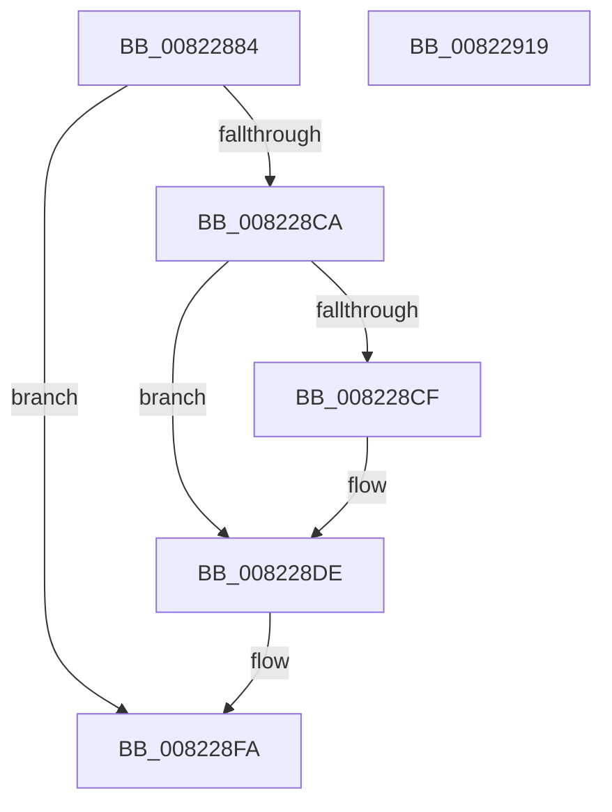

# AdtpBuildReplacementString

- RVA: `0x00822884`–`0x0082291A` (길이 `150` bytes)
- VA: `0x0000000140822884`
- 실행 섹션: `PAGE`
- PDB 이름 있음: `예`; PDB Function 태그: `아니요`
- unwind 정보 RVA: `0x000DA26C`
- 디코드: `40`개 명령, `150/150` bytes 표시
- 미해석 바이트: `0` (있으면 어셈블리에 `.byte`로 보존)

> 이 문서는 커널 이미지의 기계어와 PDB 기호를 분석해 생성했습니다. 4번과 5번은 함수 원형과 자료형을 바이너리 사용 방식에서 추정한 C 해석이며 원본 소스 복구 결과는 아닙니다.

## 1. Dependencies

- 직접 호출 지점: **5**; 고유 호출 대상: **4**
- 직접 호출자로 확인된 함수: **2**
- RIP 상대 이미지 참조: **3**

### Outgoing calls
- `0x008228BF` → [RtlIntegerToUnicodeString](../91/RtlIntegerToUnicodeString_function_0091D3E0.md) (function, `0x0091D3E0`)
- `0x008228D9` → [RtlAppendUnicodeToString](../../text/40/RtlAppendUnicodeToString_function_0040F990.md) (function, `0x0040F990`)
- `0x008228E8` → [RtlAppendUnicodeToString](../../text/40/RtlAppendUnicodeToString_function_0040F990.md) (function, `0x0040F990`)
- `0x008228F5` → [RtlAppendUnicodeStringToString](../../text/40/RtlAppendUnicodeStringToString_function_0040FA50.md) (function, `0x0040FA50`)
- `0x00822904` → [_security_check_cookie](../../text/6A/_security_check_cookie_function_006AC640.md) (function, `0x006AC640`)

### Direct callers
- [SeAdtRegistryValueChangedAuditAlarm](../79/SeAdtRegistryValueChangedAuditAlarm_function_0079DDD4.md) at `0x0079E01C`
- [SeAdtRegistryValueChangedAuditAlarm](../79/SeAdtRegistryValueChangedAuditAlarm_function_0079DDD4.md) at `0x0079E0C3`
- [SeAdtRegistryValueChangedAuditAlarm](../79/SeAdtRegistryValueChangedAuditAlarm_function_0079DDD4.md) at `0x0079E0EE`
- [AdtpBuildRegistryValueString](AdtpBuildRegistryValueString_function_00822194.md) at `0x00822365`

### Static image references
- `0x00822894` → RVA `0x00E0A740` (`.data`; read)
- `0x008228CF` → RVA `0x00041AC8` (`.rdata`; read)
- `0x008228DE` → RVA `0x000134F8` (`.rdata`; read)

## 2. Other-region calls and transfers

- 다른 실행 섹션으로 향하는 call: **4**
  - `0x008228D9` → [RtlAppendUnicodeToString](../../text/40/RtlAppendUnicodeToString_function_0040F990.md) (`PAGE` → `.text`)
  - `0x008228E8` → [RtlAppendUnicodeToString](../../text/40/RtlAppendUnicodeToString_function_0040F990.md) (`PAGE` → `.text`)
  - `0x008228F5` → [RtlAppendUnicodeStringToString](../../text/40/RtlAppendUnicodeStringToString_function_0040FA50.md) (`PAGE` → `.text`)
  - `0x00822904` → [_security_check_cookie](../../text/6A/_security_check_cookie_function_006AC640.md) (`PAGE` → `.text`)
- 별도 외부 분기/꼬리 이동을 확인하지 못했습니다.

## 3. Assembly (complete function range)

```asm
00822884  4C 8B DC                        mov r11, rsp
00822887  49 89 5B 08                     mov qword ptr [r11 + 8], rbx
0082288B  49 89 73 18                     mov qword ptr [r11 + 0x18], rsi
0082288F  57                              push rdi
00822890  48 83 EC 50                     sub rsp, 0x50
00822894  48 8B 05 A5 7E 5E 00            mov rax, qword ptr [rip + 0x5e7ea5]
0082289B  48 33 C4                        xor rax, rsp
0082289E  48 89 44 24 48                  mov qword ptr [rsp + 0x48], rax
008228A3  48 8B DA                        mov rbx, rdx
008228A6  49 C7 43 C8 00 00 14 00         mov qword ptr [r11 - 0x38], 0x140000
008228AE  49 8D 43 D8                     lea rax, [r11 - 0x28]
008228B2  33 F6                           xor esi, esi
008228B4  4D 8D 43 C8                     lea r8, [r11 - 0x38]
008228B8  49 89 43 D0                     mov qword ptr [r11 - 0x30], rax
008228BC  8D 56 0A                        lea edx, [rsi + 0xa]
008228BF  E8 1C AB 0F 00                  call 0x14091d3e0
008228C4  8B F8                           mov edi, eax
008228C6  85 C0                           test eax, eax
008228C8  78 30                           js 0x1408228fa
008228CA  66 39 33                        cmp word ptr [rbx], si
008228CD  74 0F                           je 0x1408228de
008228CF  48 8D 15 F2 F1 81 FF            lea rdx, [rip - 0x7e0e0e]
008228D6  48 8B CB                        mov rcx, rbx
008228D9  E8 B2 D0 BE FF                  call 0x14040f990
008228DE  48 8D 15 13 0C 7F FF            lea rdx, [rip - 0x80f3ed]
008228E5  48 8B CB                        mov rcx, rbx
008228E8  E8 A3 D0 BE FF                  call 0x14040f990
008228ED  48 8D 54 24 20                  lea rdx, [rsp + 0x20]
008228F2  48 8B CB                        mov rcx, rbx
008228F5  E8 56 D1 BE FF                  call 0x14040fa50
008228FA  8B C7                           mov eax, edi
008228FC  48 8B 4C 24 48                  mov rcx, qword ptr [rsp + 0x48]
00822901  48 33 CC                        xor rcx, rsp
00822904  E8 37 9D E8 FF                  call 0x1406ac640
00822909  48 8B 5C 24 60                  mov rbx, qword ptr [rsp + 0x60]
0082290E  48 8B 74 24 70                  mov rsi, qword ptr [rsp + 0x70]
00822913  48 83 C4 50                     add rsp, 0x50
00822917  5F                              pop rdi
00822918  C3                              ret
00822919  CC                              int3
```

## 4. C-style interpretation (structured pseudocode)

```c
__int64 __fastcall AdtpBuildReplacementString(__int64 a1, __int64 a2)
{
    __int64 result;
    __int64 v_rsi;
    __int64 v_rsp;
    unsigned __int64 v_stack_m10;
    unsigned __int64 v_stack_m38;
    unsigned __int64 v_stack_p18;
    unsigned __int64 v_stack_p8;

    *(unsigned __int64 *)(v_rsp + 8) = v_rbx;
    *(unsigned __int64 *)(v_rsp + 24) = v_rsi;
    v_rsp = (v_rsp) - (80);
    result = (*(unsigned __int64 *)(v_rip + 6192805)) ^ (v_rsp);
    v_stack_m10 = result;
    *(unsigned __int64 *)(v_rsp - 56) = 0x140000ULL;
    v_rsi = 0;
    *(unsigned __int64 *)(v_rsp - 48) = v_rsp - 40;
    result = RtlIntegerToUnicodeString(a1, v_rsi + 10, v_rsp - 56, a4);
    if (sign_flag) goto loc_008228FA;
    if ((*(unsigned __int16 *)(a2)) != 0) {
        a2 = v_rip - 8261134;
        a1 = a2;
        result = RtlAppendUnicodeToString(a1, a2, v_rsp - 56, a4);
    }
    result = RtlAppendUnicodeToString(a2, v_rip - 8451053, v_rsp - 56, a4);
    result = RtlAppendUnicodeStringToString(a2, v_stack_m38, v_rsp - 56, a4);
loc_008228FA:
    a1 = (v_stack_m10) ^ (v_rsp);
    result = _security_check_cookie(a1, v_stack_m38, v_rsp - 56, a4);
    v_rsp = (v_rsp) + (80);
    return result;
}
```

## 5. (Beta) C Style

```c
int64_t AdtpBuildReplacementString(int64_t Arg1, void *Arg2)
{
    uint8_t *arg2 = (uint8_t *)Arg2;

    int64_t result;
    int64_t local_rsi;
    int64_t local_rsp;
    uint64_t v_stack_m10;
    uint64_t v_stack_m38;
    uint64_t v_stack_p18;
    uint64_t v_stack_p8;

    *(uint64_t *)(local_rsp + 0x8) = local_rbx;
    *(uint64_t *)(local_rsp + 0x18) = local_rsi;
    local_rsp = (local_rsp) - (80);
    result = (*(uint64_t *)(v_rip + 0x5E7EA5)) ^ (local_rsp);
    v_stack_m10 = result;
    *(uint64_t *)(local_rsp - 0x38) = 0x140000ULL;
    local_rsi = 0;
    *(uint64_t *)(local_rsp - 0x30) = local_rsp - 40;
    result = RtlIntegerToUnicodeString(Arg1, local_rsi + 10, local_rsp - 56, a4);
    if (sign_flag) goto loc_008228FA;
    if ((*(uint16_t *)(arg2)) != 0) {
        Arg2 = v_rip - 8261134;
        Arg1 = Arg2;
        result = RtlAppendUnicodeToString(Arg1, Arg2, local_rsp - 56, a4);
    }
    result = RtlAppendUnicodeToString(Arg2, v_rip - 8451053, local_rsp - 56, a4);
    result = RtlAppendUnicodeStringToString(Arg2, v_stack_m38, local_rsp - 56, a4);
loc_008228FA:
    Arg1 = (v_stack_m10) ^ (local_rsp);
    result = _security_check_cookie(Arg1, v_stack_m38, local_rsp - 56, a4);
    local_rsp = (local_rsp) + (80);
    return result;
}
```

### 관측된 메모리 오프셋

구조체 형식이 확인되지 않은 접근은 인자 기준의 오프셋으로만 기록했습니다.

| 기준 인자 | 오프셋 표현 | 폭 (bit) | 접근 |
|---|---:|---:|---|
| `Arg2` | `+ 0x0` | `16` | `R` |

## 6. Execution-region graph

[열기: 2D/3D 그래프와 함수 탐색 컨트롤 패널](../../../control-panel.html?section=page&rva=0x00822884&view=graph)

- 2D 그래프는 위에서 아래로 흐르고, 3D 그래프는 빈 공간을 드래그해 회전합니다. Shift+드래그는 이동, 휠은 확대·축소, 함수 노드 선택은 대상 보고서 이동입니다.

### Static fallback


