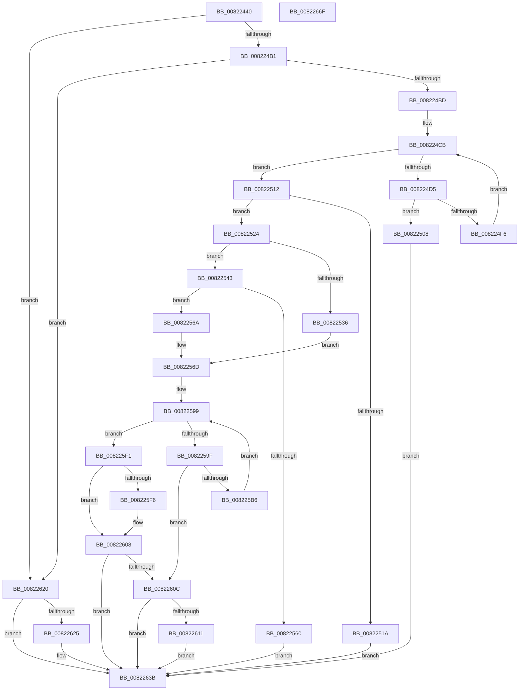

# AdtpBuildSidListString

- RVA: `0x00822440`–`0x00822670` (길이 `560` bytes)
- VA: `0x0000000140822440`
- 실행 섹션: `PAGE`
- PDB 이름 있음: `예`; PDB Function 태그: `아니요`
- unwind 정보 RVA: `0x000DA204`
- 디코드: `151`개 명령, `560/560` bytes 표시
- 미해석 바이트: `0` (있으면 어셈블리에 `.byte`로 보존)

> 이 문서는 커널 이미지의 기계어와 PDB 기호를 분석해 생성했습니다. 4번과 5번은 함수 원형과 자료형을 바이너리 사용 방식에서 추정한 C 해석이며 원본 소스 복구 결과는 아닙니다.

## 1. Dependencies

- 직접 호출 지점: **8**; 고유 호출 대상: **7**
- 직접 호출자로 확인된 함수: **1**
- RIP 상대 이미지 참조: **4**

### Outgoing calls
- `0x008224E2` → [RtlLengthSidAsUnicodeString](../92/RtlLengthSidAsUnicodeString_function_00927970.md) (function, `0x00927970`)
- `0x00822553` → [ExAllocatePool2](../../poolcode/B8/ExAllocatePool2_function_00B820F0.md) (function, `0x00B820F0`)
- `0x008225AB` → [RtlConvertSidToUnicodeString](../92/RtlConvertSidToUnicodeString_function_00927B30.md) (function, `0x00927B30`)
- `0x008225C2` → [RtlAppendUnicodeToString](../../text/40/RtlAppendUnicodeToString_function_0040F990.md) (function, `0x0040F990`)
- `0x008225D1` → [RtlAppendUnicodeStringToString](../../text/40/RtlAppendUnicodeStringToString_function_0040FA50.md) (function, `0x0040FA50`)
- `0x008225E2` → [RtlAppendUnicodeToString](../../text/40/RtlAppendUnicodeToString_function_0040F990.md) (function, `0x0040F990`)
- `0x00822616` → [ExFreePoolWithTag](../../poolcode/B8/ExFreePoolWithTag_function_00B82870.md) (function, `0x00B82870`)
- `0x0082264F` → [_security_check_cookie](../../text/6A/_security_check_cookie_function_006AC640.md) (function, `0x006AC640`)

### Direct callers
- [AdtpPackageParameters](../../text/45/AdtpPackageParameters_function_00459964.md) at `0x0045A312`

### Static image references
- `0x0082245F` → RVA `0x00E0A740` (`.data`; read)
- `0x008225B6` → RVA `0x00041998` (`.rdata`; read)
- `0x008225D6` → RVA `0x00037E68` (`.rdata`; read)
- `0x00822629` → RVA `0x0001E0B0` (`.rdata`; read)

## 2. Other-region calls and transfers

- 다른 실행 섹션으로 향하는 call: **6**
  - `0x00822553` → [ExAllocatePool2](../../poolcode/B8/ExAllocatePool2_function_00B820F0.md) (`PAGE` → `POOLCODE`)
  - `0x008225C2` → [RtlAppendUnicodeToString](../../text/40/RtlAppendUnicodeToString_function_0040F990.md) (`PAGE` → `.text`)
  - `0x008225D1` → [RtlAppendUnicodeStringToString](../../text/40/RtlAppendUnicodeStringToString_function_0040FA50.md) (`PAGE` → `.text`)
  - `0x008225E2` → [RtlAppendUnicodeToString](../../text/40/RtlAppendUnicodeToString_function_0040F990.md) (`PAGE` → `.text`)
  - `0x00822616` → [ExFreePoolWithTag](../../poolcode/B8/ExFreePoolWithTag_function_00B82870.md) (`PAGE` → `POOLCODE`)
  - `0x0082264F` → [_security_check_cookie](../../text/6A/_security_check_cookie_function_006AC640.md) (`PAGE` → `.text`)
- 별도 외부 분기/꼬리 이동을 확인하지 못했습니다.

## 3. Assembly (complete function range)

```asm
00822440  48 89 5C 24 10                  mov qword ptr [rsp + 0x10], rbx
00822445  55                              push rbp
00822446  56                              push rsi
00822447  57                              push rdi
00822448  41 54                           push r12
0082244A  41 55                           push r13
0082244C  41 56                           push r14
0082244E  41 57                           push r15
00822450  48 8D AC 24 80 FE FF FF         lea rbp, [rsp - 0x180]
00822458  48 81 EC 80 02 00 00            sub rsp, 0x280
0082245F  48 8B 05 DA 82 5E 00            mov rax, qword ptr [rip + 0x5e82da]
00822466  48 33 C4                        xor rax, rsp
00822469  48 89 85 70 01 00 00            mov qword ptr [rbp + 0x170], rax
00822470  48 8B 95 E0 01 00 00            mov rdx, qword ptr [rbp + 0x1e0]
00822477  33 DB                           xor ebx, ebx
00822479  4C 89 4C 24 58                  mov qword ptr [rsp + 0x58], r9
0082247E  45 32 FF                        xor r15b, r15b
00822481  4C 8B 8D E8 01 00 00            mov r9, qword ptr [rbp + 0x1e8]
00822488  0F 57 C0                        xorps xmm0, xmm0
0082248B  4C 89 4C 24 60                  mov qword ptr [rsp + 0x60], r9
00822490  0F 57 C9                        xorps xmm1, xmm1
00822493  48 89 54 24 50                  mov qword ptr [rsp + 0x50], rdx
00822498  49 8B F8                        mov rdi, r8
0082249B  4C 8B E1                        mov r12, rcx
0082249E  0F 11 44 24 40                  movups xmmword ptr [rsp + 0x40], xmm0
008224A3  0F 11 4C 24 28                  movups xmmword ptr [rsp + 0x28], xmm1
008224A8  48 85 C9                        test rcx, rcx
008224AB  0F 84 6F 01 00 00               je 0x140822620
008224B1  44 8B 31                        mov r14d, dword ptr [rcx]
008224B4  45 85 F6                        test r14d, r14d
008224B7  0F 84 63 01 00 00               je 0x140822620
008224BD  48 8B 41 08                     mov rax, qword ptr [rcx + 8]
008224C1  8D 73 01                        lea esi, [rbx + 1]
008224C4  45 33 ED                        xor r13d, r13d
008224C7  48 83 C0 08                     add rax, 8
008224CB  48 89 44 24 38                  mov qword ptr [rsp + 0x38], rax
008224D0  45 3B EE                        cmp r13d, r14d
008224D3  73 3D                           jae 0x140822512
008224D5  48 8B 08                        mov rcx, qword ptr [rax]
008224D8  48 8D 54 24 20                  lea rdx, [rsp + 0x20]
008224DD  83 64 24 20 00                  and dword ptr [rsp + 0x20], 0
008224E2  E8 89 54 10 00                  call 0x140927970
008224E7  8B 4C 24 20                     mov ecx, dword ptr [rsp + 0x20]
008224EB  D1 E9                           shr ecx, 1
008224ED  83 C1 07                        add ecx, 7
008224F0  03 CE                           add ecx, esi
008224F2  3B CE                           cmp ecx, esi
008224F4  72 12                           jb 0x140822508
008224F6  48 8B 44 24 38                  mov rax, qword ptr [rsp + 0x38]
008224FB  33 DB                           xor ebx, ebx
008224FD  41 FF C5                        inc r13d
00822500  8B F1                           mov esi, ecx
00822502  48 83 C0 10                     add rax, 0x10
00822506  EB C3                           jmp 0x1408224cb
00822508  BB 95 00 00 C0                  mov ebx, 0xc0000095
0082250D  E9 29 01 00 00                  jmp 0x14082263b
00822512  81 FE FF 7F 00 00               cmp esi, 0x7fff
00822518  76 0A                           jbe 0x140822524
0082251A  BB 0D 00 00 C0                  mov ebx, 0xc000000d
0082251F  E9 17 01 00 00                  jmp 0x14082263b
00822524  48 8B 54 24 50                  mov rdx, qword ptr [rsp + 0x50]
00822529  8B 02                           mov eax, dword ptr [rdx]
0082252B  8D 0C 30                        lea ecx, [rax + rsi]
0082252E  81 F9 00 04 00 00               cmp ecx, 0x400
00822534  73 0D                           jae 0x140822543
00822536  4C 8B 44 24 58                  mov r8, qword ptr [rsp + 0x58]
0082253B  89 0A                           mov dword ptr [rdx], ecx
0082253D  4D 8D 34 40                     lea r14, [r8 + rax*2]
00822541  EB 2A                           jmp 0x14082256d
00822543  8B D6                           mov edx, esi
00822545  B9 00 01 00 00                  mov ecx, 0x100
0082254A  48 03 D2                        add rdx, rdx
0082254D  41 B8 53 65 41 6B               mov r8d, 0x6b416553
00822553  E8 98 FB 35 00                  call 0x140b820f0
00822558  4C 8B F0                        mov r14, rax
0082255B  48 85 C0                        test rax, rax
0082255E  75 0A                           jne 0x14082256a
00822560  BB 17 00 00 C0                  mov ebx, 0xc0000017
00822565  E9 D1 00 00 00                  jmp 0x14082263b
0082256A  41 B7 01                        mov r15b, 1
0082256D  4D 8B 6C 24 08                  mov r13, qword ptr [r12 + 8]
00822572  66 03 F6                        add si, si
00822575  B8 00 02 00 00                  mov eax, 0x200
0082257A  66 89 74 24 2A                  mov word ptr [rsp + 0x2a], si
0082257F  66 89 44 24 42                  mov word ptr [rsp + 0x42], ax
00822584  33 F6                           xor esi, esi
00822586  48 8D 44 24 70                  lea rax, [rsp + 0x70]
0082258B  4C 89 74 24 30                  mov qword ptr [rsp + 0x30], r14
00822590  48 89 44 24 48                  mov qword ptr [rsp + 0x48], rax
00822595  49 83 C5 08                     add r13, 8
00822599  41 3B 34 24                     cmp esi, dword ptr [r12]
0082259D  73 52                           jae 0x1408225f1
0082259F  49 8B 55 00                     mov rdx, qword ptr [r13]
008225A3  48 8D 4C 24 40                  lea rcx, [rsp + 0x40]
008225A8  45 33 C0                        xor r8d, r8d
008225AB  E8 80 55 10 00                  call 0x140927b30
008225B0  8B D8                           mov ebx, eax
008225B2  85 C0                           test eax, eax
008225B4  78 56                           js 0x14082260c
008225B6  48 8D 15 DB F3 81 FF            lea rdx, [rip - 0x7e0c25]
008225BD  48 8D 4C 24 28                  lea rcx, [rsp + 0x28]
008225C2  E8 C9 D3 BE FF                  call 0x14040f990
008225C7  48 8D 54 24 40                  lea rdx, [rsp + 0x40]
008225CC  48 8D 4C 24 28                  lea rcx, [rsp + 0x28]
008225D1  E8 7A D4 BE FF                  call 0x14040fa50
008225D6  48 8D 15 8B 58 81 FF            lea rdx, [rip - 0x7ea775]
008225DD  48 8D 4C 24 28                  lea rcx, [rsp + 0x28]
008225E2  E8 A9 D3 BE FF                  call 0x14040f990
008225E7  FF C6                           inc esi
008225E9  8B D8                           mov ebx, eax
008225EB  49 83 C5 10                     add r13, 0x10
008225EF  EB A8                           jmp 0x140822599
008225F1  48 85 FF                        test rdi, rdi
008225F4  74 12                           je 0x140822608
008225F6  0F B7 44 24 28                  movzx eax, word ptr [rsp + 0x28]
008225FB  83 C0 02                        add eax, 2
008225FE  4C 89 37                        mov qword ptr [rdi], r14
00822601  83 67 0C 00                     and dword ptr [rdi + 0xc], 0
00822605  89 47 08                        mov dword ptr [rdi + 8], eax
00822608  85 DB                           test ebx, ebx
0082260A  79 2F                           jns 0x14082263b
0082260C  45 84 FF                        test r15b, r15b
0082260F  74 2A                           je 0x14082263b
00822611  33 D2                           xor edx, edx
00822613  49 8B CE                        mov rcx, r14
00822616  E8 55 02 36 00                  call 0x140b82870
0082261B  45 32 FF                        xor r15b, r15b
0082261E  EB 1B                           jmp 0x14082263b
00822620  48 85 FF                        test rdi, rdi
00822623  74 16                           je 0x14082263b
00822625  41 21 58 0C                     and dword ptr [r8 + 0xc], ebx
00822629  48 8D 05 80 BA 7F FF            lea rax, [rip - 0x804580]
00822630  49 89 00                        mov qword ptr [r8], rax
00822633  41 C7 40 08 04 00 00 00         mov dword ptr [r8 + 8], 4
0082263B  48 8B 44 24 60                  mov rax, qword ptr [rsp + 0x60]
00822640  44 88 38                        mov byte ptr [rax], r15b
00822643  8B C3                           mov eax, ebx
00822645  48 8B 8D 70 01 00 00            mov rcx, qword ptr [rbp + 0x170]
0082264C  48 33 CC                        xor rcx, rsp
0082264F  E8 EC 9F E8 FF                  call 0x1406ac640
00822654  48 8B 9C 24 C8 02 00 00         mov rbx, qword ptr [rsp + 0x2c8]
0082265C  48 81 C4 80 02 00 00            add rsp, 0x280
00822663  41 5F                           pop r15
00822665  41 5E                           pop r14
00822667  41 5D                           pop r13
00822669  41 5C                           pop r12
0082266B  5F                              pop rdi
0082266C  5E                              pop rsi
0082266D  5D                              pop rbp
0082266E  C3                              ret
0082266F  CC                              int3
```

## 4. C-style interpretation (structured pseudocode)

```c
__int64 __fastcall AdtpBuildSidListString(__int64 a1, __int64 a2, __int64 a3, __int64 a4, __int64 a5, __int64 a6)
{
    __int64 result;
    __int64 v_r13;
    __int64 v_r15;
    __int64 v_rbx;
    __int64 v_rsi;
    __int64 v_rsp;
    unsigned __int64 v_stack_m1B8;
    unsigned __int64 v_stack_m248;
    unsigned __int64 v_stack_m258;
    unsigned __int64 v_stack_m260;
    unsigned __int64 v_stack_m268;
    unsigned __int64 v_stack_m270;
    unsigned __int16 v_stack_m276;
    unsigned __int64 v_stack_m278;
    unsigned __int64 v_stack_m280;
    unsigned __int64 v_stack_m288;
    unsigned __int16 v_stack_m28E;
    unsigned __int64 v_stack_m290;
    unsigned __int64 v_stack_m298;
    unsigned __int64 v_stack_m48;
    unsigned __int64 v_stack_p10;

    v_stack_p10 = v_rbx;
    v_rsp = (v_rsp) - (640);
    result = (*(unsigned __int64 *)(v_rip + 6193882)) ^ (v_rsp);
    v_stack_m48 = result;
    v_rbx = 0;
    v_stack_m260 = a4;
    v_r15 = 0;
    v_stack_m258 = a6;
    v_stack_m268 = a5;
    v_stack_m278 = v_xmm0;
    v_stack_m290 = v_xmm1;
    if (a1 == 0) goto loc_00822620;
    if ((unsigned int)((unsigned int)(*(unsigned int *)(a1))) == 0) goto loc_00822620;
    v_r13 = 0;
    result = (*(unsigned __int64 *)(a1 + 8)) + (8);
loc_008224CB:
    v_stack_m280 = result;
    if (0 >= ((unsigned int)((unsigned int)(*(unsigned int *)(a1))))) goto loc_00822512;
    result = RtlLengthSidAsUnicodeString(*(unsigned __int64 *)(result), v_stack_m298, a3, a6);
    a1 = (unsigned int)(((unsigned int)(v_stack_m298)) >> (1));
    a1 = (unsigned int)((a1) + (7));
    a1 = (unsigned int)((a1) + ((unsigned int)(v_rbx + 1)));
    if (((unsigned int)(a1)) < ((unsigned int)(v_rbx + 1))) goto loc_00822508;
    v_rbx = 0;
    v_r13 = (unsigned int)((v_r13) + 1);
    result = (v_stack_m280) + (16);
    goto loc_008224CB;
loc_00822508:
    goto loc_0082263B;
loc_00822512:
    if (((unsigned int)((unsigned int)((unsigned int)(a1)))) <= 0x7FFFULL) goto loc_00822524;
    goto loc_0082263B;
loc_00822524:
    if (((unsigned int)((unsigned int)(*(unsigned int *)(v_stack_m268)) + (unsigned int)((unsigned int)(a1)) * 1)) >= 0x400ULL) goto loc_00822543;
    *(unsigned int *)(v_stack_m268) = (unsigned int)((unsigned int)(*(unsigned int *)(v_stack_m268)) + (unsigned int)((unsigned int)(a1)) * 1);
    goto loc_0082256D;
loc_00822543:
    a2 = ((unsigned int)((unsigned int)((unsigned int)((unsigned int)(a1))))) + ((unsigned int)((unsigned int)((unsigned int)((unsigned int)(a1)))));
    result = ExAllocatePool2(256, a2, (unsigned int)(0x6B416553ULL), a6);
    if (result != 0) goto loc_0082256A;
    goto loc_0082263B;
loc_0082256A:
loc_0082256D:
    v_rsi = (unsigned __int16)(((unsigned int)((unsigned int)(a1))) + ((unsigned __int16)((unsigned int)((unsigned int)(a1)))));
    v_stack_m28E = (unsigned __int16)(v_rsi);
    v_stack_m276 = 512;
    v_rsi = 0;
    v_stack_m288 = result;
    v_stack_m270 = v_stack_m248;
    v_r13 = (*(unsigned __int64 *)(a1 + 8)) + (8);
loc_00822599:
    if (0 >= (*(unsigned int *)(a1))) goto loc_008225F1;
    a3 = 0;
    result = RtlConvertSidToUnicodeString(v_stack_m278, *(unsigned __int64 *)(v_r13), a3, a6);
    if (sign_flag) goto loc_0082260C;
    result = RtlAppendUnicodeToString(v_stack_m290, v_rip - 8260645, a3, a6);
    result = RtlAppendUnicodeStringToString(v_stack_m290, v_stack_m278, a3, a6);
    result = RtlAppendUnicodeToString(v_stack_m290, v_rip - 8300405, a3, a6);
    v_rsi = (unsigned int)((v_rsi) + 1);
    v_r13 = (v_r13) + (16);
    goto loc_00822599;
loc_008225F1:
    if (0 != 0) {
        result = v_stack_m290;
        result = (unsigned int)((result) + (2));
        *(unsigned __int64 *)(a3) = result;
        *(unsigned int *)(a3 + 8) = (unsigned int)(result);
    }
    if (!sign_flag) goto loc_0082263B;
loc_0082260C:
    if (1 == 0) goto loc_0082263B;
    a2 = 0;
    result = ExFreePoolWithTag(result, a2, a3, a6);
    v_r15 = 0;
    goto loc_0082263B;
loc_00822620:
    if (0 != 0) {
        result = v_rip - 8406400;
        *(unsigned __int64 *)(a3) = result;
        *(unsigned int *)(a3 + 8) = 4;
    }
    *(unsigned __int8 *)(v_stack_m258) = 0;
    a1 = (v_stack_m48) ^ (v_rsp);
    result = _security_check_cookie(a1, a2, a3, a6);
    v_rsp = (v_rsp) + (640);
    return result;
}
```

## 5. (Beta) C Style

```c
int64_t AdtpBuildSidListString(void *Arg1, int64_t Arg2, void *Arg3, int64_t Arg4, int64_t Arg5, int64_t Arg6)
{
    uint8_t *arg1 = (uint8_t *)Arg1;
    uint8_t *arg3 = (uint8_t *)Arg3;

    int64_t result;
    int64_t local_r13;
    int64_t local_r15;
    int64_t local_rbx;
    int64_t local_rsi;
    int64_t local_rsp;
    uint64_t v_stack_m1B8;
    uint64_t v_stack_m248;
    uint64_t v_stack_m258;
    uint64_t v_stack_m260;
    uint64_t v_stack_m268;
    uint64_t v_stack_m270;
    uint16_t v_stack_m276;
    uint64_t v_stack_m278;
    uint64_t v_stack_m280;
    uint64_t v_stack_m288;
    uint16_t v_stack_m28E;
    uint64_t v_stack_m290;
    uint64_t v_stack_m298;
    uint64_t v_stack_m48;
    uint64_t v_stack_p10;

    v_stack_p10 = local_rbx;
    local_rsp = (local_rsp) - (640);
    result = (*(uint64_t *)(v_rip + 0x5E82DA)) ^ (local_rsp);
    v_stack_m48 = result;
    local_rbx = 0;
    v_stack_m260 = Arg4;
    local_r15 = 0;
    v_stack_m258 = Arg6;
    v_stack_m268 = Arg5;
    v_stack_m278 = v_xmm0;
    v_stack_m290 = v_xmm1;
    if (Arg1 == NULL) goto loc_00822620;
    if ((uint32_t)((uint32_t)(*(uint32_t *)(arg1))) == 0) goto loc_00822620;
    local_r13 = 0;
    result = (*(uint64_t *)(arg1 + 0x8)) + (8);
loc_008224CB:
    v_stack_m280 = result;
    if (0 >= ((uint32_t)((uint32_t)(*(uint32_t *)(arg1))))) goto loc_00822512;
    result = RtlLengthSidAsUnicodeString(*(uint64_t *)(result), v_stack_m298, Arg3, Arg6);
    Arg1 = (uint32_t)(((uint32_t)(v_stack_m298)) >> (1));
    Arg1 = (uint32_t)((Arg1) + (7));
    Arg1 = (uint32_t)((Arg1) + ((uint32_t)(local_rbx + 1)));
    if (((uint32_t)(Arg1)) < ((uint32_t)(local_rbx + 1))) goto loc_00822508;
    local_rbx = 0;
    local_r13 = (uint32_t)((local_r13) + 1);
    result = (v_stack_m280) + (16);
    goto loc_008224CB;
loc_00822508:
    goto loc_0082263B;
loc_00822512:
    if (((uint32_t)((uint32_t)((uint32_t)(Arg1)))) <= 0x7FFFULL) goto loc_00822524;
    goto loc_0082263B;
loc_00822524:
    if (((uint32_t)((uint32_t)(*(uint32_t *)(v_stack_m268)) + (uint32_t)((uint32_t)(Arg1)) * 1)) >= 0x400ULL) goto loc_00822543;
    *(uint32_t *)(v_stack_m268) = (uint32_t)((uint32_t)(*(uint32_t *)(v_stack_m268)) + (uint32_t)((uint32_t)(Arg1)) * 1);
    goto loc_0082256D;
loc_00822543:
    Arg2 = ((uint32_t)((uint32_t)((uint32_t)((uint32_t)(Arg1))))) + ((uint32_t)((uint32_t)((uint32_t)((uint32_t)(Arg1)))));
    result = ExAllocatePool2(256, Arg2, (uint32_t)(0x6B416553ULL), Arg6);
    if (result != 0) goto loc_0082256A;
    goto loc_0082263B;
loc_0082256A:
loc_0082256D:
    local_rsi = (uint16_t)(((uint32_t)((uint32_t)(Arg1))) + ((uint16_t)((uint32_t)((uint32_t)(Arg1)))));
    v_stack_m28E = (uint16_t)(local_rsi);
    v_stack_m276 = 512;
    local_rsi = 0;
    v_stack_m288 = result;
    v_stack_m270 = v_stack_m248;
    local_r13 = (*(uint64_t *)(arg1 + 0x8)) + (8);
loc_00822599:
    if (0 >= (*(uint32_t *)(arg1))) goto loc_008225F1;
    Arg3 = 0;
    result = RtlConvertSidToUnicodeString(v_stack_m278, *(uint64_t *)(local_r13), Arg3, Arg6);
    if (sign_flag) goto loc_0082260C;
    result = RtlAppendUnicodeToString(v_stack_m290, v_rip - 8260645, Arg3, Arg6);
    result = RtlAppendUnicodeStringToString(v_stack_m290, v_stack_m278, Arg3, Arg6);
    result = RtlAppendUnicodeToString(v_stack_m290, v_rip - 8300405, Arg3, Arg6);
    local_rsi = (uint32_t)((local_rsi) + 1);
    local_r13 = (local_r13) + (16);
    goto loc_00822599;
loc_008225F1:
    if (0 != 0) {
        result = v_stack_m290;
        result = (uint32_t)((result) + (2));
        *(uint64_t *)(arg3) = result;
        *(uint32_t *)(arg3 + 0x8) = (uint32_t)(result);
    }
    if (!sign_flag) goto loc_0082263B;
loc_0082260C:
    if (1 == 0) goto loc_0082263B;
    Arg2 = 0;
    result = ExFreePoolWithTag(result, Arg2, Arg3, Arg6);
    local_r15 = 0;
    goto loc_0082263B;
loc_00822620:
    if (0 != 0) {
        result = v_rip - 8406400;
        *(uint64_t *)(arg3) = result;
        *(uint32_t *)(arg3 + 0x8) = 4;
    }
    *(uint8_t *)(v_stack_m258) = 0;
    Arg1 = (v_stack_m48) ^ (local_rsp);
    result = _security_check_cookie(Arg1, Arg2, Arg3, Arg6);
    local_rsp = (local_rsp) + (640);
    return result;
}
```

### 관측된 메모리 오프셋

구조체 형식이 확인되지 않은 접근은 인자 기준의 오프셋으로만 기록했습니다.

| 기준 인자 | 오프셋 표현 | 폭 (bit) | 접근 |
|---|---:|---:|---|
| `Arg1` | `+ 0x0` | `32` | `R` |
| `Arg1` | `+ 0x8` | `64` | `R` |
| `Arg3` | `+ 0x0` | `64` | `W` |
| `Arg3` | `+ 0x8` | `32` | `W` |
| `Arg3` | `+ 0xC` | `32` | `R/W` |

## 6. Execution-region graph

[열기: 2D/3D 그래프와 함수 탐색 컨트롤 패널](../../../control-panel.html?section=page&rva=0x00822440&view=graph)

- 2D 그래프는 위에서 아래로 흐르고, 3D 그래프는 빈 공간을 드래그해 회전합니다. Shift+드래그는 이동, 휠은 확대·축소, 함수 노드 선택은 대상 보고서 이동입니다.

### Static fallback


