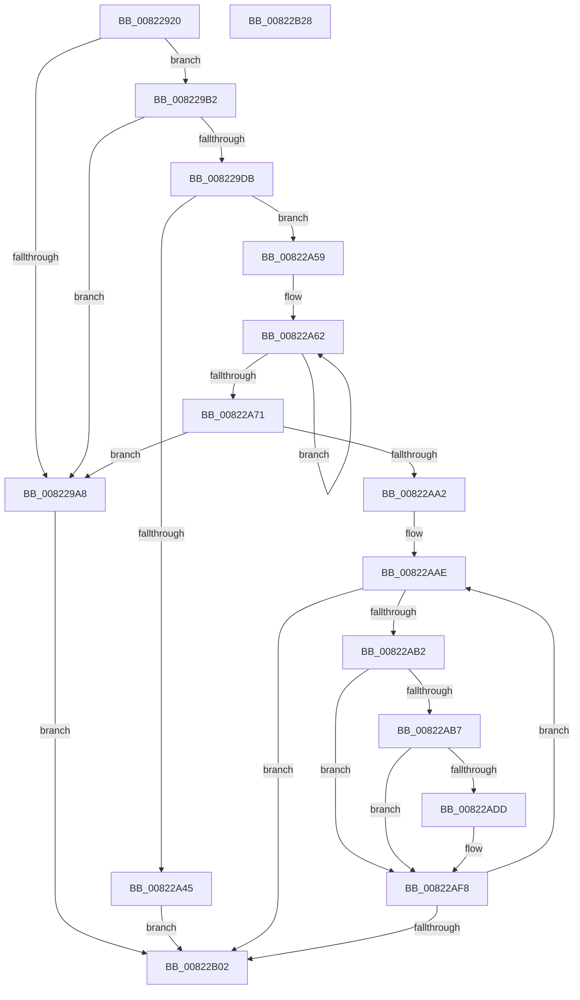

# AdtpBuildUserAccountControlString

- RVA: `0x00822920`–`0x00822B29` (길이 `521` bytes)
- VA: `0x0000000140822920`
- 실행 섹션: `PAGE`
- PDB 이름 있음: `예`; PDB Function 태그: `아니요`
- unwind 정보 RVA: `0x000DA248`
- 디코드: `144`개 명령, `521/521` bytes 표시
- 미해석 바이트: `0` (있으면 어셈블리에 `.byte`로 보존)

> 이 문서는 커널 이미지의 기계어와 PDB 기호를 분석해 생성했습니다. 4번과 5번은 함수 원형과 자료형을 바이너리 사용 방식에서 추정한 C 해석이며 원본 소스 복구 결과는 아닙니다.

## 1. Dependencies

- 직접 호출 지점: **14**; 고유 호출 대상: **6**
- 직접 호출자로 확인된 함수: **1**
- RIP 상대 이미지 참조: **4**

### Outgoing calls
- `0x00822999` → [ExAllocatePool2](../../poolcode/B8/ExAllocatePool2_function_00B820F0.md) (function, `0x00B820F0`)
- `0x008229CD` → [ExAllocatePool2](../../poolcode/B8/ExAllocatePool2_function_00B820F0.md) (function, `0x00B820F0`)
- `0x008229EC` → [RtlAppendUnicodeToString](../../text/40/RtlAppendUnicodeToString_function_0040F990.md) (function, `0x0040F990`)
- `0x00822A01` → [RtlIntegerToUnicodeString](../91/RtlIntegerToUnicodeString_function_0091D3E0.md) (function, `0x0091D3E0`)
- `0x00822A0D` → [RtlAppendUnicodeStringToString](../../text/40/RtlAppendUnicodeStringToString_function_0040FA50.md) (function, `0x0040FA50`)
- `0x00822A1C` → [RtlAppendUnicodeToString](../../text/40/RtlAppendUnicodeToString_function_0040F990.md) (function, `0x0040F990`)
- `0x00822A2F` → [RtlIntegerToUnicodeString](../91/RtlIntegerToUnicodeString_function_0091D3E0.md) (function, `0x0091D3E0`)
- `0x00822A3B` → [RtlAppendUnicodeStringToString](../../text/40/RtlAppendUnicodeStringToString_function_0040FA50.md) (function, `0x0040FA50`)
- `0x00822A4F` → [RtlInitUnicodeString](../../text/42/RtlInitUnicodeString_function_0042A780.md) (function, `0x0042A780`)
- `0x00822A90` → [ExAllocatePool2](../../poolcode/B8/ExAllocatePool2_function_00B820F0.md) (function, `0x00B820F0`)
- `0x00822AD4` → [RtlIntegerToUnicodeString](../91/RtlIntegerToUnicodeString_function_0091D3E0.md) (function, `0x0091D3E0`)
- `0x00822AE7` → [RtlAppendUnicodeToString](../../text/40/RtlAppendUnicodeToString_function_0040F990.md) (function, `0x0040F990`)
- `0x00822AF3` → [RtlAppendUnicodeStringToString](../../text/40/RtlAppendUnicodeStringToString_function_0040FA50.md) (function, `0x0040FA50`)
- `0x00822B0B` → [_security_check_cookie](../../text/6A/_security_check_cookie_function_006AC640.md) (function, `0x006AC640`)

### Direct callers
- [sub_006F1C3C](../../text/6F/Unknown_function_006F1C3C.md) at `0x006F1CBD`

### Static image references
- `0x00822937` → RVA `0x00E0A740` (`.data`; read)
- `0x008229DF` → RVA `0x00014A78` (`.rdata`; read)
- `0x00822A45` → RVA `0x0001A748` (`.rdata`; read)
- `0x00822ADD` → RVA `0x00041AB8` (`.rdata`; read)

## 2. Other-region calls and transfers

- 다른 실행 섹션으로 향하는 call: **11**
  - `0x00822999` → [ExAllocatePool2](../../poolcode/B8/ExAllocatePool2_function_00B820F0.md) (`PAGE` → `POOLCODE`)
  - `0x008229CD` → [ExAllocatePool2](../../poolcode/B8/ExAllocatePool2_function_00B820F0.md) (`PAGE` → `POOLCODE`)
  - `0x008229EC` → [RtlAppendUnicodeToString](../../text/40/RtlAppendUnicodeToString_function_0040F990.md) (`PAGE` → `.text`)
  - `0x00822A0D` → [RtlAppendUnicodeStringToString](../../text/40/RtlAppendUnicodeStringToString_function_0040FA50.md) (`PAGE` → `.text`)
  - `0x00822A1C` → [RtlAppendUnicodeToString](../../text/40/RtlAppendUnicodeToString_function_0040F990.md) (`PAGE` → `.text`)
  - `0x00822A3B` → [RtlAppendUnicodeStringToString](../../text/40/RtlAppendUnicodeStringToString_function_0040FA50.md) (`PAGE` → `.text`)
  - `0x00822A4F` → [RtlInitUnicodeString](../../text/42/RtlInitUnicodeString_function_0042A780.md) (`PAGE` → `.text`)
  - `0x00822A90` → [ExAllocatePool2](../../poolcode/B8/ExAllocatePool2_function_00B820F0.md) (`PAGE` → `POOLCODE`)
  - `0x00822AE7` → [RtlAppendUnicodeToString](../../text/40/RtlAppendUnicodeToString_function_0040F990.md) (`PAGE` → `.text`)
  - `0x00822AF3` → [RtlAppendUnicodeStringToString](../../text/40/RtlAppendUnicodeStringToString_function_0040FA50.md) (`PAGE` → `.text`)
  - `0x00822B0B` → [_security_check_cookie](../../text/6A/_security_check_cookie_function_006AC640.md) (`PAGE` → `.text`)
- 별도 외부 분기/꼬리 이동을 확인하지 못했습니다.

## 3. Assembly (complete function range)

```asm
00822920  48 89 5C 24 08                  mov qword ptr [rsp + 8], rbx
00822925  55                              push rbp
00822926  56                              push rsi
00822927  57                              push rdi
00822928  41 54                           push r12
0082292A  41 55                           push r13
0082292C  41 56                           push r14
0082292E  41 57                           push r15
00822930  48 8B EC                        mov rbp, rsp
00822933  48 83 EC 70                     sub rsp, 0x70
00822937  48 8B 05 02 7E 5E 00            mov rax, qword ptr [rip + 0x5e7e02]
0082293E  48 33 C4                        xor rax, rsp
00822941  48 89 45 F0                     mov qword ptr [rbp - 0x10], rax
00822945  48 8B 45 78                     mov rax, qword ptr [rbp + 0x78]
00822949  33 DB                           xor ebx, ebx
0082294B  48 8B 75 60                     mov rsi, qword ptr [rbp + 0x60]
0082294F  44 8B F9                        mov r15d, ecx
00822952  48 8B 4D 68                     mov rcx, qword ptr [rbp + 0x68]
00822956  4D 8B E0                        mov r12, r8
00822959  4C 8B 75 70                     mov r14, qword ptr [rbp + 0x70]
0082295D  4D 8B E9                        mov r13, r9
00822960  41 88 19                        mov byte ptr [r9], bl
00822963  8B FB                           mov edi, ebx
00822965  48 89 45 D0                     mov qword ptr [rbp - 0x30], rax
00822969  88 19                           mov byte ptr [rcx], bl
0082296B  88 18                           mov byte ptr [rax], bl
0082296D  48 8D 45 D8                     lea rax, [rbp - 0x28]
00822971  41 C7 00 00 00 16 00            mov dword ptr [r8], 0x160000
00822978  41 B8 53 65 41 6B               mov r8d, 0x6b416553
0082297E  89 55 C0                        mov dword ptr [rbp - 0x40], edx
00822981  8D 53 16                        lea edx, [rbx + 0x16]
00822984  48 89 4D C8                     mov qword ptr [rbp - 0x38], rcx
00822988  B9 00 01 00 00                  mov ecx, 0x100
0082298D  48 89 45 B8                     mov qword ptr [rbp - 0x48], rax
00822991  48 C7 45 B0 00 00 14 00         mov qword ptr [rbp - 0x50], 0x140000
00822999  E8 52 F7 35 00                  call 0x140b820f0
0082299E  49 89 44 24 08                  mov qword ptr [r12 + 8], rax
008229A3  48 85 C0                        test rax, rax
008229A6  75 0A                           jne 0x1408229b2
008229A8  BB 17 00 00 C0                  mov ebx, 0xc0000017
008229AD  E9 50 01 00 00                  jmp 0x140822b02
008229B2  41 C6 45 00 01                  mov byte ptr [r13], 1
008229B7  BA 16 00 00 00                  mov edx, 0x16
008229BC  B9 00 01 00 00                  mov ecx, 0x100
008229C1  C7 06 00 00 16 00               mov dword ptr [rsi], 0x160000
008229C7  41 B8 53 65 41 6B               mov r8d, 0x6b416553
008229CD  E8 1E F7 35 00                  call 0x140b820f0
008229D2  48 89 46 08                     mov qword ptr [rsi + 8], rax
008229D6  48 85 C0                        test rax, rax
008229D9  74 CD                           je 0x1408229a8
008229DB  48 8B 45 C8                     mov rax, qword ptr [rbp - 0x38]
008229DF  48 8D 15 92 20 7F FF            lea rdx, [rip - 0x80df6e]
008229E6  49 8B CC                        mov rcx, r12
008229E9  C6 00 01                        mov byte ptr [rax], 1
008229EC  E8 9F CF BE FF                  call 0x14040f990
008229F1  41 BD 10 00 00 00               mov r13d, 0x10
008229F7  4C 8D 45 B0                     lea r8, [rbp - 0x50]
008229FB  41 8B D5                        mov edx, r13d
008229FE  41 8B CF                        mov ecx, r15d
00822A01  E8 DA A9 0F 00                  call 0x14091d3e0
00822A06  48 8D 55 B0                     lea rdx, [rbp - 0x50]
00822A0A  49 8B CC                        mov rcx, r12
00822A0D  E8 3E D0 BE FF                  call 0x14040fa50
00822A12  48 8D 15 5F 20 7F FF            lea rdx, [rip - 0x80dfa1]
00822A19  48 8B CE                        mov rcx, rsi
00822A1C  E8 6F CF BE FF                  call 0x14040f990
00822A21  44 8B 65 C0                     mov r12d, dword ptr [rbp - 0x40]
00822A25  4C 8D 45 B0                     lea r8, [rbp - 0x50]
00822A29  41 8B D5                        mov edx, r13d
00822A2C  41 8B CC                        mov ecx, r12d
00822A2F  E8 AC A9 0F 00                  call 0x14091d3e0
00822A34  48 8D 55 B0                     lea rdx, [rbp - 0x50]
00822A38  48 8B CE                        mov rcx, rsi
00822A3B  E8 10 D0 BE FF                  call 0x14040fa50
00822A40  45 33 FC                        xor r15d, r12d
00822A43  75 14                           jne 0x140822a59
00822A45  48 8D 15 FC 7C 7F FF            lea rdx, [rip - 0x808304]
00822A4C  49 8B CE                        mov rcx, r14
00822A4F  E8 2C 7D C0 FF                  call 0x14042a780
00822A54  E9 A9 00 00 00                  jmp 0x140822b02
00822A59  41 BD 01 00 00 00               mov r13d, 1
00822A5F  41 8B D5                        mov edx, r13d
00822A62  8B C7                           mov eax, edi
00822A64  41 85 D7                        test r15d, edx
00822A67  8D 7F 01                        lea edi, [rdi + 1]
00822A6A  0F 44 F8                        cmove edi, eax
00822A6D  03 D2                           add edx, edx
00822A6F  75 F1                           jne 0x140822a62
00822A71  66 C1 E7 05                     shl di, 5
00822A75  B9 00 01 00 00                  mov ecx, 0x100
00822A7A  66 83 C7 02                     add di, 2
00822A7E  66 41 89 1E                     mov word ptr [r14], bx
00822A82  0F B7 D7                        movzx edx, di
00822A85  41 B8 53 65 41 6B               mov r8d, 0x6b416553
00822A8B  66 41 89 56 02                  mov word ptr [r14 + 2], dx
00822A90  E8 5B F6 35 00                  call 0x140b820f0
00822A95  49 89 46 08                     mov qword ptr [r14 + 8], rax
00822A99  48 85 C0                        test rax, rax
00822A9C  0F 84 06 FF FF FF               je 0x1408229a8
00822AA2  48 8B 45 D0                     mov rax, qword ptr [rbp - 0x30]
00822AA6  8B F3                           mov esi, ebx
00822AA8  41 8B FD                        mov edi, r13d
00822AAB  44 88 28                        mov byte ptr [rax], r13b
00822AAE  85 FF                           test edi, edi
00822AB0  74 50                           je 0x140822b02
00822AB2  41 85 FF                        test r15d, edi
00822AB5  74 41                           je 0x140822af8
00822AB7  8B C7                           mov eax, edi
00822AB9  4C 8D 45 B0                     lea r8, [rbp - 0x50]
00822ABD  41 23 C4                        and eax, r12d
00822AC0  BA 0A 00 00 00                  mov edx, 0xa
00822AC5  F7 D8                           neg eax
00822AC7  1B C9                           sbb ecx, ecx
00822AC9  83 E1 20                        and ecx, 0x20
00822ACC  81 C1 00 08 00 00               add ecx, 0x800
00822AD2  03 CE                           add ecx, esi
00822AD4  E8 07 A9 0F 00                  call 0x14091d3e0
00822AD9  85 C0                           test eax, eax
00822ADB  78 1B                           js 0x140822af8
00822ADD  48 8D 15 D4 EF 81 FF            lea rdx, [rip - 0x7e102c]
00822AE4  49 8B CE                        mov rcx, r14
00822AE7  E8 A4 CE BE FF                  call 0x14040f990
00822AEC  48 8D 55 B0                     lea rdx, [rbp - 0x50]
00822AF0  49 8B CE                        mov rcx, r14
00822AF3  E8 58 CF BE FF                  call 0x14040fa50
00822AF8  41 03 F5                        add esi, r13d
00822AFB  03 FF                           add edi, edi
00822AFD  83 FE 20                        cmp esi, 0x20
00822B00  72 AC                           jb 0x140822aae
00822B02  8B C3                           mov eax, ebx
00822B04  48 8B 4D F0                     mov rcx, qword ptr [rbp - 0x10]
00822B08  48 33 CC                        xor rcx, rsp
00822B0B  E8 30 9B E8 FF                  call 0x1406ac640
00822B10  48 8B 9C 24 B0 00 00 00         mov rbx, qword ptr [rsp + 0xb0]
00822B18  48 83 C4 70                     add rsp, 0x70
00822B1C  41 5F                           pop r15
00822B1E  41 5E                           pop r14
00822B20  41 5D                           pop r13
00822B22  41 5C                           pop r12
00822B24  5F                              pop rdi
00822B25  5E                              pop rsi
00822B26  5D                              pop rbp
00822B27  C3                              ret
00822B28  CC                              int3
```

## 4. C-style interpretation (structured pseudocode)

```c
__int64 __fastcall AdtpBuildUserAccountControlString(int a1, int a2, __int64 a3, __int64 a4, __int64 a5, __int64 a6, __int64 a7, __int64 a8)
{
    __int64 result;
    __int64 v_r15;
    __int64 v_rbx;
    __int64 v_rdi;
    __int64 v_rsi;
    __int64 v_rsp;
    unsigned __int64 v_stack_m48;
    unsigned __int64 v_stack_m60;
    unsigned __int64 v_stack_m68;
    unsigned __int64 v_stack_m70;
    unsigned int v_stack_m78;
    unsigned __int64 v_stack_m80;
    unsigned __int64 v_stack_m88;
    unsigned __int64 v_stack_p8;

    v_stack_p8 = v_rbx;
    v_rsp = (v_rsp) - (112);
    result = (*(unsigned __int64 *)(v_rip + 6192642)) ^ (v_rsp);
    v_stack_m48 = result;
    v_rbx = 0;
    *(unsigned __int8 *)(a4) = 0;
    v_stack_m68 = a8;
    *(unsigned __int8 *)(a6) = 0;
    *(unsigned __int8 *)(a8) = 0;
    *(unsigned int *)(a3) = 0x160000ULL;
    v_stack_m78 = a2;
    v_stack_m70 = a6;
    v_stack_m80 = v_stack_m60;
    v_stack_m88 = 0x140000ULL;
    result = ExAllocatePool2(256, v_rbx + 22, (unsigned int)(0x6B416553ULL), a4);
    *(unsigned __int64 *)(a3 + 8) = result;
    if (result != 0) goto loc_008229B2;
loc_008229A8:
    goto loc_00822B02;
loc_008229B2:
    *(unsigned __int8 *)(a4) = 1;
    *(unsigned int *)(a5) = 0x160000ULL;
    result = ExAllocatePool2(256, 22, (unsigned int)(0x6B416553ULL), a4);
    *(unsigned __int64 *)(a5 + 8) = result;
    if (result == 0) goto loc_008229A8;
    *(unsigned __int8 *)(v_stack_m70) = 1;
    result = RtlAppendUnicodeToString(a3, v_rip - 8445806, (unsigned int)(0x6B416553ULL), a4);
    result = RtlIntegerToUnicodeString((unsigned int)((unsigned int)((unsigned int)(a1))), 16, v_stack_m88, a4);
    result = RtlAppendUnicodeStringToString(a3, v_stack_m88, v_stack_m88, a4);
    result = RtlAppendUnicodeToString(a5, v_rip - 8445857, v_stack_m88, a4);
    result = RtlIntegerToUnicodeString((unsigned int)((unsigned int)((unsigned int)(v_stack_m78))), 16, v_stack_m88, a4);
    result = RtlAppendUnicodeStringToString(a5, v_stack_m88, v_stack_m88, a4);
    v_r15 = (unsigned int)(((unsigned int)(a1)) ^ ((unsigned int)((unsigned int)(v_stack_m78))));
    if (condition_is_not_equal) goto loc_00822A59;
    result = RtlInitUnicodeString(a7, v_rip - 8422148, v_stack_m88, a4);
    goto loc_00822B02;
loc_00822A59:
loc_00822A62:
    v_rdi = 0 + 1;
    if ((((unsigned int)(v_r15)) & (1)) == 0) { v_rdi = 0; }
    a2 = (unsigned int)((1) + (1));
    if (condition_is_not_equal) goto loc_00822A62;
    v_rdi = (unsigned __int16)((v_rdi) << (5));
    v_rdi = (unsigned __int16)((v_rdi) + (2));
    *(unsigned __int16 *)(a7) = (unsigned __int16)((unsigned int)(0xC0000017ULL));
    *(unsigned __int16 *)(a7 + 2) = (unsigned __int16)((unsigned __int16)(v_rdi));
    result = ExAllocatePool2(256, (unsigned __int16)(v_rdi), (unsigned int)(0x6B416553ULL), a4);
    *(unsigned __int64 *)(a7 + 8) = result;
    if (result == 0) goto loc_008229A8;
    *(unsigned __int8 *)(v_stack_m68) = 1;
loc_00822AAE:
    if (1 == 0) goto loc_00822B02;
    if ((((unsigned int)(v_r15)) & (1)) == 0) goto loc_00822AF8;
    result = (unsigned int)((1) & ((unsigned int)((unsigned int)(v_stack_m78))));
    result = (unsigned int)(-(result));
    a1 = (unsigned int)((256) & (32));
    a1 = (unsigned int)((a1) + (0x800ULL));
    a1 = (unsigned int)((a1) + ((unsigned int)((unsigned int)((unsigned int)((unsigned int)(0xC0000017ULL))))));
    result = RtlIntegerToUnicodeString(a1, 10, v_stack_m88, a4);
    if (!(sign_flag)) {
        a2 = v_rip - 8261676;
        a1 = a7;
        result = RtlAppendUnicodeToString(a1, a2, v_stack_m88, a4);
        a2 = v_stack_m88;
        a1 = a7;
        result = RtlAppendUnicodeStringToString(a1, a2, v_stack_m88, a4);
    }
    v_rsi = (unsigned int)(((unsigned int)((unsigned int)((unsigned int)(0xC0000017ULL)))) + (1));
    v_rdi = (unsigned int)((1) + (1));
    if (((unsigned int)(v_rsi)) < 32) goto loc_00822AAE;
loc_00822B02:
    a1 = (v_stack_m48) ^ (v_rsp);
    result = _security_check_cookie(a1, a2, v_stack_m88, a4);
    v_rsp = (v_rsp) + (112);
    return result;
}
```

## 5. (Beta) C Style

```c
int64_t AdtpBuildUserAccountControlString(int32_t Arg1, int32_t Arg2, void *Arg3, void *Arg4, void *Arg5, void *Arg6, void *Arg7, void *Arg8)
{
    uint8_t *arg3 = (uint8_t *)Arg3;
    uint8_t *arg4 = (uint8_t *)Arg4;
    uint8_t *arg5 = (uint8_t *)Arg5;
    uint8_t *arg6 = (uint8_t *)Arg6;
    uint8_t *arg7 = (uint8_t *)Arg7;
    uint8_t *arg8 = (uint8_t *)Arg8;

    int64_t result;
    int64_t local_r15;
    int64_t local_rbx;
    int64_t local_rdi;
    int64_t local_rsi;
    int64_t local_rsp;
    uint64_t v_stack_m48;
    uint64_t v_stack_m60;
    uint64_t v_stack_m68;
    uint64_t v_stack_m70;
    uint32_t v_stack_m78;
    uint64_t v_stack_m80;
    uint64_t v_stack_m88;
    uint64_t v_stack_p8;

    v_stack_p8 = local_rbx;
    local_rsp = (local_rsp) - (112);
    result = (*(uint64_t *)(v_rip + 0x5E7E02)) ^ (local_rsp);
    v_stack_m48 = result;
    local_rbx = 0;
    *(uint8_t *)(arg4) = 0;
    v_stack_m68 = Arg8;
    *(uint8_t *)(arg6) = 0;
    *(uint8_t *)(arg8) = 0;
    *(uint32_t *)(arg3) = 0x160000ULL;
    v_stack_m78 = Arg2;
    v_stack_m70 = Arg6;
    v_stack_m80 = v_stack_m60;
    v_stack_m88 = 0x140000ULL;
    result = ExAllocatePool2(256, local_rbx + 22, (uint32_t)(0x6B416553ULL), Arg4);
    *(uint64_t *)(arg3 + 0x8) = result;
    if (result != 0) goto loc_008229B2;
loc_008229A8:
    goto loc_00822B02;
loc_008229B2:
    *(uint8_t *)(arg4) = 1;
    *(uint32_t *)(arg5) = 0x160000ULL;
    result = ExAllocatePool2(256, 22, (uint32_t)(0x6B416553ULL), Arg4);
    *(uint64_t *)(arg5 + 0x8) = result;
    if (result == 0) goto loc_008229A8;
    *(uint8_t *)(v_stack_m70) = 1;
    result = RtlAppendUnicodeToString(Arg3, v_rip - 8445806, (uint32_t)(0x6B416553ULL), Arg4);
    result = RtlIntegerToUnicodeString((uint32_t)((uint32_t)((uint32_t)(Arg1))), 16, v_stack_m88, Arg4);
    result = RtlAppendUnicodeStringToString(Arg3, v_stack_m88, v_stack_m88, Arg4);
    result = RtlAppendUnicodeToString(Arg5, v_rip - 8445857, v_stack_m88, Arg4);
    result = RtlIntegerToUnicodeString((uint32_t)((uint32_t)((uint32_t)(v_stack_m78))), 16, v_stack_m88, Arg4);
    result = RtlAppendUnicodeStringToString(Arg5, v_stack_m88, v_stack_m88, Arg4);
    local_r15 = (uint32_t)(((uint32_t)(Arg1)) ^ ((uint32_t)((uint32_t)(v_stack_m78))));
    if (condition_is_not_equal) goto loc_00822A59;
    result = RtlInitUnicodeString(Arg7, v_rip - 8422148, v_stack_m88, Arg4);
    goto loc_00822B02;
loc_00822A59:
loc_00822A62:
    local_rdi = 0 + 1;
    if ((((uint32_t)(local_r15)) & (1)) == 0) { local_rdi = 0; }
    Arg2 = (uint32_t)((1) + (1));
    if (condition_is_not_equal) goto loc_00822A62;
    local_rdi = (uint16_t)((local_rdi) << (5));
    local_rdi = (uint16_t)((local_rdi) + (2));
    *(uint16_t *)(arg7) = (uint16_t)((uint32_t)(0xC0000017ULL));
    *(uint16_t *)(arg7 + 0x2) = (uint16_t)((uint16_t)(local_rdi));
    result = ExAllocatePool2(256, (uint16_t)(local_rdi), (uint32_t)(0x6B416553ULL), Arg4);
    *(uint64_t *)(arg7 + 0x8) = result;
    if (result == 0) goto loc_008229A8;
    *(uint8_t *)(v_stack_m68) = 1;
loc_00822AAE:
    if (1 == 0) goto loc_00822B02;
    if ((((uint32_t)(local_r15)) & (1)) == 0) goto loc_00822AF8;
    result = (uint32_t)((1) & ((uint32_t)((uint32_t)(v_stack_m78))));
    result = (uint32_t)(-(result));
    Arg1 = (uint32_t)((256) & (32));
    Arg1 = (uint32_t)((Arg1) + (0x800ULL));
    Arg1 = (uint32_t)((Arg1) + ((uint32_t)((uint32_t)((uint32_t)((uint32_t)(0xC0000017ULL))))));
    result = RtlIntegerToUnicodeString(Arg1, 10, v_stack_m88, Arg4);
    if (!(sign_flag)) {
        Arg2 = v_rip - 8261676;
        Arg1 = Arg7;
        result = RtlAppendUnicodeToString(Arg1, Arg2, v_stack_m88, Arg4);
        Arg2 = v_stack_m88;
        Arg1 = Arg7;
        result = RtlAppendUnicodeStringToString(Arg1, Arg2, v_stack_m88, Arg4);
    }
    local_rsi = (uint32_t)(((uint32_t)((uint32_t)((uint32_t)(0xC0000017ULL)))) + (1));
    local_rdi = (uint32_t)((1) + (1));
    if (((uint32_t)(local_rsi)) < 32) goto loc_00822AAE;
loc_00822B02:
    Arg1 = (v_stack_m48) ^ (local_rsp);
    result = _security_check_cookie(Arg1, Arg2, v_stack_m88, Arg4);
    local_rsp = (local_rsp) + (112);
    return result;
}
```

### 관측된 메모리 오프셋

구조체 형식이 확인되지 않은 접근은 인자 기준의 오프셋으로만 기록했습니다.

| 기준 인자 | 오프셋 표현 | 폭 (bit) | 접근 |
|---|---:|---:|---|
| `Arg3` | `+ 0x0` | `32` | `W` |
| `Arg3` | `+ 0x8` | `64` | `W` |
| `Arg4` | `+ 0x0` | `8` | `W` |
| `Arg5` | `+ 0x0` | `32` | `W` |
| `Arg5` | `+ 0x8` | `64` | `W` |
| `Arg6` | `+ 0x0` | `8` | `W` |
| `Arg7` | `+ 0x0` | `16` | `W` |
| `Arg7` | `+ 0x2` | `16` | `W` |
| `Arg7` | `+ 0x8` | `64` | `W` |
| `Arg8` | `+ 0x0` | `8` | `W` |

## 6. Execution-region graph

[열기: 2D/3D 그래프와 함수 탐색 컨트롤 패널](../../../control-panel.html?section=page&rva=0x00822920&view=graph)

- 2D 그래프는 위에서 아래로 흐르고, 3D 그래프는 빈 공간을 드래그해 회전합니다. Shift+드래그는 이동, 휠은 확대·축소, 함수 노드 선택은 대상 보고서 이동입니다.

### Static fallback


