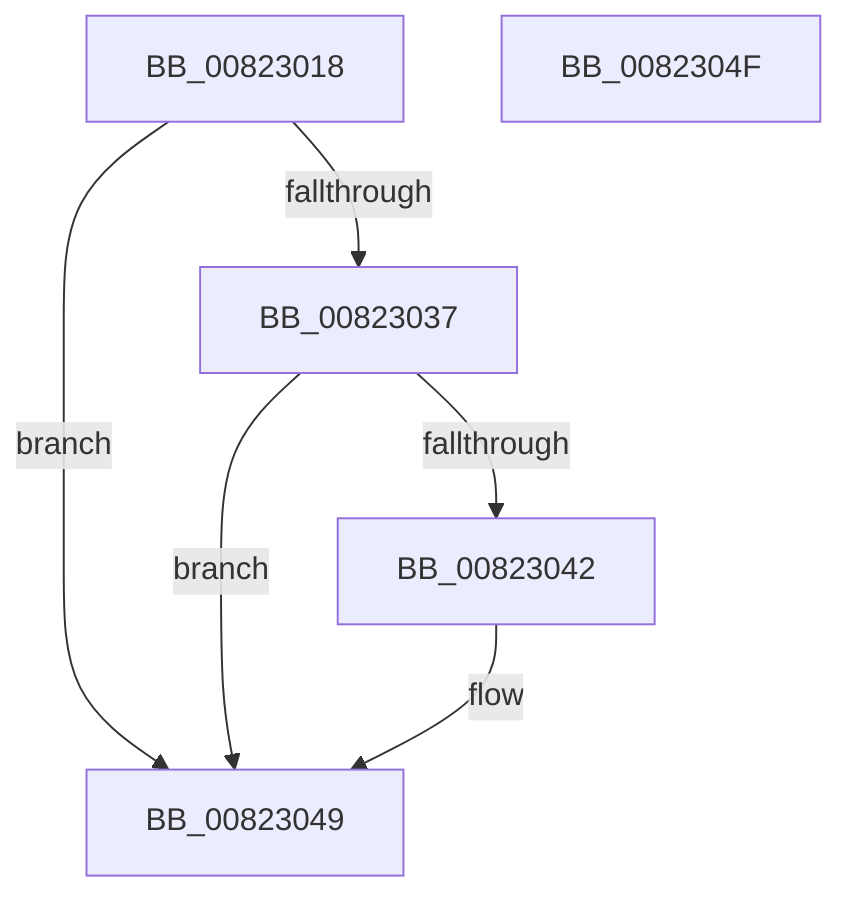

# AdtpInitializeAuditingCommon

- RVA: `0x00823018`–`0x00823050` (길이 `56` bytes)
- VA: `0x0000000140823018`
- 실행 섹션: `PAGE`
- PDB 이름 있음: `예`; PDB Function 태그: `아니요`
- unwind 정보 RVA: `0x0005CF00`
- 디코드: `17`개 명령, `56/56` bytes 표시
- 미해석 바이트: `0` (있으면 어셈블리에 `.byte`로 보존)

> 이 문서는 커널 이미지의 기계어와 PDB 기호를 분석해 생성했습니다. 4번과 5번은 함수 원형과 자료형을 바이너리 사용 방식에서 추정한 C 해석이며 원본 소스 복구 결과는 아닙니다.

## 1. Dependencies

- 직접 호출 지점: **3**; 고유 호출 대상: **3**
- 직접 호출자로 확인된 함수: **1**
- RIP 상대 이미지 참조: **2**

### Outgoing calls
- `0x0082302E` → [AdtpInitializeDriveLetters](AdtpInitializeDriveLetters_function_00823058.md) (function, `0x00823058`)
- `0x00823037` → [AdtpObjsInitialize](AdtpObjsInitialize_function_00822B30.md) (function, `0x00822B30`)
- `0x00823042` → [AdtpDbInitializePrivilegeObject](../../text/69/AdtpDbInitializePrivilegeObject_function_0069DDE8.md) (function, `0x0069DDE8`)

### Direct callers
- [SepAdtInitializeAuditingOptions](../../init/C4/SepAdtInitializeAuditingOptions_function_00C4BC1C.md) at `0x00C4BC28`

### Static image references
- `0x0082301E` → RVA `0x00FD9EC0` (`PAGEDATA`; write)
- `0x00823027` → RVA `0x00FD9A73` (`PAGEDATA`; write)

## 2. Other-region calls and transfers

- 다른 실행 섹션으로 향하는 call: **1**
  - `0x00823042` → [AdtpDbInitializePrivilegeObject](../../text/69/AdtpDbInitializePrivilegeObject_function_0069DDE8.md) (`PAGE` → `.text`)
- 별도 외부 분기/꼬리 이동을 확인하지 못했습니다.

## 3. Assembly (complete function range)

```asm
00823018  40 53                           push rbx
0082301A  48 83 EC 20                     sub rsp, 0x20
0082301E  66 C7 05 99 6E 7B 00 01 01      mov word ptr [rip + 0x7b6e99], 0x101
00823027  C6 05 45 6A 7B 00 01            mov byte ptr [rip + 0x7b6a45], 1
0082302E  E8 25 00 00 00                  call 0x140823058
00823033  85 C0                           test eax, eax
00823035  78 12                           js 0x140823049
00823037  E8 F4 FA FF FF                  call 0x140822b30
0082303C  8B D8                           mov ebx, eax
0082303E  85 C0                           test eax, eax
00823040  78 07                           js 0x140823049
00823042  E8 A1 AD E7 FF                  call 0x14069dde8
00823047  8B C3                           mov eax, ebx
00823049  48 83 C4 20                     add rsp, 0x20
0082304D  5B                              pop rbx
0082304E  C3                              ret
0082304F  CC                              int3
```

## 4. C-style interpretation (structured pseudocode)

```c
__int64 __fastcall AdtpInitializeAuditingCommon(void)
{
    __int64 result;
    __int64 v_rsp;

    v_rsp = (v_rsp) - (32);
    *(unsigned __int16 *)(v_rip + 8089241) = 257;
    *(unsigned __int8 *)(v_rip + 8088133) = 1;
    result = AdtpInitializeDriveLetters(a1, a2, a3, a4);
    if (sign_flag) goto loc_00823049;
    result = AdtpObjsInitialize(a1, a2, a3, a4);
    if (!(sign_flag)) {
        result = AdtpDbInitializePrivilegeObject(a1, a2, a3, a4);
        result = (unsigned int)((unsigned int)((unsigned int)(result)));
    }
    v_rsp = (v_rsp) + (32);
    return result;
}
```

## 5. (Beta) C Style

```c
void AdtpInitializeAuditingCommon(void)
{
    int64_t result;
    int64_t local_rsp;

    local_rsp = (local_rsp) - (32);
    *(uint16_t *)(v_rip + 0x7B6E99) = 257;
    *(uint8_t *)(v_rip + 0x7B6A45) = 1;
    result = AdtpInitializeDriveLetters(a1, a2, a3, a4);
    if (sign_flag) goto loc_00823049;
    result = AdtpObjsInitialize(a1, a2, a3, a4);
    if (!(sign_flag)) {
        result = AdtpDbInitializePrivilegeObject(a1, a2, a3, a4);
        result = (uint32_t)((uint32_t)((uint32_t)(result)));
    }
    local_rsp = (local_rsp) + (32);
    return result;
}
```

## 6. Execution-region graph

[열기: 2D/3D 그래프와 함수 탐색 컨트롤 패널](../../../control-panel.html?section=page&rva=0x00823018&view=graph)

- 2D 그래프는 위에서 아래로 흐르고, 3D 그래프는 빈 공간을 드래그해 회전합니다. Shift+드래그는 이동, 휠은 확대·축소, 함수 노드 선택은 대상 보고서 이동입니다.

### Static fallback


