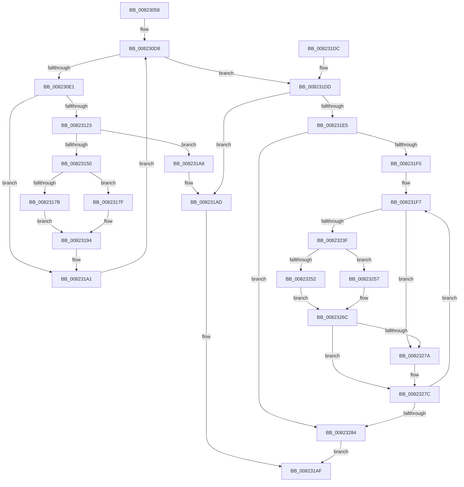

# AdtpInitializeDriveLetters

- RVA: `0x00823058`–`0x0082328B` (길이 `563` bytes)
- VA: `0x0000000140823058`
- 실행 섹션: `PAGE`
- PDB 이름 있음: `예`; PDB Function 태그: `아니요`
- unwind 정보 RVA: `0x000DA288`
- 디코드: `150`개 명령, `563/563` bytes 표시
- 미해석 바이트: `0` (있으면 어셈블리에 `.byte`로 보존)

> 이 문서는 커널 이미지의 기계어와 PDB 기호를 분석해 생성했습니다. 4번과 5번은 함수 원형과 자료형을 바이너리 사용 방식에서 추정한 C 해석이며 원본 소스 복구 결과는 아닙니다.

## 1. Dependencies

- 직접 호출 지점: **14**; 고유 호출 대상: **8**
- 직접 호출자로 확인된 함수: **1**
- RIP 상대 이미지 참조: **2**

### Outgoing calls
- `0x008230B2` → [StringCopyWorkerW](../../text/69/StringCopyWorkerW_function_0069CC90.md) (function, `0x0069CC90`)
- `0x008230BF` → [RtlInitUnicodeString](../../text/42/RtlInitUnicodeString_function_0042A780.md) (function, `0x0042A780`)
- `0x00823118` → [NtOpenSymbolicLinkObject](../9E/NtOpenSymbolicLinkObject_function_009E7A60.md) (function, `0x009E7A60`)
- `0x00823143` → [ExAllocatePool2](../../poolcode/B8/ExAllocatePool2_function_00B820F0.md) (function, `0x00B820F0`)
- `0x00823167` → [NtQuerySymbolicLinkObject](../9E/NtQuerySymbolicLinkObject_function_009EBA20.md) (function, `0x009EBA20`)
- `0x00823172` → [NtClose](../86/NtClose_function_00868870.md) (function, `0x00868870`)
- `0x00823184` → [ExFreePoolWithTag](../../poolcode/B8/ExFreePoolWithTag_function_00B82870.md) (function, `0x00B82870`)
- `0x0082318F` → [RtlInitUnicodeString](../../text/42/RtlInitUnicodeString_function_0042A780.md) (function, `0x0042A780`)
- `0x008231B6` → [_security_check_cookie](../../text/6A/_security_check_cookie_function_006AC640.md) (function, `0x006AC640`)
- `0x00823236` → [NtOpenSymbolicLinkObject](../9E/NtOpenSymbolicLinkObject_function_009E7A60.md) (function, `0x009E7A60`)
- `0x00823249` → [NtQuerySymbolicLinkObject](../9E/NtQuerySymbolicLinkObject_function_009EBA20.md) (function, `0x009EBA20`)
- `0x0082325D` → [ExFreePoolWithTag](../../poolcode/B8/ExFreePoolWithTag_function_00B82870.md) (function, `0x00B82870`)
- `0x00823267` → [RtlInitUnicodeString](../../text/42/RtlInitUnicodeString_function_0042A780.md) (function, `0x0042A780`)
- `0x00823270` → [NtClose](../86/NtClose_function_00868870.md) (function, `0x00868870`)

### Direct callers
- [AdtpInitializeAuditingCommon](AdtpInitializeAuditingCommon_function_00823018.md) at `0x0082302E`

### Static image references
- `0x0082307B` → RVA `0x00E0A740` (`.data`; read)
- `0x008230C8` → RVA `0x00FDA9B0` (`PAGEDATA`; read)

## 2. Other-region calls and transfers

- 다른 실행 섹션으로 향하는 call: **8**
  - `0x008230B2` → [StringCopyWorkerW](../../text/69/StringCopyWorkerW_function_0069CC90.md) (`PAGE` → `.text`)
  - `0x008230BF` → [RtlInitUnicodeString](../../text/42/RtlInitUnicodeString_function_0042A780.md) (`PAGE` → `.text`)
  - `0x00823143` → [ExAllocatePool2](../../poolcode/B8/ExAllocatePool2_function_00B820F0.md) (`PAGE` → `POOLCODE`)
  - `0x00823184` → [ExFreePoolWithTag](../../poolcode/B8/ExFreePoolWithTag_function_00B82870.md) (`PAGE` → `POOLCODE`)
  - `0x0082318F` → [RtlInitUnicodeString](../../text/42/RtlInitUnicodeString_function_0042A780.md) (`PAGE` → `.text`)
  - `0x008231B6` → [_security_check_cookie](../../text/6A/_security_check_cookie_function_006AC640.md) (`PAGE` → `.text`)
  - `0x0082325D` → [ExFreePoolWithTag](../../poolcode/B8/ExFreePoolWithTag_function_00B82870.md) (`PAGE` → `POOLCODE`)
  - `0x00823267` → [RtlInitUnicodeString](../../text/42/RtlInitUnicodeString_function_0042A780.md) (`PAGE` → `.text`)
- 별도 외부 분기/꼬리 이동을 확인하지 못했습니다.

## 3. Assembly (complete function range)

```asm
00823058  48 8B C4                        mov rax, rsp
0082305B  48 89 58 08                     mov qword ptr [rax + 8], rbx
0082305F  48 89 70 10                     mov qword ptr [rax + 0x10], rsi
00823063  48 89 78 18                     mov qword ptr [rax + 0x18], rdi
00823067  55                              push rbp
00823068  41 54                           push r12
0082306A  41 55                           push r13
0082306C  41 56                           push r14
0082306E  41 57                           push r15
00823070  48 8D 68 A1                     lea rbp, [rax - 0x5f]
00823074  48 81 EC C0 00 00 00            sub rsp, 0xc0
0082307B  48 8B 05 BE 76 5E 00            mov rax, qword ptr [rip + 0x5e76be]
00823082  48 33 C4                        xor rax, rsp
00823085  48 89 45 2F                     mov qword ptr [rbp + 0x2f], rax
00823089  0F 57 C0                        xorps xmm0, xmm0
0082308C  48 8D 4D EF                     lea rcx, [rbp - 0x11]
00823090  33 C0                           xor eax, eax
00823092  45 33 E4                        xor r12d, r12d
00823095  0F 11 45 DF                     movups xmmword ptr [rbp - 0x21], xmm0
00823099  48 89 45 CF                     mov qword ptr [rbp - 0x31], rax
0082309D  41 8B DC                        mov ebx, r12d
008230A0  0F 11 45 AF                     movups xmmword ptr [rbp - 0x51], xmm0
008230A4  89 45 D7                        mov dword ptr [rbp - 0x29], eax
008230A7  41 8B FC                        mov edi, r12d
008230AA  0F 11 45 BF                     movups xmmword ptr [rbp - 0x41], xmm0
008230AE  4C 89 65 A7                     mov qword ptr [rbp - 0x59], r12
008230B2  E8 D9 9B E7 FF                  call 0x14069cc90
008230B7  48 8D 55 EF                     lea rdx, [rbp - 0x11]
008230BB  48 8D 4D DF                     lea rcx, [rbp - 0x21]
008230BF  E8 BC 76 C0 FF                  call 0x14042a780
008230C4  4C 8B 6D E7                     mov r13, qword ptr [rbp - 0x19]
008230C8  4C 8D 35 E1 78 7B 00            lea r14, [rip + 0x7b78e1]
008230CF  41 8B F4                        mov esi, r12d
008230D2  41 BF 00 01 00 00               mov r15d, 0x100
008230D8  83 FE 1A                        cmp esi, 0x1a
008230DB  0F 83 FC 00 00 00               jae 0x1408231dd
008230E1  8D 46 41                        lea eax, [rsi + 0x41]
008230E4  C7 45 AF 30 00 00 00            mov dword ptr [rbp - 0x51], 0x30
008230EB  66 41 89 45 18                  mov word ptr [r13 + 0x18], ax
008230F0  4C 8D 45 AF                     lea r8, [rbp - 0x51]
008230F4  48 8D 45 DF                     lea rax, [rbp - 0x21]
008230F8  4C 89 65 B7                     mov qword ptr [rbp - 0x49], r12
008230FC  0F 57 C0                        xorps xmm0, xmm0
008230FF  48 89 45 BF                     mov qword ptr [rbp - 0x41], rax
00823103  BA 01 00 00 00                  mov edx, 1
00823108  C7 45 C7 40 02 00 00            mov dword ptr [rbp - 0x39], 0x240
0082310F  48 8D 4D A7                     lea rcx, [rbp - 0x59]
00823113  F3 0F 7F 45 CF                  movdqu xmmword ptr [rbp - 0x31], xmm0
00823118  E8 43 49 1C 00                  call 0x1409e7a60
0082311D  8B D8                           mov ebx, eax
0082311F  85 C0                           test eax, eax
00823121  78 7E                           js 0x1408231a1
00823123  8B C7                           mov eax, edi
00823125  41 B8 53 65 41 6B               mov r8d, 0x6b416553
0082312B  49 8B D7                        mov rdx, r15
0082312E  48 8D 0C 40                     lea rcx, [rax + rax*2]
00823132  41 0F B7 45 18                  movzx eax, word ptr [r13 + 0x18]
00823137  66 41 89 04 CE                  mov word ptr [r14 + rcx*8], ax
0082313C  4D 8D 34 CE                     lea r14, [r14 + rcx*8]
00823140  49 8B CF                        mov rcx, r15
00823143  E8 A8 EF 35 00                  call 0x140b820f0
00823148  4C 8B F8                        mov r15, rax
0082314B  48 85 C0                        test rax, rax
0082314E  74 58                           je 0x1408231a8
00823150  48 8B 4D A7                     mov rcx, qword ptr [rbp - 0x59]
00823154  49 8D 56 08                     lea rdx, [r14 + 8]
00823158  45 33 C0                        xor r8d, r8d
0082315B  41 C7 46 08 00 00 00 01         mov dword ptr [r14 + 8], 0x1000000
00823163  49 89 46 10                     mov qword ptr [r14 + 0x10], rax
00823167  E8 B4 88 1C 00                  call 0x1409eba20
0082316C  48 8B 4D A7                     mov rcx, qword ptr [rbp - 0x59]
00823170  8B D8                           mov ebx, eax
00823172  E8 F9 56 04 00                  call 0x140868870
00823177  85 DB                           test ebx, ebx
00823179  78 04                           js 0x14082317f
0082317B  FF C7                           inc edi
0082317D  EB 15                           jmp 0x140823194
0082317F  33 D2                           xor edx, edx
00823181  49 8B CF                        mov rcx, r15
00823184  E8 E7 F6 35 00                  call 0x140b82870
00823189  33 D2                           xor edx, edx
0082318B  49 8D 4E 08                     lea rcx, [r14 + 8]
0082318F  E8 EC 75 C0 FF                  call 0x14042a780
00823194  4C 8D 35 15 78 7B 00            lea r14, [rip + 0x7b7815]
0082319B  41 BF 00 01 00 00               mov r15d, 0x100
008231A1  FF C6                           inc esi
008231A3  E9 30 FF FF FF                  jmp 0x1408230d8
008231A8  BB 17 00 00 C0                  mov ebx, 0xc0000017
008231AD  8B C3                           mov eax, ebx
008231AF  48 8B 4D 2F                     mov rcx, qword ptr [rbp + 0x2f]
008231B3  48 33 CC                        xor rcx, rsp
008231B6  E8 85 94 E8 FF                  call 0x1406ac640
008231BB  4C 8D 9C 24 C0 00 00 00         lea r11, [rsp + 0xc0]
008231C3  49 8B 5B 30                     mov rbx, qword ptr [r11 + 0x30]
008231C7  49 8B 73 38                     mov rsi, qword ptr [r11 + 0x38]
008231CB  49 8B 7B 40                     mov rdi, qword ptr [r11 + 0x40]
008231CF  49 8B E3                        mov rsp, r11
008231D2  41 5F                           pop r15
008231D4  41 5E                           pop r14
008231D6  41 5D                           pop r13
008231D8  41 5C                           pop r12
008231DA  5D                              pop rbp
008231DB  C3                              ret
008231DC  CC                              int3
008231DD  81 FB 17 00 00 C0               cmp ebx, 0xc0000017
008231E3  74 C8                           je 0x1408231ad
008231E5  41 8B DC                        mov ebx, r12d
008231E8  85 FF                           test edi, edi
008231EA  0F 84 94 00 00 00               je 0x140823284
008231F0  4C 8D 3D B9 77 7B 00            lea r15, [rip + 0x7b77b9]
008231F7  8B C3                           mov eax, ebx
008231F9  4C 8D 45 AF                     lea r8, [rbp - 0x51]
008231FD  0F 57 C0                        xorps xmm0, xmm0
00823200  C7 45 AF 30 00 00 00            mov dword ptr [rbp - 0x51], 0x30
00823207  BA 01 00 00 00                  mov edx, 1
0082320C  4C 89 65 B7                     mov qword ptr [rbp - 0x49], r12
00823210  45 8A F4                        mov r14b, r12b
00823213  C7 45 C7 40 02 00 00            mov dword ptr [rbp - 0x39], 0x240
0082321A  48 8D 0C 45 01 00 00 00         lea rcx, [rax*2 + 1]
00823222  48 03 C8                        add rcx, rax
00823225  F3 0F 7F 45 CF                  movdqu xmmword ptr [rbp - 0x31], xmm0
0082322A  49 8D 34 CF                     lea rsi, [r15 + rcx*8]
0082322E  48 8D 4D A7                     lea rcx, [rbp - 0x59]
00823232  48 89 75 BF                     mov qword ptr [rbp - 0x41], rsi
00823236  E8 25 48 1C 00                  call 0x1409e7a60
0082323B  85 C0                           test eax, eax
0082323D  78 3B                           js 0x14082327a
0082323F  48 8B 4D A7                     mov rcx, qword ptr [rbp - 0x59]
00823243  45 33 C0                        xor r8d, r8d
00823246  48 8B D6                        mov rdx, rsi
00823249  E8 D2 87 1C 00                  call 0x1409eba20
0082324E  85 C0                           test eax, eax
00823250  78 05                           js 0x140823257
00823252  41 B6 01                        mov r14b, 1
00823255  EB 15                           jmp 0x14082326c
00823257  48 8B 4E 08                     mov rcx, qword ptr [rsi + 8]
0082325B  33 D2                           xor edx, edx
0082325D  E8 0E F6 35 00                  call 0x140b82870
00823262  33 D2                           xor edx, edx
00823264  48 8B CE                        mov rcx, rsi
00823267  E8 14 75 C0 FF                  call 0x14042a780
0082326C  48 8B 4D A7                     mov rcx, qword ptr [rbp - 0x59]
00823270  E8 FB 55 04 00                  call 0x140868870
00823275  45 84 F6                        test r14b, r14b
00823278  75 02                           jne 0x14082327c
0082327A  FF C3                           inc ebx
0082327C  3B DF                           cmp ebx, edi
0082327E  0F 82 73 FF FF FF               jb 0x1408231f7
00823284  33 C0                           xor eax, eax
00823286  E9 24 FF FF FF                  jmp 0x1408231af
```

## 4. C-style interpretation (structured pseudocode)

```c
__int64 __fastcall AdtpInitializeDriveLetters(void)
{
    __int64 result;
    __int64 v_r12;
    __int64 v_rbx;
    __int64 v_rdi;
    __int64 v_rsi;
    __int64 v_rsp;
    unsigned __int64 v_stack_m28;

    *(unsigned __int64 *)(v_rsp + 8) = v_rbx;
    *(unsigned __int64 *)(v_rsp + 16) = v_rsi;
    *(unsigned __int64 *)(v_rsp + 24) = v_rdi;
    v_rsp = (v_rsp) - (192);
    result = (*(unsigned __int64 *)(v_rip + 6190782)) ^ (v_rsp);
    *(unsigned __int64 *)(v_rsp - 95 + 47) = result;
    result = 0;
    v_r12 = 0;
    *(unsigned __int64 *)(v_rsp - 95 - 33) = v_xmm0;
    *(unsigned __int64 *)(v_rsp - 95 - 49) = 0;
    *(unsigned __int64 *)(v_rsp - 95 - 81) = v_xmm0;
    *(unsigned int *)(v_rsp - 95 - 41) = 0;
    *(unsigned __int64 *)(v_rsp - 95 - 65) = v_xmm0;
    *(unsigned __int64 *)(v_rsp - 95 - 89) = 0;
    result = StringCopyWorkerW(v_rsp - 95 - 17, a2, a3, a4);
    result = RtlInitUnicodeString(v_rsp - 95 - 33, v_rsp - 95 - 17, a3, a4);
loc_008230D8:
    if (0 >= 26) goto loc_008231DD;
    *(unsigned int *)(v_rsp - 95 - 81) = 48;
    *(unsigned __int16 *)(*(unsigned __int64 *)(v_rsp - 95 - 25) + 24) = (unsigned __int16)(0 + 65);
    *(unsigned __int64 *)(v_rsp - 95 - 73) = 0;
    *(unsigned __int64 *)(v_rsp - 95 - 65) = v_rsp - 95 - 33;
    *(unsigned int *)(v_rsp - 95 - 57) = 576;
    *(unsigned __int64 *)(v_rsp - 95 - 49) = v_xmm0;
    result = NtOpenSymbolicLinkObject(v_rsp - 95 - 89, 1, v_rsp - 95 - 81, a4);
    if (sign_flag) goto loc_008231A1;
    *(unsigned __int16 *)(v_rip + 8091873 + 0 + 0 * 2 * 8) = (unsigned __int16)(*(unsigned __int16 *)(*(unsigned __int64 *)(v_rsp - 95 - 25) + 24));
    result = ExAllocatePool2(256, 256, (unsigned int)(0x6B416553ULL), a4);
    if (result == 0) goto loc_008231A8;
    a3 = 0;
    *(unsigned int *)(v_rip + 8091873 + 0 + 0 * 2 * 8 + 8) = 0x1000000ULL;
    *(unsigned __int64 *)(v_rip + 8091873 + 0 + 0 * 2 * 8 + 16) = result;
    result = NtQuerySymbolicLinkObject(*(unsigned __int64 *)(v_rsp - 95 - 89), v_rip + 8091873 + 0 + 0 * 2 * 8 + 8, a3, a4);
    result = NtClose(*(unsigned __int64 *)(v_rsp - 95 - 89), v_rip + 8091873 + 0 + 0 * 2 * 8 + 8, a3, a4);
    if (sign_flag) goto loc_0082317F;
    v_rdi = (unsigned int)((0) + 1);
    goto loc_00823194;
loc_0082317F:
    a2 = 0;
    result = ExFreePoolWithTag(result, a2, a3, a4);
    a2 = 0;
    result = RtlInitUnicodeString(v_rip + 8091873 + 0 + 0 * 2 * 8 + 8, a2, a3, a4);
loc_00823194:
loc_008231A1:
    v_rsi = (unsigned int)((0) + 1);
    goto loc_008230D8;
loc_008231A8:
loc_008231AD:
loc_008231AF:
    a1 = (*(unsigned __int64 *)(v_rsp - 95 + 47)) ^ (v_rsp);
    result = _security_check_cookie(a1, a2, a3, a4);
    return result;
loc_008231DD:
    if (((unsigned int)(*(unsigned __int64 *)(v_stack_m28 + 48))) == 0xC0000017ULL) goto loc_008231AD;
    if ((unsigned int)(*(unsigned __int64 *)(v_stack_m28 + 64)) == 0) goto loc_00823284;
loc_008231F7:
    *(unsigned int *)(v_rsp - 95 - 81) = 48;
    *(unsigned __int64 *)(v_rsp - 95 - 73) = 0;
    *(unsigned int *)(v_rsp - 95 - 57) = 576;
    a1 = (0 * 2 + 1) + (0);
    *(unsigned __int64 *)(v_rsp - 95 - 49) = v_xmm0;
    *(unsigned __int64 *)(v_rsp - 95 - 65) = v_rip + 8091577 + a1 * 8;
    result = NtOpenSymbolicLinkObject(v_rsp - 95 - 89, 1, v_rsp - 95 - 81, a4);
    if (sign_flag) goto loc_0082327A;
    a3 = 0;
    result = NtQuerySymbolicLinkObject(*(unsigned __int64 *)(v_rsp - 95 - 89), v_rip + 8091577 + a1 * 8, a3, a4);
    if (sign_flag) goto loc_00823257;
    goto loc_0082326C;
loc_00823257:
    a2 = 0;
    result = ExFreePoolWithTag(*(unsigned __int64 *)(v_rip + 8091577 + a1 * 8 + 8), a2, a3, a4);
    a2 = 0;
    result = RtlInitUnicodeString(v_rip + 8091577 + a1 * 8, a2, a3, a4);
loc_0082326C:
    result = NtClose(*(unsigned __int64 *)(v_rsp - 95 - 89), a2, a3, a4);
    v_rbx = 0;
    if (1 == 0) {
        v_rbx = (unsigned int)((0) + 1);
    }
    if (((unsigned int)(v_rbx)) < ((unsigned int)(*(unsigned __int64 *)(v_stack_m28 + 64)))) goto loc_008231F7;
loc_00823284:
    result = 0;
    goto loc_008231AF;
}
```

## 5. (Beta) C Style

```c
void AdtpInitializeDriveLetters(void)
{
    int64_t result;
    int64_t local_r12;
    int64_t local_rbx;
    int64_t local_rdi;
    int64_t local_rsi;
    int64_t local_rsp;
    uint64_t v_stack_m28;

    *(uint64_t *)(local_rsp + 0x8) = local_rbx;
    *(uint64_t *)(local_rsp + 0x10) = local_rsi;
    *(uint64_t *)(local_rsp + 0x18) = local_rdi;
    local_rsp = (local_rsp) - (192);
    result = (*(uint64_t *)(v_rip + 0x5E76BE)) ^ (local_rsp);
    *(uint64_t *)(local_rsp - 0x5F + 0x2F) = result;
    result = 0;
    local_r12 = 0;
    *(uint64_t *)(local_rsp - 0x5F - 0x21) = v_xmm0;
    *(uint64_t *)(local_rsp - 0x5F - 0x31) = 0;
    *(uint64_t *)(local_rsp - 0x5F - 0x51) = v_xmm0;
    *(uint32_t *)(local_rsp - 0x5F - 0x29) = 0;
    *(uint64_t *)(local_rsp - 0x5F - 0x41) = v_xmm0;
    *(uint64_t *)(local_rsp - 0x5F - 0x59) = 0;
    result = StringCopyWorkerW(local_rsp - 95 - 17, a2, a3, a4);
    result = RtlInitUnicodeString(local_rsp - 95 - 33, local_rsp - 95 - 17, a3, a4);
loc_008230D8:
    if (0 >= 26) goto loc_008231DD;
    *(uint32_t *)(local_rsp - 0x5F - 0x51) = 48;
    *(uint16_t *)(*(uint64_t *)(local_rsp - 0x5F - 0x19) + 0x18) = (uint16_t)(0 + 65);
    *(uint64_t *)(local_rsp - 0x5F - 0x49) = 0;
    *(uint64_t *)(local_rsp - 0x5F - 0x41) = local_rsp - 95 - 33;
    *(uint32_t *)(local_rsp - 0x5F - 0x39) = 576;
    *(uint64_t *)(local_rsp - 0x5F - 0x31) = v_xmm0;
    result = NtOpenSymbolicLinkObject(local_rsp - 95 - 89, 1, local_rsp - 95 - 81, a4);
    if (sign_flag) goto loc_008231A1;
    *(uint16_t *)(v_rip + 0x7B78E1 + 0x0 + 0x0 * 2 * 8) = (uint16_t)(*(uint16_t *)(*(uint64_t *)(local_rsp - 0x5F - 0x19) + 0x18));
    result = ExAllocatePool2(256, 256, (uint32_t)(0x6B416553ULL), a4);
    if (result == 0) goto loc_008231A8;
    a3 = 0;
    *(uint32_t *)(v_rip + 0x7B78E1 + 0x0 + 0x0 * 2 * 8 + 0x8) = 0x1000000ULL;
    *(uint64_t *)(v_rip + 0x7B78E1 + 0x0 + 0x0 * 2 * 8 + 0x10) = result;
    result = NtQuerySymbolicLinkObject(*(uint64_t *)(local_rsp - 0x5F - 0x59), v_rip + 8091873 + 0 + 0 * 2 * 8 + 8, a3, a4);
    result = NtClose(*(uint64_t *)(local_rsp - 0x5F - 0x59), v_rip + 8091873 + 0 + 0 * 2 * 8 + 8, a3, a4);
    if (sign_flag) goto loc_0082317F;
    local_rdi = (uint32_t)((0) + 1);
    goto loc_00823194;
loc_0082317F:
    a2 = 0;
    result = ExFreePoolWithTag(result, a2, a3, a4);
    a2 = 0;
    result = RtlInitUnicodeString(v_rip + 8091873 + 0 + 0 * 2 * 8 + 8, a2, a3, a4);
loc_00823194:
loc_008231A1:
    local_rsi = (uint32_t)((0) + 1);
    goto loc_008230D8;
loc_008231A8:
loc_008231AD:
loc_008231AF:
    a1 = (*(uint64_t *)(local_rsp - 0x5F + 0x2F)) ^ (local_rsp);
    result = _security_check_cookie(a1, a2, a3, a4);
    return result;
loc_008231DD:
    if (((uint32_t)(*(uint64_t *)(v_stack_m28 + 0x30))) == 0xC0000017ULL) goto loc_008231AD;
    if ((uint32_t)(*(uint64_t *)(v_stack_m28 + 0x40)) == 0) goto loc_00823284;
loc_008231F7:
    *(uint32_t *)(local_rsp - 0x5F - 0x51) = 48;
    *(uint64_t *)(local_rsp - 0x5F - 0x49) = 0;
    *(uint32_t *)(local_rsp - 0x5F - 0x39) = 576;
    a1 = (0 * 2 + 1) + (0);
    *(uint64_t *)(local_rsp - 0x5F - 0x31) = v_xmm0;
    *(uint64_t *)(local_rsp - 0x5F - 0x41) = v_rip + 8091577 + a1 * 8;
    result = NtOpenSymbolicLinkObject(local_rsp - 95 - 89, 1, local_rsp - 95 - 81, a4);
    if (sign_flag) goto loc_0082327A;
    a3 = 0;
    result = NtQuerySymbolicLinkObject(*(uint64_t *)(local_rsp - 0x5F - 0x59), v_rip + 8091577 + a1 * 8, a3, a4);
    if (sign_flag) goto loc_00823257;
    goto loc_0082326C;
loc_00823257:
    a2 = 0;
    result = ExFreePoolWithTag(*(uint64_t *)(v_rip + 0x7B77B9 + a1 * 8 + 0x8), a2, a3, a4);
    a2 = 0;
    result = RtlInitUnicodeString(v_rip + 8091577 + a1 * 8, a2, a3, a4);
loc_0082326C:
    result = NtClose(*(uint64_t *)(local_rsp - 0x5F - 0x59), a2, a3, a4);
    local_rbx = 0;
    if (1 == 0) {
        local_rbx = (uint32_t)((0) + 1);
    }
    if (((uint32_t)(local_rbx)) < ((uint32_t)(*(uint64_t *)(v_stack_m28 + 0x40)))) goto loc_008231F7;
loc_00823284:
    result = 0;
    goto loc_008231AF;
}
```

## 6. Execution-region graph

[열기: 2D/3D 그래프와 함수 탐색 컨트롤 패널](../../../control-panel.html?section=page&rva=0x00823058&view=graph)

- 2D 그래프는 위에서 아래로 흐르고, 3D 그래프는 빈 공간을 드래그해 회전합니다. Shift+드래그는 이동, 휠은 확대·축소, 함수 노드 선택은 대상 보고서 이동입니다.

### Static fallback


