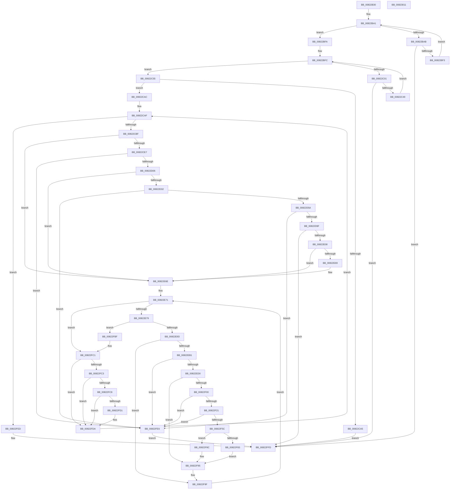

# AdtpObjsInitialize

- RVA: `0x00822B30`–`0x00823012` (길이 `1,250` bytes)
- VA: `0x0000000140822B30`
- 실행 섹션: `PAGE`
- PDB 이름 있음: `예`; PDB Function 태그: `아니요`
- unwind 정보 RVA: `0x000DA22C`
- 디코드: `314`개 명령, `1,250/1,250` bytes 표시
- 미해석 바이트: `0` (있으면 어셈블리에 `.byte`로 보존)

> 이 문서는 커널 이미지의 기계어와 PDB 기호를 분석해 생성했습니다. 4번과 5번은 함수 원형과 자료형을 바이너리 사용 방식에서 추정한 C 해석이며 원본 소스 복구 결과는 아닙니다.

## 1. Dependencies

- 직접 호출 지점: **25**; 고유 호출 대상: **10**
- 직접 호출자로 확인된 함수: **1**
- RIP 상대 이미지 참조: **6**

### Outgoing calls
- `0x00822B8D` → [ExInitializeResourceLite](../../text/41/ExInitializeResourceLite_function_0041F9A0.md) (function, `0x0041F9A0`)
- `0x00822BE6` → [RtlIntegerToUnicodeString](../91/RtlIntegerToUnicodeString_function_0091D3E0.md) (function, `0x0091D3E0`)
- `0x00822C3C` → [RtlIntegerToUnicodeString](../91/RtlIntegerToUnicodeString_function_0091D3E0.md) (function, `0x0091D3E0`)
- `0x00822C60` → [RtlInitUnicodeString](../../text/42/RtlInitUnicodeString_function_0042A780.md) (function, `0x0042A780`)
- `0x00822C97` → [NtOpenKeyEx](../A4/NtOpenKeyEx_function_00A45CC0.md) (function, `0x00A45CC0`)
- `0x00822CD5` → [NtEnumerateKey](../8B/NtEnumerateKey_function_008B1F70.md) (function, `0x008B1F70`)
- `0x00822CF5` → [ExAllocatePool2](../../poolcode/B8/ExAllocatePool2_function_00B820F0.md) (function, `0x00B820F0`)
- `0x00822D23` → [NtEnumerateKey](../8B/NtEnumerateKey_function_008B1F70.md) (function, `0x008B1F70`)
- `0x00822D49` → [ExAllocatePool2](../../poolcode/B8/ExAllocatePool2_function_00B820F0.md) (function, `0x00B820F0`)
- `0x00822D8D` → [ExAllocatePool2](../../poolcode/B8/ExAllocatePool2_function_00B820F0.md) (function, `0x00B820F0`)
- `0x00822DBA` → [RtlCopyUnicodeString](../../text/3F/RtlCopyUnicodeString_function_003FEF30.md) (function, `0x003FEF30`)
- `0x00822DC4` → [ExFreePoolWithTag](../../poolcode/B8/ExFreePoolWithTag_function_00B82870.md) (function, `0x00B82870`)
- `0x00822DFB` → [NtOpenKeyEx](../A4/NtOpenKeyEx_function_00A45CC0.md) (function, `0x00A45CC0`)
- `0x00822E13` → [RtlInitUnicodeString](../../text/42/RtlInitUnicodeString_function_0042A780.md) (function, `0x0042A780`)
- `0x00822E4E` → [NtOpenKeyEx](../A4/NtOpenKeyEx_function_00A45CC0.md) (function, `0x00A45CC0`)
- `0x00822E59` → [NtClose](../86/NtClose_function_00868870.md) (function, `0x00868870`)
- `0x00822E9E` → [NtEnumerateValueKey](../8B/NtEnumerateValueKey_function_008B3B50.md) (function, `0x008B3B50`)
- `0x00822EBF` → [ExAllocatePool2](../../poolcode/B8/ExAllocatePool2_function_00B820F0.md) (function, `0x00B820F0`)
- `0x00822EF0` → [NtEnumerateValueKey](../8B/NtEnumerateValueKey_function_008B3B50.md) (function, `0x008B3B50`)
- `0x00822F10` → [ExAllocatePool2](../../poolcode/B8/ExAllocatePool2_function_00B820F0.md) (function, `0x00B820F0`)
- `0x00822F4A` → [ExAllocatePool2](../../poolcode/B8/ExAllocatePool2_function_00B820F0.md) (function, `0x00B820F0`)
- `0x00822F78` → [RtlCopyUnicodeString](../../text/3F/RtlCopyUnicodeString_function_003FEF30.md) (function, `0x003FEF30`)
- `0x00822F9A` → [ExFreePoolWithTag](../../poolcode/B8/ExFreePoolWithTag_function_00B82870.md) (function, `0x00B82870`)
- `0x00822FD1` → [NtClose](../86/NtClose_function_00868870.md) (function, `0x00868870`)
- `0x00822FED` → [NtClose](../86/NtClose_function_00868870.md) (function, `0x00868870`)

### Direct callers
- [AdtpInitializeAuditingCommon](AdtpInitializeAuditingCommon_function_00823018.md) at `0x00823037`

### Static image references
- `0x00822B4B` → RVA `0x00EF0600` (`.data`; read)
- `0x00822B82` → RVA `0x00EF07F0` (`.data`; write)
- `0x00822B94` → RVA `0x00000000` (`image boundary/outside`; read)
- `0x00822C55` → RVA `0x000419D0` (`.rdata`; read)
- `0x00822D5A` → RVA `0x00EF07F0` (`.data`; read)
- `0x00822E08` → RVA `0x00041A60` (`.rdata`; read)

## 2. Other-region calls and transfers

- 다른 실행 섹션으로 향하는 call: **13**
  - `0x00822B8D` → [ExInitializeResourceLite](../../text/41/ExInitializeResourceLite_function_0041F9A0.md) (`PAGE` → `.text`)
  - `0x00822C60` → [RtlInitUnicodeString](../../text/42/RtlInitUnicodeString_function_0042A780.md) (`PAGE` → `.text`)
  - `0x00822CF5` → [ExAllocatePool2](../../poolcode/B8/ExAllocatePool2_function_00B820F0.md) (`PAGE` → `POOLCODE`)
  - `0x00822D49` → [ExAllocatePool2](../../poolcode/B8/ExAllocatePool2_function_00B820F0.md) (`PAGE` → `POOLCODE`)
  - `0x00822D8D` → [ExAllocatePool2](../../poolcode/B8/ExAllocatePool2_function_00B820F0.md) (`PAGE` → `POOLCODE`)
  - `0x00822DBA` → [RtlCopyUnicodeString](../../text/3F/RtlCopyUnicodeString_function_003FEF30.md) (`PAGE` → `.text`)
  - `0x00822DC4` → [ExFreePoolWithTag](../../poolcode/B8/ExFreePoolWithTag_function_00B82870.md) (`PAGE` → `POOLCODE`)
  - `0x00822E13` → [RtlInitUnicodeString](../../text/42/RtlInitUnicodeString_function_0042A780.md) (`PAGE` → `.text`)
  - `0x00822EBF` → [ExAllocatePool2](../../poolcode/B8/ExAllocatePool2_function_00B820F0.md) (`PAGE` → `POOLCODE`)
  - `0x00822F10` → [ExAllocatePool2](../../poolcode/B8/ExAllocatePool2_function_00B820F0.md) (`PAGE` → `POOLCODE`)
  - `0x00822F4A` → [ExAllocatePool2](../../poolcode/B8/ExAllocatePool2_function_00B820F0.md) (`PAGE` → `POOLCODE`)
  - `0x00822F78` → [RtlCopyUnicodeString](../../text/3F/RtlCopyUnicodeString_function_003FEF30.md) (`PAGE` → `.text`)
  - `0x00822F9A` → [ExFreePoolWithTag](../../poolcode/B8/ExFreePoolWithTag_function_00B82870.md) (`PAGE` → `POOLCODE`)
- 별도 외부 분기/꼬리 이동을 확인하지 못했습니다.

## 3. Assembly (complete function range)

```asm
00822B30  40 55                           push rbp
00822B32  53                              push rbx
00822B33  56                              push rsi
00822B34  57                              push rdi
00822B35  41 54                           push r12
00822B37  41 55                           push r13
00822B39  41 56                           push r14
00822B3B  41 57                           push r15
00822B3D  48 8D 6C 24 E1                  lea rbp, [rsp - 0x1f]
00822B42  48 81 EC 98 00 00 00            sub rsp, 0x98
00822B49  33 DB                           xor ebx, ebx
00822B4B  48 8D 0D AE DA 6C 00            lea rcx, [rip + 0x6cdaae]
00822B52  0F 57 C0                        xorps xmm0, xmm0
00822B55  48 89 5D 7F                     mov qword ptr [rbp + 0x7f], rbx
00822B59  33 C0                           xor eax, eax
00822B5B  48 89 5D B7                     mov qword ptr [rbp - 0x49], rbx
00822B5F  0F 57 C9                        xorps xmm1, xmm1
00822B62  48 89 45 FF                     mov qword ptr [rbp - 1], rax
00822B66  0F 11 45 DF                     movups xmmword ptr [rbp - 0x21], xmm0
00822B6A  89 45 07                        mov dword ptr [rbp + 7], eax
00822B6D  44 8B EB                        mov r13d, ebx
00822B70  0F 11 45 EF                     movups xmmword ptr [rbp - 0x11], xmm0
00822B74  48 89 5D 77                     mov qword ptr [rbp + 0x77], rbx
00822B78  41 B7 01                        mov r15b, 1
00822B7B  89 5D 67                        mov dword ptr [rbp + 0x67], ebx
00822B7E  0F 11 45 CF                     movups xmmword ptr [rbp - 0x31], xmm0
00822B82  48 89 1D 67 DC 6C 00            mov qword ptr [rip + 0x6cdc67], rbx
00822B89  0F 11 4D BF                     movups xmmword ptr [rbp - 0x41], xmm1
00822B8D  E8 0E CE BF FF                  call 0x14041f9a0
00822B92  8B FB                           mov edi, ebx
00822B94  4C 8D 35 65 D4 7D FF            lea r14, [rip - 0x822b9b]
00822B9B  8B F3                           mov esi, ebx
00822B9D  44 8D 63 0A                     lea r12d, [rbx + 0xa]
00822BA1  B8 18 00 00 00                  mov eax, 0x18
00822BA6  83 FE 06                        cmp esi, 6
00822BA9  77 4F                           ja 0x140822bfa
00822BAB  8B D6                           mov edx, esi
00822BAD  4D 8D 86 80 07 EF 00            lea r8, [r14 + 0xef0780]
00822BB4  48 C1 E2 04                     shl rdx, 4
00822BB8  49 8D 8E 00 08 EF 00            lea rcx, [r14 + 0xef0800]
00822BBF  4C 03 C2                        add r8, rdx
00822BC2  66 42 89 84 32 82 07 EF 00      mov word ptr [rdx + r14 + 0xef0782], ax
00822BCB  8B C7                           mov eax, edi
00822BCD  66 41 89 18                     mov word ptr [r8], bx
00822BD1  48 8D 0C 41                     lea rcx, [rcx + rax*2]
00822BD5  4A 89 8C 32 88 07 EF 00         mov qword ptr [rdx + r14 + 0xef0788], rcx
00822BDD  8D 8E 01 06 00 00               lea ecx, [rsi + 0x601]
00822BE3  41 8B D4                        mov edx, r12d
00822BE6  E8 F5 A7 0F 00                  call 0x14091d3e0
00822BEB  85 C0                           test eax, eax
00822BED  0F 88 0A 04 00 00               js 0x140822ffd
00822BF3  83 C7 0C                        add edi, 0xc
00822BF6  FF C6                           inc esi
00822BF8  EB A7                           jmp 0x140822ba1
00822BFA  8B F3                           mov esi, ebx
00822BFC  83 FE 0F                        cmp esi, 0xf
00822BFF  77 54                           ja 0x140822c55
00822C01  8B D6                           mov edx, esi
00822C03  4D 8D 86 80 06 EF 00            lea r8, [r14 + 0xef0680]
00822C0A  48 C1 E2 04                     shl rdx, 4
00822C0E  49 8D 8E 00 08 EF 00            lea rcx, [r14 + 0xef0800]
00822C15  4C 03 C2                        add r8, rdx
00822C18  66 42 89 84 32 82 06 EF 00      mov word ptr [rdx + r14 + 0xef0682], ax
00822C21  8B C7                           mov eax, edi
00822C23  66 41 89 18                     mov word ptr [r8], bx
00822C27  48 8D 0C 41                     lea rcx, [rcx + rax*2]
00822C2B  4A 89 8C 32 88 06 EF 00         mov qword ptr [rdx + r14 + 0xef0688], rcx
00822C33  8D 8E 10 06 00 00               lea ecx, [rsi + 0x610]
00822C39  41 8B D4                        mov edx, r12d
00822C3C  E8 9F A7 0F 00                  call 0x14091d3e0
00822C41  85 C0                           test eax, eax
00822C43  0F 88 B4 03 00 00               js 0x140822ffd
00822C49  83 C7 0C                        add edi, 0xc
00822C4C  B8 18 00 00 00                  mov eax, 0x18
00822C51  FF C6                           inc esi
00822C53  EB A7                           jmp 0x140822bfc
00822C55  48 8D 15 74 ED 81 FF            lea rdx, [rip - 0x7e128c]
00822C5C  48 8D 4D CF                     lea rcx, [rbp - 0x31]
00822C60  E8 1B 7B C0 FF                  call 0x14042a780
00822C65  48 8D 45 CF                     lea rax, [rbp - 0x31]
00822C69  C7 45 DF 30 00 00 00            mov dword ptr [rbp - 0x21], 0x30
00822C70  0F 57 C0                        xorps xmm0, xmm0
00822C73  48 89 45 EF                     mov qword ptr [rbp - 0x11], rax
00822C77  45 33 C9                        xor r9d, r9d
00822C7A  48 89 5D E7                     mov qword ptr [rbp - 0x19], rbx
00822C7E  4C 8D 45 DF                     lea r8, [rbp - 0x21]
00822C82  C7 45 F7 40 02 00 00            mov dword ptr [rbp - 9], 0x240
00822C89  BA 19 00 02 00                  mov edx, 0x20019
00822C8E  48 8D 4D 7F                     lea rcx, [rbp + 0x7f]
00822C92  F3 0F 7F 45 FF                  movdqu xmmword ptr [rbp - 1], xmm0
00822C97  E8 24 30 22 00                  call 0x140a45cc0
00822C9C  8B F8                           mov edi, eax
00822C9E  3D 34 00 00 C0                  cmp eax, 0xc0000034
00822CA3  75 07                           jne 0x140822cac
00822CA5  33 C0                           xor eax, eax
00822CA7  E9 51 03 00 00                  jmp 0x140822ffd
00822CAC  44 8B F3                        mov r14d, ebx
00822CAF  48 8B 4D 7F                     mov rcx, qword ptr [rbp + 0x7f]
00822CB3  44 89 75 6F                     mov dword ptr [rbp + 0x6f], r14d
00822CB7  85 FF                           test edi, edi
00822CB9  0F 88 2E 03 00 00               js 0x140822fed
00822CBF  48 8D 45 67                     lea rax, [rbp + 0x67]
00822CC3  45 33 C9                        xor r9d, r9d
00822CC6  48 89 44 24 28                  mov qword ptr [rsp + 0x28], rax
00822CCB  45 33 C0                        xor r8d, r8d
00822CCE  41 8B D6                        mov edx, r14d
00822CD1  89 5C 24 20                     mov dword ptr [rsp + 0x20], ebx
00822CD5  E8 96 F2 08 00                  call 0x1408b1f70
00822CDA  8B F8                           mov edi, eax
00822CDC  3D 23 00 00 C0                  cmp eax, 0xc0000023
00822CE1  0F 85 87 01 00 00               jne 0x140822e6e
00822CE7  8B 55 67                        mov edx, dword ptr [rbp + 0x67]
00822CEA  B9 00 01 00 00                  mov ecx, 0x100
00822CEF  41 B8 53 65 41 6B               mov r8d, 0x6b416553
00822CF5  E8 F6 F3 35 00                  call 0x140b820f0
00822CFA  48 8B F0                        mov rsi, rax
00822CFD  48 85 C0                        test rax, rax
00822D00  0F 84 E0 02 00 00               je 0x140822fe6
00822D06  48 8B 4D 7F                     mov rcx, qword ptr [rbp + 0x7f]
00822D0A  48 8D 45 67                     lea rax, [rbp + 0x67]
00822D0E  48 89 44 24 28                  mov qword ptr [rsp + 0x28], rax
00822D13  4C 8B CE                        mov r9, rsi
00822D16  8B 45 67                        mov eax, dword ptr [rbp + 0x67]
00822D19  45 33 C0                        xor r8d, r8d
00822D1C  41 8B D6                        mov edx, r14d
00822D1F  89 44 24 20                     mov dword ptr [rsp + 0x20], eax
00822D23  E8 48 F2 08 00                  call 0x1408b1f70
00822D28  8B F8                           mov edi, eax
00822D2A  85 C0                           test eax, eax
00822D2C  0F 88 3C 01 00 00               js 0x140822e6e
00822D32  41 BE 53 65 41 6B               mov r14d, 0x6b416553
00822D38  41 BF 00 01 00 00               mov r15d, 0x100
00822D3E  45 8B C6                        mov r8d, r14d
00822D41  41 8B CF                        mov ecx, r15d
00822D44  BA 20 00 00 00                  mov edx, 0x20
00822D49  E8 A2 F3 35 00                  call 0x140b820f0
00822D4E  4C 8B E8                        mov r13, rax
00822D51  48 85 C0                        test rax, rax
00822D54  0F 84 8C 02 00 00               je 0x140822fe6
00822D5A  48 8B 05 8F DA 6C 00            mov rax, qword ptr [rip + 0x6cda8f]
00822D61  49 8D 7D 08                     lea rdi, [r13 + 8]
00822D65  49 89 45 00                     mov qword ptr [r13], rax
00822D69  45 8B C6                        mov r8d, r14d
00822D6C  4C 89 2D 7D DA 6C 00            mov qword ptr [rip + 0x6cda7d], r13
00822D73  41 8B CF                        mov ecx, r15d
00822D76  49 89 5D 18                     mov qword ptr [r13 + 0x18], rbx
00822D7A  0F B7 46 0C                     movzx eax, word ptr [rsi + 0xc]
00822D7E  66 89 07                        mov word ptr [rdi], ax
00822D81  66 83 C0 02                     add ax, 2
00822D85  0F B7 D0                        movzx edx, ax
00822D88  66 41 89 55 0A                  mov word ptr [r13 + 0xa], dx
00822D8D  E8 5E F3 35 00                  call 0x140b820f0
00822D92  49 89 45 10                     mov qword ptr [r13 + 0x10], rax
00822D96  48 85 C0                        test rax, rax
00822D99  0F 84 47 02 00 00               je 0x140822fe6
00822D9F  0F B7 46 0C                     movzx eax, word ptr [rsi + 0xc]
00822DA3  48 8D 55 BF                     lea rdx, [rbp - 0x41]
00822DA7  66 89 45 BF                     mov word ptr [rbp - 0x41], ax
00822DAB  48 8B CF                        mov rcx, rdi
00822DAE  66 89 45 C1                     mov word ptr [rbp - 0x3f], ax
00822DB2  48 8D 46 10                     lea rax, [rsi + 0x10]
00822DB6  48 89 45 C7                     mov qword ptr [rbp - 0x39], rax
00822DBA  E8 71 C1 BD FF                  call 0x1403fef30
00822DBF  33 D2                           xor edx, edx
00822DC1  48 8B CE                        mov rcx, rsi
00822DC4  E8 A7 FA 35 00                  call 0x140b82870
00822DC9  48 8B 45 7F                     mov rax, qword ptr [rbp + 0x7f]
00822DCD  4C 8D 45 DF                     lea r8, [rbp - 0x21]
00822DD1  0F 57 C0                        xorps xmm0, xmm0
00822DD4  48 89 45 E7                     mov qword ptr [rbp - 0x19], rax
00822DD8  45 33 C9                        xor r9d, r9d
00822DDB  C7 45 DF 30 00 00 00            mov dword ptr [rbp - 0x21], 0x30
00822DE2  BA 19 00 02 00                  mov edx, 0x20019
00822DE7  C7 45 F7 40 02 00 00            mov dword ptr [rbp - 9], 0x240
00822DEE  48 8D 4D B7                     lea rcx, [rbp - 0x49]
00822DF2  48 89 7D EF                     mov qword ptr [rbp - 0x11], rdi
00822DF6  F3 0F 7F 45 FF                  movdqu xmmword ptr [rbp - 1], xmm0
00822DFB  E8 C0 2E 22 00                  call 0x140a45cc0
00822E00  85 C0                           test eax, eax
00822E02  0F 88 F5 01 00 00               js 0x140822ffd
00822E08  48 8D 15 51 EC 81 FF            lea rdx, [rip - 0x7e13af]
00822E0F  48 8D 4D BF                     lea rcx, [rbp - 0x41]
00822E13  E8 68 79 C0 FF                  call 0x14042a780
00822E18  48 8B 45 B7                     mov rax, qword ptr [rbp - 0x49]
00822E1C  4C 8D 45 DF                     lea r8, [rbp - 0x21]
00822E20  48 89 45 E7                     mov qword ptr [rbp - 0x19], rax
00822E24  48 8D 4D 77                     lea rcx, [rbp + 0x77]
00822E28  48 8D 45 BF                     lea rax, [rbp - 0x41]
00822E2C  C7 45 DF 30 00 00 00            mov dword ptr [rbp - 0x21], 0x30
00822E33  0F 57 C0                        xorps xmm0, xmm0
00822E36  48 89 45 EF                     mov qword ptr [rbp - 0x11], rax
00822E3A  45 33 C9                        xor r9d, r9d
00822E3D  C7 45 F7 40 02 00 00            mov dword ptr [rbp - 9], 0x240
00822E44  BA 19 00 02 00                  mov edx, 0x20019
00822E49  F3 0F 7F 45 FF                  movdqu xmmword ptr [rbp - 1], xmm0
00822E4E  E8 6D 2E 22 00                  call 0x140a45cc0
00822E53  48 8B 4D B7                     mov rcx, qword ptr [rbp - 0x49]
00822E57  8B F8                           mov edi, eax
00822E59  E8 12 5A 04 00                  call 0x140868870
00822E5E  41 B7 01                        mov r15b, 1
00822E61  81 FF 34 00 00 C0               cmp edi, 0xc0000034
00822E67  75 05                           jne 0x140822e6e
00822E69  44 8A FB                        mov r15b, bl
00822E6C  8B FB                           mov edi, ebx
00822E6E  44 8B E3                        mov r12d, ebx
00822E71  85 FF                           test edi, edi
00822E73  0F 88 48 01 00 00               js 0x140822fc1
00822E79  41 80 FF 01                     cmp r15b, 1
00822E7D  0F 85 3C 01 00 00               jne 0x140822fbf
00822E83  48 8B 4D 77                     mov rcx, qword ptr [rbp + 0x77]
00822E87  48 8D 45 67                     lea rax, [rbp + 0x67]
00822E8B  45 33 C9                        xor r9d, r9d
00822E8E  48 89 44 24 28                  mov qword ptr [rsp + 0x28], rax
00822E93  41 8B D4                        mov edx, r12d
00822E96  89 5C 24 20                     mov dword ptr [rsp + 0x20], ebx
00822E9A  45 8D 41 01                     lea r8d, [r9 + 1]
00822E9E  E8 AD 0C 09 00                  call 0x1408b3b50
00822EA3  44 8B F0                        mov r14d, eax
00822EA6  3D 23 00 00 C0                  cmp eax, 0xc0000023
00822EAB  0F 85 EE 00 00 00               jne 0x140822f9f
00822EB1  8B 55 67                        mov edx, dword ptr [rbp + 0x67]
00822EB4  B9 00 01 00 00                  mov ecx, 0x100
00822EB9  41 B8 53 65 41 6B               mov r8d, 0x6b416553
00822EBF  E8 2C F2 35 00                  call 0x140b820f0
00822EC4  48 8B F8                        mov rdi, rax
00822EC7  48 85 C0                        test rax, rax
00822ECA  0F 84 16 01 00 00               je 0x140822fe6
00822ED0  48 8B 4D 77                     mov rcx, qword ptr [rbp + 0x77]
00822ED4  48 8D 45 67                     lea rax, [rbp + 0x67]
00822ED8  48 89 44 24 28                  mov qword ptr [rsp + 0x28], rax
00822EDD  4C 8B CF                        mov r9, rdi
00822EE0  8B 45 67                        mov eax, dword ptr [rbp + 0x67]
00822EE3  41 B8 01 00 00 00               mov r8d, 1
00822EE9  41 8B D4                        mov edx, r12d
00822EEC  89 44 24 20                     mov dword ptr [rsp + 0x20], eax
00822EF0  E8 5B 0C 09 00                  call 0x1408b3b50
00822EF5  44 8B F0                        mov r14d, eax
00822EF8  85 C0                           test eax, eax
00822EFA  0F 88 95 00 00 00               js 0x140822f95
00822F00  BA 20 00 00 00                  mov edx, 0x20
00822F05  B9 00 01 00 00                  mov ecx, 0x100
00822F0A  41 B8 53 65 41 6B               mov r8d, 0x6b416553
00822F10  E8 DB F1 35 00                  call 0x140b820f0
00822F15  48 8B F0                        mov rsi, rax
00822F18  48 85 C0                        test rax, rax
00822F1B  0F 84 C5 00 00 00               je 0x140822fe6
00822F21  49 8B 45 18                     mov rax, qword ptr [r13 + 0x18]
00822F25  B9 00 01 00 00                  mov ecx, 0x100
00822F2A  48 89 06                        mov qword ptr [rsi], rax
00822F2D  41 B8 53 65 41 6B               mov r8d, 0x6b416553
00822F33  49 89 75 18                     mov qword ptr [r13 + 0x18], rsi
00822F37  0F B7 47 10                     movzx eax, word ptr [rdi + 0x10]
00822F3B  66 89 46 08                     mov word ptr [rsi + 8], ax
00822F3F  66 83 C0 02                     add ax, 2
00822F43  0F B7 D0                        movzx edx, ax
00822F46  66 89 56 0A                     mov word ptr [rsi + 0xa], dx
00822F4A  E8 A1 F1 35 00                  call 0x140b820f0
00822F4F  48 89 46 10                     mov qword ptr [rsi + 0x10], rax
00822F53  48 85 C0                        test rax, rax
00822F56  0F 84 8A 00 00 00               je 0x140822fe6
00822F5C  0F B7 47 10                     movzx eax, word ptr [rdi + 0x10]
00822F60  48 8D 55 BF                     lea rdx, [rbp - 0x41]
00822F64  66 89 45 BF                     mov word ptr [rbp - 0x41], ax
00822F68  48 8D 4E 08                     lea rcx, [rsi + 8]
00822F6C  66 89 45 C1                     mov word ptr [rbp - 0x3f], ax
00822F70  48 8D 47 14                     lea rax, [rdi + 0x14]
00822F74  48 89 45 C7                     mov qword ptr [rbp - 0x39], rax
00822F78  E8 B3 BF BD FF                  call 0x1403fef30
00822F7D  83 7F 0C 04                     cmp dword ptr [rdi + 0xc], 4
00822F81  73 09                           jae 0x140822f8c
00822F83  C7 46 18 10 06 00 00            mov dword ptr [rsi + 0x18], 0x610
00822F8A  EB 09                           jmp 0x140822f95
00822F8C  8B 47 08                        mov eax, dword ptr [rdi + 8]
00822F8F  8B 0C 38                        mov ecx, dword ptr [rax + rdi]
00822F92  89 4E 18                        mov dword ptr [rsi + 0x18], ecx
00822F95  33 D2                           xor edx, edx
00822F97  48 8B CF                        mov rcx, rdi
00822F9A  E8 D1 F8 35 00                  call 0x140b82870
00822F9F  41 81 FE 1A 00 00 80            cmp r14d, 0x8000001a
00822FA6  8B FB                           mov edi, ebx
00822FA8  41 0F 95 C7                     setne r15b
00822FAC  41 FF C4                        inc r12d
00822FAF  41 81 FE 1A 00 00 80            cmp r14d, 0x8000001a
00822FB6  41 0F 45 FE                     cmovne edi, r14d
00822FBA  E9 B2 FE FF FF                  jmp 0x140822e71
00822FBF  85 FF                           test edi, edi
00822FC1  75 17                           jne 0x140822fda
00822FC3  45 84 FF                        test r15b, r15b
00822FC6  75 12                           jne 0x140822fda
00822FC8  48 8B 4D 77                     mov rcx, qword ptr [rbp + 0x77]
00822FCC  48 85 C9                        test rcx, rcx
00822FCF  74 09                           je 0x140822fda
00822FD1  E8 9A 58 04 00                  call 0x140868870
00822FD6  48 89 5D 77                     mov qword ptr [rbp + 0x77], rbx
00822FDA  44 8B 75 6F                     mov r14d, dword ptr [rbp + 0x6f]
00822FDE  41 FF C6                        inc r14d
00822FE1  E9 C9 FC FF FF                  jmp 0x140822caf
00822FE6  B8 17 00 00 C0                  mov eax, 0xc0000017
00822FEB  EB 10                           jmp 0x140822ffd
00822FED  E8 7E 58 04 00                  call 0x140868870
00822FF2  81 FF 1A 00 00 80               cmp edi, 0x8000001a
00822FF8  0F 45 DF                        cmovne ebx, edi
00822FFB  8B C3                           mov eax, ebx
00822FFD  48 81 C4 98 00 00 00            add rsp, 0x98
00823004  41 5F                           pop r15
00823006  41 5E                           pop r14
00823008  41 5D                           pop r13
0082300A  41 5C                           pop r12
0082300C  5F                              pop rdi
0082300D  5E                              pop rsi
0082300E  5B                              pop rbx
0082300F  5D                              pop rbp
00823010  C3                              ret
00823011  CC                              int3
```

## 4. C-style interpretation (structured pseudocode)

```c
__int64 __fastcall AdtpObjsInitialize(__int64 a1, __int64 a2, __int64 a3, int a4)
{
    __int64 result;
    __int64 v_r12;
    __int64 v_r14;
    __int64 v_r15;
    __int64 v_rbx;
    __int64 v_rdi;
    __int64 v_rsi;
    __int64 v_rsp;
    unsigned int v_stack_m58;
    unsigned __int64 v_stack_m5F;
    unsigned __int64 v_stack_m60;
    unsigned int v_stack_m68;
    unsigned __int64 v_stack_m70;
    unsigned __int64 v_stack_m78;
    unsigned __int64 v_stack_m80;
    unsigned __int64 v_stack_m90;
    unsigned __int64 v_stack_m98;
    unsigned __int16 v_stack_m9E;
    unsigned __int64 v_stack_mA0;
    unsigned __int64 v_stack_mA8;
    unsigned __int64 v_stack_mB0;
    unsigned int v_stack_mB8;
    unsigned int v_stack_p10;
    unsigned __int64 v_stack_p18;
    unsigned __int64 v_stack_p20;
    unsigned int v_stack_p8;

    v_rsp = (v_rsp) - (152);
    v_rbx = 0;
    v_stack_p20 = 0;
    result = 0;
    v_stack_mA8 = 0;
    v_stack_m60 = 0;
    v_stack_m80 = v_xmm0;
    v_stack_m58 = 0;
    v_stack_m70 = v_xmm0;
    v_stack_p18 = 0;
    v_stack_p8 = 0;
    v_stack_m90 = v_xmm0;
    *(unsigned __int64 *)(v_rip + 7134311) = 0;
    v_stack_mA0 = v_xmm1;
    result = ExInitializeResourceLite(v_rip + 7133870, a2, a3, a4);
loc_00822BA1:
    if (0 > 6) goto loc_00822BFA;
    a2 = (0) << (4);
    a3 = (v_rip - 8530843 + 15665024) + (a2);
    *(unsigned __int16 *)(a2 + v_rip - 8530843 * 1 + 15665026) = 24;
    *(unsigned __int16 *)(a3) = 0;
    *(unsigned __int64 *)(a2 + v_rip - 8530843 * 1 + 15665032) = v_rip - 8530843 + 15665152 + 0 * 2;
    result = RtlIntegerToUnicodeString(0 + 1537, (unsigned int)((unsigned int)(v_rbx + 10)), a3, a4);
    if (sign_flag) goto loc_00822FFD;
    v_rdi = (unsigned int)((0) + (12));
    v_rsi = (unsigned int)((0) + 1);
    goto loc_00822BA1;
loc_00822BFA:
loc_00822BFC:
    if (0 > 15) goto loc_00822C55;
    a2 = (0) << (4);
    a3 = (v_rip - 8530843 + 15664768) + (a2);
    *(unsigned __int16 *)(a2 + v_rip - 8530843 * 1 + 15664770) = (unsigned __int16)(result);
    *(unsigned __int16 *)(a3) = 0;
    *(unsigned __int64 *)(a2 + v_rip - 8530843 * 1 + 15664776) = v_rip - 8530843 + 15665152 + (unsigned int)((unsigned int)(v_rdi)) * 2;
    result = RtlIntegerToUnicodeString(0 + 1552, (unsigned int)((unsigned int)(v_rbx + 10)), a3, a4);
    if (sign_flag) goto loc_00822FFD;
    v_rdi = (unsigned int)((v_rdi) + (12));
    v_rsi = (unsigned int)((0) + 1);
    goto loc_00822BFC;
loc_00822C55:
    result = RtlInitUnicodeString(v_stack_m90, v_rip - 8262284, a3, a4);
    v_stack_m80 = 48;
    v_stack_m70 = v_stack_m90;
    a4 = 0;
    v_stack_m78 = 0;
    v_stack_m68 = 576;
    v_stack_m60 = v_xmm0;
    result = NtOpenKeyEx(v_stack_p20, (unsigned int)(0x20019ULL), v_stack_m80, a4);
    if (((unsigned int)(result)) != 0xC0000034ULL) goto loc_00822CAC;
    result = 0;
    goto loc_00822FFD;
loc_00822CAC:
loc_00822CAF:
    v_stack_p10 = 0;
    if (sign_flag) goto loc_00822FED;
    a4 = 0;
    v_stack_mB0 = v_stack_p8;
    a3 = 0;
    v_stack_mB8 = 0;
    result = NtEnumerateKey(v_stack_p20, 0, a3, a4);
    if (((unsigned int)(result)) != 0xC0000023ULL) goto loc_00822E6E;
    result = ExAllocatePool2(256, (unsigned int)(v_stack_p8), (unsigned int)(0x6B416553ULL), a4);
    if (result == 0) goto loc_00822FE6;
    v_stack_mB0 = v_stack_p8;
    a3 = 0;
    v_stack_mB8 = (unsigned int)((unsigned int)(v_stack_p8));
    result = NtEnumerateKey(v_stack_p20, 0, a3, result);
    if (sign_flag) goto loc_00822E6E;
    result = ExAllocatePool2(256, 32, (unsigned int)((unsigned int)((unsigned int)(0x6B416553ULL))), result);
    if (result == 0) goto loc_00822FE6;
    *(unsigned __int64 *)(result) = *(unsigned __int64 *)(v_rip + 7133839);
    *(unsigned __int64 *)(v_rip + 7133821) = result;
    *(unsigned __int64 *)(result + 24) = 0;
    *(unsigned __int16 *)(result + 8) = (unsigned __int16)(*(unsigned __int16 *)(result + 12));
    result = (unsigned __int16)((*(unsigned __int16 *)(result + 12)) + (2));
    *(unsigned __int16 *)(result + 10) = (unsigned __int16)((unsigned __int16)(result));
    result = ExAllocatePool2(256, (unsigned __int16)(result), (unsigned int)((unsigned int)((unsigned int)(0x6B416553ULL))), result);
    *(unsigned __int64 *)(result + 16) = result;
    if (result == 0) goto loc_00822FE6;
    v_stack_mA0 = (unsigned __int16)(*(unsigned __int16 *)(result + 12));
    v_stack_m9E = (unsigned __int16)(*(unsigned __int16 *)(result + 12));
    v_stack_m98 = result + 16;
    result = RtlCopyUnicodeString(result + 8, v_stack_mA0, (unsigned int)((unsigned int)((unsigned int)(0x6B416553ULL))), result);
    a2 = 0;
    result = ExFreePoolWithTag(result, a2, (unsigned int)((unsigned int)((unsigned int)(0x6B416553ULL))), result);
    v_stack_m78 = v_stack_p20;
    a4 = 0;
    v_stack_m80 = 48;
    v_stack_m68 = 576;
    v_stack_m70 = result + 8;
    v_stack_m60 = v_xmm0;
    result = NtOpenKeyEx(v_stack_mA8, (unsigned int)(0x20019ULL), v_stack_m80, a4);
    if (sign_flag) goto loc_00822FFD;
    result = RtlInitUnicodeString(v_stack_mA0, v_rip - 8262575, v_stack_m80, a4);
    v_stack_m78 = v_stack_mA8;
    v_stack_m80 = 48;
    v_stack_m70 = v_stack_mA0;
    a4 = 0;
    v_stack_m68 = 576;
    v_stack_m60 = v_xmm0;
    result = NtOpenKeyEx(v_stack_p18, (unsigned int)(0x20019ULL), v_stack_m80, a4);
    result = NtClose(v_stack_mA8, (unsigned int)(0x20019ULL), v_stack_m80, a4);
    v_rdi = (unsigned int)((unsigned int)(result));
    v_r15 = 1;
    if (((unsigned int)((unsigned int)((unsigned int)(result)))) == 0xC0000034ULL) {
        v_r15 = 0;
        v_rdi = 0;
    }
loc_00822E71:
    if (sign_flag) goto loc_00822FC1;
    if (((unsigned __int8)(v_r15)) != 1) goto loc_00822FBF;
    a4 = 0;
    v_stack_mB0 = v_stack_p8;
    v_stack_mB8 = 0;
    result = NtEnumerateValueKey(v_stack_p18, 0, a4 + 1, a4);
    if (((unsigned int)(result)) != 0xC0000023ULL) goto loc_00822F9F;
    result = ExAllocatePool2(256, (unsigned int)(v_stack_p8), (unsigned int)(0x6B416553ULL), a4);
    if (result == 0) goto loc_00822FE6;
    v_stack_mB0 = v_stack_p8;
    v_stack_mB8 = (unsigned int)((unsigned int)(v_stack_p8));
    result = NtEnumerateValueKey(v_stack_p18, 0, 1, result);
    if (sign_flag) goto loc_00822F95;
    result = ExAllocatePool2(256, 32, (unsigned int)(0x6B416553ULL), result);
    if (result == 0) goto loc_00822FE6;
    *(unsigned __int64 *)(result) = *(unsigned __int64 *)(result + 24);
    *(unsigned __int64 *)(result + 24) = result;
    *(unsigned __int16 *)(result + 8) = (unsigned __int16)(*(unsigned __int16 *)(result + 16));
    result = (unsigned __int16)((*(unsigned __int16 *)(result + 16)) + (2));
    *(unsigned __int16 *)(result + 10) = (unsigned __int16)((unsigned __int16)(result));
    result = ExAllocatePool2(256, (unsigned __int16)(result), (unsigned int)(0x6B416553ULL), result);
    *(unsigned __int64 *)(result + 16) = result;
    if (result == 0) goto loc_00822FE6;
    v_stack_mA0 = (unsigned __int16)(*(unsigned __int16 *)(result + 16));
    v_stack_m9E = (unsigned __int16)(*(unsigned __int16 *)(result + 16));
    v_stack_m98 = result + 20;
    result = RtlCopyUnicodeString(result + 8, v_stack_mA0, (unsigned int)(0x6B416553ULL), result);
    if ((*(unsigned int *)(result + 12)) >= 4) goto loc_00822F8C;
    *(unsigned int *)(result + 24) = 0x610ULL;
    goto loc_00822F95;
loc_00822F8C:
    *(unsigned int *)(result + 24) = (unsigned int)((unsigned int)(*(unsigned int *)((unsigned int)(*(unsigned int *)(result + 8)) + result * 1)));
loc_00822F95:
    a2 = 0;
    result = ExFreePoolWithTag(result, a2, (unsigned int)(0x6B416553ULL), result);
loc_00822F9F:
    v_r15 = (((unsigned int)((unsigned int)((unsigned int)(result)))) != 0x8000001AULL) ? 1 : 0;
    v_r12 = (unsigned int)((0) + 1);
    v_rdi = 0;
    if (((unsigned int)((unsigned int)((unsigned int)(result)))) != 0x8000001AULL) { v_rdi = (unsigned int)((unsigned int)((unsigned int)(result))); }
    goto loc_00822E71;
loc_00822FBF:
loc_00822FC1:
    if ((unsigned int)(v_rdi) != 0) goto loc_00822FDA;
    if ((unsigned __int8)(v_r15) != 0) goto loc_00822FDA;
    if (v_stack_p18 != 0) {
        result = NtClose(v_stack_p18, a2, (unsigned int)(0x6B416553ULL), result);
        v_stack_p18 = 0;
    }
    v_r14 = (unsigned int)(((unsigned int)(v_stack_p10)) + 1);
    goto loc_00822CAF;
loc_00822FE6:
    goto loc_00822FFD;
loc_00822FED:
    result = NtClose(v_stack_p18, a2, (unsigned int)(0x6B416553ULL), result);
    if (((unsigned int)(v_rdi)) != 0x8000001AULL) { v_rbx = (unsigned int)(v_rdi); }
loc_00822FFD:
    v_rsp = (v_rsp) + (152);
    return (unsigned int)((unsigned int)(v_rbx));
}
```

## 5. (Beta) C Style

```c
int64_t AdtpObjsInitialize(int64_t Arg1, int64_t Arg2, int64_t Arg3, int32_t Arg4)
{
    int64_t result;
    int64_t local_r12;
    int64_t local_r14;
    int64_t local_r15;
    int64_t local_rbx;
    int64_t local_rdi;
    int64_t local_rsi;
    int64_t local_rsp;
    uint32_t v_stack_m58;
    uint64_t v_stack_m5F;
    uint64_t v_stack_m60;
    uint32_t v_stack_m68;
    uint64_t v_stack_m70;
    uint64_t v_stack_m78;
    uint64_t v_stack_m80;
    uint64_t v_stack_m90;
    uint64_t v_stack_m98;
    uint16_t v_stack_m9E;
    uint64_t v_stack_mA0;
    uint64_t v_stack_mA8;
    uint64_t v_stack_mB0;
    uint32_t v_stack_mB8;
    uint32_t v_stack_p10;
    uint64_t v_stack_p18;
    uint64_t v_stack_p20;
    uint32_t v_stack_p8;

    local_rsp = (local_rsp) - (152);
    local_rbx = 0;
    v_stack_p20 = 0;
    result = 0;
    v_stack_mA8 = 0;
    v_stack_m60 = 0;
    v_stack_m80 = v_xmm0;
    v_stack_m58 = 0;
    v_stack_m70 = v_xmm0;
    v_stack_p18 = 0;
    v_stack_p8 = 0;
    v_stack_m90 = v_xmm0;
    *(uint64_t *)(v_rip + 0x6CDC67) = 0;
    v_stack_mA0 = v_xmm1;
    result = ExInitializeResourceLite(v_rip + 7133870, Arg2, Arg3, Arg4);
loc_00822BA1:
    if (0 > 6) goto loc_00822BFA;
    Arg2 = (0) << (4);
    Arg3 = (v_rip - 8530843 + 15665024) + (Arg2);
    *(uint16_t *)(Arg2 + v_rip - 0x822B9B * 1 + 0xEF0782) = 24;
    *(uint16_t *)(Arg3) = 0;
    *(uint64_t *)(Arg2 + v_rip - 0x822B9B * 1 + 0xEF0788) = v_rip - 8530843 + 15665152 + 0 * 2;
    result = RtlIntegerToUnicodeString(0 + 1537, (uint32_t)((uint32_t)(local_rbx + 10)), Arg3, Arg4);
    if (sign_flag) goto loc_00822FFD;
    local_rdi = (uint32_t)((0) + (12));
    local_rsi = (uint32_t)((0) + 1);
    goto loc_00822BA1;
loc_00822BFA:
loc_00822BFC:
    if (0 > 15) goto loc_00822C55;
    Arg2 = (0) << (4);
    Arg3 = (v_rip - 8530843 + 15664768) + (Arg2);
    *(uint16_t *)(Arg2 + v_rip - 0x822B9B * 1 + 0xEF0682) = (uint16_t)(result);
    *(uint16_t *)(Arg3) = 0;
    *(uint64_t *)(Arg2 + v_rip - 0x822B9B * 1 + 0xEF0688) = v_rip - 8530843 + 15665152 + (uint32_t)((uint32_t)(local_rdi)) * 2;
    result = RtlIntegerToUnicodeString(0 + 1552, (uint32_t)((uint32_t)(local_rbx + 10)), Arg3, Arg4);
    if (sign_flag) goto loc_00822FFD;
    local_rdi = (uint32_t)((local_rdi) + (12));
    local_rsi = (uint32_t)((0) + 1);
    goto loc_00822BFC;
loc_00822C55:
    result = RtlInitUnicodeString(v_stack_m90, v_rip - 8262284, Arg3, Arg4);
    v_stack_m80 = 48;
    v_stack_m70 = v_stack_m90;
    Arg4 = 0;
    v_stack_m78 = 0;
    v_stack_m68 = 576;
    v_stack_m60 = v_xmm0;
    result = NtOpenKeyEx(v_stack_p20, (uint32_t)(0x20019ULL), v_stack_m80, Arg4);
    if (((uint32_t)(result)) != 0xC0000034ULL) goto loc_00822CAC;
    result = 0;
    goto loc_00822FFD;
loc_00822CAC:
loc_00822CAF:
    v_stack_p10 = 0;
    if (sign_flag) goto loc_00822FED;
    Arg4 = 0;
    v_stack_mB0 = v_stack_p8;
    Arg3 = 0;
    v_stack_mB8 = 0;
    result = NtEnumerateKey(v_stack_p20, 0, Arg3, Arg4);
    if (((uint32_t)(result)) != 0xC0000023ULL) goto loc_00822E6E;
    result = ExAllocatePool2(256, (uint32_t)(v_stack_p8), (uint32_t)(0x6B416553ULL), Arg4);
    if (result == 0) goto loc_00822FE6;
    v_stack_mB0 = v_stack_p8;
    Arg3 = 0;
    v_stack_mB8 = (uint32_t)((uint32_t)(v_stack_p8));
    result = NtEnumerateKey(v_stack_p20, 0, Arg3, result);
    if (sign_flag) goto loc_00822E6E;
    result = ExAllocatePool2(256, 32, (uint32_t)((uint32_t)((uint32_t)(0x6B416553ULL))), result);
    if (result == 0) goto loc_00822FE6;
    *(uint64_t *)(result) = *(uint64_t *)(v_rip + 0x6CDA8F);
    *(uint64_t *)(v_rip + 0x6CDA7D) = result;
    *(uint64_t *)(result + 0x18) = 0;
    *(uint16_t *)(result + 0x8) = (uint16_t)(*(uint16_t *)(result + 0xC));
    result = (uint16_t)((*(uint16_t *)(result + 0xC)) + (2));
    *(uint16_t *)(result + 0xA) = (uint16_t)((uint16_t)(result));
    result = ExAllocatePool2(256, (uint16_t)(result), (uint32_t)((uint32_t)((uint32_t)(0x6B416553ULL))), result);
    *(uint64_t *)(result + 0x10) = result;
    if (result == 0) goto loc_00822FE6;
    v_stack_mA0 = (uint16_t)(*(uint16_t *)(result + 0xC));
    v_stack_m9E = (uint16_t)(*(uint16_t *)(result + 0xC));
    v_stack_m98 = result + 16;
    result = RtlCopyUnicodeString(result + 8, v_stack_mA0, (uint32_t)((uint32_t)((uint32_t)(0x6B416553ULL))), result);
    Arg2 = 0;
    result = ExFreePoolWithTag(result, Arg2, (uint32_t)((uint32_t)((uint32_t)(0x6B416553ULL))), result);
    v_stack_m78 = v_stack_p20;
    Arg4 = 0;
    v_stack_m80 = 48;
    v_stack_m68 = 576;
    v_stack_m70 = result + 8;
    v_stack_m60 = v_xmm0;
    result = NtOpenKeyEx(v_stack_mA8, (uint32_t)(0x20019ULL), v_stack_m80, Arg4);
    if (sign_flag) goto loc_00822FFD;
    result = RtlInitUnicodeString(v_stack_mA0, v_rip - 8262575, v_stack_m80, Arg4);
    v_stack_m78 = v_stack_mA8;
    v_stack_m80 = 48;
    v_stack_m70 = v_stack_mA0;
    Arg4 = 0;
    v_stack_m68 = 576;
    v_stack_m60 = v_xmm0;
    result = NtOpenKeyEx(v_stack_p18, (uint32_t)(0x20019ULL), v_stack_m80, Arg4);
    result = NtClose(v_stack_mA8, (uint32_t)(0x20019ULL), v_stack_m80, Arg4);
    local_rdi = (uint32_t)((uint32_t)(result));
    local_r15 = 1;
    if (((uint32_t)((uint32_t)((uint32_t)(result)))) == 0xC0000034ULL) {
        local_r15 = 0;
        local_rdi = 0;
    }
loc_00822E71:
    if (sign_flag) goto loc_00822FC1;
    if (((uint8_t)(local_r15)) != 1) goto loc_00822FBF;
    Arg4 = 0;
    v_stack_mB0 = v_stack_p8;
    v_stack_mB8 = 0;
    result = NtEnumerateValueKey(v_stack_p18, 0, Arg4 + 1, Arg4);
    if (((uint32_t)(result)) != 0xC0000023ULL) goto loc_00822F9F;
    result = ExAllocatePool2(256, (uint32_t)(v_stack_p8), (uint32_t)(0x6B416553ULL), Arg4);
    if (result == 0) goto loc_00822FE6;
    v_stack_mB0 = v_stack_p8;
    v_stack_mB8 = (uint32_t)((uint32_t)(v_stack_p8));
    result = NtEnumerateValueKey(v_stack_p18, 0, 1, result);
    if (sign_flag) goto loc_00822F95;
    result = ExAllocatePool2(256, 32, (uint32_t)(0x6B416553ULL), result);
    if (result == 0) goto loc_00822FE6;
    *(uint64_t *)(result) = *(uint64_t *)(result + 0x18);
    *(uint64_t *)(result + 0x18) = result;
    *(uint16_t *)(result + 0x8) = (uint16_t)(*(uint16_t *)(result + 0x10));
    result = (uint16_t)((*(uint16_t *)(result + 0x10)) + (2));
    *(uint16_t *)(result + 0xA) = (uint16_t)((uint16_t)(result));
    result = ExAllocatePool2(256, (uint16_t)(result), (uint32_t)(0x6B416553ULL), result);
    *(uint64_t *)(result + 0x10) = result;
    if (result == 0) goto loc_00822FE6;
    v_stack_mA0 = (uint16_t)(*(uint16_t *)(result + 0x10));
    v_stack_m9E = (uint16_t)(*(uint16_t *)(result + 0x10));
    v_stack_m98 = result + 20;
    result = RtlCopyUnicodeString(result + 8, v_stack_mA0, (uint32_t)(0x6B416553ULL), result);
    if ((*(uint32_t *)(result + 0xC)) >= 4) goto loc_00822F8C;
    *(uint32_t *)(result + 0x18) = 0x610ULL;
    goto loc_00822F95;
loc_00822F8C:
    *(uint32_t *)(result + 0x18) = (uint32_t)((uint32_t)(*(uint32_t *)((uint32_t)(*(uint32_t *)(result + 0x8)) + result * 1)));
loc_00822F95:
    Arg2 = 0;
    result = ExFreePoolWithTag(result, Arg2, (uint32_t)(0x6B416553ULL), result);
loc_00822F9F:
    local_r15 = (((uint32_t)((uint32_t)((uint32_t)(result)))) != 0x8000001AULL) ? 1 : 0;
    local_r12 = (uint32_t)((0) + 1);
    local_rdi = 0;
    if (((uint32_t)((uint32_t)((uint32_t)(result)))) != 0x8000001AULL) { local_rdi = (uint32_t)((uint32_t)((uint32_t)(result))); }
    goto loc_00822E71;
loc_00822FBF:
loc_00822FC1:
    if ((uint32_t)(local_rdi) != 0) goto loc_00822FDA;
    if ((uint8_t)(local_r15) != 0) goto loc_00822FDA;
    if (v_stack_p18 != 0) {
        result = NtClose(v_stack_p18, Arg2, (uint32_t)(0x6B416553ULL), result);
        v_stack_p18 = 0;
    }
    local_r14 = (uint32_t)(((uint32_t)(v_stack_p10)) + 1);
    goto loc_00822CAF;
loc_00822FE6:
    goto loc_00822FFD;
loc_00822FED:
    result = NtClose(v_stack_p18, Arg2, (uint32_t)(0x6B416553ULL), result);
    if (((uint32_t)(local_rdi)) != 0x8000001AULL) { local_rbx = (uint32_t)(local_rdi); }
loc_00822FFD:
    local_rsp = (local_rsp) + (152);
    return (uint32_t)((uint32_t)(local_rbx));
}
```

## 6. Execution-region graph

[열기: 2D/3D 그래프와 함수 탐색 컨트롤 패널](../../../control-panel.html?section=page&rva=0x00822B30&view=graph)

- 2D 그래프는 위에서 아래로 흐르고, 3D 그래프는 빈 공간을 드래그해 회전합니다. Shift+드래그는 이동, 휠은 확대·축소, 함수 노드 선택은 대상 보고서 이동입니다.

### Static fallback


