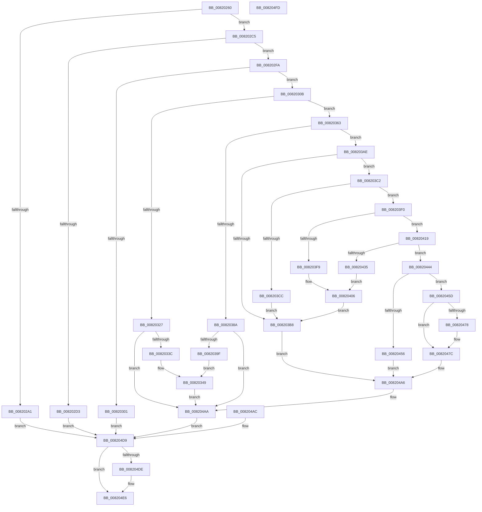

# AslpFileGetVersionBlockImageOnly

- RVA: `0x00820260`–`0x008204FE` (길이 `670` bytes)
- VA: `0x0000000140820260`
- 실행 섹션: `PAGE`
- PDB 이름 있음: `예`; PDB Function 태그: `아니요`
- unwind 정보 RVA: `0x000DA080`
- 디코드: `169`개 명령, `670/670` bytes 표시
- 미해석 바이트: `0` (있으면 어셈블리에 `.byte`로 보존)

> 이 문서는 커널 이미지의 기계어와 PDB 기호를 분석해 생성했습니다. 4번과 5번은 함수 원형과 자료형을 바이너리 사용 방식에서 추정한 C 해석이며 원본 소스 복구 결과는 아닙니다.

## 1. Dependencies

- 직접 호출 지점: **12**; 고유 호출 대상: **8**
- 직접 호출자로 확인된 함수: **1**
- RIP 상대 이미지 참조: **8**

### Outgoing calls
- `0x008202C8` → [AslFileMappingEnsure](../81/AslFileMappingEnsure_function_0081A5EC.md) (function, `0x0081A5EC`)
- `0x008202F0` → [AslLogCallPrintf](../95/AslLogCallPrintf_function_0095E4EC.md) (function, `0x0095E4EC`)
- `0x00820318` → [AslpFileGetImageResourceDirectoryRoot](../81/AslpFileGetImageResourceDirectoryRoot_function_0081F53C.md) (function, `0x0081F53C`)
- `0x00820359` → [AslLogCallPrintf](../95/AslLogCallPrintf_function_0095E4EC.md) (function, `0x0095E4EC`)
- `0x0082037B` → [AslpFileGetVersionBlockFromResourceRoot](../81/AslpFileGetVersionBlockFromResourceRoot_function_0081FF98.md) (function, `0x0081FF98`)
- `0x008203E9` → [AslLogCallPrintf](../95/AslLogCallPrintf_function_0095E4EC.md) (function, `0x0095E4EC`)
- `0x00820412` → [AslLogCallPrintf](../95/AslLogCallPrintf_function_0095E4EC.md) (function, `0x0095E4EC`)
- `0x0082042C` → [AslpMemoryCheckBounds](../../text/69/AslpMemoryCheckBounds_function_0069D3AC.md) (function, `0x0069D3AC`)
- `0x00820444` → [AslAlloc](../95/AslAlloc_function_0095BD34.md) (function, `0x0095BD34`)
- `0x0082046B` → [memcpy](../../text/6C/memcpy_function_006C6840.md) (function, `0x006C6840`)
- `0x008204CF` → [AslLogCallPrintf](../95/AslLogCallPrintf_function_0095E4EC.md) (function, `0x0095E4EC`)
- `0x008204E1` → [AslFree](../95/AslFree_function_0095B674.md) (function, `0x0095B674`)

### Direct callers
- [AslpFileGetVersionAttributes](../81/AslpFileGetVersionAttributes_function_0081F968.md) at `0x0081F995`

### Static image references
- `0x008202D7` → RVA `0x0003EE90` (`.rdata`; read)
- `0x008202E4` → RVA `0x00040578` (`.rdata`; read)
- `0x0082033C` → RVA `0x000405A0` (`.rdata`; read)
- `0x0082039F` → RVA `0x00040600` (`.rdata`; read)
- `0x008203D0` → RVA `0x00040670` (`.rdata`; read)
- `0x008203F9` → RVA `0x000406D0` (`.rdata`; read)
- `0x00820435` → RVA `0x000401B8` (`.rdata`; read)
- `0x008204B6` → RVA `0x0003EF20` (`.rdata`; read)

## 2. Other-region calls and transfers

- 다른 실행 섹션으로 향하는 call: **2**
  - `0x0082042C` → [AslpMemoryCheckBounds](../../text/69/AslpMemoryCheckBounds_function_0069D3AC.md) (`PAGE` → `.text`)
  - `0x0082046B` → [memcpy](../../text/6C/memcpy_function_006C6840.md) (`PAGE` → `.text`)
- 별도 외부 분기/꼬리 이동을 확인하지 못했습니다.

## 3. Assembly (complete function range)

```asm
00820260  48 8B C4                        mov rax, rsp
00820263  48 89 58 10                     mov qword ptr [rax + 0x10], rbx
00820267  4C 89 40 18                     mov qword ptr [rax + 0x18], r8
0082026B  48 89 48 08                     mov qword ptr [rax + 8], rcx
0082026F  56                              push rsi
00820270  57                              push rdi
00820271  41 55                           push r13
00820273  41 56                           push r14
00820275  41 57                           push r15
00820277  48 83 EC 50                     sub rsp, 0x50
0082027B  4D 8B F9                        mov r15, r9
0082027E  4C 8B EA                        mov r13, rdx
00820281  4C 8B C1                        mov r8, rcx
00820284  33 FF                           xor edi, edi
00820286  48 89 78 20                     mov qword ptr [rax + 0x20], rdi
0082028A  48 89 78 18                     mov qword ptr [rax + 0x18], rdi
0082028E  8B F7                           mov esi, edi
00820290  48 89 78 C0                     mov qword ptr [rax - 0x40], rdi
00820294  48 89 78 C8                     mov qword ptr [rax - 0x38], rdi
00820298  49 8B 49 48                     mov rcx, qword ptr [r9 + 0x48]
0082029C  48 85 C9                        test rcx, rcx
0082029F  74 24                           je 0x1408202c5
008202A1  0F B7 41 02                     movzx eax, word ptr [rcx + 2]
008202A5  48 83 C1 28                     add rcx, 0x28
008202A9  8B D7                           mov edx, edi
008202AB  66 83 F8 34                     cmp ax, 0x34
008202AF  48 0F 43 D1                     cmovae rdx, rcx
008202B3  49 89 55 00                     mov qword ptr [r13], rdx
008202B7  49 8B 41 48                     mov rax, qword ptr [r9 + 0x48]
008202BB  49 89 00                        mov qword ptr [r8], rax
008202BE  8B DF                           mov ebx, edi
008202C0  E9 14 02 00 00                  jmp 0x1408204d9
008202C5  49 8B CF                        mov rcx, r15
008202C8  E8 1F A3 FF FF                  call 0x14081a5ec
008202CD  8B D8                           mov ebx, eax
008202CF  85 C0                           test eax, eax
008202D1  79 27                           jns 0x1408202fa
008202D3  89 44 24 20                     mov dword ptr [rsp + 0x20], eax
008202D7  4C 8D 0D B2 EB 81 FF            lea r9, [rip - 0x7e144e]
008202DE  41 B8 9F 09 00 00               mov r8d, 0x99f
008202E4  48 8D 15 8D 02 82 FF            lea rdx, [rip - 0x7dfd73]
008202EB  B9 01 00 00 00                  mov ecx, 1
008202F0  E8 F7 E1 13 00                  call 0x14095e4ec
008202F5  E9 DF 01 00 00                  jmp 0x1408204d9
008202FA  41 83 7F 40 06                  cmp dword ptr [r15 + 0x40], 6
008202FF  74 0A                           je 0x14082030b
00820301  BB 89 00 00 C0                  mov ebx, 0xc0000089
00820306  E9 CE 01 00 00                  jmp 0x1408204d9
0082030B  4D 8B C7                        mov r8, r15
0082030E  33 D2                           xor edx, edx
00820310  48 8D 8C 24 98 00 00 00         lea rcx, [rsp + 0x98]
00820318  E8 1F F2 FF FF                  call 0x14081f53c
0082031D  8B D8                           mov ebx, eax
0082031F  89 44 24 30                     mov dword ptr [rsp + 0x30], eax
00820323  85 C0                           test eax, eax
00820325  79 3C                           jns 0x140820363
00820327  05 77 FF FF 3F                  add eax, 0x3fffff77
0082032C  8B CF                           mov ecx, edi
0082032E  83 F8 02                        cmp eax, 2
00820331  0F 96 C1                        setbe cl
00820334  85 C9                           test ecx, ecx
00820336  0F 85 6E 01 00 00               jne 0x1408204aa
0082033C  4C 8D 0D 5D 02 82 FF            lea r9, [rip - 0x7dfda3]
00820343  41 B8 BA 09 00 00               mov r8d, 0x9ba
00820349  89 5C 24 20                     mov dword ptr [rsp + 0x20], ebx
0082034D  48 8D 15 24 02 82 FF            lea rdx, [rip - 0x7dfddc]
00820354  B9 01 00 00 00                  mov ecx, 1
00820359  E8 8E E1 13 00                  call 0x14095e4ec
0082035E  E9 47 01 00 00                  jmp 0x1408204aa
00820363  4D 8B CF                        mov r9, r15
00820366  4C 8B 84 24 98 00 00 00         mov r8, qword ptr [rsp + 0x98]
0082036E  48 8D 54 24 40                  lea rdx, [rsp + 0x40]
00820373  48 8D 8C 24 90 00 00 00         lea rcx, [rsp + 0x90]
0082037B  E8 18 FC FF FF                  call 0x14081ff98
00820380  8B D8                           mov ebx, eax
00820382  89 44 24 30                     mov dword ptr [rsp + 0x30], eax
00820386  85 C0                           test eax, eax
00820388  79 24                           jns 0x1408203ae
0082038A  05 77 FF FF 3F                  add eax, 0x3fffff77
0082038F  8B CF                           mov ecx, edi
00820391  83 F8 02                        cmp eax, 2
00820394  0F 96 C1                        setbe cl
00820397  85 C9                           test ecx, ecx
00820399  0F 85 0B 01 00 00               jne 0x1408204aa
0082039F  4C 8D 0D 5A 02 82 FF            lea r9, [rip - 0x7dfda6]
008203A6  41 B8 C2 09 00 00               mov r8d, 0x9c2
008203AC  EB 9B                           jmp 0x140820349
008203AE  4C 8B 74 24 40                  mov r14, qword ptr [rsp + 0x40]
008203B3  4D 85 F6                        test r14, r14
008203B6  75 0A                           jne 0x1408203c2
008203B8  BB 89 00 00 C0                  mov ebx, 0xc0000089
008203BD  E9 E4 00 00 00                  jmp 0x1408204a6
008203C2  48 39 BC 24 90 00 00 00         cmp qword ptr [rsp + 0x90], rdi
008203CA  75 24                           jne 0x1408203f0
008203CC  89 5C 24 20                     mov dword ptr [rsp + 0x20], ebx
008203D0  4C 8D 0D 99 02 82 FF            lea r9, [rip - 0x7dfd67]
008203D7  41 B8 CE 09 00 00               mov r8d, 0x9ce
008203DD  48 8D 15 94 01 82 FF            lea rdx, [rip - 0x7dfe6c]
008203E4  B9 01 00 00 00                  mov ecx, 1
008203E9  E8 FE E0 13 00                  call 0x14095e4ec
008203EE  EB C8                           jmp 0x1408203b8
008203F0  49 81 FE FF 7F 00 00            cmp r14, 0x7fff
008203F7  76 20                           jbe 0x140820419
008203F9  4C 8D 0D D0 02 82 FF            lea r9, [rip - 0x7dfd30]
00820400  41 B8 D4 09 00 00               mov r8d, 0x9d4
00820406  48 8D 15 6B 01 82 FF            lea rdx, [rip - 0x7dfe95]
0082040D  B9 01 00 00 00                  mov ecx, 1
00820412  E8 D5 E0 13 00                  call 0x14095e4ec
00820417  EB 9F                           jmp 0x1408203b8
00820419  4D 8B 4F 28                     mov r9, qword ptr [r15 + 0x28]
0082041D  4D 8B 47 20                     mov r8, qword ptr [r15 + 0x20]
00820421  49 8B D6                        mov rdx, r14
00820424  48 8B 8C 24 90 00 00 00         mov rcx, qword ptr [rsp + 0x90]
0082042C  E8 7B CF E7 FF                  call 0x14069d3ac
00820431  84 C0                           test al, al
00820433  75 0F                           jne 0x140820444
00820435  4C 8D 0D 7C FD 81 FF            lea r9, [rip - 0x7e0284]
0082043C  41 B8 DD 09 00 00               mov r8d, 0x9dd
00820442  EB C2                           jmp 0x140820406
00820444  E8 EB B8 13 00                  call 0x14095bd34
00820449  48 8B F0                        mov rsi, rax
0082044C  48 89 44 24 38                  mov qword ptr [rsp + 0x38], rax
00820451  48 85 C0                        test rax, rax
00820454  75 07                           jne 0x14082045d
00820456  BB 17 00 00 C0                  mov ebx, 0xc0000017
0082045B  EB 49                           jmp 0x1408204a6
0082045D  4D 8B C6                        mov r8, r14
00820460  48 8B 94 24 90 00 00 00         mov rdx, qword ptr [rsp + 0x90]
00820468  48 8B CE                        mov rcx, rsi
0082046B  E8 D0 63 EA FF                  call 0x1406c6840
00820470  0F B7 06                        movzx eax, word ptr [rsi]
00820473  4C 3B F0                        cmp r14, rax
00820476  73 04                           jae 0x14082047c
00820478  66 44 89 36                     mov word ptr [rsi], r14w
0082047C  48 8D 4E 28                     lea rcx, [rsi + 0x28]
00820480  66 83 7E 02 34                  cmp word ptr [rsi + 2], 0x34
00820485  48 0F 42 CF                     cmovb rcx, rdi
00820489  49 89 4D 00                     mov qword ptr [r13], rcx
0082048D  48 8B 84 24 80 00 00 00         mov rax, qword ptr [rsp + 0x80]
00820495  48 89 30                        mov qword ptr [rax], rsi
00820498  49 89 77 48                     mov qword ptr [r15 + 0x48], rsi
0082049C  48 8B F7                        mov rsi, rdi
0082049F  48 89 7C 24 38                  mov qword ptr [rsp + 0x38], rdi
008204A4  8B DF                           mov ebx, edi
008204A6  89 5C 24 30                     mov dword ptr [rsp + 0x30], ebx
008204AA  EB 2D                           jmp 0x1408204d9
008204AC  8B D8                           mov ebx, eax
008204AE  89 44 24 30                     mov dword ptr [rsp + 0x30], eax
008204B2  89 44 24 20                     mov dword ptr [rsp + 0x20], eax
008204B6  4C 8D 0D 63 EA 81 FF            lea r9, [rip - 0x7e159d]
008204BD  41 B8 15 0A 00 00               mov r8d, 0xa15
008204C3  48 8D 15 AE 00 82 FF            lea rdx, [rip - 0x7dff52]
008204CA  B9 01 00 00 00                  mov ecx, 1
008204CF  E8 18 E0 13 00                  call 0x14095e4ec
008204D4  48 8B 74 24 38                  mov rsi, qword ptr [rsp + 0x38]
008204D9  48 85 F6                        test rsi, rsi
008204DC  74 08                           je 0x1408204e6
008204DE  48 8B D6                        mov rdx, rsi
008204E1  E8 8E B1 13 00                  call 0x14095b674
008204E6  8B C3                           mov eax, ebx
008204E8  48 8B 9C 24 88 00 00 00         mov rbx, qword ptr [rsp + 0x88]
008204F0  48 83 C4 50                     add rsp, 0x50
008204F4  41 5F                           pop r15
008204F6  41 5E                           pop r14
008204F8  41 5D                           pop r13
008204FA  5F                              pop rdi
008204FB  5E                              pop rsi
008204FC  C3                              ret
008204FD  CC                              int3
```

## 4. C-style interpretation (structured pseudocode)

```c
__int64 __fastcall AslpFileGetVersionBlockImageOnly(__int64 a1, __int64 a2, __int64 a3, __int64 a4)
{
    __int64 result;
    __int64 v_rdi;
    __int64 v_rsp;
    unsigned __int64 v_stack_m38;
    unsigned __int64 v_stack_m40;
    unsigned int v_stack_m48;
    unsigned int v_stack_m58;
    unsigned __int64 v_stack_p10;
    unsigned __int64 v_stack_p18;
    unsigned __int64 v_stack_p20;
    unsigned __int64 v_stack_p8;

    *(unsigned __int64 *)(v_rsp + 16) = v_rbx;
    *(unsigned __int64 *)(v_rsp + 24) = a3;
    *(unsigned __int64 *)(v_rsp + 8) = a1;
    v_rsp = (v_rsp) - (80);
    v_rdi = 0;
    *(unsigned __int64 *)(v_rsp + 32) = 0;
    *(unsigned __int64 *)(v_rsp + 24) = 0;
    *(unsigned __int64 *)(v_rsp - 64) = 0;
    *(unsigned __int64 *)(v_rsp - 56) = 0;
    if (*(unsigned __int64 *)(a4 + 72) == 0) goto loc_008202C5;
    a1 = (*(unsigned __int64 *)(a4 + 72)) + (40);
    a2 = 0;
    if (((unsigned __int16)(*(unsigned __int16 *)(*(unsigned __int64 *)(a4 + 72) + 2))) >= 52) { a2 = a1; }
    *(unsigned __int64 *)(a2) = a2;
    *(unsigned __int64 *)(a1) = *(unsigned __int64 *)(a4 + 72);
    goto loc_008204D9;
loc_008202C5:
    result = AslFileMappingEnsure(a4, a2, a1, a4);
    if (!sign_flag) goto loc_008202FA;
    v_stack_m58 = (unsigned int)(result);
    result = AslLogCallPrintf(1, v_rip - 8256883, (unsigned int)(0x99FULL), v_rip - 8262734);
    goto loc_008204D9;
loc_008202FA:
    if ((*(unsigned int *)(a4 + 64)) == 6) goto loc_0082030B;
    goto loc_008204D9;
loc_0082030B:
    a2 = 0;
    result = AslpFileGetImageResourceDirectoryRoot(v_stack_p20, a2, a4, v_rip - 8262734);
    v_stack_m48 = (unsigned int)(result);
    if (!sign_flag) goto loc_00820363;
    result = (unsigned int)((result) + (0x3FFFFF77ULL));
    a1 = (((unsigned int)(result)) <= 2) ? 1 : 0;
    if ((unsigned int)(a1) != 0) goto loc_008204AA;
loc_00820349:
    v_stack_m58 = (unsigned int)((unsigned int)((unsigned int)(result)));
    result = AslLogCallPrintf(1, v_rip - 8256988, (unsigned int)(0x9BAULL), v_rip - 8256931);
    goto loc_008204AA;
loc_00820363:
    result = AslpFileGetVersionBlockFromResourceRoot(v_stack_p18, v_stack_m38, v_stack_p20, a4);
    v_stack_m48 = (unsigned int)(result);
    if (!sign_flag) goto loc_008203AE;
    result = (unsigned int)((result) + (0x3FFFFF77ULL));
    a1 = (((unsigned int)(result)) <= 2) ? 1 : 0;
    if ((unsigned int)(a1) != 0) goto loc_008204AA;
    goto loc_00820349;
loc_008203AE:
    if (v_stack_m38 != 0) goto loc_008203C2;
loc_008203B8:
    goto loc_008204A6;
loc_008203C2:
    if (v_stack_p18 != 0) goto loc_008203F0;
    v_stack_m58 = (unsigned int)((unsigned int)(0xC0000089ULL));
    result = AslLogCallPrintf(1, v_rip - 8257132, (unsigned int)(0x9CEULL), v_rip - 8256871);
    goto loc_008203B8;
loc_008203F0:
    if (v_stack_m38 <= 0x7FFFULL) goto loc_00820419;
loc_00820406:
    result = AslLogCallPrintf(1, v_rip - 8257173, (unsigned int)(0x9D4ULL), v_rip - 8256816);
    goto loc_008203B8;
loc_00820419:
    result = AslpMemoryCheckBounds(v_stack_p18, v_stack_m38, *(unsigned __int64 *)(a4 + 32), *(unsigned __int64 *)(a4 + 40));
    if ((unsigned __int8)(result) != 0) goto loc_00820444;
    goto loc_00820406;
loc_00820444:
    result = AslAlloc(v_stack_p18, v_stack_m38, (unsigned int)(0x9DDULL), v_rip - 8258180);
    v_stack_m40 = result;
    if (result != 0) goto loc_0082045D;
    goto loc_008204A6;
loc_0082045D:
    result = memcpy(result, v_stack_p18, v_stack_m38, v_rip - 8258180);
    if (v_stack_m38 < (*(unsigned __int16 *)(result))) {
        *(unsigned __int16 *)(result) = (unsigned __int16)(v_stack_m38);
    }
    a1 = result + 40;
    if ((*(unsigned __int16 *)(result + 2)) < 52) { a1 = 0; }
    *(unsigned __int64 *)(a2) = a1;
    *(unsigned __int64 *)(v_stack_p8) = result;
    *(unsigned __int64 *)(a4 + 72) = result;
    v_stack_m40 = 0;
loc_008204A6:
    v_stack_m48 = 0;
loc_008204AA:
    goto loc_008204D9;
loc_008204D9:
    result = v_stack_p8;
    if (0 != 0) {
        a2 = 0;
        result = AslFree(a1, a2, v_stack_m38, v_rip - 8258180);
    }
    v_rsp = (v_rsp) + (80);
    return 0;
}
```

## 5. (Beta) C Style

```c
int64_t AslpFileGetVersionBlockImageOnly(void *Arg1, void *Arg2, int64_t Arg3, void *Arg4)
{
    uint8_t *arg1 = (uint8_t *)Arg1;
    uint8_t *arg2 = (uint8_t *)Arg2;
    uint8_t *arg4 = (uint8_t *)Arg4;

    int64_t result;
    int64_t local_rdi;
    int64_t local_rsp;
    uint64_t v_stack_m38;
    uint64_t v_stack_m40;
    uint32_t v_stack_m48;
    uint32_t v_stack_m58;
    uint64_t v_stack_p10;
    uint64_t v_stack_p18;
    uint64_t v_stack_p20;
    uint64_t v_stack_p8;

    *(uint64_t *)(local_rsp + 0x10) = local_rbx;
    *(uint64_t *)(local_rsp + 0x18) = Arg3;
    *(void **)(local_rsp + 0x8) = Arg1;
    local_rsp = (local_rsp) - (80);
    local_rdi = 0;
    *(uint64_t *)(local_rsp + 0x20) = 0;
    *(uint64_t *)(local_rsp + 0x18) = 0;
    *(uint64_t *)(local_rsp - 0x40) = 0;
    *(uint64_t *)(local_rsp - 0x38) = 0;
    if (*(uint64_t *)(arg4 + 0x48) == 0) goto loc_008202C5;
    Arg1 = (*(uint64_t *)(arg4 + 0x48)) + (40);
    Arg2 = 0;
    if (((uint16_t)(*(uint16_t *)(*(uint64_t *)(arg4 + 0x48) + 0x2))) >= 52) { Arg2 = Arg1; }
    *(void **)(arg2) = Arg2;
    *(uint64_t *)(arg1) = *(uint64_t *)(arg4 + 0x48);
    goto loc_008204D9;
loc_008202C5:
    result = AslFileMappingEnsure(Arg4, Arg2, Arg1, Arg4);
    if (!sign_flag) goto loc_008202FA;
    v_stack_m58 = (uint32_t)(result);
    result = AslLogCallPrintf(1, v_rip - 8256883, (uint32_t)(0x99FULL), v_rip - 8262734);
    goto loc_008204D9;
loc_008202FA:
    if ((*(uint32_t *)(arg4 + 0x40)) == 6) goto loc_0082030B;
    goto loc_008204D9;
loc_0082030B:
    Arg2 = 0;
    result = AslpFileGetImageResourceDirectoryRoot(v_stack_p20, Arg2, Arg4, v_rip - 8262734);
    v_stack_m48 = (uint32_t)(result);
    if (!sign_flag) goto loc_00820363;
    result = (uint32_t)((result) + (0x3FFFFF77ULL));
    Arg1 = (((uint32_t)(result)) <= 2) ? 1 : 0;
    if ((uint32_t)(Arg1) != 0) goto loc_008204AA;
loc_00820349:
    v_stack_m58 = (uint32_t)((uint32_t)((uint32_t)(result)));
    result = AslLogCallPrintf(1, v_rip - 8256988, (uint32_t)(0x9BAULL), v_rip - 8256931);
    goto loc_008204AA;
loc_00820363:
    result = AslpFileGetVersionBlockFromResourceRoot(v_stack_p18, v_stack_m38, v_stack_p20, Arg4);
    v_stack_m48 = (uint32_t)(result);
    if (!sign_flag) goto loc_008203AE;
    result = (uint32_t)((result) + (0x3FFFFF77ULL));
    Arg1 = (((uint32_t)(result)) <= 2) ? 1 : 0;
    if ((uint32_t)(Arg1) != 0) goto loc_008204AA;
    goto loc_00820349;
loc_008203AE:
    if (v_stack_m38 != 0) goto loc_008203C2;
loc_008203B8:
    goto loc_008204A6;
loc_008203C2:
    if (v_stack_p18 != 0) goto loc_008203F0;
    v_stack_m58 = (uint32_t)((uint32_t)(0xC0000089ULL));
    result = AslLogCallPrintf(1, v_rip - 8257132, (uint32_t)(0x9CEULL), v_rip - 8256871);
    goto loc_008203B8;
loc_008203F0:
    if (v_stack_m38 <= 0x7FFFULL) goto loc_00820419;
loc_00820406:
    result = AslLogCallPrintf(1, v_rip - 8257173, (uint32_t)(0x9D4ULL), v_rip - 8256816);
    goto loc_008203B8;
loc_00820419:
    result = AslpMemoryCheckBounds(v_stack_p18, v_stack_m38, *(uint64_t *)(arg4 + 0x20), *(uint64_t *)(arg4 + 0x28));
    if ((uint8_t)(result) != 0) goto loc_00820444;
    goto loc_00820406;
loc_00820444:
    result = AslAlloc(v_stack_p18, v_stack_m38, (uint32_t)(0x9DDULL), v_rip - 8258180);
    v_stack_m40 = result;
    if (result != 0) goto loc_0082045D;
    goto loc_008204A6;
loc_0082045D:
    result = memcpy(result, v_stack_p18, v_stack_m38, v_rip - 8258180);
    if (v_stack_m38 < (*(uint16_t *)(result))) {
        *(uint16_t *)(result) = (uint16_t)(v_stack_m38);
    }
    Arg1 = result + 40;
    if ((*(uint16_t *)(result + 0x2)) < 52) { Arg1 = 0; }
    *(void **)(arg2) = Arg1;
    *(uint64_t *)(v_stack_p8) = result;
    *(uint64_t *)(arg4 + 0x48) = result;
    v_stack_m40 = 0;
loc_008204A6:
    v_stack_m48 = 0;
loc_008204AA:
    goto loc_008204D9;
loc_008204D9:
    result = v_stack_p8;
    if (0 != 0) {
        Arg2 = 0;
        result = AslFree(Arg1, Arg2, v_stack_m38, v_rip - 8258180);
    }
    local_rsp = (local_rsp) + (80);
    return 0;
}
```

### 관측된 메모리 오프셋

구조체 형식이 확인되지 않은 접근은 인자 기준의 오프셋으로만 기록했습니다.

| 기준 인자 | 오프셋 표현 | 폭 (bit) | 접근 |
|---|---:|---:|---|
| `Arg1` | `+ 0x0` | `64` | `W` |
| `Arg2` | `+ 0x0` | `64` | `W` |
| `Arg4` | `+ 0x20` | `64` | `R` |
| `Arg4` | `+ 0x28` | `64` | `R` |
| `Arg4` | `+ 0x40` | `32` | `R` |
| `Arg4` | `+ 0x48` | `64` | `R` |
| `Arg4` | `+ 0x48` | `64` | `W` |

## 6. Execution-region graph

[열기: 2D/3D 그래프와 함수 탐색 컨트롤 패널](../../../control-panel.html?section=page&rva=0x00820260&view=graph)

- 2D 그래프는 위에서 아래로 흐르고, 3D 그래프는 빈 공간을 드래그해 회전합니다. Shift+드래그는 이동, 휠은 확대·축소, 함수 노드 선택은 대상 보고서 이동입니다.

### Static fallback


