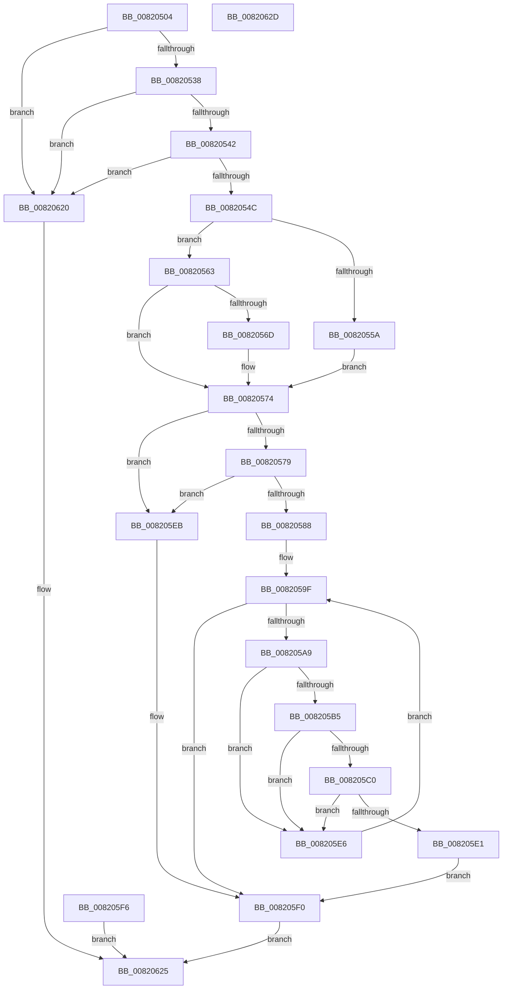

# AslpFileHasActiveMarkWrapper

- RVA: `0x00820504`–`0x0082062E` (길이 `298` bytes)
- VA: `0x0000000140820504`
- 실행 섹션: `PAGE`
- PDB 이름 있음: `예`; PDB Function 태그: `아니요`
- unwind 정보 RVA: `0x000D9FB0`
- 디코드: `80`개 명령, `298/298` bytes 표시
- 미해석 바이트: `0` (있으면 어셈블리에 `.byte`로 보존)

> 이 문서는 커널 이미지의 기계어와 PDB 기호를 분석해 생성했습니다. 4번과 5번은 함수 원형과 자료형을 바이너리 사용 방식에서 추정한 C 해석이며 원본 소스 복구 결과는 아닙니다.

## 1. Dependencies

- 직접 호출 지점: **1**; 고유 호출 대상: **1**
- 직접 호출자로 확인된 함수: **1**
- RIP 상대 이미지 참조: **3**

### Outgoing calls
- `0x00820619` → [AslLogCallPrintf](../95/AslLogCallPrintf_function_0095E4EC.md) (function, `0x0095E4EC`)

### Direct callers
- [AslpFileGetExeWrapper](../81/AslpFileGetExeWrapper_function_0081EAF4.md) at `0x0081EB8B`

### Static image references
- `0x008205AC` → RVA `0x00040E70` (`.rdata`; read)
- `0x00820600` → RVA `0x0003EF20` (`.rdata`; read)
- `0x0082060D` → RVA `0x000400D8` (`.rdata`; read)

## 2. Other-region calls and transfers

- 다른 실행 섹션으로 향하는 call: **0**
- 별도 외부 분기/꼬리 이동을 확인하지 못했습니다.

## 3. Assembly (complete function range)

```asm
00820504  40 53                           push rbx
00820506  48 83 EC 50                     sub rsp, 0x50
0082050A  4C 8B D9                        mov r11, rcx
0082050D  33 DB                           xor ebx, ebx
0082050F  44 8B CB                        mov r9d, ebx
00820512  89 19                           mov dword ptr [rcx], ebx
00820514  4D 8B 50 18                     mov r10, qword ptr [r8 + 0x18]
00820518  49 8B 40 28                     mov rax, qword ptr [r8 + 0x28]
0082051C  4C 3B D0                        cmp r10, rax
0082051F  4C 0F 43 D0                     cmovae r10, rax
00820523  49 8D 82 FF FB FF FF            lea rax, [r10 - 0x401]
0082052A  B9 FE FB FF FF                  mov ecx, 0xfffffbfe
0082052F  48 3B C1                        cmp rax, rcx
00820532  0F 87 E8 00 00 00               ja 0x140820620
00820538  41 39 58 54                     cmp dword ptr [r8 + 0x54], ebx
0082053C  0F 85 DE 00 00 00               jne 0x140820620
00820542  41 39 58 50                     cmp dword ptr [r8 + 0x50], ebx
00820546  0F 85 D4 00 00 00               jne 0x140820620
0082054C  0F B7 42 18                     movzx eax, word ptr [rdx + 0x18]
00820550  B9 0B 01 00 00                  mov ecx, 0x10b
00820555  66 3B C1                        cmp ax, cx
00820558  75 09                           jne 0x140820563
0082055A  4C 8D 8A 98 00 00 00            lea r9, [rdx + 0x98]
00820561  EB 11                           jmp 0x140820574
00820563  B9 0B 02 00 00                  mov ecx, 0x20b
00820568  66 3B C1                        cmp ax, cx
0082056B  75 07                           jne 0x140820574
0082056D  4C 8D 8A A8 00 00 00            lea r9, [rdx + 0xa8]
00820574  4D 85 C9                        test r9, r9
00820577  74 72                           je 0x1408205eb
00820579  41 8B 49 04                     mov ecx, dword ptr [r9 + 4]
0082057D  81 C1 00 04 00 00               add ecx, 0x400
00820583  4C 3B D1                        cmp r10, rcx
00820586  76 63                           jbe 0x1408205eb
00820588  4C 2B D1                        sub r10, rcx
0082058B  4D 8B 48 20                     mov r9, qword ptr [r8 + 0x20]
0082058F  4D 03 CA                        add r9, r10
00820592  49 8D 91 E6 03 00 00            lea rdx, [r9 + 0x3e6]
00820599  41 BA 01 00 00 00               mov r10d, 1
0082059F  48 89 54 24 38                  mov qword ptr [rsp + 0x38], rdx
008205A4  49 3B D1                        cmp rdx, r9
008205A7  72 47                           jb 0x1408205f0
008205A9  48 8B 02                        mov rax, qword ptr [rdx]
008205AC  48 3B 05 BD 08 82 FF            cmp rax, qword ptr [rip - 0x7df743]
008205B3  75 31                           jne 0x1408205e6
008205B5  44 0F B7 42 08                  movzx r8d, word ptr [rdx + 8]
008205BA  66 45 3B D0                     cmp r10w, r8w
008205BE  75 26                           jne 0x1408205e6
008205C0  8B 4A 12                        mov ecx, dword ptr [rdx + 0x12]
008205C3  8B 42 0E                        mov eax, dword ptr [rdx + 0xe]
008205C6  48 03 C8                        add rcx, rax
008205C9  8B 42 0A                        mov eax, dword ptr [rdx + 0xa]
008205CC  48 03 C8                        add rcx, rax
008205CF  49 8D 80 6D 02 00 00            lea rax, [r8 + 0x26d]
008205D6  48 03 C8                        add rcx, rax
008205D9  8B 42 16                        mov eax, dword ptr [rdx + 0x16]
008205DC  48 3B C8                        cmp rcx, rax
008205DF  75 05                           jne 0x1408205e6
008205E1  45 89 13                        mov dword ptr [r11], r10d
008205E4  EB 0A                           jmp 0x1408205f0
008205E6  49 2B D2                        sub rdx, r10
008205E9  EB B4                           jmp 0x14082059f
008205EB  BB 25 02 00 C0                  mov ebx, 0xc0000225
008205F0  89 5C 24 30                     mov dword ptr [rsp + 0x30], ebx
008205F4  EB 2F                           jmp 0x140820625
008205F6  8B D8                           mov ebx, eax
008205F8  89 44 24 30                     mov dword ptr [rsp + 0x30], eax
008205FC  89 44 24 20                     mov dword ptr [rsp + 0x20], eax
00820600  4C 8D 0D 19 E9 81 FF            lea r9, [rip - 0x7e16e7]
00820607  41 B8 76 10 00 00               mov r8d, 0x1076
0082060D  48 8D 15 C4 FA 81 FF            lea rdx, [rip - 0x7e053c]
00820614  B9 01 00 00 00                  mov ecx, 1
00820619  E8 CE DE 13 00                  call 0x14095e4ec
0082061E  EB 05                           jmp 0x140820625
00820620  BB 25 02 00 C0                  mov ebx, 0xc0000225
00820625  8B C3                           mov eax, ebx
00820627  48 83 C4 50                     add rsp, 0x50
0082062B  5B                              pop rbx
0082062C  C3                              ret
0082062D  CC                              int3
```

## 4. C-style interpretation (structured pseudocode)

```c
__int64 __fastcall AslpFileHasActiveMarkWrapper(__int64 a1, __int64 a2, __int64 a3)
{
    __int64 v_r10;
    __int64 v_rbx;
    __int64 v_rsp;
    unsigned __int64 v_stack_m20;
    unsigned int v_stack_m28;
    unsigned int v_stack_m38;

    v_rsp = (v_rsp) - (80);
    v_rbx = 0;
    *(unsigned int *)(a1) = 0;
    v_r10 = *(unsigned __int64 *)(a3 + 24);
    if ((*(unsigned __int64 *)(a3 + 24)) >= (*(unsigned __int64 *)(a3 + 40))) { v_r10 = *(unsigned __int64 *)(a3 + 40); }
    if ((v_r10 - 1025) > ((unsigned int)(0xFFFFFBFEULL))) goto loc_00820620;
    if ((*(unsigned int *)(a3 + 84)) != 0) goto loc_00820620;
    if ((*(unsigned int *)(a3 + 80)) != 0) goto loc_00820620;
    if (((unsigned __int16)(*(unsigned __int16 *)(a2 + 24))) != 267) goto loc_00820563;
    goto loc_00820574;
loc_00820563:
    if (((unsigned __int16)(*(unsigned __int16 *)(a2 + 24))) == 523) {
        a4 = a2 + 168;
    }
    if (a4 == 0) goto loc_008205EB;
    a1 = (unsigned int)(((unsigned int)(*(unsigned int *)(a4 + 4))) + (0x400ULL));
    if (v_r10 <= a1) goto loc_008205EB;
    v_r10 = (v_r10) - (a1);
    a4 = (*(unsigned __int64 *)(a3 + 32)) + (v_r10);
loc_0082059F:
    v_stack_m20 = a4 + 998;
    if ((a4 + 998) < a4) goto loc_008205F0;
    if ((*(unsigned __int64 *)(a4 + 998)) != (*(unsigned __int64 *)(v_rip - 8255299))) goto loc_008205E6;
    if (1 != ((unsigned __int16)(*(unsigned __int16 *)(a4 + 998 + 8)))) goto loc_008205E6;
    a1 = ((unsigned int)(*(unsigned int *)(a4 + 998 + 18))) + ((unsigned int)(*(unsigned int *)(a4 + 998 + 14)));
    a1 = (a1) + ((unsigned int)(*(unsigned int *)(a4 + 998 + 10)));
    a1 = (a1) + (*(unsigned __int16 *)(a4 + 998 + 8) + 621);
    if (a1 != ((unsigned int)(*(unsigned int *)(a4 + 998 + 22)))) goto loc_008205E6;
    *(unsigned int *)(a1) = 1;
    goto loc_008205F0;
loc_008205E6:
    a2 = (a4 + 998) - (1);
    goto loc_0082059F;
loc_008205EB:
loc_008205F0:
    v_stack_m28 = (unsigned int)((unsigned int)(0xC0000225ULL));
    goto loc_00820625;
loc_00820620:
loc_00820625:
    v_rsp = (v_rsp) + (80);
    return (unsigned int)((unsigned int)((unsigned int)(0xC0000225ULL)));
}
```

## 5. (Beta) C Style

```c
int64_t AslpFileHasActiveMarkWrapper(void *Arg1, void *Arg2, void *Arg3)
{
    uint8_t *arg1 = (uint8_t *)Arg1;
    uint8_t *arg2 = (uint8_t *)Arg2;
    uint8_t *arg3 = (uint8_t *)Arg3;

    int64_t local_r10;
    int64_t local_rbx;
    int64_t local_rsp;
    uint64_t v_stack_m20;
    uint32_t v_stack_m28;
    uint32_t v_stack_m38;

    local_rsp = (local_rsp) - (80);
    local_rbx = 0;
    *(uint32_t *)(arg1) = 0;
    local_r10 = *(uint64_t *)(arg3 + 0x18);
    if ((*(uint64_t *)(arg3 + 0x18)) >= (*(uint64_t *)(arg3 + 0x28))) { local_r10 = *(uint64_t *)(arg3 + 0x28); }
    if ((local_r10 - 1025) > ((uint32_t)(0xFFFFFBFEULL))) goto loc_00820620;
    if ((*(uint32_t *)(arg3 + 0x54)) != 0) goto loc_00820620;
    if ((*(uint32_t *)(arg3 + 0x50)) != 0) goto loc_00820620;
    if (((uint16_t)(*(uint16_t *)(arg2 + 0x18))) != 267) goto loc_00820563;
    goto loc_00820574;
loc_00820563:
    if (((uint16_t)(*(uint16_t *)(arg2 + 0x18))) == 523) {
        a4 = Arg2 + 168;
    }
    if (a4 == 0) goto loc_008205EB;
    Arg1 = (uint32_t)(((uint32_t)(*(uint32_t *)(a4 + 0x4))) + (0x400ULL));
    if (local_r10 <= Arg1) goto loc_008205EB;
    local_r10 = (local_r10) - (Arg1);
    a4 = (*(uint64_t *)(arg3 + 0x20)) + (local_r10);
loc_0082059F:
    v_stack_m20 = a4 + 998;
    if ((a4 + 998) < a4) goto loc_008205F0;
    if ((*(uint64_t *)(a4 + 0x3E6)) != (*(uint64_t *)(v_rip - 0x7DF743))) goto loc_008205E6;
    if (1 != ((uint16_t)(*(uint16_t *)(a4 + 0x3E6 + 0x8)))) goto loc_008205E6;
    Arg1 = ((uint32_t)(*(uint32_t *)(a4 + 0x3E6 + 0x12))) + ((uint32_t)(*(uint32_t *)(a4 + 0x3E6 + 0xE)));
    Arg1 = (Arg1) + ((uint32_t)(*(uint32_t *)(a4 + 0x3E6 + 0xA)));
    Arg1 = (Arg1) + (*(uint16_t *)(a4 + 0x3E6 + 0x8) + 621);
    if (Arg1 != ((uint32_t)(*(uint32_t *)(a4 + 0x3E6 + 0x16)))) goto loc_008205E6;
    *(uint32_t *)(arg1) = 1;
    goto loc_008205F0;
loc_008205E6:
    Arg2 = (a4 + 998) - (1);
    goto loc_0082059F;
loc_008205EB:
loc_008205F0:
    v_stack_m28 = (uint32_t)((uint32_t)(0xC0000225ULL));
    goto loc_00820625;
loc_00820620:
loc_00820625:
    local_rsp = (local_rsp) + (80);
    return (uint32_t)((uint32_t)((uint32_t)(0xC0000225ULL)));
}
```

### 관측된 메모리 오프셋

구조체 형식이 확인되지 않은 접근은 인자 기준의 오프셋으로만 기록했습니다.

| 기준 인자 | 오프셋 표현 | 폭 (bit) | 접근 |
|---|---:|---:|---|
| `Arg1` | `+ 0x0` | `32` | `W` |
| `Arg2` | `+ 0x18` | `16` | `R` |
| `Arg2` | `+ 0x98` | `64` | `R` |
| `Arg2` | `+ 0xA8` | `64` | `R` |
| `Arg3` | `+ 0x18` | `64` | `R` |
| `Arg3` | `+ 0x20` | `64` | `R` |
| `Arg3` | `+ 0x28` | `64` | `R` |
| `Arg3` | `+ 0x50` | `32` | `R` |
| `Arg3` | `+ 0x54` | `32` | `R` |

## 6. Execution-region graph

[열기: 2D/3D 그래프와 함수 탐색 컨트롤 패널](../../../control-panel.html?section=page&rva=0x00820504&view=graph)

- 2D 그래프는 위에서 아래로 흐르고, 3D 그래프는 빈 공간을 드래그해 회전합니다. Shift+드래그는 이동, 휠은 확대·축소, 함수 노드 선택은 대상 보고서 이동입니다.

### Static fallback


