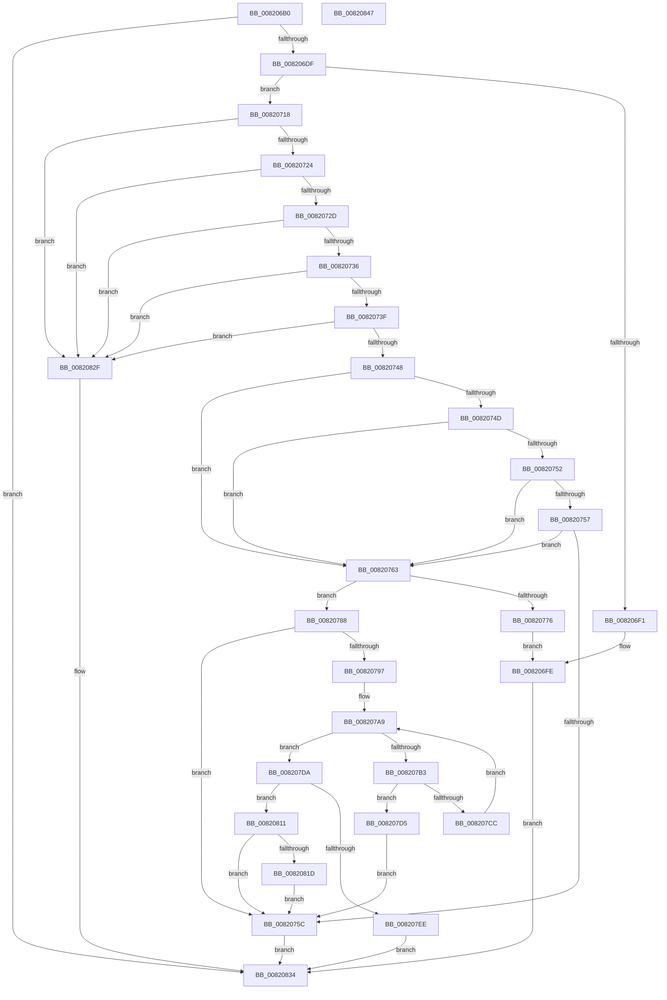

# AslpFileIsArm64XBinary

- RVA: `0x008206B0`–`0x00820848` (길이 `408` bytes)
- VA: `0x00000001408206B0`
- 실행 섹션: `PAGE`
- PDB 이름 있음: `예`; PDB Function 태그: `아니요`
- unwind 정보 RVA: `0x000D7640`
- 디코드: `111`개 명령, `408/408` bytes 표시
- 미해석 바이트: `0` (있으면 어셈블리에 `.byte`로 보존)

> 이 문서는 커널 이미지의 기계어와 PDB 기호를 분석해 생성했습니다. 4번과 5번은 함수 원형과 자료형을 바이너리 사용 방식에서 추정한 C 해석이며 원본 소스 복구 결과는 아닙니다.

## 1. Dependencies

- 직접 호출 지점: **6**; 고유 호출 대상: **5**
- 직접 호출자로 확인된 함수: **1**
- RIP 상대 이미지 참조: **5**

### Outgoing calls
- `0x008206E6` → [AslFileMappingGetFileKindDetail](../81/AslFileMappingGetFileKindDetail_function_0081A78C.md) (function, `0x0081A78C`)
- `0x0082070E` → [AslLogCallPrintf](../95/AslLogCallPrintf_function_0095E4EC.md) (function, `0x0095E4EC`)
- `0x0082076B` → [AslpFileGetImageNtHeader](../81/AslpFileGetImageNtHeader_function_0081F434.md) (function, `0x0081F434`)
- `0x008207C3` → [strncmp](../../text/6C/strncmp_function_006C6720.md) (function, `0x006C6720`)
- `0x008207E4` → [AslpImageRvaToVa](AslpImageRvaToVa_function_008214BC.md) (function, `0x008214BC`)
- `0x0082080A` → [AslLogCallPrintf](../95/AslLogCallPrintf_function_0095E4EC.md) (function, `0x0095E4EC`)

### Direct callers
- [AslFileAllocAndGetAttributes](../81/AslFileAllocAndGetAttributes_function_0081D8EC.md) at `0x0081DD18`

### Static image references
- `0x008206F1` → RVA `0x00040828` (`.rdata`; read)
- `0x008206FE` → RVA `0x00040880` (`.rdata`; read)
- `0x00820776` → RVA `0x0003EED8` (`.rdata`; read)
- `0x008207B9` → RVA `0x00040898` (`.rdata`; read)
- `0x008207EE` → RVA `0x000408A0` (`.rdata`; read)

## 2. Other-region calls and transfers

- 다른 실행 섹션으로 향하는 call: **1**
  - `0x008207C3` → [strncmp](../../text/6C/strncmp_function_006C6720.md) (`PAGE` → `.text`)
- 별도 외부 분기/꼬리 이동을 확인하지 못했습니다.

## 3. Assembly (complete function range)

```asm
008206B0  48 8B C4                        mov rax, rsp
008206B3  48 89 58 10                     mov qword ptr [rax + 0x10], rbx
008206B7  55                              push rbp
008206B8  56                              push rsi
008206B9  57                              push rdi
008206BA  41 56                           push r14
008206BC  41 57                           push r15
008206BE  48 83 EC 30                     sub rsp, 0x30
008206C2  83 60 08 00                     and dword ptr [rax + 8], 0
008206C6  48 8B F2                        mov rsi, rdx
008206C9  48 83 60 18 00                  and qword ptr [rax + 0x18], 0
008206CE  48 8B F9                        mov rdi, rcx
008206D1  BB F0 00 00 C0                  mov ebx, 0xc00000f0
008206D6  48 85 C9                        test rcx, rcx
008206D9  0F 84 55 01 00 00               je 0x140820834
008206DF  C6 01 00                        mov byte ptr [rcx], 0
008206E2  48 8D 48 08                     lea rcx, [rax + 8]
008206E6  E8 A1 A0 FF FF                  call 0x14081a78c
008206EB  8B D8                           mov ebx, eax
008206ED  85 C0                           test eax, eax
008206EF  79 27                           jns 0x140820718
008206F1  4C 8D 0D 30 01 82 FF            lea r9, [rip - 0x7dfed0]
008206F8  41 B8 37 16 00 00               mov r8d, 0x1637
008206FE  48 8D 15 7B 01 82 FF            lea rdx, [rip - 0x7dfe85]
00820705  89 44 24 20                     mov dword ptr [rsp + 0x20], eax
00820709  B9 01 00 00 00                  mov ecx, 1
0082070E  E8 D9 DD 13 00                  call 0x14095e4ec
00820713  E9 1C 01 00 00                  jmp 0x140820834
00820718  8B 4C 24 60                     mov ecx, dword ptr [rsp + 0x60]
0082071C  85 C9                           test ecx, ecx
0082071E  0F 84 0B 01 00 00               je 0x14082082f
00820724  83 E9 01                        sub ecx, 1
00820727  0F 84 02 01 00 00               je 0x14082082f
0082072D  83 E9 01                        sub ecx, 1
00820730  0F 84 F9 00 00 00               je 0x14082082f
00820736  83 E9 01                        sub ecx, 1
00820739  0F 84 F0 00 00 00               je 0x14082082f
0082073F  83 E9 01                        sub ecx, 1
00820742  0F 84 E7 00 00 00               je 0x14082082f
00820748  83 E9 04                        sub ecx, 4
0082074B  74 16                           je 0x140820763
0082074D  83 E9 01                        sub ecx, 1
00820750  74 11                           je 0x140820763
00820752  83 E9 01                        sub ecx, 1
00820755  74 0C                           je 0x140820763
00820757  83 F9 05                        cmp ecx, 5
0082075A  74 07                           je 0x140820763
0082075C  33 DB                           xor ebx, ebx
0082075E  E9 D1 00 00 00                  jmp 0x140820834
00820763  48 8B D6                        mov rdx, rsi
00820766  48 8D 4C 24 70                  lea rcx, [rsp + 0x70]
0082076B  E8 C4 EC FF FF                  call 0x14081f434
00820770  8B D8                           mov ebx, eax
00820772  85 C0                           test eax, eax
00820774  79 12                           jns 0x140820788
00820776  4C 8D 0D 5B E7 81 FF            lea r9, [rip - 0x7e18a5]
0082077D  41 B8 57 16 00 00               mov r8d, 0x1657
00820783  E9 76 FF FF FF                  jmp 0x1408206fe
00820788  48 8B 44 24 70                  mov rax, qword ptr [rsp + 0x70]
0082078D  8B A8 D8 00 00 00               mov ebp, dword ptr [rax + 0xd8]
00820793  85 ED                           test ebp, ebp
00820795  74 C5                           je 0x14082075c
00820797  0F B7 40 14                     movzx eax, word ptr [rax + 0x14]
0082079B  4C 8B 7C 24 70                  mov r15, qword ptr [rsp + 0x70]
008207A0  4D 8D 77 18                     lea r14, [r15 + 0x18]
008207A4  4C 03 F0                        add r14, rax
008207A7  33 DB                           xor ebx, ebx
008207A9  41 0F B7 47 06                  movzx eax, word ptr [r15 + 6]
008207AE  48 3B D8                        cmp rbx, rax
008207B1  73 27                           jae 0x1408207da
008207B3  41 B8 08 00 00 00               mov r8d, 8
008207B9  48 8D 0D D8 00 82 FF            lea rcx, [rip - 0x7dff28]
008207C0  49 8B D6                        mov rdx, r14
008207C3  E8 58 5F EA FF                  call 0x1406c6720
008207C8  85 C0                           test eax, eax
008207CA  74 09                           je 0x1408207d5
008207CC  48 FF C3                        inc rbx
008207CF  49 83 C6 28                     add r14, 0x28
008207D3  EB D4                           jmp 0x1408207a9
008207D5  C6 07 01                        mov byte ptr [rdi], 1
008207D8  EB 82                           jmp 0x14082075c
008207DA  48 8D 56 08                     lea rdx, [rsi + 8]
008207DE  44 8B C5                        mov r8d, ebp
008207E1  49 8B CF                        mov rcx, r15
008207E4  E8 D3 0C 00 00                  call 0x1408214bc
008207E9  48 85 C0                        test rax, rax
008207EC  75 23                           jne 0x140820811
008207EE  4C 8D 0D AB 00 82 FF            lea r9, [rip - 0x7dff55]
008207F5  41 B8 76 16 00 00               mov r8d, 0x1676
008207FB  48 8D 15 7E 00 82 FF            lea rdx, [rip - 0x7dff82]
00820802  BB 25 02 00 C0                  mov ebx, 0xc0000225
00820807  8D 48 01                        lea ecx, [rax + 1]
0082080A  E8 DD DC 13 00                  call 0x14095e4ec
0082080F  EB 23                           jmp 0x140820834
00820811  81 38 D0 00 00 00               cmp dword ptr [rax], 0xd0
00820817  0F 82 3F FF FF FF               jb 0x14082075c
0082081D  48 83 B8 C8 00 00 00 00         cmp qword ptr [rax + 0xc8], 0
00820825  0F 95 C0                        setne al
00820828  88 07                           mov byte ptr [rdi], al
0082082A  E9 2D FF FF FF                  jmp 0x14082075c
0082082F  BB 22 00 00 80                  mov ebx, 0x80000022
00820834  8B C3                           mov eax, ebx
00820836  48 8B 5C 24 68                  mov rbx, qword ptr [rsp + 0x68]
0082083B  48 83 C4 30                     add rsp, 0x30
0082083F  41 5F                           pop r15
00820841  41 5E                           pop r14
00820843  5F                              pop rdi
00820844  5E                              pop rsi
00820845  5D                              pop rbp
00820846  C3                              ret
00820847  CC                              int3
```

## 4. C-style interpretation (structured pseudocode)

```c
__int64 __fastcall AslpFileIsArm64XBinary(__int64 a1, __int64 a2)
{
    __int64 result;
    __int64 v_r14;
    __int64 v_rbx;
    __int64 v_rsp;
    unsigned int v_stack_m38;
    unsigned __int64 v_stack_p10;
    unsigned __int64 v_stack_p18;
    unsigned int v_stack_p8;

    *(unsigned __int64 *)(v_rsp + 16) = v_rbx;
    v_rsp = (v_rsp) - (48);
    if (a1 == 0) goto loc_00820834;
    *(unsigned __int8 *)(a1) = 0;
    result = AslFileMappingGetFileKindDetail(v_rsp + 8, a2, a3, a4);
    if (!sign_flag) goto loc_00820718;
loc_008206FE:
    v_stack_m38 = (unsigned int)(result);
    result = AslLogCallPrintf(1, v_rip - 8257157, (unsigned int)(0x1637ULL), v_rip - 8257232);
    goto loc_00820834;
loc_00820718:
    if ((unsigned int)((unsigned int)(v_stack_p8)) == 0) goto loc_0082082F;
    a1 = (unsigned int)(((unsigned int)(v_stack_p8)) - (1));
    if (condition_is_equal) goto loc_0082082F;
    a1 = (unsigned int)((a1) - (1));
    if (condition_is_equal) goto loc_0082082F;
    a1 = (unsigned int)((a1) - (1));
    if (condition_is_equal) goto loc_0082082F;
    a1 = (unsigned int)((a1) - (1));
    if (condition_is_equal) goto loc_0082082F;
    a1 = (unsigned int)((a1) - (4));
    if (condition_is_equal) goto loc_00820763;
    a1 = (unsigned int)((a1) - (1));
    if (condition_is_equal) goto loc_00820763;
    a1 = (unsigned int)((a1) - (1));
    if (condition_is_equal) goto loc_00820763;
    if (((unsigned int)(a1)) == 5) goto loc_00820763;
loc_0082075C:
    v_rbx = 0;
    goto loc_00820834;
loc_00820763:
    result = AslpFileGetImageNtHeader(v_stack_p18, a2, (unsigned int)(0x1637ULL), v_rip - 8257232);
    if (!sign_flag) goto loc_00820788;
    goto loc_008206FE;
loc_00820788:
    if ((unsigned int)((unsigned int)(*(unsigned int *)(v_stack_p18 + 216))) == 0) goto loc_0082075C;
    v_r14 = (v_stack_p18 + 24) + (*(unsigned __int16 *)(v_stack_p18 + 20));
    v_rbx = 0;
loc_008207A9:
    if (0 >= (*(unsigned __int16 *)(v_stack_p18 + 6))) goto loc_008207DA;
    result = strncmp(v_rip - 8257320, v_r14, 8, v_rip - 8263845);
    if ((unsigned int)(result) == 0) goto loc_008207D5;
    v_rbx = (v_rbx) + 1;
    v_r14 = (v_r14) + (40);
    goto loc_008207A9;
loc_008207D5:
    *(unsigned __int8 *)(a1) = 1;
    goto loc_0082075C;
loc_008207DA:
    result = AslpImageRvaToVa(v_stack_p18, a2 + 8, (unsigned int)((unsigned int)((unsigned int)(*(unsigned int *)(v_stack_p18 + 216)))), v_rip - 8263845);
    if (result != 0) goto loc_00820811;
    result = AslLogCallPrintf(result + 1, v_rip - 8257410, (unsigned int)(0x1676ULL), v_rip - 8257365);
    goto loc_00820834;
loc_00820811:
    if ((*(unsigned int *)(result)) < 208) goto loc_0082075C;
    result = ((*(unsigned __int64 *)(result + 200)) != 0) ? 1 : 0;
    *(unsigned __int8 *)(a1) = (unsigned __int8)(result);
    goto loc_0082075C;
loc_0082082F:
loc_00820834:
    v_rsp = (v_rsp) + (48);
    return (unsigned int)((unsigned int)((unsigned int)(0x80000022ULL)));
}
```

## 5. (Beta) C Style

```c
int64_t AslpFileIsArm64XBinary(void *Arg1, void *Arg2)
{
    uint8_t *arg1 = (uint8_t *)Arg1;
    uint8_t *arg2 = (uint8_t *)Arg2;

    int64_t result;
    int64_t local_r14;
    int64_t local_rbx;
    int64_t local_rsp;
    uint32_t v_stack_m38;
    uint64_t v_stack_p10;
    uint64_t v_stack_p18;
    uint32_t v_stack_p8;

    *(uint64_t *)(local_rsp + 0x10) = local_rbx;
    local_rsp = (local_rsp) - (48);
    if (Arg1 == NULL) goto loc_00820834;
    *(uint8_t *)(arg1) = 0;
    result = AslFileMappingGetFileKindDetail(local_rsp + 8, Arg2, a3, a4);
    if (!sign_flag) goto loc_00820718;
loc_008206FE:
    v_stack_m38 = (uint32_t)(result);
    result = AslLogCallPrintf(1, v_rip - 8257157, (uint32_t)(0x1637ULL), v_rip - 8257232);
    goto loc_00820834;
loc_00820718:
    if ((uint32_t)((uint32_t)(v_stack_p8)) == 0) goto loc_0082082F;
    Arg1 = (uint32_t)(((uint32_t)(v_stack_p8)) - (1));
    if (condition_is_equal) goto loc_0082082F;
    Arg1 = (uint32_t)((Arg1) - (1));
    if (condition_is_equal) goto loc_0082082F;
    Arg1 = (uint32_t)((Arg1) - (1));
    if (condition_is_equal) goto loc_0082082F;
    Arg1 = (uint32_t)((Arg1) - (1));
    if (condition_is_equal) goto loc_0082082F;
    Arg1 = (uint32_t)((Arg1) - (4));
    if (condition_is_equal) goto loc_00820763;
    Arg1 = (uint32_t)((Arg1) - (1));
    if (condition_is_equal) goto loc_00820763;
    Arg1 = (uint32_t)((Arg1) - (1));
    if (condition_is_equal) goto loc_00820763;
    if (((uint32_t)(Arg1)) == 5) goto loc_00820763;
loc_0082075C:
    local_rbx = 0;
    goto loc_00820834;
loc_00820763:
    result = AslpFileGetImageNtHeader(v_stack_p18, Arg2, (uint32_t)(0x1637ULL), v_rip - 8257232);
    if (!sign_flag) goto loc_00820788;
    goto loc_008206FE;
loc_00820788:
    if ((uint32_t)((uint32_t)(*(uint32_t *)(v_stack_p18 + 0xD8))) == 0) goto loc_0082075C;
    local_r14 = (v_stack_p18 + 24) + (*(uint16_t *)(v_stack_p18 + 0x14));
    local_rbx = 0;
loc_008207A9:
    if (0 >= (*(uint16_t *)(v_stack_p18 + 0x6))) goto loc_008207DA;
    result = strncmp(v_rip - 8257320, local_r14, 8, v_rip - 8263845);
    if ((uint32_t)(result) == 0) goto loc_008207D5;
    local_rbx = (local_rbx) + 1;
    local_r14 = (local_r14) + (40);
    goto loc_008207A9;
loc_008207D5:
    *(uint8_t *)(arg1) = 1;
    goto loc_0082075C;
loc_008207DA:
    result = AslpImageRvaToVa(v_stack_p18, Arg2 + 8, (uint32_t)((uint32_t)((uint32_t)(*(uint32_t *)(v_stack_p18 + 0xD8)))), v_rip - 8263845);
    if (result != 0) goto loc_00820811;
    result = AslLogCallPrintf(result + 1, v_rip - 8257410, (uint32_t)(0x1676ULL), v_rip - 8257365);
    goto loc_00820834;
loc_00820811:
    if ((*(uint32_t *)(result)) < 208) goto loc_0082075C;
    result = ((*(uint64_t *)(result + 0xC8)) != 0) ? 1 : 0;
    *(uint8_t *)(arg1) = (uint8_t)(result);
    goto loc_0082075C;
loc_0082082F:
loc_00820834:
    local_rsp = (local_rsp) + (48);
    return (uint32_t)((uint32_t)((uint32_t)(0x80000022ULL)));
}
```

### 관측된 메모리 오프셋

구조체 형식이 확인되지 않은 접근은 인자 기준의 오프셋으로만 기록했습니다.

| 기준 인자 | 오프셋 표현 | 폭 (bit) | 접근 |
|---|---:|---:|---|
| `Arg1` | `+ 0x0` | `8` | `W` |
| `Arg2` | `+ 0x8` | `64` | `R` |

## 6. Execution-region graph

[열기: 2D/3D 그래프와 함수 탐색 컨트롤 패널](../../../control-panel.html?section=page&rva=0x008206B0&view=graph)

- 2D 그래프는 위에서 아래로 흐르고, 3D 그래프는 빈 공간을 드래그해 회전합니다. Shift+드래그는 이동, 휠은 확대·축소, 함수 노드 선택은 대상 보고서 이동입니다.

### Static fallback


