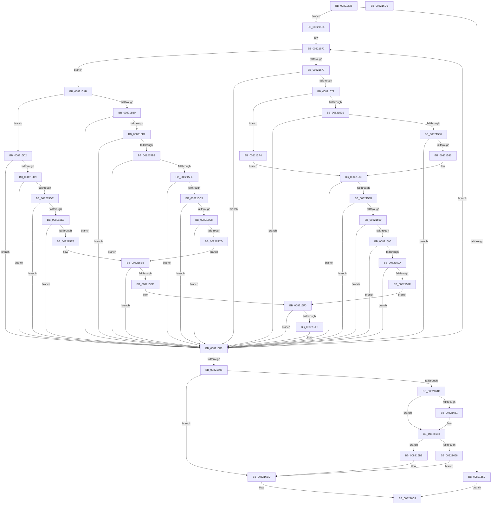

# AslpFileLargeEnsureLargeFileMapping

- RVA: `0x00821538`–`0x008216DF` (길이 `423` bytes)
- VA: `0x0000000140821538`
- 실행 섹션: `PAGE`
- PDB 이름 있음: `예`; PDB Function 태그: `아니요`
- unwind 정보 RVA: `0x000A7960`
- 디코드: `125`개 명령, `423/423` bytes 표시
- 미해석 바이트: `0` (있으면 어셈블리에 `.byte`로 보존)

> 이 문서는 커널 이미지의 기계어와 PDB 기호를 분석해 생성했습니다. 4번과 5번은 함수 원형과 자료형을 바이너리 사용 방식에서 추정한 C 해석이며 원본 소스 복구 결과는 아닙니다.

## 1. Dependencies

- 직접 호출 지점: **6**; 고유 호출 대상: **5**
- 직접 호출자로 확인된 함수: **1**
- RIP 상대 이미지 참조: **2**

### Outgoing calls
- `0x0082160E` → [AslpFileLargeMapCreate](AslpFileLargeMapCreate_function_00821A88.md) (function, `0x00821A88`)
- `0x00821628` → [AslpFileLargeGetChecksumAttributes](AslpFileLargeGetChecksumAttributes_function_008217C8.md) (function, `0x008217C8`)
- `0x0082164E` → [AslLogCallPrintf](../95/AslLogCallPrintf_function_0095E4EC.md) (function, `0x0095E4EC`)
- `0x008216A2` → [AslpFileLargeMapDelete](AslpFileLargeMapDelete_function_00821CF0.md) (function, `0x00821CF0`)
- `0x008216AF` → [AslpFileMappingGetFileKind](../AF/AslpFileMappingGetFileKind_function_00AF950C.md) (function, `0x00AF950C`)
- `0x008216C2` → [AslpFileLargeMapDelete](AslpFileLargeMapDelete_function_00821CF0.md) (function, `0x00821CF0`)

### Direct callers
- [AslFileAllocAndGetAttributes](../81/AslFileAllocAndGetAttributes_function_0081D8EC.md) at `0x0081DA02`

### Static image references
- `0x00821631` → RVA `0x00040E80` (`.rdata`; read)
- `0x00821642` → RVA `0x00040ED0` (`.rdata`; read)

## 2. Other-region calls and transfers

- 다른 실행 섹션으로 향하는 call: **0**
- 별도 외부 분기/꼬리 이동을 확인하지 못했습니다.

## 3. Assembly (complete function range)

```asm
00821538  48 89 5C 24 08                  mov qword ptr [rsp + 8], rbx
0082153D  48 89 6C 24 18                  mov qword ptr [rsp + 0x18], rbp
00821542  48 89 74 24 20                  mov qword ptr [rsp + 0x20], rsi
00821547  57                              push rdi
00821548  48 83 EC 30                     sub rsp, 0x30
0082154C  48 81 7A 18 00 00 10 00         cmp qword ptr [rdx + 0x18], 0x100000
00821554  48 8B FA                        mov rdi, rdx
00821557  48 8B E9                        mov rbp, rcx
0082155A  73 0A                           jae 0x140821566
0082155C  B8 F0 00 00 C0                  mov eax, 0xc00000f0
00821561  E9 63 01 00 00                  jmp 0x1408216c9
00821566  48 83 64 24 48 00               and qword ptr [rsp + 0x48], 0
0082156C  4C 8D 41 18                     lea r8, [rcx + 0x18]
00821570  33 D2                           xor edx, edx
00821572  83 FA 0E                        cmp edx, 0xe
00821575  77 34                           ja 0x1408215ab
00821577  74 7D                           je 0x1408215f6
00821579  83 FA 07                        cmp edx, 7
0082157C  77 26                           ja 0x1408215a4
0082157E  74 76                           je 0x1408215f6
00821580  8B CA                           mov ecx, edx
00821582  85 D2                           test edx, edx
00821584  74 70                           je 0x1408215f6
00821586  83 E9 01                        sub ecx, 1
00821589  74 6B                           je 0x1408215f6
0082158B  83 E9 01                        sub ecx, 1
0082158E  74 66                           je 0x1408215f6
00821590  83 E9 01                        sub ecx, 1
00821593  74 61                           je 0x1408215f6
00821595  83 E9 01                        sub ecx, 1
00821598  74 5C                           je 0x1408215f6
0082159A  83 E9 01                        sub ecx, 1
0082159D  74 57                           je 0x1408215f6
0082159F  83 F9 01                        cmp ecx, 1
008215A2  EB 4C                           jmp 0x1408215f0
008215A4  8B CA                           mov ecx, edx
008215A6  83 E9 08                        sub ecx, 8
008215A9  EB DE                           jmp 0x140821589
008215AB  83 FA 1A                        cmp edx, 0x1a
008215AE  77 22                           ja 0x1408215d2
008215B0  74 44                           je 0x1408215f6
008215B2  8B CA                           mov ecx, edx
008215B4  83 E9 0F                        sub ecx, 0xf
008215B7  74 3D                           je 0x1408215f6
008215B9  83 E9 01                        sub ecx, 1
008215BC  74 38                           je 0x1408215f6
008215BE  83 E9 01                        sub ecx, 1
008215C1  74 33                           je 0x1408215f6
008215C3  83 E9 01                        sub ecx, 1
008215C6  74 2E                           je 0x1408215f6
008215C8  83 E9 01                        sub ecx, 1
008215CB  74 29                           je 0x1408215f6
008215CD  83 E9 03                        sub ecx, 3
008215D0  EB 19                           jmp 0x1408215eb
008215D2  8B CA                           mov ecx, edx
008215D4  83 E9 1B                        sub ecx, 0x1b
008215D7  74 1D                           je 0x1408215f6
008215D9  83 E9 01                        sub ecx, 1
008215DC  74 18                           je 0x1408215f6
008215DE  83 E9 01                        sub ecx, 1
008215E1  74 13                           je 0x1408215f6
008215E3  83 E9 01                        sub ecx, 1
008215E6  74 0E                           je 0x1408215f6
008215E8  83 E9 01                        sub ecx, 1
008215EB  74 09                           je 0x1408215f6
008215ED  83 F9 02                        cmp ecx, 2
008215F0  74 04                           je 0x1408215f6
008215F2  41 83 08 02                     or dword ptr [r8], 2
008215F6  FF C2                           inc edx
008215F8  49 83 C0 20                     add r8, 0x20
008215FC  83 FA 24                        cmp edx, 0x24
008215FF  0F 8C 6D FF FF FF               jl 0x140821572
00821605  48 8D 57 08                     lea rdx, [rdi + 8]
00821609  48 8D 4C 24 48                  lea rcx, [rsp + 0x48]
0082160E  E8 75 04 00 00                  call 0x140821a88
00821613  8B D8                           mov ebx, eax
00821615  85 C0                           test eax, eax
00821617  0F 88 A0 00 00 00               js 0x1408216bd
0082161D  48 8B 5C 24 48                  mov rbx, qword ptr [rsp + 0x48]
00821622  48 8B CD                        mov rcx, rbp
00821625  48 8B D3                        mov rdx, rbx
00821628  E8 9B 01 00 00                  call 0x1408217c8
0082162D  85 C0                           test eax, eax
0082162F  79 22                           jns 0x140821653
00821631  4C 8D 0D 48 F8 81 FF            lea r9, [rip - 0x7e07b8]
00821638  89 44 24 20                     mov dword ptr [rsp + 0x20], eax
0082163C  41 B8 F9 00 00 00               mov r8d, 0xf9
00821642  48 8D 15 87 F8 81 FF            lea rdx, [rip - 0x7e0779]
00821649  B9 01 00 00 00                  mov ecx, 1
0082164E  E8 99 CE 13 00                  call 0x14095e4ec
00821653  48 85 DB                        test rbx, rbx
00821656  74 60                           je 0x1408216b8
00821658  48 8B 43 08                     mov rax, qword ptr [rbx + 8]
0082165C  48 8D 4C 24 48                  lea rcx, [rsp + 0x48]
00821661  48 89 47 10                     mov qword ptr [rdi + 0x10], rax
00821665  C6 47 39 01                     mov byte ptr [rdi + 0x39], 1
00821669  48 8B 43 28                     mov rax, qword ptr [rbx + 0x28]
0082166D  48 83 63 08 00                  and qword ptr [rbx + 8], 0
00821672  48 89 47 30                     mov qword ptr [rdi + 0x30], rax
00821676  48 8B 43 10                     mov rax, qword ptr [rbx + 0x10]
0082167A  48 83 63 28 00                  and qword ptr [rbx + 0x28], 0
0082167F  48 89 47 20                     mov qword ptr [rdi + 0x20], rax
00821683  48 8B 43 18                     mov rax, qword ptr [rbx + 0x18]
00821687  48 89 47 28                     mov qword ptr [rdi + 0x28], rax
0082168B  66 C7 47 3A 01 00               mov word ptr [rdi + 0x3a], 1
00821691  C7 47 54 01 00 00 00            mov dword ptr [rdi + 0x54], 1
00821698  48 83 63 10 00                  and qword ptr [rbx + 0x10], 0
0082169D  48 83 63 18 00                  and qword ptr [rbx + 0x18], 0
008216A2  E8 49 06 00 00                  call 0x140821cf0
008216A7  48 8D 57 40                     lea rdx, [rdi + 0x40]
008216AB  48 8D 4F 08                     lea rcx, [rdi + 8]
008216AF  E8 58 7E 2D 00                  call 0x140af950c
008216B4  8B D8                           mov ebx, eax
008216B6  EB 05                           jmp 0x1408216bd
008216B8  BB F0 00 00 C0                  mov ebx, 0xc00000f0
008216BD  48 8D 4C 24 48                  lea rcx, [rsp + 0x48]
008216C2  E8 29 06 00 00                  call 0x140821cf0
008216C7  8B C3                           mov eax, ebx
008216C9  48 8B 5C 24 40                  mov rbx, qword ptr [rsp + 0x40]
008216CE  48 8B 6C 24 50                  mov rbp, qword ptr [rsp + 0x50]
008216D3  48 8B 74 24 58                  mov rsi, qword ptr [rsp + 0x58]
008216D8  48 83 C4 30                     add rsp, 0x30
008216DC  5F                              pop rdi
008216DD  C3                              ret
008216DE  CC                              int3
```

## 4. C-style interpretation (structured pseudocode)

```c
__int64 __fastcall AslpFileLargeEnsureLargeFileMapping(__int64 a1, __int64 a2)
{
    __int64 result;
    __int64 v_rsp;
    unsigned int v_stack_m18;
    unsigned __int64 v_stack_p10;
    unsigned __int64 v_stack_p18;
    unsigned __int64 v_stack_p20;
    unsigned __int64 v_stack_p8;

    v_stack_p8 = v_rbx;
    v_stack_p18 = v_rbp;
    v_stack_p20 = v_rsi;
    v_rsp = (v_rsp) - (48);
    if ((*(unsigned __int64 *)(a2 + 24)) >= 0x100000ULL) goto loc_00821566;
    goto loc_008216C9;
loc_00821566:
    a2 = 0;
loc_00821572:
    if (0 > 14) goto loc_008215AB;
    if (0 == 14) goto loc_008215F6;
    if (0 > 7) goto loc_008215A4;
    if (0 == 7) goto loc_008215F6;
    if (0 == 0) goto loc_008215F6;
    a1 = (unsigned int)((0) - (1));
loc_00821589:
    if (condition_is_equal) goto loc_008215F6;
    a1 = (unsigned int)((a1) - (1));
    if (condition_is_equal) goto loc_008215F6;
    a1 = (unsigned int)((a1) - (1));
    if (condition_is_equal) goto loc_008215F6;
    a1 = (unsigned int)((a1) - (1));
    if (condition_is_equal) goto loc_008215F6;
    a1 = (unsigned int)((a1) - (1));
    if (condition_is_equal) goto loc_008215F6;
    goto loc_008215F0;
loc_008215A4:
    a1 = (unsigned int)((0) - (8));
    goto loc_00821589;
loc_008215AB:
    if (0 > 26) goto loc_008215D2;
    if (0 == 26) goto loc_008215F6;
    a1 = (unsigned int)((0) - (15));
    if (condition_is_equal) goto loc_008215F6;
    a1 = (unsigned int)((a1) - (1));
    if (condition_is_equal) goto loc_008215F6;
    a1 = (unsigned int)((a1) - (1));
    if (condition_is_equal) goto loc_008215F6;
    a1 = (unsigned int)((a1) - (1));
    if (condition_is_equal) goto loc_008215F6;
    a1 = (unsigned int)((a1) - (1));
    if (condition_is_equal) goto loc_008215F6;
    a1 = (unsigned int)((a1) - (3));
    goto loc_008215EB;
loc_008215D2:
    a1 = (unsigned int)((0) - (27));
    if (condition_is_equal) goto loc_008215F6;
    a1 = (unsigned int)((a1) - (1));
    if (condition_is_equal) goto loc_008215F6;
    a1 = (unsigned int)((a1) - (1));
    if (condition_is_equal) goto loc_008215F6;
    a1 = (unsigned int)((a1) - (1));
    if (condition_is_equal) goto loc_008215F6;
    a1 = (unsigned int)((a1) - (1));
loc_008215EB:
    if (condition_is_equal) goto loc_008215F6;
loc_008215F0:
    if (((unsigned int)(a1)) != 2) {
    }
    a2 = (unsigned int)((a2) + 1);
    a3 = (a1 + 24) + (32);
    if (((unsigned int)(a2)) < 36) goto loc_00821572;
    result = AslpFileLargeMapCreate(v_stack_p10, a2 + 8, a3, a4);
    if (sign_flag) goto loc_008216BD;
    result = AslpFileLargeGetChecksumAttributes(a1, v_stack_p10, a3, a4);
    if (sign_flag) {
        a4 = v_rip - 8259512;
        v_stack_m18 = (unsigned int)(result);
        a3 = 249;
        a2 = v_rip - 8259449;
        a1 = 1;
        result = AslLogCallPrintf(a1, a2, a3, a4);
    }
    if (v_stack_p10 == 0) goto loc_008216B8;
    *(unsigned __int64 *)(a2 + 16) = *(unsigned __int64 *)(v_stack_p10 + 8);
    *(unsigned __int8 *)(a2 + 57) = 1;
    *(unsigned __int64 *)(a2 + 48) = *(unsigned __int64 *)(v_stack_p10 + 40);
    *(unsigned __int64 *)(a2 + 32) = *(unsigned __int64 *)(v_stack_p10 + 16);
    *(unsigned __int64 *)(a2 + 40) = *(unsigned __int64 *)(v_stack_p10 + 24);
    *(unsigned __int16 *)(a2 + 58) = 1;
    *(unsigned int *)(a2 + 84) = 1;
    result = AslpFileLargeMapDelete(v_stack_p10, a2, a3, a4);
    result = AslpFileMappingGetFileKind(a2 + 8, a2 + 64, a3, a4);
    goto loc_008216BD;
loc_008216B8:
loc_008216BD:
    result = AslpFileLargeMapDelete(v_stack_p10, a2 + 64, a3, a4);
loc_008216C9:
    v_rsp = (v_rsp) + (48);
    return (unsigned int)((unsigned int)((unsigned int)(0xC00000F0ULL)));
}
```

## 5. (Beta) C Style

```c
int64_t AslpFileLargeEnsureLargeFileMapping(void *Arg1, void *Arg2)
{
    uint8_t *arg1 = (uint8_t *)Arg1;
    uint8_t *arg2 = (uint8_t *)Arg2;

    int64_t result;
    int64_t local_rsp;
    uint32_t v_stack_m18;
    uint64_t v_stack_p10;
    uint64_t v_stack_p18;
    uint64_t v_stack_p20;
    uint64_t v_stack_p8;

    v_stack_p8 = local_rbx;
    v_stack_p18 = local_rbp;
    v_stack_p20 = local_rsi;
    local_rsp = (local_rsp) - (48);
    if ((*(uint64_t *)(arg2 + 0x18)) >= 0x100000ULL) goto loc_00821566;
    goto loc_008216C9;
loc_00821566:
    Arg2 = 0;
loc_00821572:
    if (0 > 14) goto loc_008215AB;
    if (0 == 14) goto loc_008215F6;
    if (0 > 7) goto loc_008215A4;
    if (0 == 7) goto loc_008215F6;
    if (0 == 0) goto loc_008215F6;
    Arg1 = (uint32_t)((0) - (1));
loc_00821589:
    if (condition_is_equal) goto loc_008215F6;
    Arg1 = (uint32_t)((Arg1) - (1));
    if (condition_is_equal) goto loc_008215F6;
    Arg1 = (uint32_t)((Arg1) - (1));
    if (condition_is_equal) goto loc_008215F6;
    Arg1 = (uint32_t)((Arg1) - (1));
    if (condition_is_equal) goto loc_008215F6;
    Arg1 = (uint32_t)((Arg1) - (1));
    if (condition_is_equal) goto loc_008215F6;
    goto loc_008215F0;
loc_008215A4:
    Arg1 = (uint32_t)((0) - (8));
    goto loc_00821589;
loc_008215AB:
    if (0 > 26) goto loc_008215D2;
    if (0 == 26) goto loc_008215F6;
    Arg1 = (uint32_t)((0) - (15));
    if (condition_is_equal) goto loc_008215F6;
    Arg1 = (uint32_t)((Arg1) - (1));
    if (condition_is_equal) goto loc_008215F6;
    Arg1 = (uint32_t)((Arg1) - (1));
    if (condition_is_equal) goto loc_008215F6;
    Arg1 = (uint32_t)((Arg1) - (1));
    if (condition_is_equal) goto loc_008215F6;
    Arg1 = (uint32_t)((Arg1) - (1));
    if (condition_is_equal) goto loc_008215F6;
    Arg1 = (uint32_t)((Arg1) - (3));
    goto loc_008215EB;
loc_008215D2:
    Arg1 = (uint32_t)((0) - (27));
    if (condition_is_equal) goto loc_008215F6;
    Arg1 = (uint32_t)((Arg1) - (1));
    if (condition_is_equal) goto loc_008215F6;
    Arg1 = (uint32_t)((Arg1) - (1));
    if (condition_is_equal) goto loc_008215F6;
    Arg1 = (uint32_t)((Arg1) - (1));
    if (condition_is_equal) goto loc_008215F6;
    Arg1 = (uint32_t)((Arg1) - (1));
loc_008215EB:
    if (condition_is_equal) goto loc_008215F6;
loc_008215F0:
    if (((uint32_t)(Arg1)) != 2) {
    }
    Arg2 = (uint32_t)((Arg2) + 1);
    a3 = (Arg1 + 24) + (32);
    if (((uint32_t)(Arg2)) < 36) goto loc_00821572;
    result = AslpFileLargeMapCreate(v_stack_p10, Arg2 + 8, a3, a4);
    if (sign_flag) goto loc_008216BD;
    result = AslpFileLargeGetChecksumAttributes(Arg1, v_stack_p10, a3, a4);
    if (sign_flag) {
        a4 = v_rip - 8259512;
        v_stack_m18 = (uint32_t)(result);
        a3 = 249;
        Arg2 = v_rip - 8259449;
        Arg1 = 1;
        result = AslLogCallPrintf(Arg1, Arg2, a3, a4);
    }
    if (v_stack_p10 == 0) goto loc_008216B8;
    *(uint64_t *)(arg2 + 0x10) = *(uint64_t *)(v_stack_p10 + 0x8);
    *(uint8_t *)(arg2 + 0x39) = 1;
    *(uint64_t *)(arg2 + 0x30) = *(uint64_t *)(v_stack_p10 + 0x28);
    *(uint64_t *)(arg2 + 0x20) = *(uint64_t *)(v_stack_p10 + 0x10);
    *(uint64_t *)(arg2 + 0x28) = *(uint64_t *)(v_stack_p10 + 0x18);
    *(uint16_t *)(arg2 + 0x3A) = 1;
    *(uint32_t *)(arg2 + 0x54) = 1;
    result = AslpFileLargeMapDelete(v_stack_p10, Arg2, a3, a4);
    result = AslpFileMappingGetFileKind(Arg2 + 8, Arg2 + 64, a3, a4);
    goto loc_008216BD;
loc_008216B8:
loc_008216BD:
    result = AslpFileLargeMapDelete(v_stack_p10, Arg2 + 64, a3, a4);
loc_008216C9:
    local_rsp = (local_rsp) + (48);
    return (uint32_t)((uint32_t)((uint32_t)(0xC00000F0ULL)));
}
```

### 관측된 메모리 오프셋

구조체 형식이 확인되지 않은 접근은 인자 기준의 오프셋으로만 기록했습니다.

| 기준 인자 | 오프셋 표현 | 폭 (bit) | 접근 |
|---|---:|---:|---|
| `Arg1` | `+ 0x0` | `32` | `R/W` |
| `Arg1` | `+ 0x18` | `64` | `R` |
| `Arg2` | `+ 0x8` | `64` | `R` |
| `Arg2` | `+ 0x10` | `64` | `W` |
| `Arg2` | `+ 0x18` | `64` | `R` |
| `Arg2` | `+ 0x20` | `64` | `W` |
| `Arg2` | `+ 0x28` | `64` | `W` |
| `Arg2` | `+ 0x30` | `64` | `W` |
| `Arg2` | `+ 0x39` | `8` | `W` |
| `Arg2` | `+ 0x3A` | `16` | `W` |
| `Arg2` | `+ 0x40` | `64` | `R` |
| `Arg2` | `+ 0x54` | `32` | `W` |

## 6. Execution-region graph

[열기: 2D/3D 그래프와 함수 탐색 컨트롤 패널](../../../control-panel.html?section=page&rva=0x00821538&view=graph)

- 2D 그래프는 위에서 아래로 흐르고, 3D 그래프는 빈 공간을 드래그해 회전합니다. Shift+드래그는 이동, 휠은 확대·축소, 함수 노드 선택은 대상 보고서 이동입니다.

### Static fallback


