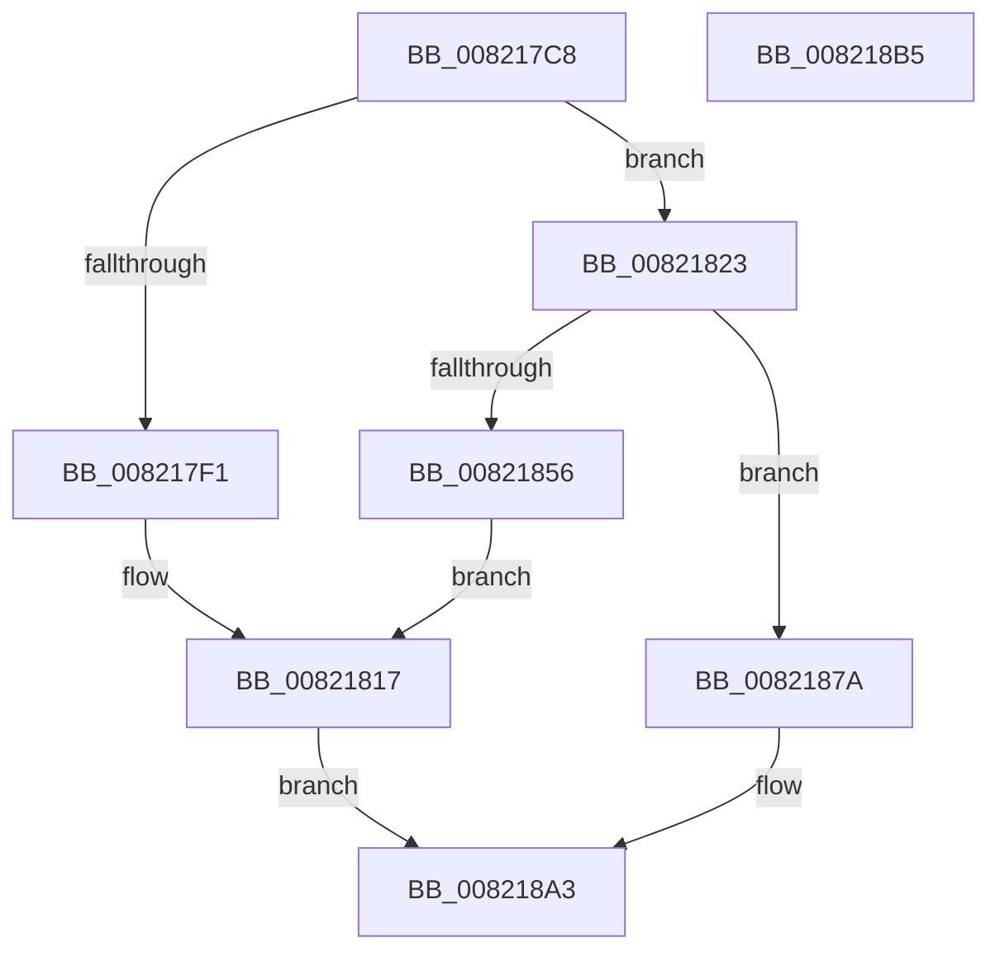

# AslpFileLargeGetChecksumAttributes

- RVA: `0x008217C8`–`0x008218B6` (길이 `238` bytes)
- VA: `0x00000001408217C8`
- 실행 섹션: `PAGE`
- PDB 이름 있음: `예`; PDB Function 태그: `아니요`
- unwind 정보 RVA: `0x000733E4`
- 디코드: `54`개 명령, `238/238` bytes 표시
- 미해석 바이트: `0` (있으면 어셈블리에 `.byte`로 보존)

> 이 문서는 커널 이미지의 기계어와 PDB 기호를 분석해 생성했습니다. 4번과 5번은 함수 원형과 자료형을 바이너리 사용 방식에서 추정한 C 해석이며 원본 소스 복구 결과는 아닙니다.

## 1. Dependencies

- 직접 호출 지점: **4**; 고유 호출 대상: **3**
- 직접 호출자로 확인된 함수: **1**
- RIP 상대 이미지 참조: **3**

### Outgoing calls
- `0x008217E6` → [AslpFileLargeGetChecksum](AslpFileLargeGetChecksum_function_008216E8.md) (function, `0x008216E8`)
- `0x0082180E` → [AslLogCallPrintf](../95/AslLogCallPrintf_function_0095E4EC.md) (function, `0x0095E4EC`)
- `0x0082184B` → [AslpFileLargeGetCrcChecksum](AslpFileLargeGetCrcChecksum_function_008218BC.md) (function, `0x008218BC`)
- `0x00821873` → [AslLogCallPrintf](../95/AslLogCallPrintf_function_0095E4EC.md) (function, `0x0095E4EC`)

### Direct callers
- [AslpFileLargeEnsureLargeFileMapping](AslpFileLargeEnsureLargeFileMapping_function_00821538.md) at `0x00821628`

### Static image references
- `0x008217F1` → RVA `0x00041000` (`.rdata`; read)
- `0x00821802` → RVA `0x00041028` (`.rdata`; read)
- `0x00821856` → RVA `0x00040B90` (`.rdata`; read)

## 2. Other-region calls and transfers

- 다른 실행 섹션으로 향하는 call: **0**
- 별도 외부 분기/꼬리 이동을 확인하지 못했습니다.

## 3. Assembly (complete function range)

```asm
008217C8  48 8B C4                        mov rax, rsp
008217CB  48 89 58 08                     mov qword ptr [rax + 8], rbx
008217CF  48 89 70 10                     mov qword ptr [rax + 0x10], rsi
008217D3  57                              push rdi
008217D4  48 83 EC 30                     sub rsp, 0x30
008217D8  83 60 18 00                     and dword ptr [rax + 0x18], 0
008217DC  48 8B D9                        mov rbx, rcx
008217DF  48 8D 48 18                     lea rcx, [rax + 0x18]
008217E3  48 8B F2                        mov rsi, rdx
008217E6  E8 FD FE FF FF                  call 0x1408216e8
008217EB  8B F8                           mov edi, eax
008217ED  85 C0                           test eax, eax
008217EF  79 32                           jns 0x140821823
008217F1  4C 8D 0D 08 F8 81 FF            lea r9, [rip - 0x7e07f8]
008217F8  89 44 24 20                     mov dword ptr [rsp + 0x20], eax
008217FC  41 B8 A2 02 00 00               mov r8d, 0x2a2
00821802  48 8D 15 1F F8 81 FF            lea rdx, [rip - 0x7e07e1]
00821809  B9 01 00 00 00                  mov ecx, 1
0082180E  E8 D9 CC 13 00                  call 0x14095e4ec
00821813  83 4B 58 02                     or dword ptr [rbx + 0x58], 2
00821817  83 8B 58 03 00 00 02            or dword ptr [rbx + 0x358], 2
0082181E  E9 80 00 00 00                  jmp 0x1408218a3
00821823  8B 44 24 50                     mov eax, dword ptr [rsp + 0x50]
00821827  48 8D 4C 24 50                  lea rcx, [rsp + 0x50]
0082182C  83 4B 58 01                     or dword ptr [rbx + 0x58], 1
00821830  48 8B D6                        mov rdx, rsi
00821833  83 64 24 50 00                  and dword ptr [rsp + 0x50], 0
00821838  48 89 43 50                     mov qword ptr [rbx + 0x50], rax
0082183C  C7 43 40 02 00 00 00            mov dword ptr [rbx + 0x40], 2
00821843  48 C7 43 48 04 00 00 00         mov qword ptr [rbx + 0x48], 4
0082184B  E8 6C 00 00 00                  call 0x1408218bc
00821850  8B F8                           mov edi, eax
00821852  85 C0                           test eax, eax
00821854  79 24                           jns 0x14082187a
00821856  4C 8D 0D 33 F3 81 FF            lea r9, [rip - 0x7e0ccd]
0082185D  89 44 24 20                     mov dword ptr [rsp + 0x20], eax
00821861  41 B8 B7 02 00 00               mov r8d, 0x2b7
00821867  48 8D 15 BA F7 81 FF            lea rdx, [rip - 0x7e0846]
0082186E  B9 01 00 00 00                  mov ecx, 1
00821873  E8 74 CC 13 00                  call 0x14095e4ec
00821878  EB 9D                           jmp 0x140821817
0082187A  8B 44 24 50                     mov eax, dword ptr [rsp + 0x50]
0082187E  83 8B 58 03 00 00 01            or dword ptr [rbx + 0x358], 1
00821885  48 89 83 50 03 00 00            mov qword ptr [rbx + 0x350], rax
0082188C  33 FF                           xor edi, edi
0082188E  C7 83 40 03 00 00 02 00 00 00   mov dword ptr [rbx + 0x340], 2
00821898  48 C7 83 48 03 00 00 04 00 00 00  mov qword ptr [rbx + 0x348], 4
008218A3  48 8B 5C 24 40                  mov rbx, qword ptr [rsp + 0x40]
008218A8  8B C7                           mov eax, edi
008218AA  48 8B 74 24 48                  mov rsi, qword ptr [rsp + 0x48]
008218AF  48 83 C4 30                     add rsp, 0x30
008218B3  5F                              pop rdi
008218B4  C3                              ret
008218B5  CC                              int3
```

## 4. C-style interpretation (structured pseudocode)

```c
__int64 __fastcall AslpFileLargeGetChecksumAttributes(__int64 a1, __int64 a2)
{
    __int64 result;
    __int64 v_rdi;
    __int64 v_rsp;
    unsigned int v_stack_m18;
    unsigned __int64 v_stack_p10;
    unsigned int v_stack_p18;
    unsigned __int64 v_stack_p8;

    *(unsigned __int64 *)(v_rsp + 8) = v_rbx;
    *(unsigned __int64 *)(v_rsp + 16) = v_rsi;
    v_rsp = (v_rsp) - (48);
    result = AslpFileLargeGetChecksum(v_rsp + 24, a2, a3, a4);
    if (!sign_flag) goto loc_00821823;
    v_stack_m18 = (unsigned int)(result);
    result = AslLogCallPrintf(1, v_rip - 8259553, 674, v_rip - 8259576);
loc_00821817:
    goto loc_008218A3;
loc_00821823:
    *(unsigned __int64 *)(a1 + 80) = (unsigned int)(v_stack_p18);
    *(unsigned int *)(a1 + 64) = 2;
    *(unsigned __int64 *)(a1 + 72) = 4;
    result = AslpFileLargeGetCrcChecksum(v_stack_p18, a2, 674, v_rip - 8259576);
    if (!sign_flag) goto loc_0082187A;
    v_stack_m18 = (unsigned int)(result);
    result = AslLogCallPrintf(1, v_rip - 8259654, 695, v_rip - 8260813);
    goto loc_00821817;
loc_0082187A:
    *(unsigned __int64 *)(a1 + 848) = (unsigned int)(v_stack_p18);
    v_rdi = 0;
    *(unsigned int *)(a1 + 832) = 2;
    *(unsigned __int64 *)(a1 + 840) = 4;
loc_008218A3:
    v_rsp = (v_rsp) + (48);
    return 0;
}
```

## 5. (Beta) C Style

```c
int64_t AslpFileLargeGetChecksumAttributes(void *Arg1, int64_t Arg2)
{
    uint8_t *arg1 = (uint8_t *)Arg1;

    int64_t result;
    int64_t local_rdi;
    int64_t local_rsp;
    uint32_t v_stack_m18;
    uint64_t v_stack_p10;
    uint32_t v_stack_p18;
    uint64_t v_stack_p8;

    *(uint64_t *)(local_rsp + 0x8) = local_rbx;
    *(uint64_t *)(local_rsp + 0x10) = local_rsi;
    local_rsp = (local_rsp) - (48);
    result = AslpFileLargeGetChecksum(local_rsp + 24, Arg2, a3, a4);
    if (!sign_flag) goto loc_00821823;
    v_stack_m18 = (uint32_t)(result);
    result = AslLogCallPrintf(1, v_rip - 8259553, 674, v_rip - 8259576);
loc_00821817:
    goto loc_008218A3;
loc_00821823:
    *(uint64_t *)(arg1 + 0x50) = (uint32_t)(v_stack_p18);
    *(uint32_t *)(arg1 + 0x40) = 2;
    *(uint64_t *)(arg1 + 0x48) = 4;
    result = AslpFileLargeGetCrcChecksum(v_stack_p18, Arg2, 674, v_rip - 8259576);
    if (!sign_flag) goto loc_0082187A;
    v_stack_m18 = (uint32_t)(result);
    result = AslLogCallPrintf(1, v_rip - 8259654, 695, v_rip - 8260813);
    goto loc_00821817;
loc_0082187A:
    *(uint64_t *)(arg1 + 0x350) = (uint32_t)(v_stack_p18);
    local_rdi = 0;
    *(uint32_t *)(arg1 + 0x340) = 2;
    *(uint64_t *)(arg1 + 0x348) = 4;
loc_008218A3:
    local_rsp = (local_rsp) + (48);
    return 0;
}
```

### 관측된 메모리 오프셋

구조체 형식이 확인되지 않은 접근은 인자 기준의 오프셋으로만 기록했습니다.

| 기준 인자 | 오프셋 표현 | 폭 (bit) | 접근 |
|---|---:|---:|---|
| `Arg1` | `+ 0x40` | `32` | `W` |
| `Arg1` | `+ 0x48` | `64` | `W` |
| `Arg1` | `+ 0x50` | `64` | `W` |
| `Arg1` | `+ 0x58` | `32` | `R/W` |
| `Arg1` | `+ 0x340` | `32` | `W` |
| `Arg1` | `+ 0x348` | `64` | `W` |
| `Arg1` | `+ 0x350` | `64` | `W` |
| `Arg1` | `+ 0x358` | `32` | `R/W` |

## 6. Execution-region graph

[열기: 2D/3D 그래프와 함수 탐색 컨트롤 패널](../../../control-panel.html?section=page&rva=0x008217C8&view=graph)

- 2D 그래프는 위에서 아래로 흐르고, 3D 그래프는 빈 공간을 드래그해 회전합니다. Shift+드래그는 이동, 휠은 확대·축소, 함수 노드 선택은 대상 보고서 이동입니다.

### Static fallback


