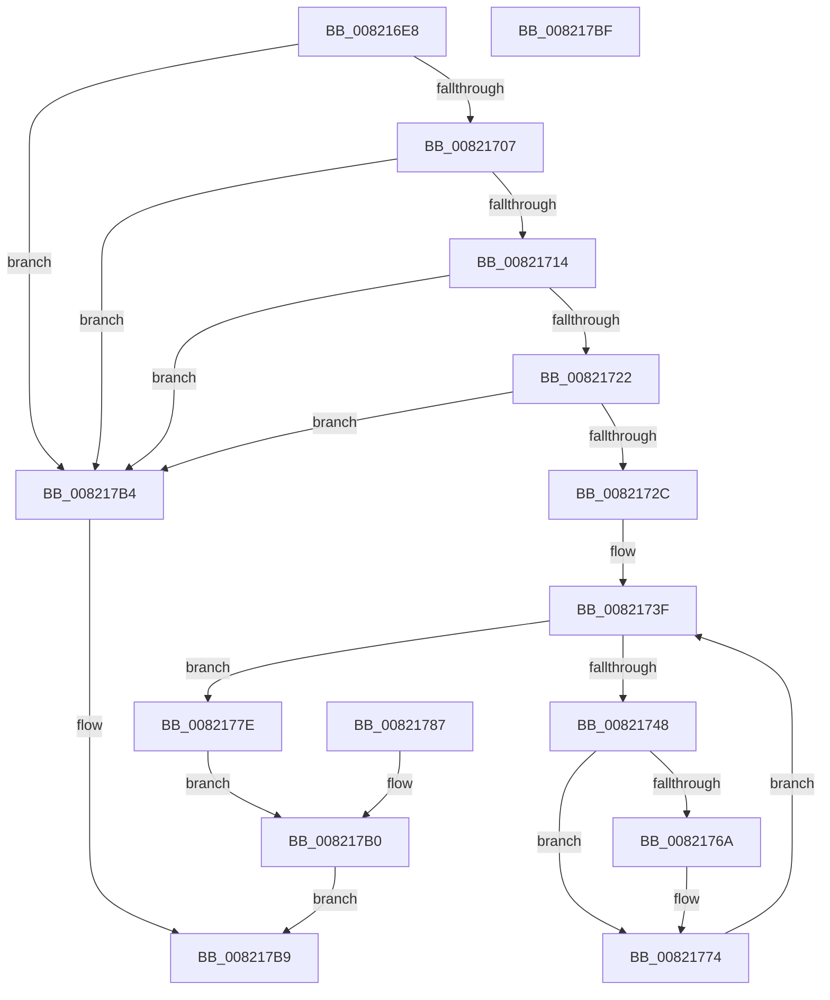

# AslpFileLargeGetChecksum

- RVA: `0x008216E8`–`0x008217C0` (길이 `216` bytes)
- VA: `0x00000001408216E8`
- 실행 섹션: `PAGE`
- PDB 이름 있음: `예`; PDB Function 태그: `아니요`
- unwind 정보 RVA: `0x000DA144`
- 디코드: `54`개 명령, `216/216` bytes 표시
- 미해석 바이트: `0` (있으면 어셈블리에 `.byte`로 보존)

> 이 문서는 커널 이미지의 기계어와 PDB 기호를 분석해 생성했습니다. 4번과 5번은 함수 원형과 자료형을 바이너리 사용 방식에서 추정한 C 해석이며 원본 소스 복구 결과는 아닙니다.

## 1. Dependencies

- 직접 호출 지점: **1**; 고유 호출 대상: **1**
- 직접 호출자로 확인된 함수: **1**
- RIP 상대 이미지 참조: **2**

### Outgoing calls
- `0x008217AA` → [AslLogCallPrintf](../95/AslLogCallPrintf_function_0095E4EC.md) (function, `0x0095E4EC`)

### Direct callers
- [AslpFileLargeGetChecksumAttributes](AslpFileLargeGetChecksumAttributes_function_008217C8.md) at `0x008217E6`

### Static image references
- `0x00821791` → RVA `0x0003EF20` (`.rdata`; read)
- `0x0082179E` → RVA `0x00041050` (`.rdata`; read)

## 2. Other-region calls and transfers

- 다른 실행 섹션으로 향하는 call: **0**
- 별도 외부 분기/꼬리 이동을 확인하지 못했습니다.

## 3. Assembly (complete function range)

```asm
008216E8  40 53                           push rbx
008216EA  48 83 EC 50                     sub rsp, 0x50
008216EE  4C 8B C9                        mov r9, rcx
008216F1  33 DB                           xor ebx, ebx
008216F3  44 8B C3                        mov r8d, ebx
008216F6  48 8B 02                        mov rax, qword ptr [rdx]
008216F9  48 81 78 10 00 00 10 00         cmp qword ptr [rax + 0x10], 0x100000
00821701  0F 82 AD 00 00 00               jb 0x1408217b4
00821707  48 8B 4A 10                     mov rcx, qword ptr [rdx + 0x10]
0082170B  48 85 C9                        test rcx, rcx
0082170E  0F 84 A0 00 00 00               je 0x1408217b4
00821714  48 81 7A 18 00 12 00 00         cmp qword ptr [rdx + 0x18], 0x1200
0082171C  0F 82 92 00 00 00               jb 0x1408217b4
00821722  48 39 5A 20                     cmp qword ptr [rdx + 0x20], rbx
00821726  0F 85 88 00 00 00               jne 0x1408217b4
0082172C  48 81 C1 00 02 00 00            add rcx, 0x200
00821733  48 89 4C 24 68                  mov qword ptr [rsp + 0x68], rcx
00821738  8B D3                           mov edx, ebx
0082173A  48 89 5C 24 38                  mov qword ptr [rsp + 0x38], rbx
0082173F  48 81 FA 00 04 00 00            cmp rdx, 0x400
00821746  73 36                           jae 0x14082177e
00821748  44 03 01                        add r8d, dword ptr [rcx]
0082174B  44 89 44 24 30                  mov dword ptr [rsp + 0x30], r8d
00821750  48 83 C1 04                     add rcx, 4
00821754  48 89 4C 24 68                  mov qword ptr [rsp + 0x68], rcx
00821759  41 8B C0                        mov eax, r8d
0082175C  41 D1 E8                        shr r8d, 1
0082175F  44 89 44 24 30                  mov dword ptr [rsp + 0x30], r8d
00821764  0F BA E0 00                     bt eax, 0
00821768  73 0A                           jae 0x140821774
0082176A  41 0F BA E8 1F                  bts r8d, 0x1f
0082176F  44 89 44 24 30                  mov dword ptr [rsp + 0x30], r8d
00821774  48 FF C2                        inc rdx
00821777  48 89 54 24 38                  mov qword ptr [rsp + 0x38], rdx
0082177C  EB C1                           jmp 0x14082173f
0082177E  45 89 01                        mov dword ptr [r9], r8d
00821781  89 5C 24 34                     mov dword ptr [rsp + 0x34], ebx
00821785  EB 29                           jmp 0x1408217b0
00821787  8B D8                           mov ebx, eax
00821789  89 44 24 34                     mov dword ptr [rsp + 0x34], eax
0082178D  89 44 24 20                     mov dword ptr [rsp + 0x20], eax
00821791  4C 8D 0D 88 D7 81 FF            lea r9, [rip - 0x7e2878]
00821798  41 B8 24 03 00 00               mov r8d, 0x324
0082179E  48 8D 15 AB F8 81 FF            lea rdx, [rip - 0x7e0755]
008217A5  B9 01 00 00 00                  mov ecx, 1
008217AA  E8 3D CD 13 00                  call 0x14095e4ec
008217AF  90                              nop
008217B0  8B C3                           mov eax, ebx
008217B2  EB 05                           jmp 0x1408217b9
008217B4  B8 0D 00 00 C0                  mov eax, 0xc000000d
008217B9  48 83 C4 50                     add rsp, 0x50
008217BD  5B                              pop rbx
008217BE  C3                              ret
008217BF  CC                              int3
```

## 4. C-style interpretation (structured pseudocode)

```c
__int64 __fastcall AslpFileLargeGetChecksum(__int64 a1, __int64 a2)
{
    __int64 v_rbx;
    __int64 v_rsp;
    unsigned __int64 v_stack_m20;
    unsigned int v_stack_m24;
    unsigned int v_stack_m28;
    unsigned int v_stack_m38;
    unsigned __int64 v_stack_p10;

    v_rsp = (v_rsp) - (80);
    v_rbx = 0;
    if ((*(unsigned __int64 *)(*(unsigned __int64 *)(a2) + 16)) < 0x100000ULL) goto loc_008217B4;
    if (*(unsigned __int64 *)(a2 + 16) == 0) goto loc_008217B4;
    if ((*(unsigned __int64 *)(a2 + 24)) < 0x1200ULL) goto loc_008217B4;
    if ((*(unsigned __int64 *)(a2 + 32)) != 0) goto loc_008217B4;
    a1 = (*(unsigned __int64 *)(a2 + 16)) + (512);
    v_stack_p10 = a1;
    v_stack_m20 = 0;
loc_0082173F:
    if (0 >= 0x400ULL) goto loc_0082177E;
    a3 = (unsigned int)((0) + (*(unsigned int *)(a1)));
    v_stack_m28 = (unsigned int)(a3);
    a1 = (a1) + (4);
    v_stack_p10 = a1;
    a3 = (unsigned int)((a3) >> (1));
    v_stack_m28 = (unsigned int)(a3);
    if (!(condition_is_above_or_equal)) {
        v_stack_m28 = (unsigned int)(a3);
    }
    a2 = (0) + 1;
    v_stack_m20 = a2;
    goto loc_0082173F;
loc_0082177E:
    *(unsigned int *)(a1) = (unsigned int)(a3);
    v_stack_m24 = 0;
    goto loc_008217B0;
loc_008217B0:
    goto loc_008217B9;
loc_008217B4:
loc_008217B9:
    v_rsp = (v_rsp) + (80);
    return (unsigned int)(0xC000000DULL);
}
```

## 5. (Beta) C Style

```c
int64_t AslpFileLargeGetChecksum(void *Arg1, void *Arg2)
{
    uint8_t *arg1 = (uint8_t *)Arg1;
    uint8_t *arg2 = (uint8_t *)Arg2;

    int64_t local_rbx;
    int64_t local_rsp;
    uint64_t v_stack_m20;
    uint32_t v_stack_m24;
    uint32_t v_stack_m28;
    uint32_t v_stack_m38;
    uint64_t v_stack_p10;

    local_rsp = (local_rsp) - (80);
    local_rbx = 0;
    if ((*(uint64_t *)(*(uint64_t *)(arg2) + 0x10)) < 0x100000ULL) goto loc_008217B4;
    if (*(uint64_t *)(arg2 + 0x10) == 0) goto loc_008217B4;
    if ((*(uint64_t *)(arg2 + 0x18)) < 0x1200ULL) goto loc_008217B4;
    if ((*(uint64_t *)(arg2 + 0x20)) != 0) goto loc_008217B4;
    Arg1 = (*(uint64_t *)(arg2 + 0x10)) + (512);
    v_stack_p10 = Arg1;
    v_stack_m20 = 0;
loc_0082173F:
    if (0 >= 0x400ULL) goto loc_0082177E;
    a3 = (uint32_t)((0) + (*(uint32_t *)(arg1)));
    v_stack_m28 = (uint32_t)(a3);
    Arg1 = (Arg1) + (4);
    v_stack_p10 = Arg1;
    a3 = (uint32_t)((a3) >> (1));
    v_stack_m28 = (uint32_t)(a3);
    if (!(condition_is_above_or_equal)) {
        v_stack_m28 = (uint32_t)(a3);
    }
    Arg2 = (0) + 1;
    v_stack_m20 = Arg2;
    goto loc_0082173F;
loc_0082177E:
    *(uint32_t *)(arg1) = (uint32_t)(a3);
    v_stack_m24 = 0;
    goto loc_008217B0;
loc_008217B0:
    goto loc_008217B9;
loc_008217B4:
loc_008217B9:
    local_rsp = (local_rsp) + (80);
    return (uint32_t)(0xC000000DULL);
}
```

### 관측된 메모리 오프셋

구조체 형식이 확인되지 않은 접근은 인자 기준의 오프셋으로만 기록했습니다.

| 기준 인자 | 오프셋 표현 | 폭 (bit) | 접근 |
|---|---:|---:|---|
| `Arg1` | `+ 0x0` | `32` | `W` |
| `Arg2` | `+ 0x0` | `64` | `R` |
| `Arg2` | `+ 0x10` | `64` | `R` |
| `Arg2` | `+ 0x18` | `64` | `R` |
| `Arg2` | `+ 0x20` | `64` | `R` |

## 6. Execution-region graph

[열기: 2D/3D 그래프와 함수 탐색 컨트롤 패널](../../../control-panel.html?section=page&rva=0x008216E8&view=graph)

- 2D 그래프는 위에서 아래로 흐르고, 3D 그래프는 빈 공간을 드래그해 회전합니다. Shift+드래그는 이동, 휠은 확대·축소, 함수 노드 선택은 대상 보고서 이동입니다.

### Static fallback


