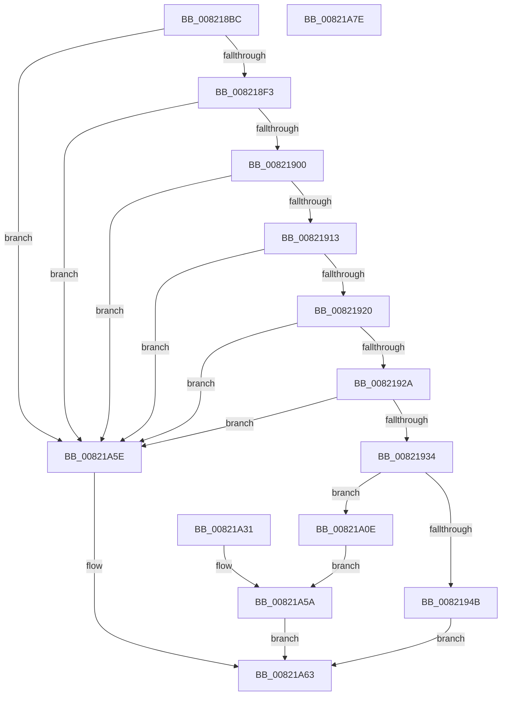

# AslpFileLargeGetCrcChecksum

- RVA: `0x008218BC`–`0x00821A7F` (길이 `451` bytes)
- VA: `0x00000001408218BC`
- 실행 섹션: `PAGE`
- PDB 이름 있음: `예`; PDB Function 태그: `아니요`
- unwind 정보 RVA: `0x000DA110`
- 디코드: `108`개 명령, `451/451` bytes 표시
- 미해석 바이트: `0` (있으면 어셈블리에 `.byte`로 보존)

> 이 문서는 커널 이미지의 기계어와 PDB 기호를 분석해 생성했습니다. 4번과 5번은 함수 원형과 자료형을 바이너리 사용 방식에서 추정한 C 해석이며 원본 소스 복구 결과는 아닙니다.

## 1. Dependencies

- 직접 호출 지점: **9**; 고유 호출 대상: **2**
- 직접 호출자로 확인된 함수: **1**
- RIP 상대 이미지 참조: **8**

### Outgoing calls
- `0x00821968` → [AslLogCallPrintf](../95/AslLogCallPrintf_function_0095E4EC.md) (function, `0x0095E4EC`)
- `0x0082198E` → [AslLogCallPrintf](../95/AslLogCallPrintf_function_0095E4EC.md) (function, `0x0095E4EC`)
- `0x008219AE` → [AslLogCallPrintf](../95/AslLogCallPrintf_function_0095E4EC.md) (function, `0x0095E4EC`)
- `0x008219CC` → [AslLogCallPrintf](../95/AslLogCallPrintf_function_0095E4EC.md) (function, `0x0095E4EC`)
- `0x008219E8` → [AslLogCallPrintf](../95/AslLogCallPrintf_function_0095E4EC.md) (function, `0x0095E4EC`)
- `0x00821A02` → [AslLogCallPrintf](../95/AslLogCallPrintf_function_0095E4EC.md) (function, `0x0095E4EC`)
- `0x00821A1A` → [AslComputeCrc32](../81/AslComputeCrc32_function_00819AFC.md) (function, `0x00819AFC`)
- `0x00821A24` → [AslComputeCrc32](../81/AslComputeCrc32_function_00819AFC.md) (function, `0x00819AFC`)
- `0x00821A54` → [AslLogCallPrintf](../95/AslLogCallPrintf_function_0095E4EC.md) (function, `0x0095E4EC`)

### Direct callers
- [AslpFileLargeGetChecksumAttributes](AslpFileLargeGetChecksumAttributes_function_008217C8.md) at `0x0082184B`

### Static image references
- `0x0082194F` → RVA `0x00041070` (`.rdata`; read)
- `0x0082195C` → RVA `0x00041088` (`.rdata`; read)
- `0x0082197C` → RVA `0x000410A8` (`.rdata`; read)
- `0x0082199C` → RVA `0x000410C0` (`.rdata`; read)
- `0x008219BA` → RVA `0x000410D8` (`.rdata`; read)
- `0x008219D6` → RVA `0x000410F0` (`.rdata`; read)
- `0x008219ED` → RVA `0x00041108` (`.rdata`; read)
- `0x00821A3B` → RVA `0x0003EF20` (`.rdata`; read)

## 2. Other-region calls and transfers

- 다른 실행 섹션으로 향하는 call: **0**
- 별도 외부 분기/꼬리 이동을 확인하지 못했습니다.

## 3. Assembly (complete function range)

```asm
008218BC  4C 8B DC                        mov r11, rsp
008218BF  49 89 5B 08                     mov qword ptr [r11 + 8], rbx
008218C3  49 89 73 10                     mov qword ptr [r11 + 0x10], rsi
008218C7  49 89 7B 18                     mov qword ptr [r11 + 0x18], rdi
008218CB  4D 89 73 20                     mov qword ptr [r11 + 0x20], r14
008218CF  41 57                           push r15
008218D1  48 83 EC 40                     sub rsp, 0x40
008218D5  48 8B FA                        mov rdi, rdx
008218D8  48 8B F1                        mov rsi, rcx
008218DB  33 DB                           xor ebx, ebx
008218DD  89 19                           mov dword ptr [rcx], ebx
008218DF  48 8B 02                        mov rax, qword ptr [rdx]
008218E2  48 8B 50 10                     mov rdx, qword ptr [rax + 0x10]
008218E6  48 81 FA 00 00 10 00            cmp rdx, 0x100000
008218ED  0F 82 6B 01 00 00               jb 0x140821a5e
008218F3  4C 8B 47 30                     mov r8, qword ptr [rdi + 0x30]
008218F7  4D 85 C0                        test r8, r8
008218FA  0F 84 5E 01 00 00               je 0x140821a5e
00821900  48 8B 4F 38                     mov rcx, qword ptr [rdi + 0x38]
00821904  41 BF 00 10 00 00               mov r15d, 0x1000
0082190A  49 3B CF                        cmp rcx, r15
0082190D  0F 82 4B 01 00 00               jb 0x140821a5e
00821913  4C 8B 4F 10                     mov r9, qword ptr [rdi + 0x10]
00821917  4D 85 C9                        test r9, r9
0082191A  0F 84 3E 01 00 00               je 0x140821a5e
00821920  4C 39 7F 18                     cmp qword ptr [rdi + 0x18], r15
00821924  0F 82 34 01 00 00               jb 0x140821a5e
0082192A  48 39 5F 20                     cmp qword ptr [rdi + 0x20], rbx
0082192E  0F 85 2A 01 00 00               jne 0x140821a5e
00821934  48 8B C2                        mov rax, rdx
00821937  48 2B 47 40                     sub rax, qword ptr [rdi + 0x40]
0082193B  4C 8D B0 00 F0 FF FF            lea r14, [rax - 0x1000]
00821942  48 3B C1                        cmp rax, rcx
00821945  0F 86 C3 00 00 00               jbe 0x140821a0e
0082194B  49 89 53 D8                     mov qword ptr [r11 - 0x28], rdx
0082194F  4C 8D 0D 1A F7 81 FF            lea r9, [rip - 0x7e08e6]
00821956  41 B8 77 03 00 00               mov r8d, 0x377
0082195C  48 8D 1D 25 F7 81 FF            lea rbx, [rip - 0x7e08db]
00821963  48 8B D3                        mov rdx, rbx
00821966  33 C9                           xor ecx, ecx
00821968  E8 7F CB 13 00                  call 0x14095e4ec
0082196D  48 8B 07                        mov rax, qword ptr [rdi]
00821970  48 8B 48 10                     mov rcx, qword ptr [rax + 0x10]
00821974  49 2B CF                        sub rcx, r15
00821977  48 89 4C 24 20                  mov qword ptr [rsp + 0x20], rcx
0082197C  4C 8D 0D 25 F7 81 FF            lea r9, [rip - 0x7e08db]
00821983  41 B8 78 03 00 00               mov r8d, 0x378
00821989  48 8B D3                        mov rdx, rbx
0082198C  33 C9                           xor ecx, ecx
0082198E  E8 59 CB 13 00                  call 0x14095e4ec
00821993  48 8B 47 40                     mov rax, qword ptr [rdi + 0x40]
00821997  48 89 44 24 20                  mov qword ptr [rsp + 0x20], rax
0082199C  4C 8D 0D 1D F7 81 FF            lea r9, [rip - 0x7e08e3]
008219A3  41 B8 79 03 00 00               mov r8d, 0x379
008219A9  48 8B D3                        mov rdx, rbx
008219AC  33 C9                           xor ecx, ecx
008219AE  E8 39 CB 13 00                  call 0x14095e4ec
008219B3  8B 47 38                        mov eax, dword ptr [rdi + 0x38]
008219B6  89 44 24 20                     mov dword ptr [rsp + 0x20], eax
008219BA  4C 8D 0D 17 F7 81 FF            lea r9, [rip - 0x7e08e9]
008219C1  41 B8 7A 03 00 00               mov r8d, 0x37a
008219C7  48 8B D3                        mov rdx, rbx
008219CA  33 C9                           xor ecx, ecx
008219CC  E8 1B CB 13 00                  call 0x14095e4ec
008219D1  4C 89 74 24 20                  mov qword ptr [rsp + 0x20], r14
008219D6  4C 8D 0D 13 F7 81 FF            lea r9, [rip - 0x7e08ed]
008219DD  41 B8 7B 03 00 00               mov r8d, 0x37b
008219E3  48 8B D3                        mov rdx, rbx
008219E6  33 C9                           xor ecx, ecx
008219E8  E8 FF CA 13 00                  call 0x14095e4ec
008219ED  4C 8D 0D 14 F7 81 FF            lea r9, [rip - 0x7e08ec]
008219F4  41 B8 7F 03 00 00               mov r8d, 0x37f
008219FA  48 8B D3                        mov rdx, rbx
008219FD  B9 01 00 00 00                  mov ecx, 1
00821A02  E8 E5 CA 13 00                  call 0x14095e4ec
00821A07  B8 20 02 00 C0                  mov eax, 0xc0000220
00821A0C  EB 55                           jmp 0x140821a63
00821A0E  4F 8D 1C 30                     lea r11, [r8 + r14]
00821A12  45 8B C7                        mov r8d, r15d
00821A15  49 8B D1                        mov rdx, r9
00821A18  33 C9                           xor ecx, ecx
00821A1A  E8 DD 80 FF FF                  call 0x140819afc
00821A1F  8B C8                           mov ecx, eax
00821A21  49 8B D3                        mov rdx, r11
00821A24  E8 D3 80 FF FF                  call 0x140819afc
00821A29  89 06                           mov dword ptr [rsi], eax
00821A2B  89 5C 24 30                     mov dword ptr [rsp + 0x30], ebx
00821A2F  EB 29                           jmp 0x140821a5a
00821A31  8B D8                           mov ebx, eax
00821A33  89 44 24 30                     mov dword ptr [rsp + 0x30], eax
00821A37  89 44 24 20                     mov dword ptr [rsp + 0x20], eax
00821A3B  4C 8D 0D DE D4 81 FF            lea r9, [rip - 0x7e2b22]
00821A42  41 B8 91 03 00 00               mov r8d, 0x391
00821A48  48 8D 15 39 F6 81 FF            lea rdx, [rip - 0x7e09c7]
00821A4F  B9 01 00 00 00                  mov ecx, 1
00821A54  E8 93 CA 13 00                  call 0x14095e4ec
00821A59  90                              nop
00821A5A  8B C3                           mov eax, ebx
00821A5C  EB 05                           jmp 0x140821a63
00821A5E  B8 0D 00 00 C0                  mov eax, 0xc000000d
00821A63  48 8B 5C 24 50                  mov rbx, qword ptr [rsp + 0x50]
00821A68  48 8B 74 24 58                  mov rsi, qword ptr [rsp + 0x58]
00821A6D  48 8B 7C 24 60                  mov rdi, qword ptr [rsp + 0x60]
00821A72  4C 8B 74 24 68                  mov r14, qword ptr [rsp + 0x68]
00821A77  48 83 C4 40                     add rsp, 0x40
00821A7B  41 5F                           pop r15
00821A7D  C3                              ret
00821A7E  CC                              int3
```

## 4. C-style interpretation (structured pseudocode)

```c
__int64 __fastcall AslpFileLargeGetCrcChecksum(__int64 a1, __int64 a2)
{
    __int64 result;
    __int64 v_rbx;
    __int64 v_rsp;
    unsigned int v_stack_m18;
    unsigned __int64 v_stack_m28;
    unsigned __int64 v_stack_p10;
    unsigned __int64 v_stack_p18;
    unsigned __int64 v_stack_p20;
    unsigned __int64 v_stack_p8;

    *(unsigned __int64 *)(v_rsp + 8) = v_rbx;
    *(unsigned __int64 *)(v_rsp + 16) = v_rsi;
    *(unsigned __int64 *)(v_rsp + 24) = v_rdi;
    *(unsigned __int64 *)(v_rsp + 32) = v_r14;
    v_rsp = (v_rsp) - (64);
    v_rbx = 0;
    *(unsigned int *)(a1) = 0;
    if ((*(unsigned __int64 *)(*(unsigned __int64 *)(a2) + 16)) < 0x100000ULL) goto loc_00821A5E;
    if (*(unsigned __int64 *)(a2 + 48) == 0) goto loc_00821A5E;
    if ((*(unsigned __int64 *)(a2 + 56)) < ((unsigned int)(0x1000ULL))) goto loc_00821A5E;
    if (*(unsigned __int64 *)(a2 + 16) == 0) goto loc_00821A5E;
    if ((*(unsigned __int64 *)(a2 + 24)) < ((unsigned int)(0x1000ULL))) goto loc_00821A5E;
    if ((*(unsigned __int64 *)(a2 + 32)) != 0) goto loc_00821A5E;
    result = (*(unsigned __int64 *)(*(unsigned __int64 *)(a2) + 16)) - (*(unsigned __int64 *)(a2 + 64));
    if (result <= (*(unsigned __int64 *)(a2 + 56))) goto loc_00821A0E;
    *(unsigned __int64 *)(v_rsp - 40) = *(unsigned __int64 *)(*(unsigned __int64 *)(a2) + 16);
    a1 = 0;
    result = AslLogCallPrintf(a1, v_rip - 8259803, 887, v_rip - 8259814);
    a1 = (*(unsigned __int64 *)(*(unsigned __int64 *)(a2) + 16)) - ((unsigned int)(0x1000ULL));
    v_stack_m28 = a1;
    a1 = 0;
    result = AslLogCallPrintf(a1, v_rip - 8259803, 888, v_rip - 8259803);
    v_stack_m28 = *(unsigned __int64 *)(a2 + 64);
    a1 = 0;
    result = AslLogCallPrintf(a1, v_rip - 8259803, 889, v_rip - 8259811);
    v_stack_m28 = (unsigned int)((unsigned int)(*(unsigned int *)(a2 + 56)));
    a1 = 0;
    result = AslLogCallPrintf(a1, v_rip - 8259803, 890, v_rip - 8259817);
    v_stack_m28 = result - 4096;
    a1 = 0;
    result = AslLogCallPrintf(a1, v_rip - 8259803, 891, v_rip - 8259821);
    result = AslLogCallPrintf(1, v_rip - 8259803, 895, v_rip - 8259820);
    goto loc_00821A63;
loc_00821A0E:
    a1 = 0;
    result = AslComputeCrc32(a1, v_rip - 8259820, (unsigned int)((unsigned int)((unsigned int)(0x1000ULL))), v_rip - 8259820);
    result = AslComputeCrc32((unsigned int)((unsigned int)(result)), 895 + result - 4096 * 1, (unsigned int)((unsigned int)((unsigned int)(0x1000ULL))), v_rip - 8259820);
    *(unsigned int *)(a1) = (unsigned int)(result);
    v_stack_m18 = (unsigned int)(v_rip - 8259803);
    goto loc_00821A5A;
loc_00821A5A:
    goto loc_00821A63;
loc_00821A5E:
loc_00821A63:
    v_rsp = (v_rsp) + (64);
    return (unsigned int)(0xC000000DULL);
}
```

## 5. (Beta) C Style

```c
int64_t AslpFileLargeGetCrcChecksum(void *Arg1, void *Arg2)
{
    uint8_t *arg1 = (uint8_t *)Arg1;
    uint8_t *arg2 = (uint8_t *)Arg2;

    int64_t result;
    int64_t local_rbx;
    int64_t local_rsp;
    uint32_t v_stack_m18;
    uint64_t v_stack_m28;
    uint64_t v_stack_p10;
    uint64_t v_stack_p18;
    uint64_t v_stack_p20;
    uint64_t v_stack_p8;

    *(uint64_t *)(local_rsp + 0x8) = local_rbx;
    *(uint64_t *)(local_rsp + 0x10) = local_rsi;
    *(uint64_t *)(local_rsp + 0x18) = local_rdi;
    *(uint64_t *)(local_rsp + 0x20) = local_r14;
    local_rsp = (local_rsp) - (64);
    local_rbx = 0;
    *(uint32_t *)(arg1) = 0;
    if ((*(uint64_t *)(*(uint64_t *)(arg2) + 0x10)) < 0x100000ULL) goto loc_00821A5E;
    if (*(uint64_t *)(arg2 + 0x30) == 0) goto loc_00821A5E;
    if ((*(uint64_t *)(arg2 + 0x38)) < ((uint32_t)(0x1000ULL))) goto loc_00821A5E;
    if (*(uint64_t *)(arg2 + 0x10) == 0) goto loc_00821A5E;
    if ((*(uint64_t *)(arg2 + 0x18)) < ((uint32_t)(0x1000ULL))) goto loc_00821A5E;
    if ((*(uint64_t *)(arg2 + 0x20)) != 0) goto loc_00821A5E;
    result = (*(uint64_t *)(*(uint64_t *)(arg2) + 0x10)) - (*(uint64_t *)(arg2 + 0x40));
    if (result <= (*(uint64_t *)(arg2 + 0x38))) goto loc_00821A0E;
    *(uint64_t *)(local_rsp - 0x28) = *(uint64_t *)(*(uint64_t *)(arg2) + 0x10);
    Arg1 = 0;
    result = AslLogCallPrintf(Arg1, v_rip - 8259803, 887, v_rip - 8259814);
    Arg1 = (*(uint64_t *)(*(uint64_t *)(arg2) + 0x10)) - ((uint32_t)(0x1000ULL));
    v_stack_m28 = Arg1;
    Arg1 = 0;
    result = AslLogCallPrintf(Arg1, v_rip - 8259803, 888, v_rip - 8259803);
    v_stack_m28 = *(uint64_t *)(arg2 + 0x40);
    Arg1 = 0;
    result = AslLogCallPrintf(Arg1, v_rip - 8259803, 889, v_rip - 8259811);
    v_stack_m28 = (uint32_t)((uint32_t)(*(uint32_t *)(arg2 + 0x38)));
    Arg1 = 0;
    result = AslLogCallPrintf(Arg1, v_rip - 8259803, 890, v_rip - 8259817);
    v_stack_m28 = result - 4096;
    Arg1 = 0;
    result = AslLogCallPrintf(Arg1, v_rip - 8259803, 891, v_rip - 8259821);
    result = AslLogCallPrintf(1, v_rip - 8259803, 895, v_rip - 8259820);
    goto loc_00821A63;
loc_00821A0E:
    Arg1 = 0;
    result = AslComputeCrc32(Arg1, v_rip - 8259820, (uint32_t)((uint32_t)((uint32_t)(0x1000ULL))), v_rip - 8259820);
    result = AslComputeCrc32((uint32_t)((uint32_t)(result)), 895 + result - 4096 * 1, (uint32_t)((uint32_t)((uint32_t)(0x1000ULL))), v_rip - 8259820);
    *(uint32_t *)(arg1) = (uint32_t)(result);
    v_stack_m18 = (uint32_t)(v_rip - 8259803);
    goto loc_00821A5A;
loc_00821A5A:
    goto loc_00821A63;
loc_00821A5E:
loc_00821A63:
    local_rsp = (local_rsp) + (64);
    return (uint32_t)(0xC000000DULL);
}
```

### 관측된 메모리 오프셋

구조체 형식이 확인되지 않은 접근은 인자 기준의 오프셋으로만 기록했습니다.

| 기준 인자 | 오프셋 표현 | 폭 (bit) | 접근 |
|---|---:|---:|---|
| `Arg1` | `+ 0x0` | `32` | `W` |
| `Arg2` | `+ 0x0` | `64` | `R` |
| `Arg2` | `+ 0x10` | `64` | `R` |
| `Arg2` | `+ 0x18` | `64` | `R` |
| `Arg2` | `+ 0x20` | `64` | `R` |
| `Arg2` | `+ 0x30` | `64` | `R` |
| `Arg2` | `+ 0x38` | `32` | `R` |
| `Arg2` | `+ 0x38` | `64` | `R` |
| `Arg2` | `+ 0x40` | `64` | `R` |

## 6. Execution-region graph

[열기: 2D/3D 그래프와 함수 탐색 컨트롤 패널](../../../control-panel.html?section=page&rva=0x008218BC&view=graph)

- 2D 그래프는 위에서 아래로 흐르고, 3D 그래프는 빈 공간을 드래그해 회전합니다. Shift+드래그는 이동, 휠은 확대·축소, 함수 노드 선택은 대상 보고서 이동입니다.

### Static fallback


