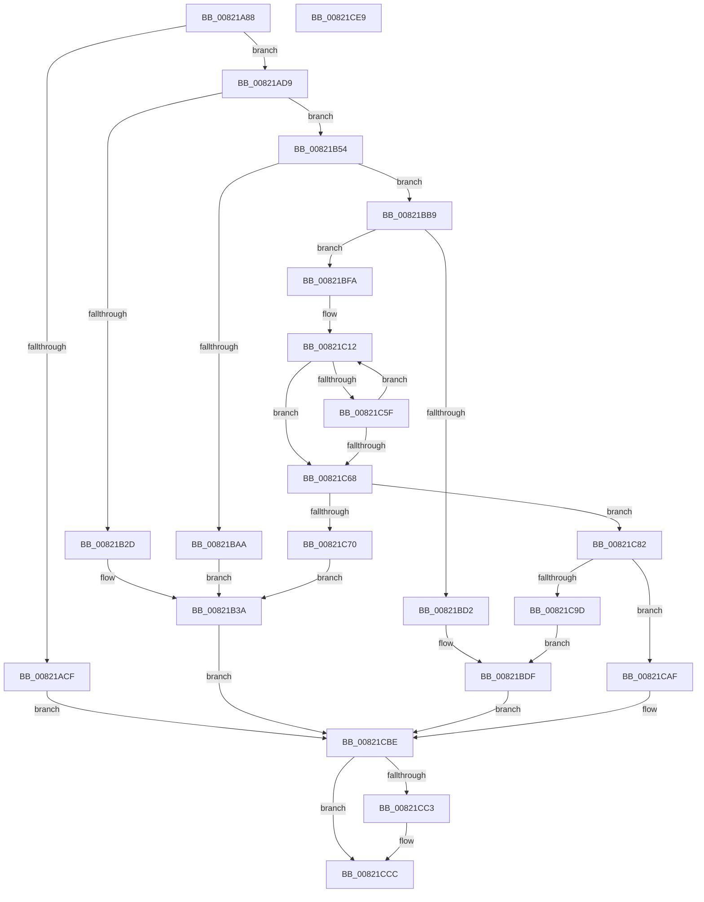

# AslpFileLargeMapCreate

- RVA: `0x00821A88`–`0x00821CEA` (길이 `610` bytes)
- VA: `0x0000000140821A88`
- 실행 섹션: `PAGE`
- PDB 이름 있음: `예`; PDB Function 태그: `아니요`
- unwind 정보 RVA: `0x000BC564`
- 디코드: `151`개 명령, `610/610` bytes 표시
- 미해석 바이트: `0` (있으면 어셈블리에 `.byte`로 보존)

> 이 문서는 커널 이미지의 기계어와 PDB 기호를 분석해 생성했습니다. 4번과 5번은 함수 원형과 자료형을 바이너리 사용 방식에서 추정한 C 해석이며 원본 소스 복구 결과는 아닙니다.

## 1. Dependencies

- 직접 호출 지점: **9**; 고유 호출 대상: **6**
- 직접 호출자로 확인된 함수: **1**
- RIP 상대 이미지 참조: **6**

### Outgoing calls
- `0x00821ABE` → [AslAlloc](../95/AslAlloc_function_0095BD34.md) (function, `0x0095BD34`)
- `0x00821B22` → [ZwCreateSection](../../text/6A/ZwCreateSection_function_006ADA10.md) (function, `0x006ADA10`)
- `0x00821B4A` → [AslLogCallPrintf](../95/AslLogCallPrintf_function_0095E4EC.md) (function, `0x0095E4EC`)
- `0x00821B9F` → [ZwMapViewOfSection](../../text/6A/ZwMapViewOfSection_function_006AD5D0.md) (function, `0x006AD5D0`)
- `0x00821BC4` → [MmSecureVirtualMemory](../9F/MmSecureVirtualMemory_function_009F55F0.md) (function, `0x009F55F0`)
- `0x00821BEB` → [AslLogCallPrintf](../95/AslLogCallPrintf_function_0095E4EC.md) (function, `0x0095E4EC`)
- `0x00821C4E` → [ZwMapViewOfSection](../../text/6A/ZwMapViewOfSection_function_006AD5D0.md) (function, `0x006AD5D0`)
- `0x00821C8F` → [MmSecureVirtualMemory](../9F/MmSecureVirtualMemory_function_009F55F0.md) (function, `0x009F55F0`)
- `0x00821CC7` → [AslpFileLargeMapDelete](AslpFileLargeMapDelete_function_00821CF0.md) (function, `0x00821CF0`)

### Direct callers
- [AslpFileLargeEnsureLargeFileMapping](AslpFileLargeEnsureLargeFileMapping_function_00821538.md) at `0x0082160E`

### Static image references
- `0x00821B2D` → RVA `0x0003E958` (`.rdata`; read)
- `0x00821B3A` → RVA `0x00040EF8` (`.rdata`; read)
- `0x00821BAA` → RVA `0x00040F10` (`.rdata`; read)
- `0x00821BD2` → RVA `0x00040F50` (`.rdata`; read)
- `0x00821C70` → RVA `0x00040F88` (`.rdata`; read)
- `0x00821C9D` → RVA `0x00040FC8` (`.rdata`; read)

## 2. Other-region calls and transfers

- 다른 실행 섹션으로 향하는 call: **3**
  - `0x00821B22` → [ZwCreateSection](../../text/6A/ZwCreateSection_function_006ADA10.md) (`PAGE` → `.text`)
  - `0x00821B9F` → [ZwMapViewOfSection](../../text/6A/ZwMapViewOfSection_function_006AD5D0.md) (`PAGE` → `.text`)
  - `0x00821C4E` → [ZwMapViewOfSection](../../text/6A/ZwMapViewOfSection_function_006AD5D0.md) (`PAGE` → `.text`)
- 별도 외부 분기/꼬리 이동을 확인하지 못했습니다.

## 3. Assembly (complete function range)

```asm
00821A88  48 89 5C 24 10                  mov qword ptr [rsp + 0x10], rbx
00821A8D  48 89 4C 24 08                  mov qword ptr [rsp + 8], rcx
00821A92  55                              push rbp
00821A93  56                              push rsi
00821A94  57                              push rdi
00821A95  41 54                           push r12
00821A97  41 55                           push r13
00821A99  41 56                           push r14
00821A9B  41 57                           push r15
00821A9D  48 8B EC                        mov rbp, rsp
00821AA0  48 81 EC 80 00 00 00            sub rsp, 0x80
00821AA7  0F 57 C0                        xorps xmm0, xmm0
00821AAA  4C 8B F2                        mov r14, rdx
00821AAD  BA 50 00 00 00                  mov edx, 0x50
00821AB2  0F 11 45 D0                     movups xmmword ptr [rbp - 0x30], xmm0
00821AB6  0F 11 45 E0                     movups xmmword ptr [rbp - 0x20], xmm0
00821ABA  0F 11 45 F0                     movups xmmword ptr [rbp - 0x10], xmm0
00821ABE  E8 71 A2 13 00                  call 0x14095bd34
00821AC3  48 89 45 50                     mov qword ptr [rbp + 0x50], rax
00821AC7  48 8B D8                        mov rbx, rax
00821ACA  48 85 C0                        test rax, rax
00821ACD  75 0A                           jne 0x140821ad9
00821ACF  BF 17 00 00 C0                  mov edi, 0xc0000017
00821AD4  E9 E5 01 00 00                  jmp 0x140821cbe
00821AD9  48 83 65 D8 00                  and qword ptr [rbp - 0x28], 0
00821ADE  48 8D 48 08                     lea rcx, [rax + 8]
00821AE2  49 8B 06                        mov rax, qword ptr [r14]
00821AE5  4C 8D 45 D0                     lea r8, [rbp - 0x30]
00821AE9  48 83 65 E0 00                  and qword ptr [rbp - 0x20], 0
00821AEE  0F 57 C0                        xorps xmm0, xmm0
00821AF1  48 89 44 24 30                  mov qword ptr [rsp + 0x30], rax
00821AF6  BE 02 00 00 00                  mov esi, 2
00821AFB  C7 44 24 28 00 00 00 08         mov dword ptr [rsp + 0x28], 0x8000000
00821B03  45 33 C9                        xor r9d, r9d
00821B06  BA 05 00 0F 00                  mov edx, 0xf0005
00821B0B  89 74 24 20                     mov dword ptr [rsp + 0x20], esi
00821B0F  C7 45 D0 30 00 00 00            mov dword ptr [rbp - 0x30], 0x30
00821B16  C7 45 E8 00 02 00 00            mov dword ptr [rbp - 0x18], 0x200
00821B1D  F3 0F 7F 45 F0                  movdqu xmmword ptr [rbp - 0x10], xmm0
00821B22  E8 E9 BE E8 FF                  call 0x1406ada10
00821B27  8B F8                           mov edi, eax
00821B29  85 C0                           test eax, eax
00821B2B  79 27                           jns 0x140821b54
00821B2D  4C 8D 0D 24 CE 81 FF            lea r9, [rip - 0x7e31dc]
00821B34  41 B8 5A 01 00 00               mov r8d, 0x15a
00821B3A  48 8D 15 B7 F3 81 FF            lea rdx, [rip - 0x7e0c49]
00821B41  89 44 24 20                     mov dword ptr [rsp + 0x20], eax
00821B45  B9 01 00 00 00                  mov ecx, 1
00821B4A  E8 9D C9 13 00                  call 0x14095e4ec
00821B4F  E9 6A 01 00 00                  jmp 0x140821cbe
00821B54  49 8B 4E 10                     mov rcx, qword ptr [r14 + 0x10]
00821B58  48 8D 53 40                     lea rdx, [rbx + 0x40]
00821B5C  89 74 24 48                     mov dword ptr [rsp + 0x48], esi
00821B60  4C 8D 43 30                     lea r8, [rbx + 0x30]
00821B64  48 81 E9 00 10 00 00            sub rcx, 0x1000
00821B6B  C7 44 24 40 00 00 50 00         mov dword ptr [rsp + 0x40], 0x500000
00821B73  0F B7 C1                        movzx eax, cx
00821B76  45 33 C9                        xor r9d, r9d
00821B79  48 2B C8                        sub rcx, rax
00821B7C  89 74 24 38                     mov dword ptr [rsp + 0x38], esi
00821B80  48 89 0A                        mov qword ptr [rdx], rcx
00821B83  48 8D 43 38                     lea rax, [rbx + 0x38]
00821B87  48 8B 4B 08                     mov rcx, qword ptr [rbx + 8]
00821B8B  48 89 44 24 30                  mov qword ptr [rsp + 0x30], rax
00821B90  48 89 54 24 28                  mov qword ptr [rsp + 0x28], rdx
00821B95  48 83 CA FF                     or rdx, 0xffffffffffffffff
00821B99  48 83 64 24 20 00               and qword ptr [rsp + 0x20], 0
00821B9F  E8 2C BA E8 FF                  call 0x1406ad5d0
00821BA4  8B F8                           mov edi, eax
00821BA6  85 C0                           test eax, eax
00821BA8  79 0F                           jns 0x140821bb9
00821BAA  4C 8D 0D 5F F3 81 FF            lea r9, [rip - 0x7e0ca1]
00821BB1  41 B8 76 01 00 00               mov r8d, 0x176
00821BB7  EB 81                           jmp 0x140821b3a
00821BB9  48 8B 53 38                     mov rdx, qword ptr [rbx + 0x38]
00821BBD  44 8B C6                        mov r8d, esi
00821BC0  48 8B 4B 30                     mov rcx, qword ptr [rbx + 0x30]
00821BC4  E8 27 3A 1D 00                  call 0x1409f55f0
00821BC9  48 89 43 48                     mov qword ptr [rbx + 0x48], rax
00821BCD  48 85 C0                        test rax, rax
00821BD0  75 28                           jne 0x140821bfa
00821BD2  4C 8D 0D 77 F3 81 FF            lea r9, [rip - 0x7e0c89]
00821BD9  41 B8 7D 01 00 00               mov r8d, 0x17d
00821BDF  48 8D 15 12 F3 81 FF            lea rdx, [rip - 0x7e0cee]
00821BE6  B9 01 00 00 00                  mov ecx, 1
00821BEB  E8 FC C8 13 00                  call 0x14095e4ec
00821BF0  BF 01 00 00 C0                  mov edi, 0xc0000001
00821BF5  E9 C4 00 00 00                  jmp 0x140821cbe
00821BFA  49 8B 76 10                     mov rsi, qword ptr [r14 + 0x10]
00821BFE  4C 8D 7B 18                     lea r15, [rbx + 0x18]
00821C02  B8 00 00 00 20                  mov eax, 0x20000000
00821C07  4C 8D 6B 20                     lea r13, [rbx + 0x20]
00821C0B  48 3B F0                        cmp rsi, rax
00821C0E  48 0F 47 F0                     cmova rsi, rax
00821C12  B8 02 00 00 00                  mov eax, 2
00821C17  49 89 37                        mov qword ptr [r15], rsi
00821C1A  49 83 65 00 00                  and qword ptr [r13], 0
00821C1F  4C 8D 43 10                     lea r8, [rbx + 0x10]
00821C23  48 8B 4B 08                     mov rcx, qword ptr [rbx + 8]
00821C27  45 33 C9                        xor r9d, r9d
00821C2A  89 44 24 48                     mov dword ptr [rsp + 0x48], eax
00821C2E  48 83 CA FF                     or rdx, 0xffffffffffffffff
00821C32  C7 44 24 40 00 00 50 00         mov dword ptr [rsp + 0x40], 0x500000
00821C3A  89 44 24 38                     mov dword ptr [rsp + 0x38], eax
00821C3E  4C 89 7C 24 30                  mov qword ptr [rsp + 0x30], r15
00821C43  4C 89 6C 24 28                  mov qword ptr [rsp + 0x28], r13
00821C48  48 83 64 24 20 00               and qword ptr [rsp + 0x20], 0
00821C4E  E8 7D B9 E8 FF                  call 0x1406ad5d0
00821C53  48 D1 EE                        shr rsi, 1
00821C56  8B F8                           mov edi, eax
00821C58  3D 17 00 00 C0                  cmp eax, 0xc0000017
00821C5D  75 09                           jne 0x140821c68
00821C5F  48 81 FE 00 00 10 00            cmp rsi, 0x100000
00821C66  73 AA                           jae 0x140821c12
00821C68  4C 8B 6D 40                     mov r13, qword ptr [rbp + 0x40]
00821C6C  85 C0                           test eax, eax
00821C6E  79 12                           jns 0x140821c82
00821C70  4C 8D 0D 11 F3 81 FF            lea r9, [rip - 0x7e0cef]
00821C77  41 B8 A0 01 00 00               mov r8d, 0x1a0
00821C7D  E9 B8 FE FF FF                  jmp 0x140821b3a
00821C82  49 8B 17                        mov rdx, qword ptr [r15]
00821C85  41 B8 02 00 00 00               mov r8d, 2
00821C8B  48 8B 4B 10                     mov rcx, qword ptr [rbx + 0x10]
00821C8F  E8 5C 39 1D 00                  call 0x1409f55f0
00821C94  48 89 43 28                     mov qword ptr [rbx + 0x28], rax
00821C98  48 85 C0                        test rax, rax
00821C9B  75 12                           jne 0x140821caf
00821C9D  4C 8D 0D 24 F3 81 FF            lea r9, [rip - 0x7e0cdc]
00821CA4  41 B8 A7 01 00 00               mov r8d, 0x1a7
00821CAA  E9 30 FF FF FF                  jmp 0x140821bdf
00821CAF  4C 89 33                        mov qword ptr [rbx], r14
00821CB2  49 89 5D 00                     mov qword ptr [r13], rbx
00821CB6  33 DB                           xor ebx, ebx
00821CB8  48 89 5D 50                     mov qword ptr [rbp + 0x50], rbx
00821CBC  33 FF                           xor edi, edi
00821CBE  48 85 DB                        test rbx, rbx
00821CC1  74 09                           je 0x140821ccc
00821CC3  48 8D 4D 50                     lea rcx, [rbp + 0x50]
00821CC7  E8 24 00 00 00                  call 0x140821cf0
00821CCC  48 8B 9C 24 C8 00 00 00         mov rbx, qword ptr [rsp + 0xc8]
00821CD4  8B C7                           mov eax, edi
00821CD6  48 81 C4 80 00 00 00            add rsp, 0x80
00821CDD  41 5F                           pop r15
00821CDF  41 5E                           pop r14
00821CE1  41 5D                           pop r13
00821CE3  41 5C                           pop r12
00821CE5  5F                              pop rdi
00821CE6  5E                              pop rsi
00821CE7  5D                              pop rbp
00821CE8  C3                              ret
00821CE9  CC                              int3
```

## 4. C-style interpretation (structured pseudocode)

```c
__int64 __fastcall AslpFileLargeMapCreate(__int64 a1, __int64 a2, __int64 a3, int a4)
{
    __int64 result;
    __int64 v_rbx;
    __int64 v_rdi;
    __int64 v_rsi;
    __int64 v_rsp;
    unsigned __int64 v_stack_m48;
    unsigned int v_stack_m50;
    unsigned __int64 v_stack_m58;
    unsigned __int64 v_stack_m60;
    unsigned __int64 v_stack_m68;
    unsigned int v_stack_m70;
    unsigned int v_stack_m78;
    unsigned int v_stack_m80;
    unsigned __int64 v_stack_m88;
    unsigned int v_stack_m90;
    unsigned int v_stack_m98;
    unsigned __int64 v_stack_p10;
    unsigned __int64 v_stack_p18;
    unsigned __int64 v_stack_p8;

    v_stack_p10 = v_rbx;
    v_stack_p8 = a1;
    v_rsp = (v_rsp) - (128);
    v_stack_m68 = v_xmm0;
    v_stack_m58 = v_xmm0;
    v_stack_m48 = v_xmm0;
    result = AslAlloc(a1, 80, a3, a4);
    v_stack_p18 = result;
    if (result != 0) goto loc_00821AD9;
    goto loc_00821CBE;
loc_00821AD9:
    v_stack_m88 = *(unsigned __int64 *)(a2);
    v_stack_m90 = 0x8000000ULL;
    a4 = 0;
    v_stack_m98 = 2;
    v_stack_m68 = 48;
    v_stack_m50 = 512;
    v_stack_m48 = v_xmm0;
    result = ZwCreateSection(result + 8, (unsigned int)(0xF0005ULL), v_stack_m68, a4);
    if (!sign_flag) goto loc_00821B54;
loc_00821B3A:
    v_stack_m98 = (unsigned int)(result);
    result = AslLogCallPrintf(1, v_rip - 8260681, 346, v_rip - 8270300);
    goto loc_00821CBE;
loc_00821B54:
    v_stack_m70 = 2;
    a1 = (*(unsigned __int64 *)(a2 + 16)) - (0x1000ULL);
    v_stack_m78 = 0x500000ULL;
    a4 = 0;
    a1 = (a1) - ((unsigned __int16)(a1));
    v_stack_m80 = 2;
    *(unsigned __int64 *)(result + 64) = a1;
    v_stack_m88 = result + 56;
    v_stack_m90 = result + 64;
    a2 = (result + 64) | (-1);
    result = ZwMapViewOfSection(*(unsigned __int64 *)(result + 8), a2, result + 48, a4);
    if (!sign_flag) goto loc_00821BB9;
    goto loc_00821B3A;
loc_00821BB9:
    result = MmSecureVirtualMemory(*(unsigned __int64 *)(result + 48), *(unsigned __int64 *)(result + 56), 2, v_rip - 8260769);
    *(unsigned __int64 *)(result + 72) = result;
    if (result != 0) goto loc_00821BFA;
loc_00821BDF:
    result = AslLogCallPrintf(1, v_rip - 8260846, 381, v_rip - 8260745);
    goto loc_00821CBE;
loc_00821BFA:
    v_rsi = *(unsigned __int64 *)(a2 + 16);
    if ((*(unsigned __int64 *)(a2 + 16)) > ((unsigned int)(0x20000000ULL))) { v_rsi = (unsigned int)(0x20000000ULL); }
loc_00821C12:
    *(unsigned __int64 *)(result + 24) = v_rsi;
    a4 = 0;
    v_stack_m70 = 2;
    a2 = (v_rip - 8260846) | (-1);
    v_stack_m78 = 0x500000ULL;
    v_stack_m80 = 2;
    v_stack_m88 = result + 24;
    v_stack_m90 = result + 32;
    result = ZwMapViewOfSection(*(unsigned __int64 *)(result + 8), a2, result + 16, a4);
    v_rsi = (v_rsi) >> (1);
    if (((unsigned int)(result)) != 0xC0000017ULL) goto loc_00821C68;
    if (v_rsi >= 0x100000ULL) goto loc_00821C12;
loc_00821C68:
    if (!sign_flag) goto loc_00821C82;
    goto loc_00821B3A;
loc_00821C82:
    result = MmSecureVirtualMemory(*(unsigned __int64 *)(result + 16), *(unsigned __int64 *)(result + 24), 2, v_rip - 8260847);
    *(unsigned __int64 *)(result + 40) = result;
    if (result != 0) goto loc_00821CAF;
    goto loc_00821BDF;
loc_00821CAF:
    *(unsigned __int64 *)(result) = a2;
    *(unsigned __int64 *)(v_stack_p8) = result;
    v_rbx = 0;
    v_stack_p18 = 0;
    v_rdi = 0;
loc_00821CBE:
    if (0 != 0) {
        a1 = v_stack_p18;
        result = AslpFileLargeMapDelete(a1, *(unsigned __int64 *)(result + 24), 423, v_rip - 8260828);
    }
    v_rsp = (v_rsp) + (128);
    return 0;
}
```

## 5. (Beta) C Style

```c
int64_t AslpFileLargeMapCreate(int64_t Arg1, void *Arg2, int64_t Arg3, int32_t Arg4)
{
    uint8_t *arg2 = (uint8_t *)Arg2;

    int64_t result;
    int64_t local_rbx;
    int64_t local_rdi;
    int64_t local_rsi;
    int64_t local_rsp;
    uint64_t v_stack_m48;
    uint32_t v_stack_m50;
    uint64_t v_stack_m58;
    uint64_t v_stack_m60;
    uint64_t v_stack_m68;
    uint32_t v_stack_m70;
    uint32_t v_stack_m78;
    uint32_t v_stack_m80;
    uint64_t v_stack_m88;
    uint32_t v_stack_m90;
    uint32_t v_stack_m98;
    uint64_t v_stack_p10;
    uint64_t v_stack_p18;
    uint64_t v_stack_p8;

    v_stack_p10 = local_rbx;
    v_stack_p8 = Arg1;
    local_rsp = (local_rsp) - (128);
    v_stack_m68 = v_xmm0;
    v_stack_m58 = v_xmm0;
    v_stack_m48 = v_xmm0;
    result = AslAlloc(Arg1, 80, Arg3, Arg4);
    v_stack_p18 = result;
    if (result != 0) goto loc_00821AD9;
    goto loc_00821CBE;
loc_00821AD9:
    v_stack_m88 = *(uint64_t *)(arg2);
    v_stack_m90 = 0x8000000ULL;
    Arg4 = 0;
    v_stack_m98 = 2;
    v_stack_m68 = 48;
    v_stack_m50 = 512;
    v_stack_m48 = v_xmm0;
    result = ZwCreateSection(result + 8, (uint32_t)(0xF0005ULL), v_stack_m68, Arg4);
    if (!sign_flag) goto loc_00821B54;
loc_00821B3A:
    v_stack_m98 = (uint32_t)(result);
    result = AslLogCallPrintf(1, v_rip - 8260681, 346, v_rip - 8270300);
    goto loc_00821CBE;
loc_00821B54:
    v_stack_m70 = 2;
    Arg1 = (*(uint64_t *)(arg2 + 0x10)) - (0x1000ULL);
    v_stack_m78 = 0x500000ULL;
    Arg4 = 0;
    Arg1 = (Arg1) - ((uint16_t)(Arg1));
    v_stack_m80 = 2;
    *(uint64_t *)(result + 0x40) = Arg1;
    v_stack_m88 = result + 56;
    v_stack_m90 = result + 64;
    Arg2 = (result + 64) | (-1);
    result = ZwMapViewOfSection(*(uint64_t *)(result + 0x8), Arg2, result + 48, Arg4);
    if (!sign_flag) goto loc_00821BB9;
    goto loc_00821B3A;
loc_00821BB9:
    result = MmSecureVirtualMemory(*(uint64_t *)(result + 0x30), *(uint64_t *)(result + 0x38), 2, v_rip - 8260769);
    *(uint64_t *)(result + 0x48) = result;
    if (result != 0) goto loc_00821BFA;
loc_00821BDF:
    result = AslLogCallPrintf(1, v_rip - 8260846, 381, v_rip - 8260745);
    goto loc_00821CBE;
loc_00821BFA:
    local_rsi = *(uint64_t *)(arg2 + 0x10);
    if ((*(uint64_t *)(arg2 + 0x10)) > ((uint32_t)(0x20000000ULL))) { local_rsi = (uint32_t)(0x20000000ULL); }
loc_00821C12:
    *(uint64_t *)(result + 0x18) = local_rsi;
    Arg4 = 0;
    v_stack_m70 = 2;
    Arg2 = (v_rip - 8260846) | (-1);
    v_stack_m78 = 0x500000ULL;
    v_stack_m80 = 2;
    v_stack_m88 = result + 24;
    v_stack_m90 = result + 32;
    result = ZwMapViewOfSection(*(uint64_t *)(result + 0x8), Arg2, result + 16, Arg4);
    local_rsi = (local_rsi) >> (1);
    if (((uint32_t)(result)) != 0xC0000017ULL) goto loc_00821C68;
    if (local_rsi >= 0x100000ULL) goto loc_00821C12;
loc_00821C68:
    if (!sign_flag) goto loc_00821C82;
    goto loc_00821B3A;
loc_00821C82:
    result = MmSecureVirtualMemory(*(uint64_t *)(result + 0x10), *(uint64_t *)(result + 0x18), 2, v_rip - 8260847);
    *(uint64_t *)(result + 0x28) = result;
    if (result != 0) goto loc_00821CAF;
    goto loc_00821BDF;
loc_00821CAF:
    *(void **)(result) = Arg2;
    *(uint64_t *)(v_stack_p8) = result;
    local_rbx = 0;
    v_stack_p18 = 0;
    local_rdi = 0;
loc_00821CBE:
    if (0 != 0) {
        Arg1 = v_stack_p18;
        result = AslpFileLargeMapDelete(Arg1, *(uint64_t *)(result + 0x18), 423, v_rip - 8260828);
    }
    local_rsp = (local_rsp) + (128);
    return 0;
}
```

### 관측된 메모리 오프셋

구조체 형식이 확인되지 않은 접근은 인자 기준의 오프셋으로만 기록했습니다.

| 기준 인자 | 오프셋 표현 | 폭 (bit) | 접근 |
|---|---:|---:|---|
| `Arg2` | `+ 0x0` | `64` | `R` |
| `Arg2` | `+ 0x10` | `64` | `R` |

## 6. Execution-region graph

[열기: 2D/3D 그래프와 함수 탐색 컨트롤 패널](../../../control-panel.html?section=page&rva=0x00821A88&view=graph)

- 2D 그래프는 위에서 아래로 흐르고, 3D 그래프는 빈 공간을 드래그해 회전합니다. Shift+드래그는 이동, 휠은 확대·축소, 함수 노드 선택은 대상 보고서 이동입니다.

### Static fallback


