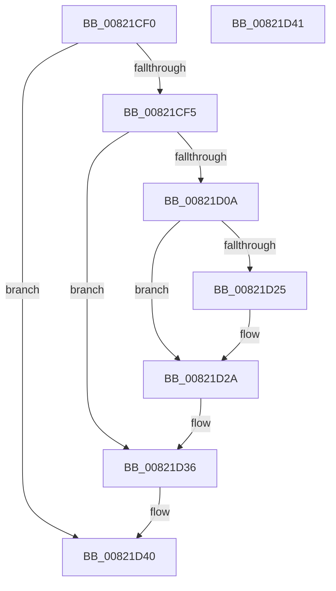

# AslpFileLargeMapDelete

- RVA: `0x00821CF0`–`0x00821D42` (길이 `82` bytes)
- VA: `0x0000000140821CF0`
- 실행 섹션: `PAGE`
- PDB 이름 있음: `예`; PDB Function 태그: `아니요`
- unwind 정보 RVA: `0x00084918`
- 디코드: `25`개 명령, `82/82` bytes 표시
- 미해석 바이트: `0` (있으면 어셈블리에 `.byte`로 보존)

> 이 문서는 커널 이미지의 기계어와 PDB 기호를 분석해 생성했습니다. 4번과 5번은 함수 원형과 자료형을 바이너리 사용 방식에서 추정한 C 해석이며 원본 소스 복구 결과는 아닙니다.

## 1. Dependencies

- 직접 호출 지점: **4**; 고유 호출 대상: **3**
- 직접 호출자로 확인된 함수: **2**
- RIP 상대 이미지 참조: **0**

### Outgoing calls
- `0x00821D0E` → [AslpFilePartialViewFree](AslpFilePartialViewFree_function_00821D48.md) (function, `0x00821D48`)
- `0x00821D17` → [AslpFilePartialViewFree](AslpFilePartialViewFree_function_00821D48.md) (function, `0x00821D48`)
- `0x00821D25` → [ZwClose](../../text/6A/ZwClose_function_006AD2B0.md) (function, `0x006AD2B0`)
- `0x00821D2D` → [AslFree](../95/AslFree_function_0095B674.md) (function, `0x0095B674`)

### Direct callers
- [AslpFileLargeEnsureLargeFileMapping](AslpFileLargeEnsureLargeFileMapping_function_00821538.md) at `0x008216A2`
- [AslpFileLargeEnsureLargeFileMapping](AslpFileLargeEnsureLargeFileMapping_function_00821538.md) at `0x008216C2`
- [AslpFileLargeMapCreate](AslpFileLargeMapCreate_function_00821A88.md) at `0x00821CC7`

### Static image references
- 디코드된 RIP-relative 메모리 참조가 없습니다.

## 2. Other-region calls and transfers

- 다른 실행 섹션으로 향하는 call: **1**
  - `0x00821D25` → [ZwClose](../../text/6A/ZwClose_function_006AD2B0.md) (`PAGE` → `.text`)
- 별도 외부 분기/꼬리 이동을 확인하지 못했습니다.

## 3. Assembly (complete function range)

```asm
00821CF0  48 85 C9                        test rcx, rcx
00821CF3  74 4B                           je 0x140821d40
00821CF5  48 89 5C 24 08                  mov qword ptr [rsp + 8], rbx
00821CFA  57                              push rdi
00821CFB  48 83 EC 20                     sub rsp, 0x20
00821CFF  48 8B 19                        mov rbx, qword ptr [rcx]
00821D02  48 8B F9                        mov rdi, rcx
00821D05  48 85 DB                        test rbx, rbx
00821D08  74 2C                           je 0x140821d36
00821D0A  48 8D 4B 30                     lea rcx, [rbx + 0x30]
00821D0E  E8 35 00 00 00                  call 0x140821d48
00821D13  48 8D 4B 10                     lea rcx, [rbx + 0x10]
00821D17  E8 2C 00 00 00                  call 0x140821d48
00821D1C  48 8B 4B 08                     mov rcx, qword ptr [rbx + 8]
00821D20  48 85 C9                        test rcx, rcx
00821D23  74 05                           je 0x140821d2a
00821D25  E8 86 B5 E8 FF                  call 0x1406ad2b0
00821D2A  48 8B D3                        mov rdx, rbx
00821D2D  E8 42 99 13 00                  call 0x14095b674
00821D32  48 83 27 00                     and qword ptr [rdi], 0
00821D36  48 8B 5C 24 30                  mov rbx, qword ptr [rsp + 0x30]
00821D3B  48 83 C4 20                     add rsp, 0x20
00821D3F  5F                              pop rdi
00821D40  C3                              ret
00821D41  CC                              int3
```

## 4. C-style interpretation (structured pseudocode)

```c
__int64 __fastcall AslpFileLargeMapDelete(__int64 a1)
{
    __int64 result;
    __int64 v_rsp;
    unsigned __int64 v_stack_p8;

    if (a1 == 0) goto loc_00821D40;
    v_stack_p8 = v_rbx;
    v_rsp = (v_rsp) - (32);
    if (*(unsigned __int64 *)(a1) == 0) goto loc_00821D36;
    result = AslpFilePartialViewFree(*(unsigned __int64 *)(a1) + 48, a2, a3, a4);
    result = AslpFilePartialViewFree(*(unsigned __int64 *)(a1) + 16, a2, a3, a4);
    if (*(unsigned __int64 *)(*(unsigned __int64 *)(a1) + 8) != 0) {
        result = ZwClose(*(unsigned __int64 *)(*(unsigned __int64 *)(a1) + 8), a2, a3, a4);
    }
    result = AslFree(*(unsigned __int64 *)(*(unsigned __int64 *)(a1) + 8), *(unsigned __int64 *)(a1), a3, a4);
loc_00821D36:
    v_rsp = (v_rsp) + (32);
loc_00821D40:
    return result;
}
```

## 5. (Beta) C Style

```c
int64_t AslpFileLargeMapDelete(int64_t Arg1)
{
    int64_t result;
    int64_t local_rsp;
    uint64_t v_stack_p8;

    if (Arg1 == 0) goto loc_00821D40;
    v_stack_p8 = local_rbx;
    local_rsp = (local_rsp) - (32);
    if (*(uint64_t *)(Arg1) == 0) goto loc_00821D36;
    result = AslpFilePartialViewFree(*(uint64_t *)(Arg1) + 48, a2, a3, a4);
    result = AslpFilePartialViewFree(*(uint64_t *)(Arg1) + 16, a2, a3, a4);
    if (*(uint64_t *)(*(uint64_t *)(Arg1) + 0x8) != 0) {
        result = ZwClose(*(uint64_t *)(*(uint64_t *)(Arg1) + 0x8), a2, a3, a4);
    }
    result = AslFree(*(uint64_t *)(*(uint64_t *)(Arg1) + 0x8), *(uint64_t *)(Arg1), a3, a4);
loc_00821D36:
    local_rsp = (local_rsp) + (32);
loc_00821D40:
    return result;
}
```

## 6. Execution-region graph

[열기: 2D/3D 그래프와 함수 탐색 컨트롤 패널](../../../control-panel.html?section=page&rva=0x00821CF0&view=graph)

- 2D 그래프는 위에서 아래로 흐르고, 3D 그래프는 빈 공간을 드래그해 회전합니다. Shift+드래그는 이동, 휠은 확대·축소, 함수 노드 선택은 대상 보고서 이동입니다.

### Static fallback


