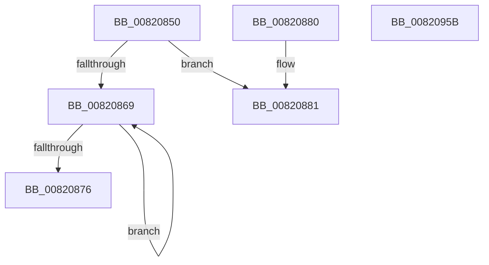

# AslpFileMakeBinVersionAttributes

- RVA: `0x00820850`–`0x0082095C` (길이 `268` bytes)
- VA: `0x0000000140820850`
- 실행 섹션: `PAGE`
- PDB 이름 있음: `예`; PDB Function 태그: `아니요`
- unwind 정보 RVA: `0x000DB714`
- 디코드: `56`개 명령, `268/268` bytes 표시
- 미해석 바이트: `0` (있으면 어셈블리에 `.byte`로 보존)

> 이 문서는 커널 이미지의 기계어와 PDB 기호를 분석해 생성했습니다. 4번과 5번은 함수 원형과 자료형을 바이너리 사용 방식에서 추정한 C 해석이며 원본 소스 복구 결과는 아닙니다.

## 1. Dependencies

- 직접 호출 지점: **0**; 고유 호출 대상: **0**
- 직접 호출자로 확인된 함수: **1**
- RIP 상대 이미지 참조: **0**

### Outgoing calls
- 직접 디코드된 call 명령이 없습니다.

### Direct callers
- [AslpFileGetVersionAttributes](../81/AslpFileGetVersionAttributes_function_0081F968.md) at `0x0081FA00`

### Static image references
- 디코드된 RIP-relative 메모리 참조가 없습니다.

## 2. Other-region calls and transfers

- 다른 실행 섹션으로 향하는 call: **0**
- 별도 외부 분기/꼬리 이동을 확인하지 못했습니다.

## 3. Assembly (complete function range)

```asm
00820850  41 B9 04 00 00 00               mov r9d, 4
00820856  4C 8D 81 B8 01 00 00            lea r8, [rcx + 0x1b8]
0082085D  4C 8B D2                        mov r10, rdx
00820860  48 85 D2                        test rdx, rdx
00820863  41 8D 51 FE                     lea edx, [r9 - 2]
00820867  75 18                           jne 0x140820881
00820869  41 09 10                        or dword ptr [r8], edx
0082086C  4D 8D 40 20                     lea r8, [r8 + 0x20]
00820870  49 83 E9 01                     sub r9, 1
00820874  75 F3                           jne 0x140820869
00820876  09 91 98 00 00 00               or dword ptr [rcx + 0x98], edx
0082087C  09 51 78                        or dword ptr [rcx + 0x78], edx
0082087F  C3                              ret
00820880  CC                              int3
00820881  89 91 A0 01 00 00               mov dword ptr [rcx + 0x1a0], edx
00820887  4C 89 89 A8 01 00 00            mov qword ptr [rcx + 0x1a8], r9
0082088E  41 8B 42 2C                     mov eax, dword ptr [r10 + 0x2c]
00820892  41 83 08 01                     or dword ptr [r8], 1
00820896  41 B8 03 00 00 00               mov r8d, 3
0082089C  48 89 81 B0 01 00 00            mov qword ptr [rcx + 0x1b0], rax
008208A3  89 91 C0 01 00 00               mov dword ptr [rcx + 0x1c0], edx
008208A9  4C 89 89 C8 01 00 00            mov qword ptr [rcx + 0x1c8], r9
008208B0  41 8B 42 30                     mov eax, dword ptr [r10 + 0x30]
008208B4  83 89 D8 01 00 00 01            or dword ptr [rcx + 0x1d8], 1
008208BB  48 89 81 D0 01 00 00            mov qword ptr [rcx + 0x1d0], rax
008208C2  89 91 E0 01 00 00               mov dword ptr [rcx + 0x1e0], edx
008208C8  4C 89 89 E8 01 00 00            mov qword ptr [rcx + 0x1e8], r9
008208CF  41 8B 42 20                     mov eax, dword ptr [r10 + 0x20]
008208D3  83 89 F8 01 00 00 01            or dword ptr [rcx + 0x1f8], 1
008208DA  48 89 81 F0 01 00 00            mov qword ptr [rcx + 0x1f0], rax
008208E1  89 91 00 02 00 00               mov dword ptr [rcx + 0x200], edx
008208E7  41 8D 50 05                     lea edx, [r8 + 5]
008208EB  4C 89 89 08 02 00 00            mov qword ptr [rcx + 0x208], r9
008208F2  41 8B 42 24                     mov eax, dword ptr [r10 + 0x24]
008208F6  83 89 18 02 00 00 01            or dword ptr [rcx + 0x218], 1
008208FD  48 89 81 10 02 00 00            mov qword ptr [rcx + 0x210], rax
00820904  41 8B 42 14                     mov eax, dword ptr [r10 + 0x14]
00820908  89 44 24 10                     mov dword ptr [rsp + 0x10], eax
0082090C  41 8B 42 10                     mov eax, dword ptr [r10 + 0x10]
00820910  83 89 98 00 00 00 01            or dword ptr [rcx + 0x98], 1
00820917  89 44 24 14                     mov dword ptr [rsp + 0x14], eax
0082091B  48 8B 44 24 10                  mov rax, qword ptr [rsp + 0x10]
00820920  48 89 81 90 00 00 00            mov qword ptr [rcx + 0x90], rax
00820927  44 89 81 80 00 00 00            mov dword ptr [rcx + 0x80], r8d
0082092E  48 89 91 88 00 00 00            mov qword ptr [rcx + 0x88], rdx
00820935  41 8B 42 0C                     mov eax, dword ptr [r10 + 0xc]
00820939  89 44 24 10                     mov dword ptr [rsp + 0x10], eax
0082093D  41 8B 42 08                     mov eax, dword ptr [r10 + 8]
00820941  83 49 78 01                     or dword ptr [rcx + 0x78], 1
00820945  89 44 24 14                     mov dword ptr [rsp + 0x14], eax
00820949  48 8B 44 24 10                  mov rax, qword ptr [rsp + 0x10]
0082094E  48 89 41 70                     mov qword ptr [rcx + 0x70], rax
00820952  44 89 41 60                     mov dword ptr [rcx + 0x60], r8d
00820956  48 89 51 68                     mov qword ptr [rcx + 0x68], rdx
0082095A  C3                              ret
0082095B  CC                              int3
```

## 4. C-style interpretation (structured pseudocode)

```c
__int64 __fastcall AslpFileMakeBinVersionAttributes(__int64 a1, __int64 a2)
{
    unsigned int v_stack_p10;
    unsigned int v_stack_p14;

    if (a2 != 0) goto loc_00820881;
loc_00820869:
    a4 = (4) - (1);
    if (condition_is_not_equal) goto loc_00820869;
    return result;
loc_00820881:
    *(unsigned int *)(a1 + 416) = (unsigned int)(4 - 2);
    *(unsigned __int64 *)(a1 + 424) = a4;
    *(unsigned __int64 *)(a1 + 432) = (unsigned int)(*(unsigned int *)(a2 + 44));
    *(unsigned int *)(a1 + 448) = (unsigned int)(4 - 2);
    *(unsigned __int64 *)(a1 + 456) = a4;
    *(unsigned __int64 *)(a1 + 464) = (unsigned int)(*(unsigned int *)(a2 + 48));
    *(unsigned int *)(a1 + 480) = (unsigned int)(4 - 2);
    *(unsigned __int64 *)(a1 + 488) = a4;
    *(unsigned __int64 *)(a1 + 496) = (unsigned int)(*(unsigned int *)(a2 + 32));
    *(unsigned int *)(a1 + 512) = (unsigned int)(4 - 2);
    *(unsigned __int64 *)(a1 + 520) = a4;
    *(unsigned __int64 *)(a1 + 528) = (unsigned int)(*(unsigned int *)(a2 + 36));
    v_stack_p10 = (unsigned int)((unsigned int)(*(unsigned int *)(a2 + 20)));
    v_stack_p14 = (unsigned int)((unsigned int)(*(unsigned int *)(a2 + 16)));
    *(unsigned __int64 *)(a1 + 144) = v_stack_p10;
    *(unsigned int *)(a1 + 128) = 3;
    *(unsigned __int64 *)(a1 + 136) = 3 + 5;
    v_stack_p10 = (unsigned int)((unsigned int)(*(unsigned int *)(a2 + 12)));
    v_stack_p14 = (unsigned int)((unsigned int)(*(unsigned int *)(a2 + 8)));
    *(unsigned __int64 *)(a1 + 112) = v_stack_p10;
    *(unsigned int *)(a1 + 96) = 3;
    *(unsigned __int64 *)(a1 + 104) = 3 + 5;
    return v_stack_p10;
}
```

## 5. (Beta) C Style

```c
int64_t AslpFileMakeBinVersionAttributes(void *Arg1, void *Arg2)
{
    uint8_t *arg1 = (uint8_t *)Arg1;
    uint8_t *arg2 = (uint8_t *)Arg2;

    uint32_t v_stack_p10;
    uint32_t v_stack_p14;

    if (Arg2 != NULL) goto loc_00820881;
loc_00820869:
    a4 = (4) - (1);
    if (condition_is_not_equal) goto loc_00820869;
    return result;
loc_00820881:
    *(uint32_t *)(arg1 + 0x1A0) = (uint32_t)(4 - 2);
    *(uint64_t *)(arg1 + 0x1A8) = a4;
    *(uint64_t *)(arg1 + 0x1B0) = (uint32_t)(*(uint32_t *)(arg2 + 0x2C));
    *(uint32_t *)(arg1 + 0x1C0) = (uint32_t)(4 - 2);
    *(uint64_t *)(arg1 + 0x1C8) = a4;
    *(uint64_t *)(arg1 + 0x1D0) = (uint32_t)(*(uint32_t *)(arg2 + 0x30));
    *(uint32_t *)(arg1 + 0x1E0) = (uint32_t)(4 - 2);
    *(uint64_t *)(arg1 + 0x1E8) = a4;
    *(uint64_t *)(arg1 + 0x1F0) = (uint32_t)(*(uint32_t *)(arg2 + 0x20));
    *(uint32_t *)(arg1 + 0x200) = (uint32_t)(4 - 2);
    *(uint64_t *)(arg1 + 0x208) = a4;
    *(uint64_t *)(arg1 + 0x210) = (uint32_t)(*(uint32_t *)(arg2 + 0x24));
    v_stack_p10 = (uint32_t)((uint32_t)(*(uint32_t *)(arg2 + 0x14)));
    v_stack_p14 = (uint32_t)((uint32_t)(*(uint32_t *)(arg2 + 0x10)));
    *(uint64_t *)(arg1 + 0x90) = v_stack_p10;
    *(uint32_t *)(arg1 + 0x80) = 3;
    *(uint64_t *)(arg1 + 0x88) = 3 + 5;
    v_stack_p10 = (uint32_t)((uint32_t)(*(uint32_t *)(arg2 + 0xC)));
    v_stack_p14 = (uint32_t)((uint32_t)(*(uint32_t *)(arg2 + 0x8)));
    *(uint64_t *)(arg1 + 0x70) = v_stack_p10;
    *(uint32_t *)(arg1 + 0x60) = 3;
    *(uint64_t *)(arg1 + 0x68) = 3 + 5;
    return v_stack_p10;
}
```

### 관측된 메모리 오프셋

구조체 형식이 확인되지 않은 접근은 인자 기준의 오프셋으로만 기록했습니다.

| 기준 인자 | 오프셋 표현 | 폭 (bit) | 접근 |
|---|---:|---:|---|
| `Arg1` | `+ 0x0` | `32` | `R/W` |
| `Arg1` | `+ 0x20` | `64` | `R` |
| `Arg1` | `+ 0x60` | `32` | `W` |
| `Arg1` | `+ 0x68` | `64` | `W` |
| `Arg1` | `+ 0x70` | `64` | `W` |
| `Arg1` | `+ 0x78` | `32` | `R/W` |
| `Arg1` | `+ 0x80` | `32` | `W` |
| `Arg1` | `+ 0x88` | `64` | `W` |
| `Arg1` | `+ 0x90` | `64` | `W` |
| `Arg1` | `+ 0x98` | `32` | `R/W` |
| `Arg1` | `+ 0x1A0` | `32` | `W` |
| `Arg1` | `+ 0x1A8` | `64` | `W` |
| `Arg1` | `+ 0x1B0` | `64` | `W` |
| `Arg1` | `+ 0x1B8` | `64` | `R` |
| `Arg1` | `+ 0x1C0` | `32` | `W` |
| `Arg1` | `+ 0x1C8` | `64` | `W` |
| `Arg1` | `+ 0x1D0` | `64` | `W` |
| `Arg1` | `+ 0x1D8` | `32` | `R/W` |
| `Arg1` | `+ 0x1E0` | `32` | `W` |
| `Arg1` | `+ 0x1E8` | `64` | `W` |
| `Arg1` | `+ 0x1F0` | `64` | `W` |
| `Arg1` | `+ 0x1F8` | `32` | `R/W` |
| `Arg1` | `+ 0x200` | `32` | `W` |
| `Arg1` | `+ 0x208` | `64` | `W` |
| `Arg1` | `+ 0x210` | `64` | `W` |
| `Arg1` | `+ 0x218` | `32` | `R/W` |
| `Arg2` | `+ 0x8` | `32` | `R` |
| `Arg2` | `+ 0xC` | `32` | `R` |
| `Arg2` | `+ 0x10` | `32` | `R` |
| `Arg2` | `+ 0x14` | `32` | `R` |
| `Arg2` | `+ 0x20` | `32` | `R` |
| `Arg2` | `+ 0x24` | `32` | `R` |

추가 오프셋 2개는 표에서 생략했습니다.

## 6. Execution-region graph

[열기: 2D/3D 그래프와 함수 탐색 컨트롤 패널](../../../control-panel.html?section=page&rva=0x00820850&view=graph)

- 2D 그래프는 위에서 아래로 흐르고, 3D 그래프는 빈 공간을 드래그해 회전합니다. Shift+드래그는 이동, 휠은 확대·축소, 함수 노드 선택은 대상 보고서 이동입니다.

### Static fallback


