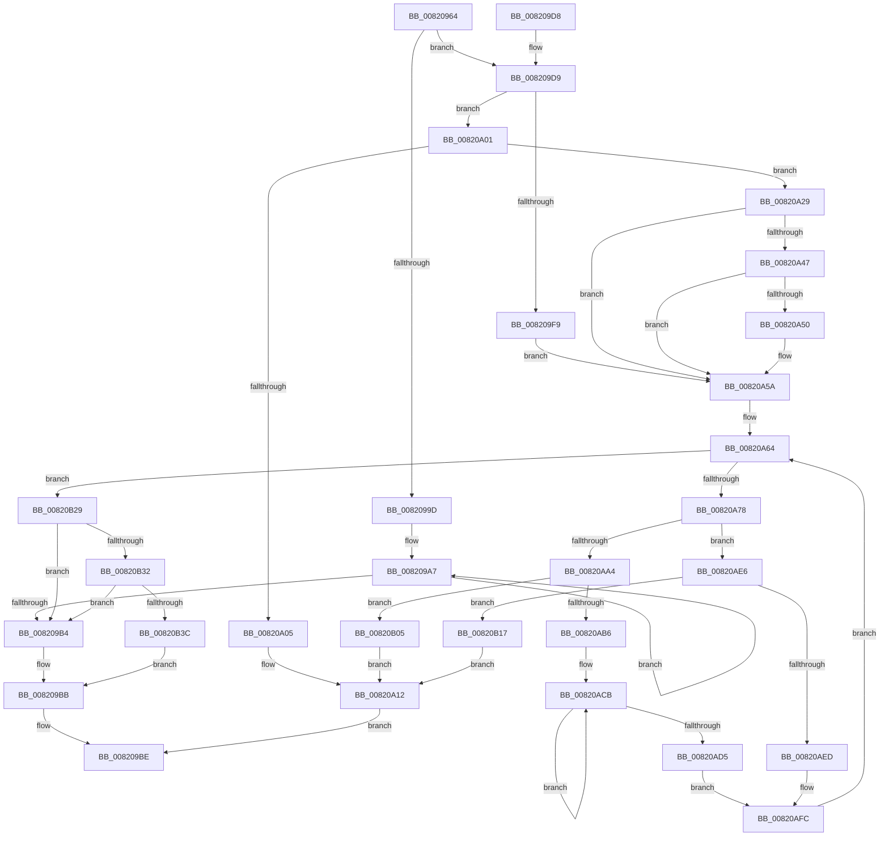

# AslpFileMakeStringVersionAttributes

- RVA: `0x00820964`–`0x00820B67` (길이 `515` bytes)
- VA: `0x0000000140820964`
- 실행 섹션: `PAGE`
- PDB 이름 있음: `예`; PDB Function 태그: `아니요`
- unwind 정보 RVA: `0x000DA064`
- 디코드: `135`개 명령, `515/515` bytes 표시
- 미해석 바이트: `0` (있으면 어셈블리에 `.byte`로 보존)

> 이 문서는 커널 이미지의 기계어와 PDB 기호를 분석해 생성했습니다. 4번과 5번은 함수 원형과 자료형을 바이너리 사용 방식에서 추정한 C 해석이며 원본 소스 복구 결과는 아닙니다.

## 1. Dependencies

- 직접 호출 지점: **5**; 고유 호출 대상: **5**
- 직접 호출자로 확인된 함수: **1**
- RIP 상대 이미지 참조: **6**

### Outgoing calls
- `0x008209EB` → [AslpFileVerQueryBlock](../AF/AslpFileVerQueryBlock_function_00AF9694.md) (function, `0x00AF9694`)
- `0x00820A22` → [AslLogCallPrintf](../95/AslLogCallPrintf_function_0095E4EC.md) (function, `0x0095E4EC`)
- `0x00820A3E` → [AslpFileVerBlockGetValueOffset](../../text/4B/AslpFileVerBlockGetValueOffset_function_004B47D8.md) (function, `0x004B47D8`)
- `0x00820A99` → [AslpFileQueryVersionString](AslpFileQueryVersionString_function_0082113C.md) (function, `0x0082113C`)
- `0x00820AAB` → [AslStringXmlSanitize](../AC/AslStringXmlSanitize_function_00ACB4B8.md) (function, `0x00ACB4B8`)

### Direct callers
- [AslpFileGetVersionAttributes](../81/AslpFileGetVersionAttributes_function_0081F968.md) at `0x0081FA08`

### Static image references
- `0x008209E4` → RVA `0x0003FCF0` (`.rdata`; read)
- `0x00820A05` → RVA `0x0003FD28` (`.rdata`; read)
- `0x00820A12` → RVA `0x0003FD50` (`.rdata`; read)
- `0x00820A64` → RVA `0x0000C010` (`.rdata`; read)
- `0x00820B05` → RVA `0x0003FD78` (`.rdata`; read)
- `0x00820B17` → RVA `0x0003FDA0` (`.rdata`; read)

## 2. Other-region calls and transfers

- 다른 실행 섹션으로 향하는 call: **1**
  - `0x00820A3E` → [AslpFileVerBlockGetValueOffset](../../text/4B/AslpFileVerBlockGetValueOffset_function_004B47D8.md) (`PAGE` → `.text`)
- 별도 외부 분기/꼬리 이동을 확인하지 못했습니다.

## 3. Assembly (complete function range)

```asm
00820964  48 89 5C 24 08                  mov qword ptr [rsp + 8], rbx
00820969  55                              push rbp
0082096A  56                              push rsi
0082096B  57                              push rdi
0082096C  41 54                           push r12
0082096E  41 55                           push r13
00820970  41 56                           push r14
00820972  41 57                           push r15
00820974  48 8B EC                        mov rbp, rsp
00820977  48 83 EC 40                     sub rsp, 0x40
0082097B  45 33 ED                        xor r13d, r13d
0082097E  4C 8B E2                        mov r12, rdx
00820981  4C 89 6D F0                     mov qword ptr [rbp - 0x10], r13
00820985  48 8B D9                        mov rbx, rcx
00820988  4C 89 6D F8                     mov qword ptr [rbp - 8], r13
0082098C  4C 89 6D 50                     mov qword ptr [rbp + 0x50], r13
00820990  4C 89 6D 48                     mov qword ptr [rbp + 0x48], r13
00820994  4C 89 6D 58                     mov qword ptr [rbp + 0x58], r13
00820998  48 85 D2                        test rdx, rdx
0082099B  75 3C                           jne 0x1408209d9
0082099D  48 8D 81 B8 00 00 00            lea rax, [rcx + 0xb8]
008209A4  8D 4A 08                        lea ecx, [rdx + 8]
008209A7  83 08 02                        or dword ptr [rax], 2
008209AA  48 8D 40 20                     lea rax, [rax + 0x20]
008209AE  48 83 E9 01                     sub rcx, 1
008209B2  75 F3                           jne 0x1408209a7
008209B4  83 8B 18 03 00 00 02            or dword ptr [rbx + 0x318], 2
008209BB  41 8B FD                        mov edi, r13d
008209BE  48 8B 9C 24 80 00 00 00         mov rbx, qword ptr [rsp + 0x80]
008209C6  8B C7                           mov eax, edi
008209C8  48 83 C4 40                     add rsp, 0x40
008209CC  41 5F                           pop r15
008209CE  41 5E                           pop r14
008209D0  41 5D                           pop r13
008209D2  41 5C                           pop r12
008209D4  5F                              pop rdi
008209D5  5E                              pop rsi
008209D6  5D                              pop rbp
008209D7  C3                              ret
008209D8  CC                              int3
008209D9  4C 8D 4D 48                     lea r9, [rbp + 0x48]
008209DD  49 8B CC                        mov rcx, r12
008209E0  4C 8D 45 50                     lea r8, [rbp + 0x50]
008209E4  48 8D 15 05 F3 81 FF            lea rdx, [rip - 0x7e0cfb]
008209EB  E8 A4 8C 2D 00                  call 0x140af9694
008209F0  8B F8                           mov edi, eax
008209F2  3D 25 02 00 C0                  cmp eax, 0xc0000225
008209F7  75 08                           jne 0x140820a01
008209F9  49 8B F5                        mov rsi, r13
008209FC  45 8B DD                        mov r11d, r13d
008209FF  EB 59                           jmp 0x140820a5a
00820A01  85 C0                           test eax, eax
00820A03  79 24                           jns 0x140820a29
00820A05  4C 8D 0D 1C F3 81 FF            lea r9, [rip - 0x7e0ce4]
00820A0C  41 B8 B0 0A 00 00               mov r8d, 0xab0
00820A12  48 8D 15 37 F3 81 FF            lea rdx, [rip - 0x7e0cc9]
00820A19  89 44 24 20                     mov dword ptr [rsp + 0x20], eax
00820A1D  B9 01 00 00 00                  mov ecx, 1
00820A22  E8 C5 DA 13 00                  call 0x14095e4ec
00820A27  EB 95                           jmp 0x1408209be
00820A29  48 8B 7D 50                     mov rdi, qword ptr [rbp + 0x50]
00820A2D  48 8D 4D 58                     lea rcx, [rbp + 0x58]
00820A31  4C 8B 45 48                     mov r8, qword ptr [rbp + 0x48]
00820A35  48 8B D7                        mov rdx, rdi
00820A38  49 8B F5                        mov rsi, r13
00820A3B  45 8B DD                        mov r11d, r13d
00820A3E  E8 95 3D C9 FF                  call 0x1404b47d8
00820A43  85 C0                           test eax, eax
00820A45  78 13                           js 0x140820a5a
00820A47  48 8B 45 58                     mov rax, qword ptr [rbp + 0x58]
00820A4B  49 3B C0                        cmp rax, r8
00820A4E  73 0A                           jae 0x140820a5a
00820A50  45 8B D8                        mov r11d, r8d
00820A53  48 8D 34 38                     lea rsi, [rax + rdi]
00820A57  44 2B D8                        sub r11d, eax
00820A5A  45 8B FB                        mov r15d, r11d
00820A5D  4D 8B F5                        mov r14, r13
00820A60  49 C1 EF 02                     shr r15, 2
00820A64  48 8D 05 A5 B5 7E FF            lea rax, [rip - 0x814a5b]
00820A6B  49 81 FE 80 00 00 00            cmp r14, 0x80
00820A72  0F 83 B1 00 00 00               jae 0x140820b29
00820A78  4D 63 2C 06                     movsxd r13, dword ptr [r14 + rax]
00820A7C  48 8D 55 F8                     lea rdx, [rbp - 8]
00820A80  49 8B 44 06 08                  mov rax, qword ptr [r14 + rax + 8]
00820A85  48 8D 4D F0                     lea rcx, [rbp - 0x10]
00820A89  48 89 44 24 28                  mov qword ptr [rsp + 0x28], rax
00820A8E  4C 8B CE                        mov r9, rsi
00820A91  4D 8B C4                        mov r8, r12
00820A94  4C 89 7C 24 20                  mov qword ptr [rsp + 0x20], r15
00820A99  E8 9E 06 00 00                  call 0x14082113c
00820A9E  8B F8                           mov edi, eax
00820AA0  85 C0                           test eax, eax
00820AA2  78 42                           js 0x140820ae6
00820AA4  4C 8B 5D F0                     mov r11, qword ptr [rbp - 0x10]
00820AA8  49 8B CB                        mov rcx, r11
00820AAB  E8 08 AA 2A 00                  call 0x140acb4b8
00820AB0  8B F8                           mov edi, eax
00820AB2  85 C0                           test eax, eax
00820AB4  78 4F                           js 0x140820b05
00820AB6  49 8B C5                        mov rax, r13
00820AB9  48 83 C9 FF                     or rcx, 0xffffffffffffffff
00820ABD  48 C1 E0 05                     shl rax, 5
00820AC1  45 33 ED                        xor r13d, r13d
00820AC4  C7 04 18 04 00 00 00            mov dword ptr [rax + rbx], 4
00820ACB  48 FF C1                        inc rcx
00820ACE  66 45 39 2C 4B                  cmp word ptr [r11 + rcx*2], r13w
00820AD3  75 F6                           jne 0x140820acb
00820AD5  83 4C 18 18 01                  or dword ptr [rax + rbx + 0x18], 1
00820ADA  48 89 4C 18 08                  mov qword ptr [rax + rbx + 8], rcx
00820ADF  4C 89 5C 18 10                  mov qword ptr [rax + rbx + 0x10], r11
00820AE4  EB 16                           jmp 0x140820afc
00820AE6  3D 25 02 00 C0                  cmp eax, 0xc0000225
00820AEB  75 2A                           jne 0x140820b17
00820AED  49 8B C5                        mov rax, r13
00820AF0  48 C1 E0 05                     shl rax, 5
00820AF4  83 4C 18 18 02                  or dword ptr [rax + rbx + 0x18], 2
00820AF9  45 33 ED                        xor r13d, r13d
00820AFC  49 83 C6 10                     add r14, 0x10
00820B00  E9 5F FF FF FF                  jmp 0x140820a64
00820B05  4C 8D 0D 6C F2 81 FF            lea r9, [rip - 0x7e0d94]
00820B0C  41 B8 DA 0A 00 00               mov r8d, 0xada
00820B12  E9 FB FE FF FF                  jmp 0x140820a12
00820B17  4C 8D 0D 82 F2 81 FF            lea r9, [rip - 0x7e0d7e]
00820B1E  41 B8 E7 0A 00 00               mov r8d, 0xae7
00820B24  E9 E9 FE FF FF                  jmp 0x140820a12
00820B29  48 85 F6                        test rsi, rsi
00820B2C  0F 84 82 FE FF FF               je 0x1408209b4
00820B32  49 83 FF 01                     cmp r15, 1
00820B36  0F 85 78 FE FF FF               jne 0x1408209b4
00820B3C  C7 83 00 03 00 00 02 00 00 00   mov dword ptr [rbx + 0x300], 2
00820B46  48 C7 83 08 03 00 00 04 00 00 00  mov qword ptr [rbx + 0x308], 4
00820B51  0F B7 06                        movzx eax, word ptr [rsi]
00820B54  44 09 BB 18 03 00 00            or dword ptr [rbx + 0x318], r15d
00820B5B  48 89 83 10 03 00 00            mov qword ptr [rbx + 0x310], rax
00820B62  E9 54 FE FF FF                  jmp 0x1408209bb
```

## 4. C-style interpretation (structured pseudocode)

```c
__int64 __fastcall AslpFileMakeStringVersionAttributes(__int64 a1, __int64 a2)
{
    __int64 result;
    __int64 v_r11;
    __int64 v_r13;
    __int64 v_r14;
    __int64 v_r15;
    __int64 v_rsi;
    __int64 v_rsp;
    unsigned __int64 v_stack_m40;
    unsigned __int64 v_stack_m48;
    unsigned __int64 v_stack_p10;
    unsigned __int64 v_stack_p18;
    unsigned __int64 v_stack_p20;
    unsigned __int64 v_stack_p28;
    unsigned __int64 v_stack_p8;

    v_stack_p8 = v_rbx;
    v_rsp = (v_rsp) - (64);
    v_r13 = 0;
    v_stack_m48 = 0;
    v_stack_m40 = 0;
    v_stack_p18 = 0;
    v_stack_p10 = 0;
    v_stack_p20 = 0;
    if (a2 != 0) goto loc_008209D9;
loc_008209A7:
    a1 = (a2 + 8) - (1);
    if (condition_is_not_equal) goto loc_008209A7;
loc_008209B4:
loc_008209BB:
loc_008209BE:
    v_rsp = (v_rsp) + (64);
    return 0;
loc_008209D9:
    result = AslpFileVerQueryBlock(a2, v_rip - 8260859, v_stack_p18, v_stack_p10);
    if (((unsigned int)(result)) != 0xC0000225ULL) goto loc_00820A01;
    goto loc_00820A5A;
loc_00820A01:
    if (!sign_flag) goto loc_00820A29;
loc_00820A12:
    v_stack_p20 = (unsigned int)(result);
    result = AslLogCallPrintf(1, v_rip - 8260809, (unsigned int)(0xAB0ULL), v_rip - 8260836);
    goto loc_008209BE;
loc_00820A29:
    result = AslpFileVerBlockGetValueOffset(v_stack_p20, v_stack_p18, v_stack_p10, v_rip - 8260836);
    if (sign_flag) goto loc_00820A5A;
    v_rsi = 0;
    v_r11 = 0;
    if (v_stack_p20 < v_stack_p10) {
        v_r11 = (unsigned int)(v_stack_p10);
        v_rsi = v_stack_p20 + v_stack_p18 * 1;
        v_r11 = (unsigned int)((v_r11) - ((unsigned int)(v_stack_p20)));
    }
    v_r15 = ((unsigned int)((unsigned int)(v_r11))) >> (2);
loc_00820A64:
    if (0 >= 128) goto loc_00820B29;
    v_stack_p28 = *(unsigned __int64 *)(0 + v_rip - 8473179 * 1 + 8);
    v_stack_p20 = v_r15;
    result = AslpFileQueryVersionString(v_stack_m48, v_stack_m40, a2, v_rsi);
    if (sign_flag) goto loc_00820AE6;
    result = AslStringXmlSanitize(v_stack_m48, v_stack_m40, a2, v_rsi);
    if (sign_flag) goto loc_00820B05;
    a1 = (v_stack_m48) | (-1);
    result = ((int)(*(unsigned int *)(0 + v_rip - 8473179 * 1))) << (5);
    v_r13 = 0;
    *(unsigned int *)(result + v_stack_p8 * 1) = 4;
loc_00820ACB:
    a1 = (a1) + 1;
    if ((*(unsigned __int16 *)(v_stack_m48 + a1 * 2)) != 0) goto loc_00820ACB;
    *(unsigned __int64 *)(result + v_stack_p8 * 1 + 8) = a1;
    *(unsigned __int64 *)(result + v_stack_p8 * 1 + 16) = v_stack_m48;
    goto loc_00820AFC;
loc_00820AE6:
    if (((unsigned int)(result)) != 0xC0000225ULL) goto loc_00820B17;
    result = (0) << (5);
    v_r13 = 0;
loc_00820AFC:
    v_r14 = (0) + (16);
    goto loc_00820A64;
loc_00820B05:
    goto loc_00820A12;
loc_00820B17:
    goto loc_00820A12;
loc_00820B29:
    if (v_rsi == 0) goto loc_008209B4;
    if (v_r15 != 1) goto loc_008209B4;
    *(unsigned int *)(v_stack_p8 + 768) = 2;
    *(unsigned __int64 *)(v_stack_p8 + 776) = 4;
    *(unsigned __int64 *)(v_stack_p8 + 784) = *(unsigned __int16 *)(v_rsi);
    goto loc_008209BB;
}
```

## 5. (Beta) C Style

```c
int64_t AslpFileMakeStringVersionAttributes(void *Arg1, int64_t Arg2)
{
    uint8_t *arg1 = (uint8_t *)Arg1;

    int64_t result;
    int64_t local_r11;
    int64_t local_r13;
    int64_t local_r14;
    int64_t local_r15;
    int64_t local_rsi;
    int64_t local_rsp;
    uint64_t v_stack_m40;
    uint64_t v_stack_m48;
    uint64_t v_stack_p10;
    uint64_t v_stack_p18;
    uint64_t v_stack_p20;
    uint64_t v_stack_p28;
    uint64_t v_stack_p8;

    v_stack_p8 = local_rbx;
    local_rsp = (local_rsp) - (64);
    local_r13 = 0;
    v_stack_m48 = 0;
    v_stack_m40 = 0;
    v_stack_p18 = 0;
    v_stack_p10 = 0;
    v_stack_p20 = 0;
    if (Arg2 != 0) goto loc_008209D9;
loc_008209A7:
    Arg1 = (Arg2 + 8) - (1);
    if (condition_is_not_equal) goto loc_008209A7;
loc_008209B4:
loc_008209BB:
loc_008209BE:
    local_rsp = (local_rsp) + (64);
    return 0;
loc_008209D9:
    result = AslpFileVerQueryBlock(Arg2, v_rip - 8260859, v_stack_p18, v_stack_p10);
    if (((uint32_t)(result)) != 0xC0000225ULL) goto loc_00820A01;
    goto loc_00820A5A;
loc_00820A01:
    if (!sign_flag) goto loc_00820A29;
loc_00820A12:
    v_stack_p20 = (uint32_t)(result);
    result = AslLogCallPrintf(1, v_rip - 8260809, (uint32_t)(0xAB0ULL), v_rip - 8260836);
    goto loc_008209BE;
loc_00820A29:
    result = AslpFileVerBlockGetValueOffset(v_stack_p20, v_stack_p18, v_stack_p10, v_rip - 8260836);
    if (sign_flag) goto loc_00820A5A;
    local_rsi = 0;
    local_r11 = 0;
    if (v_stack_p20 < v_stack_p10) {
        local_r11 = (uint32_t)(v_stack_p10);
        local_rsi = v_stack_p20 + v_stack_p18 * 1;
        local_r11 = (uint32_t)((local_r11) - ((uint32_t)(v_stack_p20)));
    }
    local_r15 = ((uint32_t)((uint32_t)(local_r11))) >> (2);
loc_00820A64:
    if (0 >= 128) goto loc_00820B29;
    v_stack_p28 = *(uint64_t *)(0 + v_rip - 0x814A5B * 1 + 0x8);
    v_stack_p20 = local_r15;
    result = AslpFileQueryVersionString(v_stack_m48, v_stack_m40, Arg2, local_rsi);
    if (sign_flag) goto loc_00820AE6;
    result = AslStringXmlSanitize(v_stack_m48, v_stack_m40, Arg2, local_rsi);
    if (sign_flag) goto loc_00820B05;
    Arg1 = (v_stack_m48) | (-1);
    result = ((int32_t)(*(uint32_t *)(0 + v_rip - 0x814A5B * 1))) << (5);
    local_r13 = 0;
    *(uint32_t *)(result + v_stack_p8 * 1) = 4;
loc_00820ACB:
    Arg1 = (Arg1) + 1;
    if ((*(uint16_t *)(v_stack_m48 + arg1 * 2)) != 0) goto loc_00820ACB;
    *(void **)(result + v_stack_p8 * 1 + 0x8) = Arg1;
    *(uint64_t *)(result + v_stack_p8 * 1 + 0x10) = v_stack_m48;
    goto loc_00820AFC;
loc_00820AE6:
    if (((uint32_t)(result)) != 0xC0000225ULL) goto loc_00820B17;
    result = (0) << (5);
    local_r13 = 0;
loc_00820AFC:
    local_r14 = (0) + (16);
    goto loc_00820A64;
loc_00820B05:
    goto loc_00820A12;
loc_00820B17:
    goto loc_00820A12;
loc_00820B29:
    if (local_rsi == 0) goto loc_008209B4;
    if (local_r15 != 1) goto loc_008209B4;
    *(uint32_t *)(v_stack_p8 + 0x300) = 2;
    *(uint64_t *)(v_stack_p8 + 0x308) = 4;
    *(uint64_t *)(v_stack_p8 + 0x310) = *(uint16_t *)(local_rsi);
    goto loc_008209BB;
}
```

### 관측된 메모리 오프셋

구조체 형식이 확인되지 않은 접근은 인자 기준의 오프셋으로만 기록했습니다.

| 기준 인자 | 오프셋 표현 | 폭 (bit) | 접근 |
|---|---:|---:|---|
| `Arg1` | `+ 0x0` | `32` | `R/W` |
| `Arg1` | `+ 0x20` | `64` | `R` |
| `Arg1` | `+ 0xB8` | `64` | `R` |
| `Arg1` | `+ 0x300` | `32` | `W` |
| `Arg1` | `+ 0x308` | `64` | `W` |
| `Arg1` | `+ 0x310` | `64` | `W` |
| `Arg1` | `+ 0x318` | `32` | `R/W` |

## 6. Execution-region graph

[열기: 2D/3D 그래프와 함수 탐색 컨트롤 패널](../../../control-panel.html?section=page&rva=0x00820964&view=graph)

- 2D 그래프는 위에서 아래로 흐르고, 3D 그래프는 빈 공간을 드래그해 회전합니다. Shift+드래그는 이동, 휠은 확대·축소, 함수 노드 선택은 대상 보고서 이동입니다.

### Static fallback


