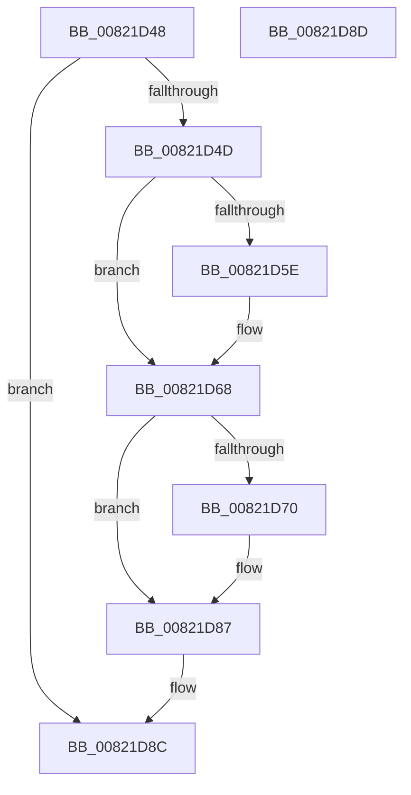

# AslpFilePartialViewFree

- RVA: `0x00821D48`–`0x00821D8E` (길이 `70` bytes)
- VA: `0x0000000140821D48`
- 실행 섹션: `PAGE`
- PDB 이름 있음: `예`; PDB Function 태그: `아니요`
- unwind 정보 RVA: `0x000805BC`
- 디코드: `22`개 명령, `70/70` bytes 표시
- 미해석 바이트: `0` (있으면 어셈블리에 `.byte`로 보존)

> 이 문서는 커널 이미지의 기계어와 PDB 기호를 분석해 생성했습니다. 4번과 5번은 함수 원형과 자료형을 바이너리 사용 방식에서 추정한 C 해석이며 원본 소스 복구 결과는 아닙니다.

## 1. Dependencies

- 직접 호출 지점: **2**; 고유 호출 대상: **2**
- 직접 호출자로 확인된 함수: **1**
- RIP 상대 이미지 참조: **0**

### Outgoing calls
- `0x00821D5E` → [MmUnsecureVirtualMemory](../88/MmUnsecureVirtualMemory_function_0088A2A0.md) (function, `0x0088A2A0`)
- `0x00821D74` → [ZwUnmapViewOfSection](../../text/6A/ZwUnmapViewOfSection_function_006AD610.md) (function, `0x006AD610`)

### Direct callers
- [AslpFileLargeMapDelete](AslpFileLargeMapDelete_function_00821CF0.md) at `0x00821D0E`
- [AslpFileLargeMapDelete](AslpFileLargeMapDelete_function_00821CF0.md) at `0x00821D17`

### Static image references
- 디코드된 RIP-relative 메모리 참조가 없습니다.

## 2. Other-region calls and transfers

- 다른 실행 섹션으로 향하는 call: **1**
  - `0x00821D74` → [ZwUnmapViewOfSection](../../text/6A/ZwUnmapViewOfSection_function_006AD610.md) (`PAGE` → `.text`)
- 별도 외부 분기/꼬리 이동을 확인하지 못했습니다.

## 3. Assembly (complete function range)

```asm
00821D48  48 85 C9                        test rcx, rcx
00821D4B  74 3F                           je 0x140821d8c
00821D4D  53                              push rbx
00821D4E  48 83 EC 20                     sub rsp, 0x20
00821D52  48 8B D9                        mov rbx, rcx
00821D55  48 8B 49 18                     mov rcx, qword ptr [rcx + 0x18]
00821D59  48 85 C9                        test rcx, rcx
00821D5C  74 0A                           je 0x140821d68
00821D5E  E8 3D 85 06 00                  call 0x14088a2a0
00821D63  48 83 63 18 00                  and qword ptr [rbx + 0x18], 0
00821D68  48 8B 13                        mov rdx, qword ptr [rbx]
00821D6B  48 85 D2                        test rdx, rdx
00821D6E  74 17                           je 0x140821d87
00821D70  48 83 C9 FF                     or rcx, 0xffffffffffffffff
00821D74  E8 97 B8 E8 FF                  call 0x1406ad610
00821D79  48 83 23 00                     and qword ptr [rbx], 0
00821D7D  48 83 63 08 00                  and qword ptr [rbx + 8], 0
00821D82  48 83 63 10 00                  and qword ptr [rbx + 0x10], 0
00821D87  48 83 C4 20                     add rsp, 0x20
00821D8B  5B                              pop rbx
00821D8C  C3                              ret
00821D8D  CC                              int3
```

## 4. C-style interpretation (structured pseudocode)

```c
__int64 __fastcall AslpFilePartialViewFree(__int64 a1)
{
    __int64 result;
    __int64 v_rsp;

    if (a1 == 0) goto loc_00821D8C;
    v_rsp = (v_rsp) - (32);
    if (*(unsigned __int64 *)(a1 + 24) != 0) {
        result = MmUnsecureVirtualMemory(*(unsigned __int64 *)(a1 + 24), a2, a3, a4);
    }
    if (*(unsigned __int64 *)(a1) != 0) {
        a1 = (*(unsigned __int64 *)(a1 + 24)) | (-1);
        result = ZwUnmapViewOfSection(a1, *(unsigned __int64 *)(a1), a3, a4);
    }
    v_rsp = (v_rsp) + (32);
loc_00821D8C:
    return result;
}
```

## 5. (Beta) C Style

```c
int64_t AslpFilePartialViewFree(int64_t Arg1)
{
    int64_t result;
    int64_t local_rsp;

    if (Arg1 == 0) goto loc_00821D8C;
    local_rsp = (local_rsp) - (32);
    if (*(uint64_t *)(Arg1 + 0x18) != 0) {
        result = MmUnsecureVirtualMemory(*(uint64_t *)(Arg1 + 0x18), a2, a3, a4);
    }
    if (*(uint64_t *)(Arg1) != 0) {
        Arg1 = (*(uint64_t *)(Arg1 + 0x18)) | (-1);
        result = ZwUnmapViewOfSection(Arg1, *(uint64_t *)(Arg1), a3, a4);
    }
    local_rsp = (local_rsp) + (32);
loc_00821D8C:
    return result;
}
```

## 6. Execution-region graph

[열기: 2D/3D 그래프와 함수 탐색 컨트롤 패널](../../../control-panel.html?section=page&rva=0x00821D48&view=graph)

- 2D 그래프는 위에서 아래로 흐르고, 3D 그래프는 빈 공간을 드래그해 회전합니다. Shift+드래그는 이동, 휠은 확대·축소, 함수 노드 선택은 대상 보고서 이동입니다.

### Static fallback


