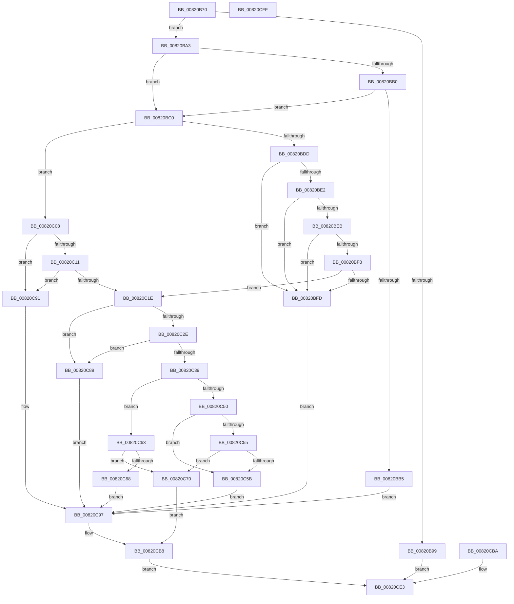

# AslpFileQuery16BitDescription

- RVA: `0x00820B70`–`0x00820D00` (길이 `400` bytes)
- VA: `0x0000000140820B70`
- 실행 섹션: `PAGE`
- PDB 이름 있음: `예`; PDB Function 태그: `아니요`
- unwind 정보 RVA: `0x000D9F2C`
- 디코드: `111`개 명령, `400/400` bytes 표시
- 미해석 바이트: `0` (있으면 어셈블리에 `.byte`로 보존)

> 이 문서는 커널 이미지의 기계어와 PDB 기호를 분석해 생성했습니다. 4번과 5번은 함수 원형과 자료형을 바이너리 사용 방식에서 추정한 C 해석이며 원본 소스 복구 결과는 아닙니다.

## 1. Dependencies

- 직접 호출 지점: **6**; 고유 호출 대상: **3**
- 직접 호출자로 확인된 함수: **1**
- RIP 상대 이미지 참조: **3**

### Outgoing calls
- `0x00820BA7` → [Feature_Servicing_MSRC131691__private_IsEnabledDeviceUsageNoInline](../../text/69/Feature_Servicing_MSRC131691__private_IsEnabledDeviceUsageNoInline_function_0069CFF4.md) (function, `0x0069CFF4`)
- `0x00820BC8` → [Feature_Servicing_MSRC131691__private_IsEnabledDeviceUsageNoInline](../../text/69/Feature_Servicing_MSRC131691__private_IsEnabledDeviceUsageNoInline_function_0069CFF4.md) (function, `0x0069CFF4`)
- `0x00820C39` → [Feature_Servicing_MSRC131691__private_IsEnabledDeviceUsageNoInline](../../text/69/Feature_Servicing_MSRC131691__private_IsEnabledDeviceUsageNoInline_function_0069CFF4.md) (function, `0x0069CFF4`)
- `0x00820C7A` → [memcpy](../../text/6C/memcpy_function_006C6840.md) (function, `0x006C6840`)
- `0x00820CB3` → [AslLogCallPrintf](../95/AslLogCallPrintf_function_0095E4EC.md) (function, `0x0095E4EC`)
- `0x00820CDD` → [AslLogCallPrintf](../95/AslLogCallPrintf_function_0095E4EC.md) (function, `0x0095E4EC`)

### Direct callers
- [AslpFileGet16BitDescription](../81/AslpFileGet16BitDescription_function_0081DE94.md) at `0x0081DEE7`

### Static image references
- `0x00820CA0` → RVA `0x00040A70` (`.rdata`; read)
- `0x00820CA7` → RVA `0x00040A88` (`.rdata`; read)
- `0x00820CC4` → RVA `0x0003EF20` (`.rdata`; read)

## 2. Other-region calls and transfers

- 다른 실행 섹션으로 향하는 call: **4**
  - `0x00820BA7` → [Feature_Servicing_MSRC131691__private_IsEnabledDeviceUsageNoInline](../../text/69/Feature_Servicing_MSRC131691__private_IsEnabledDeviceUsageNoInline_function_0069CFF4.md) (`PAGE` → `.text`)
  - `0x00820BC8` → [Feature_Servicing_MSRC131691__private_IsEnabledDeviceUsageNoInline](../../text/69/Feature_Servicing_MSRC131691__private_IsEnabledDeviceUsageNoInline_function_0069CFF4.md) (`PAGE` → `.text`)
  - `0x00820C39` → [Feature_Servicing_MSRC131691__private_IsEnabledDeviceUsageNoInline](../../text/69/Feature_Servicing_MSRC131691__private_IsEnabledDeviceUsageNoInline_function_0069CFF4.md) (`PAGE` → `.text`)
  - `0x00820C7A` → [memcpy](../../text/6C/memcpy_function_006C6840.md) (`PAGE` → `.text`)
- 별도 외부 분기/꼬리 이동을 확인하지 못했습니다.

## 3. Assembly (complete function range)

```asm
00820B70  48 89 5C 24 08                  mov qword ptr [rsp + 8], rbx
00820B75  48 89 74 24 10                  mov qword ptr [rsp + 0x10], rsi
00820B7A  48 89 7C 24 18                  mov qword ptr [rsp + 0x18], rdi
00820B7F  41 55                           push r13
00820B81  41 56                           push r14
00820B83  41 57                           push r15
00820B85  48 83 EC 40                     sub rsp, 0x40
00820B89  48 8B FA                        mov rdi, rdx
00820B8C  4C 8B F9                        mov r15, rcx
00820B8F  33 DB                           xor ebx, ebx
00820B91  88 19                           mov byte ptr [rcx], bl
00820B93  83 7A 40 05                     cmp dword ptr [rdx + 0x40], 5
00820B97  74 0A                           je 0x140820ba3
00820B99  BB BB 00 00 C0                  mov ebx, 0xc00000bb
00820B9E  E9 40 01 00 00                  jmp 0x140820ce3
00820BA3  48 8B 72 20                     mov rsi, qword ptr [rdx + 0x20]
00820BA7  E8 48 C4 E7 FF                  call 0x14069cff4
00820BAC  85 C0                           test eax, eax
00820BAE  74 10                           je 0x140820bc0
00820BB0  39 5E 3C                        cmp dword ptr [rsi + 0x3c], ebx
00820BB3  7F 0B                           jg 0x140820bc0
00820BB5  41 B8 C0 11 00 00               mov r8d, 0x11c0
00820BBB  E9 D7 00 00 00                  jmp 0x140820c97
00820BC0  4C 63 6E 3C                     movsxd r13, dword ptr [rsi + 0x3c]
00820BC4  4C 03 6F 20                     add r13, qword ptr [rdi + 0x20]
00820BC8  E8 27 C4 E7 FF                  call 0x14069cff4
00820BCD  48 8B 57 18                     mov rdx, qword ptr [rdi + 0x18]
00820BD1  48 63 4E 3C                     movsxd rcx, dword ptr [rsi + 0x3c]
00820BD5  48 83 C1 40                     add rcx, 0x40
00820BD9  85 C0                           test eax, eax
00820BDB  74 2B                           je 0x140820c08
00820BDD  48 3B D1                        cmp rdx, rcx
00820BE0  72 1B                           jb 0x140820bfd
00820BE2  4C 8B 47 28                     mov r8, qword ptr [rdi + 0x28]
00820BE6  4C 3B C1                        cmp r8, rcx
00820BE9  72 12                           jb 0x140820bfd
00820BEB  49 63 4D 2C                     movsxd rcx, dword ptr [r13 + 0x2c]
00820BEF  48 8D 41 01                     lea rax, [rcx + 1]
00820BF3  48 3B D0                        cmp rdx, rax
00820BF6  72 05                           jb 0x140820bfd
00820BF8  4C 3B C0                        cmp r8, rax
00820BFB  73 21                           jae 0x140820c1e
00820BFD  41 B8 CD 11 00 00               mov r8d, 0x11cd
00820C03  E9 8F 00 00 00                  jmp 0x140820c97
00820C08  48 3B D1                        cmp rdx, rcx
00820C0B  0F 82 80 00 00 00               jb 0x140820c91
00820C11  49 63 4D 2C                     movsxd rcx, dword ptr [r13 + 0x2c]
00820C15  48 8D 41 01                     lea rax, [rcx + 1]
00820C19  48 3B D0                        cmp rdx, rax
00820C1C  72 73                           jb 0x140820c91
00820C1E  48 63 F1                        movsxd rsi, ecx
00820C21  48 03 77 20                     add rsi, qword ptr [rdi + 0x20]
00820C25  44 0F B6 36                     movzx r14d, byte ptr [rsi]
00820C29  45 85 F6                        test r14d, r14d
00820C2C  74 5B                           je 0x140820c89
00820C2E  41 8D 46 01                     lea eax, [r14 + 1]
00820C32  3D 00 01 00 00                  cmp eax, 0x100
00820C37  77 50                           ja 0x140820c89
00820C39  E8 B6 C3 E7 FF                  call 0x14069cff4
00820C3E  4C 8B 47 18                     mov r8, qword ptr [rdi + 0x18]
00820C42  49 63 55 2C                     movsxd rdx, dword ptr [r13 + 0x2c]
00820C46  48 FF C2                        inc rdx
00820C49  49 03 D6                        add rdx, r14
00820C4C  85 C0                           test eax, eax
00820C4E  74 13                           je 0x140820c63
00820C50  4C 3B C2                        cmp r8, rdx
00820C53  72 06                           jb 0x140820c5b
00820C55  48 39 57 28                     cmp qword ptr [rdi + 0x28], rdx
00820C59  73 15                           jae 0x140820c70
00820C5B  41 B8 E7 11 00 00               mov r8d, 0x11e7
00820C61  EB 34                           jmp 0x140820c97
00820C63  4C 3B C2                        cmp r8, rdx
00820C66  73 08                           jae 0x140820c70
00820C68  41 B8 EE 11 00 00               mov r8d, 0x11ee
00820C6E  EB 27                           jmp 0x140820c97
00820C70  48 8D 56 01                     lea rdx, [rsi + 1]
00820C74  4D 8B C6                        mov r8, r14
00820C77  49 8B CF                        mov rcx, r15
00820C7A  E8 C1 5B EA FF                  call 0x1406c6840
00820C7F  43 88 1C 3E                     mov byte ptr [r14 + r15], bl
00820C83  89 5C 24 30                     mov dword ptr [rsp + 0x30], ebx
00820C87  EB 2F                           jmp 0x140820cb8
00820C89  41 B8 DF 11 00 00               mov r8d, 0x11df
00820C8F  EB 06                           jmp 0x140820c97
00820C91  41 B8 D5 11 00 00               mov r8d, 0x11d5
00820C97  BB 7B 00 00 C0                  mov ebx, 0xc000007b
00820C9C  89 5C 24 30                     mov dword ptr [rsp + 0x30], ebx
00820CA0  4C 8D 0D C9 FD 81 FF            lea r9, [rip - 0x7e0237]
00820CA7  48 8D 15 DA FD 81 FF            lea rdx, [rip - 0x7e0226]
00820CAE  B9 01 00 00 00                  mov ecx, 1
00820CB3  E8 34 D8 13 00                  call 0x14095e4ec
00820CB8  EB 29                           jmp 0x140820ce3
00820CBA  8B D8                           mov ebx, eax
00820CBC  89 44 24 30                     mov dword ptr [rsp + 0x30], eax
00820CC0  89 44 24 20                     mov dword ptr [rsp + 0x20], eax
00820CC4  4C 8D 0D 55 E2 81 FF            lea r9, [rip - 0x7e1dab]
00820CCB  41 B8 FA 11 00 00               mov r8d, 0x11fa
00820CD1  48 8D 15 B0 FD 81 FF            lea rdx, [rip - 0x7e0250]
00820CD8  B9 01 00 00 00                  mov ecx, 1
00820CDD  E8 0A D8 13 00                  call 0x14095e4ec
00820CE2  90                              nop
00820CE3  8B C3                           mov eax, ebx
00820CE5  48 8B 5C 24 60                  mov rbx, qword ptr [rsp + 0x60]
00820CEA  48 8B 74 24 68                  mov rsi, qword ptr [rsp + 0x68]
00820CEF  48 8B 7C 24 70                  mov rdi, qword ptr [rsp + 0x70]
00820CF4  48 83 C4 40                     add rsp, 0x40
00820CF8  41 5F                           pop r15
00820CFA  41 5E                           pop r14
00820CFC  41 5D                           pop r13
00820CFE  C3                              ret
00820CFF  CC                              int3
```

## 4. C-style interpretation (structured pseudocode)

```c
__int64 __fastcall AslpFileQuery16BitDescription(__int64 a1, __int64 a2)
{
    __int64 result;
    __int64 v_r13;
    __int64 v_rbx;
    __int64 v_rsi;
    __int64 v_rsp;
    unsigned int v_stack_m28;
    unsigned int v_stack_m38;
    unsigned __int64 v_stack_p10;
    unsigned __int64 v_stack_p18;
    unsigned __int64 v_stack_p8;

    v_stack_p8 = v_rbx;
    v_stack_p10 = v_rsi;
    v_stack_p18 = v_rdi;
    v_rsp = (v_rsp) - (64);
    v_rbx = 0;
    *(unsigned __int8 *)(a1) = 0;
    if ((*(unsigned int *)(a2 + 64)) == 5) goto loc_00820BA3;
    goto loc_00820CE3;
loc_00820BA3:
    result = Feature_Servicing_MSRC131691__private_IsEnabledDeviceUsageNoInline(a1, a2, a3, a4);
    if ((unsigned int)(result) == 0) goto loc_00820BC0;
    if ((*(unsigned int *)(*(unsigned __int64 *)(a2 + 32) + 60)) > ((unsigned int)((unsigned int)(0xC00000BBULL)))) goto loc_00820BC0;
    goto loc_00820C97;
loc_00820BC0:
    v_r13 = ((int)(*(unsigned int *)(*(unsigned __int64 *)(a2 + 32) + 60))) + (*(unsigned __int64 *)(a2 + 32));
    result = Feature_Servicing_MSRC131691__private_IsEnabledDeviceUsageNoInline(a1, a2, (unsigned int)(0x11C0ULL), a4);
    a1 = ((int)(*(unsigned int *)(*(unsigned __int64 *)(a2 + 32) + 60))) + (64);
    if ((unsigned int)(result) == 0) goto loc_00820C08;
    if ((*(unsigned __int64 *)(a2 + 24)) < a1) goto loc_00820BFD;
    if ((*(unsigned __int64 *)(a2 + 40)) < a1) goto loc_00820BFD;
    if ((*(unsigned __int64 *)(a2 + 24)) < ((int)(*(unsigned int *)(v_r13 + 44)) + 1)) goto loc_00820BFD;
    if ((*(unsigned __int64 *)(a2 + 40)) >= ((int)(*(unsigned int *)(v_r13 + 44)) + 1)) goto loc_00820C1E;
loc_00820BFD:
    goto loc_00820C97;
loc_00820C08:
    if ((*(unsigned __int64 *)(a2 + 24)) < ((int)(*(unsigned int *)(v_r13 + 44)))) goto loc_00820C91;
    if ((*(unsigned __int64 *)(a2 + 24)) < ((int)(*(unsigned int *)(v_r13 + 44)) + 1)) goto loc_00820C91;
loc_00820C1E:
    v_rsi = ((int)((unsigned int)((int)(*(unsigned int *)(v_r13 + 44))))) + (*(unsigned __int64 *)(a2 + 32));
    if ((unsigned int)(*(unsigned __int8 *)(v_rsi)) == 0) goto loc_00820C89;
    if (((unsigned int)(*(unsigned __int8 *)(v_rsi) + 1)) > 256) goto loc_00820C89;
    result = Feature_Servicing_MSRC131691__private_IsEnabledDeviceUsageNoInline((int)(*(unsigned int *)(v_r13 + 44)), *(unsigned __int64 *)(a2 + 24), (unsigned int)(0x11CDULL), a4);
    a2 = ((int)(*(unsigned int *)(v_r13 + 44))) + 1;
    a2 = (a2) + (*(unsigned __int8 *)(v_rsi));
    if ((unsigned int)(result) == 0) goto loc_00820C63;
    if ((*(unsigned __int64 *)(a2 + 24)) < a2) goto loc_00820C5B;
    if ((*(unsigned __int64 *)(a2 + 40)) >= a2) goto loc_00820C70;
loc_00820C5B:
    goto loc_00820C97;
loc_00820C63:
    if (((unsigned int)(0x11E7ULL)) >= a2) goto loc_00820C70;
    goto loc_00820C97;
loc_00820C70:
    result = memcpy(a1, v_rsi + 1, *(unsigned __int8 *)(v_rsi), a4);
    *(unsigned __int8 *)(*(unsigned __int8 *)(v_rsi) + a1 * 1) = (unsigned __int8)((unsigned int)(0xC00000BBULL));
    v_stack_m28 = (unsigned int)((unsigned int)(0xC00000BBULL));
    goto loc_00820CB8;
loc_00820C89:
    goto loc_00820C97;
loc_00820C91:
loc_00820C97:
    v_stack_m28 = (unsigned int)((unsigned int)(0xC000007BULL));
    result = AslLogCallPrintf(1, v_rip - 8258086, (unsigned int)(0x11D5ULL), v_rip - 8258103);
loc_00820CB8:
    goto loc_00820CE3;
loc_00820CE3:
    v_rsp = (v_rsp) + (64);
    return (unsigned int)((unsigned int)((unsigned int)(0xC000007BULL)));
}
```

## 5. (Beta) C Style

```c
int64_t AslpFileQuery16BitDescription(void *Arg1, void *Arg2)
{
    uint8_t *arg1 = (uint8_t *)Arg1;
    uint8_t *arg2 = (uint8_t *)Arg2;

    int64_t result;
    int64_t local_r13;
    int64_t local_rbx;
    int64_t local_rsi;
    int64_t local_rsp;
    uint32_t v_stack_m28;
    uint32_t v_stack_m38;
    uint64_t v_stack_p10;
    uint64_t v_stack_p18;
    uint64_t v_stack_p8;

    v_stack_p8 = local_rbx;
    v_stack_p10 = local_rsi;
    v_stack_p18 = local_rdi;
    local_rsp = (local_rsp) - (64);
    local_rbx = 0;
    *(uint8_t *)(arg1) = 0;
    if ((*(uint32_t *)(arg2 + 0x40)) == 5) goto loc_00820BA3;
    goto loc_00820CE3;
loc_00820BA3:
    result = Feature_Servicing_MSRC131691__private_IsEnabledDeviceUsageNoInline(Arg1, Arg2, a3, a4);
    if ((uint32_t)(result) == 0) goto loc_00820BC0;
    if ((*(uint32_t *)(*(uint64_t *)(arg2 + 0x20) + 0x3C)) > ((uint32_t)((uint32_t)(0xC00000BBULL)))) goto loc_00820BC0;
    goto loc_00820C97;
loc_00820BC0:
    local_r13 = ((int32_t)(*(uint32_t *)(*(uint64_t *)(arg2 + 0x20) + 0x3C))) + (*(uint64_t *)(arg2 + 0x20));
    result = Feature_Servicing_MSRC131691__private_IsEnabledDeviceUsageNoInline(Arg1, Arg2, (uint32_t)(0x11C0ULL), a4);
    Arg1 = ((int32_t)(*(uint32_t *)(*(uint64_t *)(arg2 + 0x20) + 0x3C))) + (64);
    if ((uint32_t)(result) == 0) goto loc_00820C08;
    if ((*(uint64_t *)(arg2 + 0x18)) < Arg1) goto loc_00820BFD;
    if ((*(uint64_t *)(arg2 + 0x28)) < Arg1) goto loc_00820BFD;
    if ((*(uint64_t *)(arg2 + 0x18)) < ((int32_t)(*(uint32_t *)(local_r13 + 0x2C)) + 1)) goto loc_00820BFD;
    if ((*(uint64_t *)(arg2 + 0x28)) >= ((int32_t)(*(uint32_t *)(local_r13 + 0x2C)) + 1)) goto loc_00820C1E;
loc_00820BFD:
    goto loc_00820C97;
loc_00820C08:
    if ((*(uint64_t *)(arg2 + 0x18)) < ((int32_t)(*(uint32_t *)(local_r13 + 0x2C)))) goto loc_00820C91;
    if ((*(uint64_t *)(arg2 + 0x18)) < ((int32_t)(*(uint32_t *)(local_r13 + 0x2C)) + 1)) goto loc_00820C91;
loc_00820C1E:
    local_rsi = ((int32_t)((uint32_t)((int32_t)(*(uint32_t *)(local_r13 + 0x2C))))) + (*(uint64_t *)(arg2 + 0x20));
    if ((uint32_t)(*(uint8_t *)(local_rsi)) == 0) goto loc_00820C89;
    if (((uint32_t)(*(uint8_t *)(local_rsi) + 1)) > 256) goto loc_00820C89;
    result = Feature_Servicing_MSRC131691__private_IsEnabledDeviceUsageNoInline((int32_t)(*(uint32_t *)(local_r13 + 0x2C)), *(uint64_t *)(arg2 + 0x18), (uint32_t)(0x11CDULL), a4);
    Arg2 = ((int32_t)(*(uint32_t *)(local_r13 + 0x2C))) + 1;
    Arg2 = (Arg2) + (*(uint8_t *)(local_rsi));
    if ((uint32_t)(result) == 0) goto loc_00820C63;
    if ((*(uint64_t *)(arg2 + 0x18)) < Arg2) goto loc_00820C5B;
    if ((*(uint64_t *)(arg2 + 0x28)) >= Arg2) goto loc_00820C70;
loc_00820C5B:
    goto loc_00820C97;
loc_00820C63:
    if (((uint32_t)(0x11E7ULL)) >= Arg2) goto loc_00820C70;
    goto loc_00820C97;
loc_00820C70:
    result = memcpy(Arg1, local_rsi + 1, *(uint8_t *)(local_rsi), a4);
    *(uint8_t *)(*(uint8_t *)(local_rsi) + arg1 * 1) = (uint8_t)((uint32_t)(0xC00000BBULL));
    v_stack_m28 = (uint32_t)((uint32_t)(0xC00000BBULL));
    goto loc_00820CB8;
loc_00820C89:
    goto loc_00820C97;
loc_00820C91:
loc_00820C97:
    v_stack_m28 = (uint32_t)((uint32_t)(0xC000007BULL));
    result = AslLogCallPrintf(1, v_rip - 8258086, (uint32_t)(0x11D5ULL), v_rip - 8258103);
loc_00820CB8:
    goto loc_00820CE3;
loc_00820CE3:
    local_rsp = (local_rsp) + (64);
    return (uint32_t)((uint32_t)((uint32_t)(0xC000007BULL)));
}
```

### 관측된 메모리 오프셋

구조체 형식이 확인되지 않은 접근은 인자 기준의 오프셋으로만 기록했습니다.

| 기준 인자 | 오프셋 표현 | 폭 (bit) | 접근 |
|---|---:|---:|---|
| `Arg1` | `+ 0x0` | `8` | `W` |
| `Arg2` | `+ 0x18` | `64` | `R` |
| `Arg2` | `+ 0x20` | `64` | `R` |
| `Arg2` | `+ 0x28` | `64` | `R` |
| `Arg2` | `+ 0x40` | `32` | `R` |

## 6. Execution-region graph

[열기: 2D/3D 그래프와 함수 탐색 컨트롤 패널](../../../control-panel.html?section=page&rva=0x00820B70&view=graph)

- 2D 그래프는 위에서 아래로 흐르고, 3D 그래프는 빈 공간을 드래그해 회전합니다. Shift+드래그는 이동, 휠은 확대·축소, 함수 노드 선택은 대상 보고서 이동입니다.

### Static fallback


