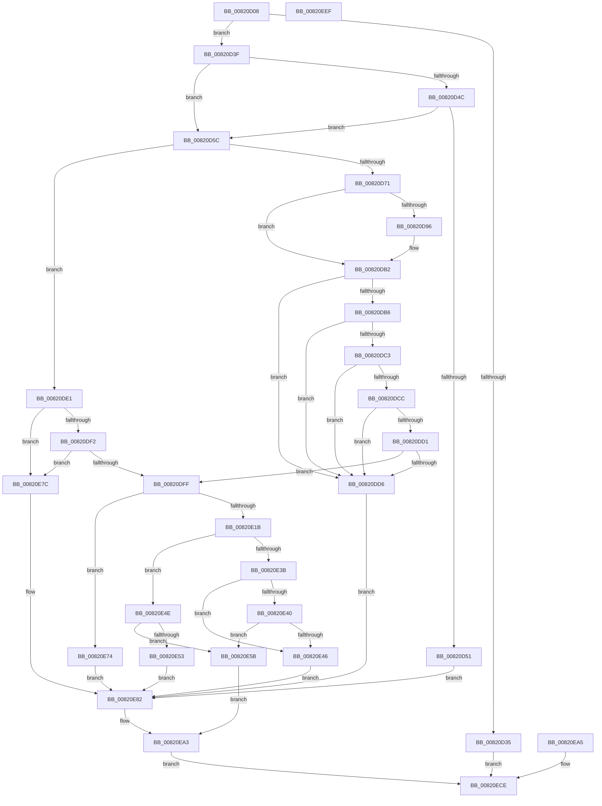

# AslpFileQuery16BitModuleName

- RVA: `0x00820D08`–`0x00820EF0` (길이 `488` bytes)
- VA: `0x0000000140820D08`
- 실행 섹션: `PAGE`
- PDB 이름 있음: `예`; PDB Function 태그: `아니요`
- unwind 정보 RVA: `0x000D9EF4`
- 디코드: `139`개 명령, `488/488` bytes 표시
- 미해석 바이트: `0` (있으면 어셈블리에 `.byte`로 보존)

> 이 문서는 커널 이미지의 기계어와 PDB 기호를 분석해 생성했습니다. 4번과 5번은 함수 원형과 자료형을 바이너리 사용 방식에서 추정한 C 해석이며 원본 소스 복구 결과는 아닙니다.

## 1. Dependencies

- 직접 호출 지점: **6**; 고유 호출 대상: **3**
- 직접 호출자로 확인된 함수: **1**
- RIP 상대 이미지 참조: **3**

### Outgoing calls
- `0x00820D43` → [Feature_Servicing_MSRC131691__private_IsEnabledDeviceUsageNoInline](../../text/69/Feature_Servicing_MSRC131691__private_IsEnabledDeviceUsageNoInline_function_0069CFF4.md) (function, `0x0069CFF4`)
- `0x00820D64` → [Feature_Servicing_MSRC131691__private_IsEnabledDeviceUsageNoInline](../../text/69/Feature_Servicing_MSRC131691__private_IsEnabledDeviceUsageNoInline_function_0069CFF4.md) (function, `0x0069CFF4`)
- `0x00820E1B` → [Feature_Servicing_MSRC131691__private_IsEnabledDeviceUsageNoInline](../../text/69/Feature_Servicing_MSRC131691__private_IsEnabledDeviceUsageNoInline_function_0069CFF4.md) (function, `0x0069CFF4`)
- `0x00820E65` → [memcpy](../../text/6C/memcpy_function_006C6840.md) (function, `0x006C6840`)
- `0x00820E9E` → [AslLogCallPrintf](../95/AslLogCallPrintf_function_0095E4EC.md) (function, `0x0095E4EC`)
- `0x00820EC8` → [AslLogCallPrintf](../95/AslLogCallPrintf_function_0095E4EC.md) (function, `0x0095E4EC`)

### Direct callers
- [AslpFileGet16BitModuleName](../81/AslpFileGet16BitModuleName_function_0081DF78.md) at `0x0081DFCB`

### Static image references
- `0x00820E8B` → RVA `0x00040A70` (`.rdata`; read)
- `0x00820E92` → RVA `0x00040AA8` (`.rdata`; read)
- `0x00820EAF` → RVA `0x0003EF20` (`.rdata`; read)

## 2. Other-region calls and transfers

- 다른 실행 섹션으로 향하는 call: **4**
  - `0x00820D43` → [Feature_Servicing_MSRC131691__private_IsEnabledDeviceUsageNoInline](../../text/69/Feature_Servicing_MSRC131691__private_IsEnabledDeviceUsageNoInline_function_0069CFF4.md) (`PAGE` → `.text`)
  - `0x00820D64` → [Feature_Servicing_MSRC131691__private_IsEnabledDeviceUsageNoInline](../../text/69/Feature_Servicing_MSRC131691__private_IsEnabledDeviceUsageNoInline_function_0069CFF4.md) (`PAGE` → `.text`)
  - `0x00820E1B` → [Feature_Servicing_MSRC131691__private_IsEnabledDeviceUsageNoInline](../../text/69/Feature_Servicing_MSRC131691__private_IsEnabledDeviceUsageNoInline_function_0069CFF4.md) (`PAGE` → `.text`)
  - `0x00820E65` → [memcpy](../../text/6C/memcpy_function_006C6840.md) (`PAGE` → `.text`)
- 별도 외부 분기/꼬리 이동을 확인하지 못했습니다.

## 3. Assembly (complete function range)

```asm
00820D08  48 8B C4                        mov rax, rsp
00820D0B  48 89 58 08                     mov qword ptr [rax + 8], rbx
00820D0F  48 89 70 10                     mov qword ptr [rax + 0x10], rsi
00820D13  48 89 78 18                     mov qword ptr [rax + 0x18], rdi
00820D17  4C 89 60 20                     mov qword ptr [rax + 0x20], r12
00820D1B  41 55                           push r13
00820D1D  41 56                           push r14
00820D1F  41 57                           push r15
00820D21  48 83 EC 40                     sub rsp, 0x40
00820D25  48 8B FA                        mov rdi, rdx
00820D28  4C 8B F9                        mov r15, rcx
00820D2B  33 DB                           xor ebx, ebx
00820D2D  88 19                           mov byte ptr [rcx], bl
00820D2F  83 7A 40 05                     cmp dword ptr [rdx + 0x40], 5
00820D33  74 0A                           je 0x140820d3f
00820D35  BB BB 00 00 C0                  mov ebx, 0xc00000bb
00820D3A  E9 8F 01 00 00                  jmp 0x140820ece
00820D3F  48 8B 72 20                     mov rsi, qword ptr [rdx + 0x20]
00820D43  E8 AC C2 E7 FF                  call 0x14069cff4
00820D48  85 C0                           test eax, eax
00820D4A  74 10                           je 0x140820d5c
00820D4C  39 5E 3C                        cmp dword ptr [rsi + 0x3c], ebx
00820D4F  7F 0B                           jg 0x140820d5c
00820D51  41 B8 2C 12 00 00               mov r8d, 0x122c
00820D57  E9 26 01 00 00                  jmp 0x140820e82
00820D5C  4C 63 76 3C                     movsxd r14, dword ptr [rsi + 0x3c]
00820D60  4C 03 77 20                     add r14, qword ptr [rdi + 0x20]
00820D64  E8 8B C2 E7 FF                  call 0x14069cff4
00820D69  4C 63 4E 3C                     movsxd r9, dword ptr [rsi + 0x3c]
00820D6D  85 C0                           test eax, eax
00820D6F  74 70                           je 0x140820de1
00820D71  41 0F B7 4E 26                  movzx ecx, word ptr [r14 + 0x26]
00820D76  49 03 C9                        add rcx, r9
00820D79  49 83 CA FF                     or r10, 0xffffffffffffffff
00820D7D  4D 8B C2                        mov r8, r10
00820D80  49 3B C9                        cmp rcx, r9
00820D83  4C 0F 43 C1                     cmovae r8, rcx
00820D87  1B C0                           sbb eax, eax
00820D89  BA 95 00 00 C0                  mov edx, 0xc0000095
00820D8E  23 C2                           and eax, edx
00820D90  89 44 24 30                     mov dword ptr [rsp + 0x30], eax
00820D94  7C 1C                           jl 0x140820db2
00820D96  49 8B C8                        mov rcx, r8
00820D99  49 8D 40 01                     lea rax, [r8 + 1]
00820D9D  49 3B C0                        cmp rax, r8
00820DA0  4C 0F 43 D0                     cmovae r10, rax
00820DA4  4D 8B C2                        mov r8, r10
00820DA7  48 3B C1                        cmp rax, rcx
00820DAA  1B C0                           sbb eax, eax
00820DAC  23 C2                           and eax, edx
00820DAE  89 44 24 30                     mov dword ptr [rsp + 0x30], eax
00820DB2  85 C0                           test eax, eax
00820DB4  78 20                           js 0x140820dd6
00820DB6  49 8D 49 40                     lea rcx, [r9 + 0x40]
00820DBA  48 8B 57 18                     mov rdx, qword ptr [rdi + 0x18]
00820DBE  48 3B D1                        cmp rdx, rcx
00820DC1  72 13                           jb 0x140820dd6
00820DC3  48 8B 47 28                     mov rax, qword ptr [rdi + 0x28]
00820DC7  48 3B C1                        cmp rax, rcx
00820DCA  72 0A                           jb 0x140820dd6
00820DCC  49 3B D0                        cmp rdx, r8
00820DCF  72 05                           jb 0x140820dd6
00820DD1  49 3B C0                        cmp rax, r8
00820DD4  73 29                           jae 0x140820dff
00820DD6  41 B8 41 12 00 00               mov r8d, 0x1241
00820DDC  E9 A1 00 00 00                  jmp 0x140820e82
00820DE1  48 8B 4F 18                     mov rcx, qword ptr [rdi + 0x18]
00820DE5  49 8D 41 40                     lea rax, [r9 + 0x40]
00820DE9  48 3B C8                        cmp rcx, rax
00820DEC  0F 82 8A 00 00 00               jb 0x140820e7c
00820DF2  41 0F B7 46 26                  movzx eax, word ptr [r14 + 0x26]
00820DF7  48 FF C0                        inc rax
00820DFA  48 3B C8                        cmp rcx, rax
00820DFD  72 7D                           jb 0x140820e7c
00820DFF  41 0F B7 46 26                  movzx eax, word ptr [r14 + 0x26]
00820E04  4C 8B 6F 20                     mov r13, qword ptr [rdi + 0x20]
00820E08  4C 03 E8                        add r13, rax
00820E0B  49 63 C1                        movsxd rax, r9d
00820E0E  4C 03 E8                        add r13, rax
00820E11  45 0F B6 65 00                  movzx r12d, byte ptr [r13]
00820E16  45 84 E4                        test r12b, r12b
00820E19  74 59                           je 0x140820e74
00820E1B  E8 D4 C1 E7 FF                  call 0x14069cff4
00820E20  4C 8B 47 18                     mov r8, qword ptr [rdi + 0x18]
00820E24  41 0F B7 4E 26                  movzx ecx, word ptr [r14 + 0x26]
00820E29  8B 56 3C                        mov edx, dword ptr [rsi + 0x3c]
00820E2C  03 D1                           add edx, ecx
00820E2E  48 63 D2                        movsxd rdx, edx
00820E31  48 FF C2                        inc rdx
00820E34  49 03 D4                        add rdx, r12
00820E37  85 C0                           test eax, eax
00820E39  74 13                           je 0x140820e4e
00820E3B  4C 3B C2                        cmp r8, rdx
00820E3E  72 06                           jb 0x140820e46
00820E40  48 39 57 28                     cmp qword ptr [rdi + 0x28], rdx
00820E44  73 15                           jae 0x140820e5b
00820E46  41 B8 5B 12 00 00               mov r8d, 0x125b
00820E4C  EB 34                           jmp 0x140820e82
00820E4E  4C 3B C2                        cmp r8, rdx
00820E51  73 08                           jae 0x140820e5b
00820E53  41 B8 62 12 00 00               mov r8d, 0x1262
00820E59  EB 27                           jmp 0x140820e82
00820E5B  49 8D 55 01                     lea rdx, [r13 + 1]
00820E5F  4D 8B C4                        mov r8, r12
00820E62  49 8B CF                        mov rcx, r15
00820E65  E8 D6 59 EA FF                  call 0x1406c6840
00820E6A  43 88 1C 3C                     mov byte ptr [r12 + r15], bl
00820E6E  89 5C 24 30                     mov dword ptr [rsp + 0x30], ebx
00820E72  EB 2F                           jmp 0x140820ea3
00820E74  41 B8 53 12 00 00               mov r8d, 0x1253
00820E7A  EB 06                           jmp 0x140820e82
00820E7C  41 B8 49 12 00 00               mov r8d, 0x1249
00820E82  BB 7B 00 00 C0                  mov ebx, 0xc000007b
00820E87  89 5C 24 30                     mov dword ptr [rsp + 0x30], ebx
00820E8B  4C 8D 0D DE FB 81 FF            lea r9, [rip - 0x7e0422]
00820E92  48 8D 15 0F FC 81 FF            lea rdx, [rip - 0x7e03f1]
00820E99  B9 01 00 00 00                  mov ecx, 1
00820E9E  E8 49 D6 13 00                  call 0x14095e4ec
00820EA3  EB 29                           jmp 0x140820ece
00820EA5  8B D8                           mov ebx, eax
00820EA7  89 44 24 30                     mov dword ptr [rsp + 0x30], eax
00820EAB  89 44 24 20                     mov dword ptr [rsp + 0x20], eax
00820EAF  4C 8D 0D 6A E0 81 FF            lea r9, [rip - 0x7e1f96]
00820EB6  41 B8 6E 12 00 00               mov r8d, 0x126e
00820EBC  48 8D 15 E5 FB 81 FF            lea rdx, [rip - 0x7e041b]
00820EC3  B9 01 00 00 00                  mov ecx, 1
00820EC8  E8 1F D6 13 00                  call 0x14095e4ec
00820ECD  90                              nop
00820ECE  8B C3                           mov eax, ebx
00820ED0  48 8B 5C 24 60                  mov rbx, qword ptr [rsp + 0x60]
00820ED5  48 8B 74 24 68                  mov rsi, qword ptr [rsp + 0x68]
00820EDA  48 8B 7C 24 70                  mov rdi, qword ptr [rsp + 0x70]
00820EDF  4C 8B 64 24 78                  mov r12, qword ptr [rsp + 0x78]
00820EE4  48 83 C4 40                     add rsp, 0x40
00820EE8  41 5F                           pop r15
00820EEA  41 5E                           pop r14
00820EEC  41 5D                           pop r13
00820EEE  C3                              ret
00820EEF  CC                              int3
```

## 4. C-style interpretation (structured pseudocode)

```c
__int64 __fastcall AslpFileQuery16BitModuleName(__int64 a1, __int64 a2)
{
    __int64 result;
    __int64 v_r10;
    __int64 v_r13;
    __int64 v_r14;
    __int64 v_rbx;
    __int64 v_rsp;
    unsigned int v_stack_m28;
    unsigned int v_stack_m38;
    unsigned __int64 v_stack_p10;
    unsigned __int64 v_stack_p18;
    unsigned __int64 v_stack_p20;
    unsigned __int64 v_stack_p8;

    *(unsigned __int64 *)(v_rsp + 8) = v_rbx;
    *(unsigned __int64 *)(v_rsp + 16) = v_rsi;
    *(unsigned __int64 *)(v_rsp + 24) = v_rdi;
    *(unsigned __int64 *)(v_rsp + 32) = v_r12;
    v_rsp = (v_rsp) - (64);
    v_rbx = 0;
    *(unsigned __int8 *)(a1) = 0;
    if ((*(unsigned int *)(a2 + 64)) == 5) goto loc_00820D3F;
    goto loc_00820ECE;
loc_00820D3F:
    result = Feature_Servicing_MSRC131691__private_IsEnabledDeviceUsageNoInline(a1, a2, a3, a4);
    if ((unsigned int)(result) == 0) goto loc_00820D5C;
    if ((*(unsigned int *)(*(unsigned __int64 *)(a2 + 32) + 60)) > ((unsigned int)((unsigned int)(0xC00000BBULL)))) goto loc_00820D5C;
    goto loc_00820E82;
loc_00820D5C:
    v_r14 = ((int)(*(unsigned int *)(*(unsigned __int64 *)(a2 + 32) + 60))) + (*(unsigned __int64 *)(a2 + 32));
    result = Feature_Servicing_MSRC131691__private_IsEnabledDeviceUsageNoInline(a1, a2, (unsigned int)(0x122CULL), a4);
    if ((unsigned int)(result) == 0) goto loc_00820DE1;
    a1 = (*(unsigned __int16 *)(v_r14 + 38)) + ((int)(*(unsigned int *)(*(unsigned __int64 *)(a2 + 32) + 60)));
    v_r10 = (v_r10) | (-1);
    a3 = v_r10;
    if (a1 >= ((int)(*(unsigned int *)(*(unsigned __int64 *)(a2 + 32) + 60)))) { a3 = a1; }
    result = (unsigned int)((result) & ((unsigned int)((unsigned int)(0xC0000095ULL))));
    v_stack_m28 = (unsigned int)(result);
    if (!(condition_is_less)) {
        a1 = a3;
        result = a3 + 1;
        if (result >= a3) { v_r10 = result; }
        a3 = v_r10;
        result = (unsigned int)((result) & ((unsigned int)((unsigned int)(0xC0000095ULL))));
        v_stack_m28 = (unsigned int)(result);
    }
    if (sign_flag) goto loc_00820DD6;
    if ((*(unsigned __int64 *)(a2 + 24)) < ((int)(*(unsigned int *)(*(unsigned __int64 *)(a2 + 32) + 60)) + 64)) goto loc_00820DD6;
    if ((*(unsigned __int64 *)(a2 + 40)) < ((int)(*(unsigned int *)(*(unsigned __int64 *)(a2 + 32) + 60)) + 64)) goto loc_00820DD6;
    if ((*(unsigned __int64 *)(a2 + 24)) < a3) goto loc_00820DD6;
    if ((*(unsigned __int64 *)(a2 + 40)) >= a3) goto loc_00820DFF;
loc_00820DD6:
    goto loc_00820E82;
loc_00820DE1:
    if ((*(unsigned __int64 *)(a2 + 24)) < ((int)(*(unsigned int *)(*(unsigned __int64 *)(a2 + 32) + 60)) + 64)) goto loc_00820E7C;
    result = (*(unsigned __int16 *)(v_r14 + 38)) + 1;
    if ((*(unsigned __int64 *)(a2 + 24)) < result) goto loc_00820E7C;
loc_00820DFF:
    v_r13 = (*(unsigned __int64 *)(a2 + 32)) + (*(unsigned __int16 *)(v_r14 + 38));
    v_r13 = (v_r13) + ((int)((unsigned int)((int)(*(unsigned int *)(*(unsigned __int64 *)(a2 + 32) + 60)))));
    if ((unsigned __int8)(*(unsigned __int8 *)(v_r13)) == 0) goto loc_00820E74;
    result = Feature_Servicing_MSRC131691__private_IsEnabledDeviceUsageNoInline(*(unsigned __int64 *)(a2 + 24), *(unsigned __int64 *)(a2 + 24), (unsigned int)(0x1241ULL), (int)(*(unsigned int *)(*(unsigned __int64 *)(a2 + 32) + 60)));
    a2 = (unsigned int)(((unsigned int)(*(unsigned int *)(*(unsigned __int64 *)(a2 + 32) + 60))) + ((unsigned int)(*(unsigned __int16 *)(v_r14 + 38))));
    a2 = ((int)((unsigned int)(a2))) + 1;
    a2 = (a2) + (*(unsigned __int8 *)(v_r13));
    if ((unsigned int)(result) == 0) goto loc_00820E4E;
    if ((*(unsigned __int64 *)(a2 + 24)) < a2) goto loc_00820E46;
    if ((*(unsigned __int64 *)(a2 + 40)) >= a2) goto loc_00820E5B;
loc_00820E46:
    goto loc_00820E82;
loc_00820E4E:
    if (((unsigned int)(0x125BULL)) >= a2) goto loc_00820E5B;
    goto loc_00820E82;
loc_00820E5B:
    result = memcpy(a1, v_r13 + 1, *(unsigned __int8 *)(v_r13), (int)(*(unsigned int *)(*(unsigned __int64 *)(a2 + 32) + 60)));
    *(unsigned __int8 *)(*(unsigned __int8 *)(v_r13) + a1 * 1) = (unsigned __int8)((unsigned int)(0xC00000BBULL));
    v_stack_m28 = (unsigned int)((unsigned int)(0xC00000BBULL));
    goto loc_00820EA3;
loc_00820E74:
    goto loc_00820E82;
loc_00820E7C:
loc_00820E82:
    v_stack_m28 = (unsigned int)((unsigned int)(0xC000007BULL));
    result = AslLogCallPrintf(1, v_rip - 8258545, (unsigned int)(0x1249ULL), v_rip - 8258594);
loc_00820EA3:
    goto loc_00820ECE;
loc_00820ECE:
    v_rsp = (v_rsp) + (64);
    return (unsigned int)((unsigned int)((unsigned int)(0xC000007BULL)));
}
```

## 5. (Beta) C Style

```c
int64_t AslpFileQuery16BitModuleName(void *Arg1, void *Arg2)
{
    uint8_t *arg1 = (uint8_t *)Arg1;
    uint8_t *arg2 = (uint8_t *)Arg2;

    int64_t result;
    int64_t local_r10;
    int64_t local_r13;
    int64_t local_r14;
    int64_t local_rbx;
    int64_t local_rsp;
    uint32_t v_stack_m28;
    uint32_t v_stack_m38;
    uint64_t v_stack_p10;
    uint64_t v_stack_p18;
    uint64_t v_stack_p20;
    uint64_t v_stack_p8;

    *(uint64_t *)(local_rsp + 0x8) = local_rbx;
    *(uint64_t *)(local_rsp + 0x10) = local_rsi;
    *(uint64_t *)(local_rsp + 0x18) = local_rdi;
    *(uint64_t *)(local_rsp + 0x20) = local_r12;
    local_rsp = (local_rsp) - (64);
    local_rbx = 0;
    *(uint8_t *)(arg1) = 0;
    if ((*(uint32_t *)(arg2 + 0x40)) == 5) goto loc_00820D3F;
    goto loc_00820ECE;
loc_00820D3F:
    result = Feature_Servicing_MSRC131691__private_IsEnabledDeviceUsageNoInline(Arg1, Arg2, a3, a4);
    if ((uint32_t)(result) == 0) goto loc_00820D5C;
    if ((*(uint32_t *)(*(uint64_t *)(arg2 + 0x20) + 0x3C)) > ((uint32_t)((uint32_t)(0xC00000BBULL)))) goto loc_00820D5C;
    goto loc_00820E82;
loc_00820D5C:
    local_r14 = ((int32_t)(*(uint32_t *)(*(uint64_t *)(arg2 + 0x20) + 0x3C))) + (*(uint64_t *)(arg2 + 0x20));
    result = Feature_Servicing_MSRC131691__private_IsEnabledDeviceUsageNoInline(Arg1, Arg2, (uint32_t)(0x122CULL), a4);
    if ((uint32_t)(result) == 0) goto loc_00820DE1;
    Arg1 = (*(uint16_t *)(local_r14 + 0x26)) + ((int32_t)(*(uint32_t *)(*(uint64_t *)(arg2 + 0x20) + 0x3C)));
    local_r10 = (local_r10) | (-1);
    a3 = local_r10;
    if (Arg1 >= ((int32_t)(*(uint32_t *)(*(uint64_t *)(arg2 + 0x20) + 0x3C)))) { a3 = Arg1; }
    result = (uint32_t)((result) & ((uint32_t)((uint32_t)(0xC0000095ULL))));
    v_stack_m28 = (uint32_t)(result);
    if (!(condition_is_less)) {
        Arg1 = a3;
        result = a3 + 1;
        if (result >= a3) { local_r10 = result; }
        a3 = local_r10;
        result = (uint32_t)((result) & ((uint32_t)((uint32_t)(0xC0000095ULL))));
        v_stack_m28 = (uint32_t)(result);
    }
    if (sign_flag) goto loc_00820DD6;
    if ((*(uint64_t *)(arg2 + 0x18)) < ((int32_t)(*(uint32_t *)(*(uint64_t *)(arg2 + 0x20) + 0x3C)) + 64)) goto loc_00820DD6;
    if ((*(uint64_t *)(arg2 + 0x28)) < ((int32_t)(*(uint32_t *)(*(uint64_t *)(arg2 + 0x20) + 0x3C)) + 64)) goto loc_00820DD6;
    if ((*(uint64_t *)(arg2 + 0x18)) < a3) goto loc_00820DD6;
    if ((*(uint64_t *)(arg2 + 0x28)) >= a3) goto loc_00820DFF;
loc_00820DD6:
    goto loc_00820E82;
loc_00820DE1:
    if ((*(uint64_t *)(arg2 + 0x18)) < ((int32_t)(*(uint32_t *)(*(uint64_t *)(arg2 + 0x20) + 0x3C)) + 64)) goto loc_00820E7C;
    result = (*(uint16_t *)(local_r14 + 0x26)) + 1;
    if ((*(uint64_t *)(arg2 + 0x18)) < result) goto loc_00820E7C;
loc_00820DFF:
    local_r13 = (*(uint64_t *)(arg2 + 0x20)) + (*(uint16_t *)(local_r14 + 0x26));
    local_r13 = (local_r13) + ((int32_t)((uint32_t)((int32_t)(*(uint32_t *)(*(uint64_t *)(arg2 + 0x20) + 0x3C)))));
    if ((uint8_t)(*(uint8_t *)(local_r13)) == 0) goto loc_00820E74;
    result = Feature_Servicing_MSRC131691__private_IsEnabledDeviceUsageNoInline(*(uint64_t *)(arg2 + 0x18), *(uint64_t *)(arg2 + 0x18), (uint32_t)(0x1241ULL), (int32_t)(*(uint32_t *)(*(uint64_t *)(arg2 + 0x20) + 0x3C)));
    Arg2 = (uint32_t)(((uint32_t)(*(uint32_t *)(*(uint64_t *)(arg2 + 0x20) + 0x3C))) + ((uint32_t)(*(uint16_t *)(local_r14 + 0x26))));
    Arg2 = ((int32_t)((uint32_t)(Arg2))) + 1;
    Arg2 = (Arg2) + (*(uint8_t *)(local_r13));
    if ((uint32_t)(result) == 0) goto loc_00820E4E;
    if ((*(uint64_t *)(arg2 + 0x18)) < Arg2) goto loc_00820E46;
    if ((*(uint64_t *)(arg2 + 0x28)) >= Arg2) goto loc_00820E5B;
loc_00820E46:
    goto loc_00820E82;
loc_00820E4E:
    if (((uint32_t)(0x125BULL)) >= Arg2) goto loc_00820E5B;
    goto loc_00820E82;
loc_00820E5B:
    result = memcpy(Arg1, local_r13 + 1, *(uint8_t *)(local_r13), (int32_t)(*(uint32_t *)(*(uint64_t *)(arg2 + 0x20) + 0x3C)));
    *(uint8_t *)(*(uint8_t *)(local_r13) + arg1 * 1) = (uint8_t)((uint32_t)(0xC00000BBULL));
    v_stack_m28 = (uint32_t)((uint32_t)(0xC00000BBULL));
    goto loc_00820EA3;
loc_00820E74:
    goto loc_00820E82;
loc_00820E7C:
loc_00820E82:
    v_stack_m28 = (uint32_t)((uint32_t)(0xC000007BULL));
    result = AslLogCallPrintf(1, v_rip - 8258545, (uint32_t)(0x1249ULL), v_rip - 8258594);
loc_00820EA3:
    goto loc_00820ECE;
loc_00820ECE:
    local_rsp = (local_rsp) + (64);
    return (uint32_t)((uint32_t)((uint32_t)(0xC000007BULL)));
}
```

### 관측된 메모리 오프셋

구조체 형식이 확인되지 않은 접근은 인자 기준의 오프셋으로만 기록했습니다.

| 기준 인자 | 오프셋 표현 | 폭 (bit) | 접근 |
|---|---:|---:|---|
| `Arg1` | `+ 0x0` | `8` | `W` |
| `Arg2` | `+ 0x18` | `64` | `R` |
| `Arg2` | `+ 0x20` | `64` | `R` |
| `Arg2` | `+ 0x28` | `64` | `R` |
| `Arg2` | `+ 0x40` | `32` | `R` |

## 6. Execution-region graph

[열기: 2D/3D 그래프와 함수 탐색 컨트롤 패널](../../../control-panel.html?section=page&rva=0x00820D08&view=graph)

- 2D 그래프는 위에서 아래로 흐르고, 3D 그래프는 빈 공간을 드래그해 회전합니다. Shift+드래그는 이동, 휠은 확대·축소, 함수 노드 선택은 대상 보고서 이동입니다.

### Static fallback


