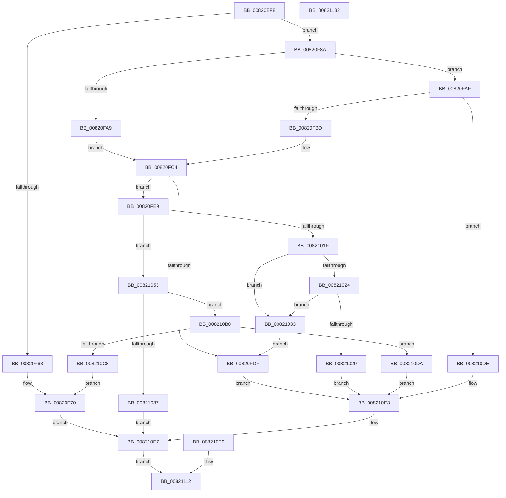

# AslpFileQueryExportName

- RVA: `0x00820EF8`–`0x00821133` (길이 `571` bytes)
- VA: `0x0000000140820EF8`
- 실행 섹션: `PAGE`
- PDB 이름 있음: `예`; PDB Function 태그: `아니요`
- unwind 정보 RVA: `0x000D9F7C`
- 디코드: `139`개 명령, `571/571` bytes 표시
- 미해석 바이트: `0` (있으면 어셈블리에 `.byte`로 보존)

> 이 문서는 커널 이미지의 기계어와 PDB 기호를 분석해 생성했습니다. 4번과 5번은 함수 원형과 자료형을 바이너리 사용 방식에서 추정한 C 해석이며 원본 소스 복구 결과는 아닙니다.

## 1. Dependencies

- 직접 호출 지점: **11**; 고유 호출 대상: **5**
- 직접 호출자로 확인된 함수: **1**
- RIP 상대 이미지 참조: **6**

### Outgoing calls
- `0x00820F54` → [AslpFileGetImageNtHeader](../81/AslpFileGetImageNtHeader_function_0081F434.md) (function, `0x0081F434`)
- `0x00820F80` → [AslLogCallPrintf](../95/AslLogCallPrintf_function_0095E4EC.md) (function, `0x0095E4EC`)
- `0x00820FD6` → [AslpMemorySpanCheckBounds](../../text/69/AslpMemorySpanCheckBounds_function_0069D424.md) (function, `0x0069D424`)
- `0x00820FF6` → [AslpImageRvaToVa](AslpImageRvaToVa_function_008214BC.md) (function, `0x008214BC`)
- `0x00821016` → [AslpMemorySpanCheckBounds](../../text/69/AslpMemorySpanCheckBounds_function_0069D424.md) (function, `0x0069D424`)
- `0x0082104C` → [AslLogCallPrintf](../95/AslLogCallPrintf_function_0095E4EC.md) (function, `0x0095E4EC`)
- `0x0082105D` → [AslpImageRvaToVa](AslpImageRvaToVa_function_008214BC.md) (function, `0x008214BC`)
- `0x0082107E` → [AslpMemorySpanCheckBounds](../../text/69/AslpMemorySpanCheckBounds_function_0069D424.md) (function, `0x0069D424`)
- `0x008210A9` → [AslLogCallPrintf](../95/AslLogCallPrintf_function_0095E4EC.md) (function, `0x0095E4EC`)
- `0x008210B9` → [RtlStringCchCopyA](../../text/46/RtlStringCchCopyA_function_00460628.md) (function, `0x00460628`)
- `0x0082110C` → [AslLogCallPrintf](../95/AslLogCallPrintf_function_0095E4EC.md) (function, `0x0095E4EC`)

### Direct callers
- [AslpFileGetExportName](../81/AslpFileGetExportName_function_0081ED30.md) at `0x0081ED6F`

### Static image references
- `0x00820F63` → RVA `0x0003EED8` (`.rdata`; read)
- `0x00820F74` → RVA `0x00040920` (`.rdata`; read)
- `0x00821033` → RVA `0x00040938` (`.rdata`; read)
- `0x00821090` → RVA `0x00040970` (`.rdata`; read)
- `0x008210C8` → RVA `0x000409B0` (`.rdata`; read)
- `0x008210F3` → RVA `0x0003EF20` (`.rdata`; read)

## 2. Other-region calls and transfers

- 다른 실행 섹션으로 향하는 call: **4**
  - `0x00820FD6` → [AslpMemorySpanCheckBounds](../../text/69/AslpMemorySpanCheckBounds_function_0069D424.md) (`PAGE` → `.text`)
  - `0x00821016` → [AslpMemorySpanCheckBounds](../../text/69/AslpMemorySpanCheckBounds_function_0069D424.md) (`PAGE` → `.text`)
  - `0x0082107E` → [AslpMemorySpanCheckBounds](../../text/69/AslpMemorySpanCheckBounds_function_0069D424.md) (`PAGE` → `.text`)
  - `0x008210B9` → [RtlStringCchCopyA](../../text/46/RtlStringCchCopyA_function_00460628.md) (`PAGE` → `.text`)
- 별도 외부 분기/꼬리 이동을 확인하지 못했습니다.

## 3. Assembly (complete function range)

```asm
00820EF8  4C 8B DC                        mov r11, rsp
00820EFB  49 89 5B 10                     mov qword ptr [r11 + 0x10], rbx
00820EFF  49 89 73 18                     mov qword ptr [r11 + 0x18], rsi
00820F03  49 89 7B 20                     mov qword ptr [r11 + 0x20], rdi
00820F07  41 54                           push r12
00820F09  41 56                           push r14
00820F0B  41 57                           push r15
00820F0D  48 81 EC 80 00 00 00            sub rsp, 0x80
00820F14  48 8B F2                        mov rsi, rdx
00820F17  4C 8B F1                        mov r14, rcx
00820F1A  49 83 63 08 00                  and qword ptr [r11 + 8], 0
00820F1F  48 8B 42 20                     mov rax, qword ptr [rdx + 0x20]
00820F23  49 89 43 C8                     mov qword ptr [r11 - 0x38], rax
00820F27  48 8B 42 28                     mov rax, qword ptr [rdx + 0x28]
00820F2B  49 89 43 D0                     mov qword ptr [r11 - 0x30], rax
00820F2F  49 83 63 A8 00                  and qword ptr [r11 - 0x58], 0
00820F34  49 83 63 B0 00                  and qword ptr [r11 - 0x50], 0
00820F39  49 83 63 B8 00                  and qword ptr [r11 - 0x48], 0
00820F3E  49 83 63 C0 00                  and qword ptr [r11 - 0x40], 0
00820F43  49 83 63 D8 00                  and qword ptr [r11 - 0x28], 0
00820F48  49 83 63 E0 00                  and qword ptr [r11 - 0x20], 0
00820F4D  C6 01 00                        mov byte ptr [rcx], 0
00820F50  49 8D 4B 08                     lea rcx, [r11 + 8]
00820F54  E8 DB E4 FF FF                  call 0x14081f434
00820F59  8B D8                           mov ebx, eax
00820F5B  89 44 24 30                     mov dword ptr [rsp + 0x30], eax
00820F5F  85 C0                           test eax, eax
00820F61  79 27                           jns 0x140820f8a
00820F63  4C 8D 0D 6E DF 81 FF            lea r9, [rip - 0x7e2092]
00820F6A  41 B8 04 11 00 00               mov r8d, 0x1104
00820F70  89 44 24 20                     mov dword ptr [rsp + 0x20], eax
00820F74  48 8D 15 A5 F9 81 FF            lea rdx, [rip - 0x7e065b]
00820F7B  B9 01 00 00 00                  mov ecx, 1
00820F80  E8 67 D5 13 00                  call 0x14095e4ec
00820F85  E9 5D 01 00 00                  jmp 0x1408210e7
00820F8A  48 C7 44 24 48 08 00 00 00      mov qword ptr [rsp + 0x48], 8
00820F93  48 8B BC 24 A0 00 00 00         mov rdi, qword ptr [rsp + 0xa0]
00820F9B  0F B7 47 18                     movzx eax, word ptr [rdi + 0x18]
00820F9F  B9 0B 01 00 00                  mov ecx, 0x10b
00820FA4  66 3B C1                        cmp ax, cx
00820FA7  75 06                           jne 0x140820faf
00820FA9  48 8D 5F 78                     lea rbx, [rdi + 0x78]
00820FAD  EB 15                           jmp 0x140820fc4
00820FAF  B9 0B 02 00 00                  mov ecx, 0x20b
00820FB4  66 3B C1                        cmp ax, cx
00820FB7  0F 85 21 01 00 00               jne 0x1408210de
00820FBD  48 8D 9F 88 00 00 00            lea rbx, [rdi + 0x88]
00820FC4  48 89 5C 24 40                  mov qword ptr [rsp + 0x40], rbx
00820FC9  4C 8B FB                        mov r15, rbx
00820FCC  48 8D 54 24 60                  lea rdx, [rsp + 0x60]
00820FD1  48 8D 4C 24 40                  lea rcx, [rsp + 0x40]
00820FD6  E8 49 C4 E7 FF                  call 0x14069d424
00820FDB  84 C0                           test al, al
00820FDD  75 0A                           jne 0x140820fe9
00820FDF  BB 7B 00 00 C0                  mov ebx, 0xc000007b
00820FE4  E9 FA 00 00 00                  jmp 0x1408210e3
00820FE9  4C 8D 66 08                     lea r12, [rsi + 8]
00820FED  44 8B 03                        mov r8d, dword ptr [rbx]
00820FF0  49 8B D4                        mov rdx, r12
00820FF3  48 8B CF                        mov rcx, rdi
00820FF6  E8 C1 04 00 00                  call 0x1408214bc
00820FFB  48 8B D8                        mov rbx, rax
00820FFE  48 89 44 24 50                  mov qword ptr [rsp + 0x50], rax
00821003  41 8B 77 04                     mov esi, dword ptr [r15 + 4]
00821007  48 89 74 24 58                  mov qword ptr [rsp + 0x58], rsi
0082100C  48 8D 54 24 60                  lea rdx, [rsp + 0x60]
00821011  48 8D 4C 24 50                  lea rcx, [rsp + 0x50]
00821016  E8 09 C4 E7 FF                  call 0x14069d424
0082101B  84 C0                           test al, al
0082101D  75 34                           jne 0x140821053
0082101F  48 85 F6                        test rsi, rsi
00821022  75 0F                           jne 0x140821033
00821024  48 85 DB                        test rbx, rbx
00821027  75 0A                           jne 0x140821033
00821029  BB 25 02 00 C0                  mov ebx, 0xc0000225
0082102E  E9 B0 00 00 00                  jmp 0x1408210e3
00821033  4C 8D 0D FE F8 81 FF            lea r9, [rip - 0x7e0702]
0082103A  41 B8 1E 11 00 00               mov r8d, 0x111e
00821040  48 8D 15 D9 F8 81 FF            lea rdx, [rip - 0x7e0727]
00821047  B9 02 00 00 00                  mov ecx, 2
0082104C  E8 9B D4 13 00                  call 0x14095e4ec
00821051  EB 8C                           jmp 0x140820fdf
00821053  44 8B 43 0C                     mov r8d, dword ptr [rbx + 0xc]
00821057  49 8B D4                        mov rdx, r12
0082105A  48 8B CF                        mov rcx, rdi
0082105D  E8 5A 04 00 00                  call 0x1408214bc
00821062  48 8B D8                        mov rbx, rax
00821065  48 89 44 24 70                  mov qword ptr [rsp + 0x70], rax
0082106A  BF 00 01 00 00                  mov edi, 0x100
0082106F  48 89 7C 24 78                  mov qword ptr [rsp + 0x78], rdi
00821074  48 8D 54 24 60                  lea rdx, [rsp + 0x60]
00821079  48 8D 4C 24 70                  lea rcx, [rsp + 0x70]
0082107E  E8 A1 C3 E7 FF                  call 0x14069d424
00821083  84 C0                           test al, al
00821085  75 29                           jne 0x1408210b0
00821087  BB 7B 00 00 C0                  mov ebx, 0xc000007b
0082108C  89 5C 24 30                     mov dword ptr [rsp + 0x30], ebx
00821090  4C 8D 0D D9 F8 81 FF            lea r9, [rip - 0x7e0727]
00821097  41 B8 2C 11 00 00               mov r8d, 0x112c
0082109D  48 8D 15 7C F8 81 FF            lea rdx, [rip - 0x7e0784]
008210A4  B9 02 00 00 00                  mov ecx, 2
008210A9  E8 3E D4 13 00                  call 0x14095e4ec
008210AE  EB 37                           jmp 0x1408210e7
008210B0  4C 8B C3                        mov r8, rbx
008210B3  48 8B D7                        mov rdx, rdi
008210B6  49 8B CE                        mov rcx, r14
008210B9  E8 6A F5 C3 FF                  call 0x140460628
008210BE  8B D8                           mov ebx, eax
008210C0  89 44 24 30                     mov dword ptr [rsp + 0x30], eax
008210C4  85 C0                           test eax, eax
008210C6  79 12                           jns 0x1408210da
008210C8  4C 8D 0D E1 F8 81 FF            lea r9, [rip - 0x7e071f]
008210CF  41 B8 32 11 00 00               mov r8d, 0x1132
008210D5  E9 96 FE FF FF                  jmp 0x140820f70
008210DA  33 DB                           xor ebx, ebx
008210DC  EB 05                           jmp 0x1408210e3
008210DE  BB BB 00 00 C0                  mov ebx, 0xc00000bb
008210E3  89 5C 24 30                     mov dword ptr [rsp + 0x30], ebx
008210E7  EB 29                           jmp 0x140821112
008210E9  8B D8                           mov ebx, eax
008210EB  89 44 24 30                     mov dword ptr [rsp + 0x30], eax
008210EF  89 44 24 20                     mov dword ptr [rsp + 0x20], eax
008210F3  4C 8D 0D 26 DE 81 FF            lea r9, [rip - 0x7e21da]
008210FA  41 B8 3A 11 00 00               mov r8d, 0x113a
00821100  48 8D 15 19 F8 81 FF            lea rdx, [rip - 0x7e07e7]
00821107  B9 01 00 00 00                  mov ecx, 1
0082110C  E8 DB D3 13 00                  call 0x14095e4ec
00821111  90                              nop
00821112  8B C3                           mov eax, ebx
00821114  4C 8D 9C 24 80 00 00 00         lea r11, [rsp + 0x80]
0082111C  49 8B 5B 28                     mov rbx, qword ptr [r11 + 0x28]
00821120  49 8B 73 30                     mov rsi, qword ptr [r11 + 0x30]
00821124  49 8B 7B 38                     mov rdi, qword ptr [r11 + 0x38]
00821128  49 8B E3                        mov rsp, r11
0082112B  41 5F                           pop r15
0082112D  41 5E                           pop r14
0082112F  41 5C                           pop r12
00821131  C3                              ret
00821132  CC                              int3
```

## 4. C-style interpretation (structured pseudocode)

```c
__int64 __fastcall AslpFileQueryExportName(__int64 a1, __int64 a2)
{
    __int64 result;
    __int64 v_rbx;
    __int64 v_rsp;
    unsigned __int64 v_stack_m18;
    unsigned __int64 v_stack_m20;
    unsigned __int64 v_stack_m28;
    unsigned __int64 v_stack_m38;
    unsigned __int64 v_stack_m40;
    unsigned __int64 v_stack_m48;
    unsigned __int64 v_stack_m50;
    unsigned __int64 v_stack_m58;
    unsigned int v_stack_m68;
    unsigned int v_stack_m78;
    unsigned __int64 v_stack_p8;

    *(unsigned __int64 *)(v_rsp + 16) = v_rbx;
    *(unsigned __int64 *)(v_rsp + 24) = v_rsi;
    *(unsigned __int64 *)(v_rsp + 32) = v_rdi;
    v_rsp = (v_rsp) - (128);
    *(unsigned __int64 *)(v_rsp - 56) = *(unsigned __int64 *)(a2 + 32);
    *(unsigned __int64 *)(v_rsp - 48) = *(unsigned __int64 *)(a2 + 40);
    *(unsigned __int8 *)(a1) = 0;
    result = AslpFileGetImageNtHeader(v_rsp + 8, a2, a3, a4);
    v_stack_m68 = (unsigned int)(result);
    if (!sign_flag) goto loc_00820F8A;
loc_00820F70:
    v_stack_m78 = (unsigned int)(result);
    result = AslLogCallPrintf(1, v_rip - 8259163, (unsigned int)(0x1104ULL), v_rip - 8265874);
    goto loc_008210E7;
loc_00820F8A:
    v_stack_m50 = 8;
    if (((unsigned __int16)(*(unsigned __int16 *)(v_stack_p8 + 24))) != 267) goto loc_00820FAF;
    goto loc_00820FC4;
loc_00820FAF:
    if (((unsigned __int16)(*(unsigned __int16 *)(v_stack_p8 + 24))) != 523) goto loc_008210DE;
loc_00820FC4:
    v_stack_m58 = v_stack_p8 + 136;
    result = AslpMemorySpanCheckBounds(v_stack_m58, v_stack_m38, (unsigned int)(0x1104ULL), v_rip - 8265874);
    if ((unsigned __int8)(result) != 0) goto loc_00820FE9;
loc_00820FDF:
    goto loc_008210E3;
loc_00820FE9:
    result = AslpImageRvaToVa(v_stack_p8, a2 + 8, (unsigned int)(*(unsigned int *)((unsigned int)(0xC000007BULL))), v_rip - 8265874);
    v_stack_m48 = result;
    v_stack_m40 = (unsigned int)(*(unsigned int *)(v_stack_p8 + 136 + 4));
    result = AslpMemorySpanCheckBounds(v_stack_m48, v_stack_m38, (unsigned int)(*(unsigned int *)((unsigned int)(0xC000007BULL))), v_rip - 8265874);
    if ((unsigned __int8)(result) != 0) goto loc_00821053;
    if ((unsigned int)(*(unsigned int *)(v_stack_p8 + 136 + 4)) != 0) goto loc_00821033;
    if (result != 0) goto loc_00821033;
    goto loc_008210E3;
loc_00821033:
    result = AslLogCallPrintf(2, v_rip - 8259367, (unsigned int)(0x111EULL), v_rip - 8259330);
    goto loc_00820FDF;
loc_00821053:
    result = AslpImageRvaToVa(v_stack_p8, a2 + 8, (unsigned int)(*(unsigned int *)((unsigned int)(0xC0000225ULL) + 12)), v_rip - 8259330);
    v_stack_m28 = result;
    v_stack_m20 = 256;
    result = AslpMemorySpanCheckBounds(v_stack_m28, v_stack_m38, (unsigned int)(*(unsigned int *)((unsigned int)(0xC0000225ULL) + 12)), v_rip - 8259330);
    if ((unsigned __int8)(result) != 0) goto loc_008210B0;
    v_stack_m68 = (unsigned int)((unsigned int)(0xC000007BULL));
    result = AslLogCallPrintf(2, v_rip - 8259460, (unsigned int)(0x112CULL), v_rip - 8259367);
    goto loc_008210E7;
loc_008210B0:
    result = RtlStringCchCopyA(a1, 256, (unsigned int)(0xC000007BULL), v_rip - 8259367);
    v_stack_m68 = (unsigned int)(result);
    if (!sign_flag) goto loc_008210DA;
    goto loc_00820F70;
loc_008210DA:
    v_rbx = 0;
    goto loc_008210E3;
loc_008210DE:
loc_008210E3:
    v_stack_m68 = (unsigned int)((unsigned int)(0xC00000BBULL));
loc_008210E7:
    goto loc_00821112;
loc_00821112:
    return (unsigned int)((unsigned int)((unsigned int)(0xC00000BBULL)));
}
```

## 5. (Beta) C Style

```c
int64_t AslpFileQueryExportName(void *Arg1, void *Arg2)
{
    uint8_t *arg1 = (uint8_t *)Arg1;
    uint8_t *arg2 = (uint8_t *)Arg2;

    int64_t result;
    int64_t local_rbx;
    int64_t local_rsp;
    uint64_t v_stack_m18;
    uint64_t v_stack_m20;
    uint64_t v_stack_m28;
    uint64_t v_stack_m38;
    uint64_t v_stack_m40;
    uint64_t v_stack_m48;
    uint64_t v_stack_m50;
    uint64_t v_stack_m58;
    uint32_t v_stack_m68;
    uint32_t v_stack_m78;
    uint64_t v_stack_p8;

    *(uint64_t *)(local_rsp + 0x10) = local_rbx;
    *(uint64_t *)(local_rsp + 0x18) = local_rsi;
    *(uint64_t *)(local_rsp + 0x20) = local_rdi;
    local_rsp = (local_rsp) - (128);
    *(uint64_t *)(local_rsp - 0x38) = *(uint64_t *)(arg2 + 0x20);
    *(uint64_t *)(local_rsp - 0x30) = *(uint64_t *)(arg2 + 0x28);
    *(uint8_t *)(arg1) = 0;
    result = AslpFileGetImageNtHeader(local_rsp + 8, Arg2, a3, a4);
    v_stack_m68 = (uint32_t)(result);
    if (!sign_flag) goto loc_00820F8A;
loc_00820F70:
    v_stack_m78 = (uint32_t)(result);
    result = AslLogCallPrintf(1, v_rip - 8259163, (uint32_t)(0x1104ULL), v_rip - 8265874);
    goto loc_008210E7;
loc_00820F8A:
    v_stack_m50 = 8;
    if (((uint16_t)(*(uint16_t *)(v_stack_p8 + 0x18))) != 267) goto loc_00820FAF;
    goto loc_00820FC4;
loc_00820FAF:
    if (((uint16_t)(*(uint16_t *)(v_stack_p8 + 0x18))) != 523) goto loc_008210DE;
loc_00820FC4:
    v_stack_m58 = v_stack_p8 + 136;
    result = AslpMemorySpanCheckBounds(v_stack_m58, v_stack_m38, (uint32_t)(0x1104ULL), v_rip - 8265874);
    if ((uint8_t)(result) != 0) goto loc_00820FE9;
loc_00820FDF:
    goto loc_008210E3;
loc_00820FE9:
    result = AslpImageRvaToVa(v_stack_p8, Arg2 + 8, (uint32_t)(*(uint32_t *)((uint32_t)(0xC000007BULL))), v_rip - 8265874);
    v_stack_m48 = result;
    v_stack_m40 = (uint32_t)(*(uint32_t *)(v_stack_p8 + 0x88 + 0x4));
    result = AslpMemorySpanCheckBounds(v_stack_m48, v_stack_m38, (uint32_t)(*(uint32_t *)((uint32_t)(0xC000007BULL))), v_rip - 8265874);
    if ((uint8_t)(result) != 0) goto loc_00821053;
    if ((uint32_t)(*(uint32_t *)(v_stack_p8 + 0x88 + 0x4)) != 0) goto loc_00821033;
    if (result != 0) goto loc_00821033;
    goto loc_008210E3;
loc_00821033:
    result = AslLogCallPrintf(2, v_rip - 8259367, (uint32_t)(0x111EULL), v_rip - 8259330);
    goto loc_00820FDF;
loc_00821053:
    result = AslpImageRvaToVa(v_stack_p8, Arg2 + 8, (uint32_t)(*(uint32_t *)((uint32_t)(0xC0000225ULL) + 0xC)), v_rip - 8259330);
    v_stack_m28 = result;
    v_stack_m20 = 256;
    result = AslpMemorySpanCheckBounds(v_stack_m28, v_stack_m38, (uint32_t)(*(uint32_t *)((uint32_t)(0xC0000225ULL) + 0xC)), v_rip - 8259330);
    if ((uint8_t)(result) != 0) goto loc_008210B0;
    v_stack_m68 = (uint32_t)((uint32_t)(0xC000007BULL));
    result = AslLogCallPrintf(2, v_rip - 8259460, (uint32_t)(0x112CULL), v_rip - 8259367);
    goto loc_008210E7;
loc_008210B0:
    result = RtlStringCchCopyA(Arg1, 256, (uint32_t)(0xC000007BULL), v_rip - 8259367);
    v_stack_m68 = (uint32_t)(result);
    if (!sign_flag) goto loc_008210DA;
    goto loc_00820F70;
loc_008210DA:
    local_rbx = 0;
    goto loc_008210E3;
loc_008210DE:
loc_008210E3:
    v_stack_m68 = (uint32_t)((uint32_t)(0xC00000BBULL));
loc_008210E7:
    goto loc_00821112;
loc_00821112:
    return (uint32_t)((uint32_t)((uint32_t)(0xC00000BBULL)));
}
```

### 관측된 메모리 오프셋

구조체 형식이 확인되지 않은 접근은 인자 기준의 오프셋으로만 기록했습니다.

| 기준 인자 | 오프셋 표현 | 폭 (bit) | 접근 |
|---|---:|---:|---|
| `Arg1` | `+ 0x0` | `8` | `W` |
| `Arg2` | `+ 0x8` | `64` | `R` |
| `Arg2` | `+ 0x20` | `64` | `R` |
| `Arg2` | `+ 0x28` | `64` | `R` |

## 6. Execution-region graph

[열기: 2D/3D 그래프와 함수 탐색 컨트롤 패널](../../../control-panel.html?section=page&rva=0x00820EF8&view=graph)

- 2D 그래프는 위에서 아래로 흐르고, 3D 그래프는 빈 공간을 드래그해 회전합니다. Shift+드래그는 이동, 휠은 확대·축소, 함수 노드 선택은 대상 보고서 이동입니다.

### Static fallback


