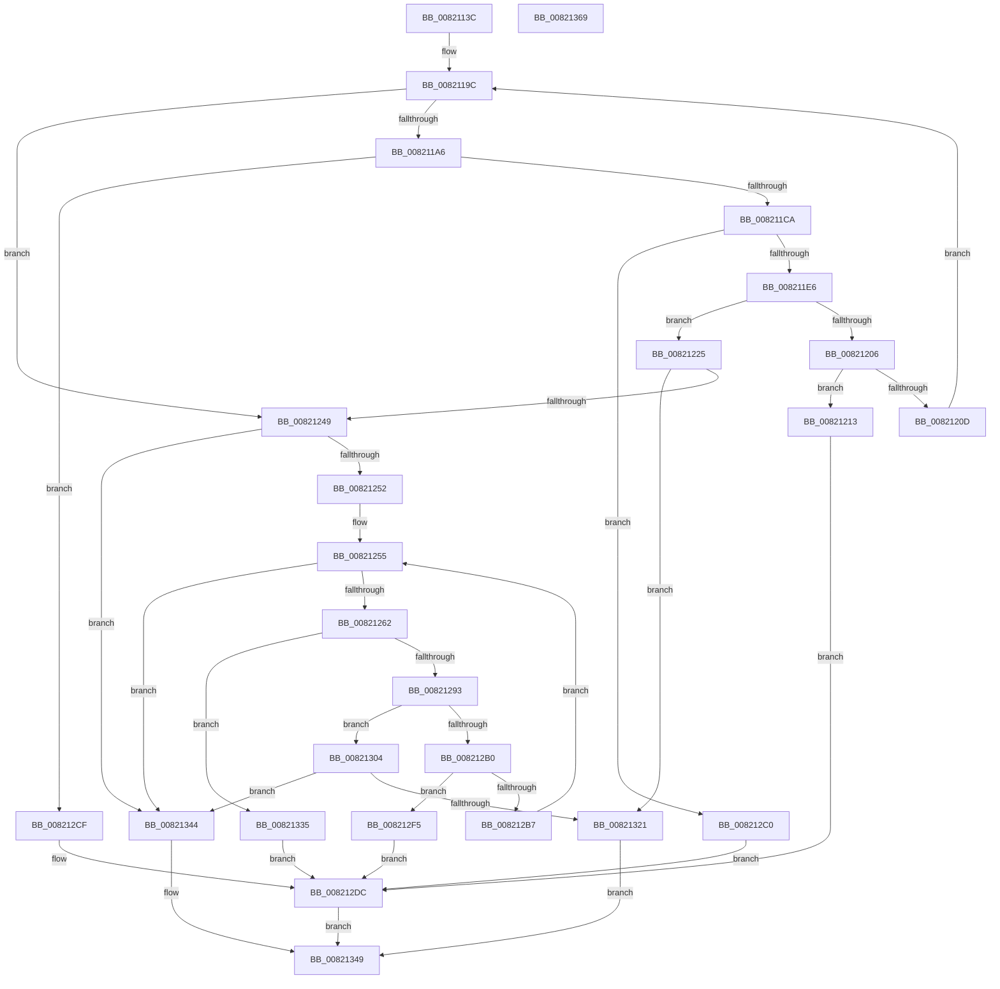

# AslpFileQueryVersionString

- RVA: `0x0082113C`–`0x0082136A` (길이 `558` bytes)
- VA: `0x000000014082113C`
- 실행 섹션: `PAGE`
- PDB 이름 있음: `예`; PDB Function 태그: `아니요`
- unwind 정보 RVA: `0x000D4B14`
- 디코드: `142`개 명령, `558/558` bytes 표시
- 미해석 바이트: `0` (있으면 어셈블리에 `.byte`로 보존)

> 이 문서는 커널 이미지의 기계어와 PDB 기호를 분석해 생성했습니다. 4번과 5번은 함수 원형과 자료형을 바이너리 사용 방식에서 추정한 C 해석이며 원본 소스 복구 결과는 아닙니다.

## 1. Dependencies

- 직접 호출 지점: **9**; 고유 호출 대상: **7**
- 직접 호출자로 확인된 함수: **1**
- RIP 상대 이미지 참조: **8**

### Outgoing calls
- `0x008211BB` → [RtlStringCchCopyW](../../text/26/RtlStringCchCopyW_function_0026E9A4.md) (function, `0x0026E9A4`)
- `0x008211D7` → [RtlStringCchCatW](../../text/4C/RtlStringCchCatW_function_004C7500.md) (function, `0x004C7500`)
- `0x008211F8` → [AslpFileVerQueryBlock](../AF/AslpFileVerQueryBlock_function_00AF9694.md) (function, `0x00AF9694`)
- `0x00821239` → [AslpFileVerStringBlockGetValue](AslpFileVerStringBlockGetValue_function_00821370.md) (function, `0x00821370`)
- `0x00821284` → [RtlStringCchPrintfW](../../text/48/RtlStringCchPrintfW_function_00482D5C.md) (function, `0x00482D5C`)
- `0x008212A5` → [AslpFileVerQueryBlock](../AF/AslpFileVerQueryBlock_function_00AF9694.md) (function, `0x00AF9694`)
- `0x008212EC` → [AslLogCallPrintf](../95/AslLogCallPrintf_function_0095E4EC.md) (function, `0x0095E4EC`)
- `0x00821318` → [AslpFileVerStringBlockGetValue](AslpFileVerStringBlockGetValue_function_00821370.md) (function, `0x00821370`)
- `0x00821350` → [_security_check_cookie](../../text/6A/_security_check_cookie_function_006AC640.md) (function, `0x006AC640`)

### Direct callers
- [AslpFileMakeStringVersionAttributes](AslpFileMakeStringVersionAttributes_function_00820964.md) at `0x00820A99`

### Static image references
- `0x00821155` → RVA `0x00E0A740` (`.data`; read)
- `0x008211A6` → RVA `0x0000BFE8` (`.rdata`; read)
- `0x00821213` → RVA `0x0003FD28` (`.rdata`; read)
- `0x00821266` → RVA `0x0003FF20` (`.rdata`; read)
- `0x008212C0` → RVA `0x0003DCB0` (`.rdata`; read)
- `0x008212CF` → RVA `0x0003E680` (`.rdata`; read)
- `0x008212DC` → RVA `0x0003FF00` (`.rdata`; read)
- `0x00821335` → RVA `0x0001E420` (`.rdata`; read)

## 2. Other-region calls and transfers

- 다른 실행 섹션으로 향하는 call: **4**
  - `0x008211BB` → [RtlStringCchCopyW](../../text/26/RtlStringCchCopyW_function_0026E9A4.md) (`PAGE` → `.text`)
  - `0x008211D7` → [RtlStringCchCatW](../../text/4C/RtlStringCchCatW_function_004C7500.md) (`PAGE` → `.text`)
  - `0x00821284` → [RtlStringCchPrintfW](../../text/48/RtlStringCchPrintfW_function_00482D5C.md) (`PAGE` → `.text`)
  - `0x00821350` → [_security_check_cookie](../../text/6A/_security_check_cookie_function_006AC640.md) (`PAGE` → `.text`)
- 별도 외부 분기/꼬리 이동을 확인하지 못했습니다.

## 3. Assembly (complete function range)

```asm
0082113C  40 55                           push rbp
0082113E  53                              push rbx
0082113F  56                              push rsi
00821140  57                              push rdi
00821141  41 54                           push r12
00821143  41 55                           push r13
00821145  41 56                           push r14
00821147  41 57                           push r15
00821149  48 8D 6C 24 98                  lea rbp, [rsp - 0x68]
0082114E  48 81 EC 68 01 00 00            sub rsp, 0x168
00821155  48 8B 05 E4 95 5E 00            mov rax, qword ptr [rip + 0x5e95e4]
0082115C  48 33 C4                        xor rax, rsp
0082115F  48 89 45 50                     mov qword ptr [rbp + 0x50], rax
00821163  4C 8B AD D8 00 00 00            mov r13, qword ptr [rbp + 0xd8]
0082116A  45 33 DB                        xor r11d, r11d
0082116D  4C 89 19                        mov qword ptr [rcx], r11
00821170  49 8B F1                        mov rsi, r9
00821173  4C 89 1A                        mov qword ptr [rdx], r11
00821176  4D 8B E0                        mov r12, r8
00821179  4C 8B FA                        mov r15, rdx
0082117C  66 44 89 5C 24 50               mov word ptr [rsp + 0x50], r11w
00821182  4C 8B F1                        mov r14, rcx
00821185  4C 89 5C 24 48                  mov qword ptr [rsp + 0x48], r11
0082118A  4C 89 5C 24 40                  mov qword ptr [rsp + 0x40], r11
0082118F  41 8B FB                        mov edi, r11d
00821192  4C 89 5C 24 38                  mov qword ptr [rsp + 0x38], r11
00821197  4C 89 5C 24 30                  mov qword ptr [rsp + 0x30], r11
0082119C  48 83 FF 20                     cmp rdi, 0x20
008211A0  0F 83 A3 00 00 00               jae 0x140821249
008211A6  4C 8D 05 3B AE 7E FF            lea r8, [rip - 0x8151c5]
008211AD  BA 80 00 00 00                  mov edx, 0x80
008211B2  4E 8B 04 07                     mov r8, qword ptr [rdi + r8]
008211B6  48 8D 4C 24 50                  lea rcx, [rsp + 0x50]
008211BB  E8 E4 D7 A4 FF                  call 0x14026e9a4
008211C0  8B D8                           mov ebx, eax
008211C2  85 C0                           test eax, eax
008211C4  0F 88 05 01 00 00               js 0x1408212cf
008211CA  4D 8B C5                        mov r8, r13
008211CD  48 8D 4C 24 50                  lea rcx, [rsp + 0x50]
008211D2  BA 80 00 00 00                  mov edx, 0x80
008211D7  E8 24 63 CA FF                  call 0x1404c7500
008211DC  8B D8                           mov ebx, eax
008211DE  85 C0                           test eax, eax
008211E0  0F 88 DA 00 00 00               js 0x1408212c0
008211E6  4C 8D 4C 24 30                  lea r9, [rsp + 0x30]
008211EB  49 8B CC                        mov rcx, r12
008211EE  4C 8D 44 24 38                  lea r8, [rsp + 0x38]
008211F3  48 8D 54 24 50                  lea rdx, [rsp + 0x50]
008211F8  E8 97 84 2D 00                  call 0x140af9694
008211FD  45 33 DB                        xor r11d, r11d
00821200  8B D8                           mov ebx, eax
00821202  85 C0                           test eax, eax
00821204  79 1F                           jns 0x140821225
00821206  3D 25 02 00 C0                  cmp eax, 0xc0000225
0082120B  75 06                           jne 0x140821213
0082120D  48 83 C7 08                     add rdi, 8
00821211  EB 89                           jmp 0x14082119c
00821213  4C 8D 0D 0E EB 81 FF            lea r9, [rip - 0x7e14f2]
0082121A  41 B8 03 0D 00 00               mov r8d, 0xd03
00821220  E9 B7 00 00 00                  jmp 0x1408212dc
00821225  4C 8B 4C 24 30                  mov r9, qword ptr [rsp + 0x30]
0082122A  48 8D 54 24 40                  lea rdx, [rsp + 0x40]
0082122F  4C 8B 44 24 38                  mov r8, qword ptr [rsp + 0x38]
00821234  48 8D 4C 24 48                  lea rcx, [rsp + 0x48]
00821239  E8 32 01 00 00                  call 0x140821370
0082123E  45 33 DB                        xor r11d, r11d
00821241  85 C0                           test eax, eax
00821243  0F 89 D8 00 00 00               jns 0x140821321
00821249  48 85 F6                        test rsi, rsi
0082124C  0F 84 F2 00 00 00               je 0x140821344
00821252  49 8B FB                        mov rdi, r11
00821255  48 3B BD D0 00 00 00            cmp rdi, qword ptr [rbp + 0xd0]
0082125C  0F 83 E2 00 00 00               jae 0x140821344
00821262  0F B7 46 02                     movzx eax, word ptr [rsi + 2]
00821266  4C 8D 05 B3 EC 81 FF            lea r8, [rip - 0x7e134d]
0082126D  44 0F B7 0E                     movzx r9d, word ptr [rsi]
00821271  48 8D 4C 24 50                  lea rcx, [rsp + 0x50]
00821276  4C 89 6C 24 28                  mov qword ptr [rsp + 0x28], r13
0082127B  BA 80 00 00 00                  mov edx, 0x80
00821280  89 44 24 20                     mov dword ptr [rsp + 0x20], eax
00821284  E8 D3 1A C6 FF                  call 0x140482d5c
00821289  8B D8                           mov ebx, eax
0082128B  85 C0                           test eax, eax
0082128D  0F 88 A2 00 00 00               js 0x140821335
00821293  4C 8D 4C 24 30                  lea r9, [rsp + 0x30]
00821298  49 8B CC                        mov rcx, r12
0082129B  4C 8D 44 24 38                  lea r8, [rsp + 0x38]
008212A0  48 8D 54 24 50                  lea rdx, [rsp + 0x50]
008212A5  E8 EA 83 2D 00                  call 0x140af9694
008212AA  8B D8                           mov ebx, eax
008212AC  85 C0                           test eax, eax
008212AE  79 54                           jns 0x140821304
008212B0  3D 25 02 00 C0                  cmp eax, 0xc0000225
008212B5  75 3E                           jne 0x1408212f5
008212B7  48 FF C7                        inc rdi
008212BA  48 83 C6 04                     add rsi, 4
008212BE  EB 95                           jmp 0x140821255
008212C0  4C 8D 0D E9 C9 81 FF            lea r9, [rip - 0x7e3617]
008212C7  41 B8 E5 0C 00 00               mov r8d, 0xce5
008212CD  EB 0D                           jmp 0x1408212dc
008212CF  4C 8D 0D AA D3 81 FF            lea r9, [rip - 0x7e2c56]
008212D6  41 B8 DF 0C 00 00               mov r8d, 0xcdf
008212DC  48 8D 15 1D EC 81 FF            lea rdx, [rip - 0x7e13e3]
008212E3  89 5C 24 20                     mov dword ptr [rsp + 0x20], ebx
008212E7  B9 01 00 00 00                  mov ecx, 1
008212EC  E8 FB D1 13 00                  call 0x14095e4ec
008212F1  8B C3                           mov eax, ebx
008212F3  EB 54                           jmp 0x140821349
008212F5  4C 8D 0D 2C EA 81 FF            lea r9, [rip - 0x7e15d4]
008212FC  41 B8 33 0D 00 00               mov r8d, 0xd33
00821302  EB D8                           jmp 0x1408212dc
00821304  4C 8B 4C 24 30                  mov r9, qword ptr [rsp + 0x30]
00821309  48 8D 54 24 40                  lea rdx, [rsp + 0x40]
0082130E  4C 8B 44 24 38                  mov r8, qword ptr [rsp + 0x38]
00821313  48 8D 4C 24 48                  lea rcx, [rsp + 0x48]
00821318  E8 53 00 00 00                  call 0x140821370
0082131D  85 C0                           test eax, eax
0082131F  78 23                           js 0x140821344
00821321  48 8B 44 24 40                  mov rax, qword ptr [rsp + 0x40]
00821326  49 89 07                        mov qword ptr [r15], rax
00821329  48 8B 44 24 48                  mov rax, qword ptr [rsp + 0x48]
0082132E  49 89 06                        mov qword ptr [r14], rax
00821331  33 C0                           xor eax, eax
00821333  EB 14                           jmp 0x140821349
00821335  4C 8D 0D E4 D0 7F FF            lea r9, [rip - 0x802f1c]
0082133C  41 B8 15 0D 00 00               mov r8d, 0xd15
00821342  EB 98                           jmp 0x1408212dc
00821344  B8 25 02 00 C0                  mov eax, 0xc0000225
00821349  48 8B 4D 50                     mov rcx, qword ptr [rbp + 0x50]
0082134D  48 33 CC                        xor rcx, rsp
00821350  E8 EB B2 E8 FF                  call 0x1406ac640
00821355  48 81 C4 68 01 00 00            add rsp, 0x168
0082135C  41 5F                           pop r15
0082135E  41 5E                           pop r14
00821360  41 5D                           pop r13
00821362  41 5C                           pop r12
00821364  5F                              pop rdi
00821365  5E                              pop rsi
00821366  5B                              pop rbx
00821367  5D                              pop rbp
00821368  C3                              ret
00821369  CC                              int3
```

## 4. C-style interpretation (structured pseudocode)

```c
__int64 __fastcall AslpFileQueryVersionString(__int64 a1, __int64 a2, __int64 a3, __int64 a4, __int64 a5, __int64 a6)
{
    __int64 result;
    __int64 v_r11;
    __int64 v_rdi;
    __int64 v_rsi;
    __int64 v_rsp;
    unsigned __int16 v_stack_m158;
    unsigned __int64 v_stack_m160;
    unsigned __int64 v_stack_m168;
    unsigned __int64 v_stack_m170;
    unsigned __int64 v_stack_m178;
    unsigned __int64 v_stack_m180;
    unsigned int v_stack_m188;
    unsigned __int64 v_stack_m58;
    unsigned __int64 v_stack_mA8;

    v_rsp = (v_rsp) - (360);
    result = (*(unsigned __int64 *)(v_rip + 6198756)) ^ (v_rsp);
    v_stack_m58 = result;
    v_r11 = 0;
    *(unsigned __int64 *)(a1) = 0;
    *(unsigned __int64 *)(a2) = 0;
    v_stack_m158 = 0;
    v_stack_m160 = 0;
    v_stack_m168 = 0;
    v_stack_m170 = 0;
    v_stack_m178 = 0;
loc_0082119C:
    if (0 >= 32) goto loc_00821249;
    result = RtlStringCchCopyW(v_stack_m158, 128, *(unsigned __int64 *)(0 + v_rip - 8475077 * 1), a4);
    if (sign_flag) goto loc_008212CF;
    result = RtlStringCchCatW(v_stack_m158, 128, a6, a4);
    if (sign_flag) goto loc_008212C0;
    result = AslpFileVerQueryBlock(a3, v_stack_m158, v_stack_m170, v_stack_m178);
    v_r11 = 0;
    if (!sign_flag) goto loc_00821225;
    if (((unsigned int)(result)) != 0xC0000225ULL) goto loc_00821213;
    v_rdi = (0) + (8);
    goto loc_0082119C;
loc_00821213:
    goto loc_008212DC;
loc_00821225:
    result = AslpFileVerStringBlockGetValue(v_stack_m160, v_stack_m168, v_stack_m170, v_stack_m178);
    v_r11 = 0;
    if (!sign_flag) goto loc_00821321;
loc_00821249:
    if (a4 == 0) goto loc_00821344;
loc_00821255:
    if (0 >= a5) goto loc_00821344;
    v_stack_m180 = a6;
    v_stack_m188 = (unsigned int)(*(unsigned __int16 *)(a4 + 2));
    result = RtlStringCchPrintfW(v_stack_m158, 128, v_rip - 8262477, *(unsigned __int16 *)(a4));
    if (sign_flag) goto loc_00821335;
    result = AslpFileVerQueryBlock(a3, v_stack_m158, v_stack_m170, v_stack_m178);
    if (!sign_flag) goto loc_00821304;
    if (((unsigned int)(result)) != 0xC0000225ULL) goto loc_008212F5;
    v_rdi = (0) + 1;
    v_rsi = (a4) + (4);
    goto loc_00821255;
loc_008212C0:
    goto loc_008212DC;
loc_008212CF:
loc_008212DC:
    v_stack_m188 = (unsigned int)((unsigned int)((unsigned int)(result)));
    result = AslLogCallPrintf(1, v_rip - 8262627, (unsigned int)(0xCDFULL), v_rip - 8268886);
    goto loc_00821349;
loc_008212F5:
    goto loc_008212DC;
loc_00821304:
    result = AslpFileVerStringBlockGetValue(v_stack_m160, v_stack_m168, v_stack_m170, v_stack_m178);
    if (sign_flag) goto loc_00821344;
loc_00821321:
    *(unsigned __int64 *)(a2) = v_stack_m168;
    *(unsigned __int64 *)(a1) = v_stack_m160;
    result = 0;
    goto loc_00821349;
loc_00821335:
    goto loc_008212DC;
loc_00821344:
loc_00821349:
    a1 = (v_stack_m58) ^ (v_rsp);
    result = _security_check_cookie(a1, v_stack_m168, (unsigned int)(0xD15ULL), v_rip - 8400668);
    v_rsp = (v_rsp) + (360);
    return result;
}
```

## 5. (Beta) C Style

```c
int64_t AslpFileQueryVersionString(void *Arg1, void *Arg2, int64_t Arg3, int64_t Arg4, int64_t Arg5, int64_t Arg6)
{
    uint8_t *arg1 = (uint8_t *)Arg1;
    uint8_t *arg2 = (uint8_t *)Arg2;

    int64_t result;
    int64_t local_r11;
    int64_t local_rdi;
    int64_t local_rsi;
    int64_t local_rsp;
    uint16_t v_stack_m158;
    uint64_t v_stack_m160;
    uint64_t v_stack_m168;
    uint64_t v_stack_m170;
    uint64_t v_stack_m178;
    uint64_t v_stack_m180;
    uint32_t v_stack_m188;
    uint64_t v_stack_m58;
    uint64_t v_stack_mA8;

    local_rsp = (local_rsp) - (360);
    result = (*(uint64_t *)(v_rip + 0x5E95E4)) ^ (local_rsp);
    v_stack_m58 = result;
    local_r11 = 0;
    *(uint64_t *)(arg1) = 0;
    *(uint64_t *)(arg2) = 0;
    v_stack_m158 = 0;
    v_stack_m160 = 0;
    v_stack_m168 = 0;
    v_stack_m170 = 0;
    v_stack_m178 = 0;
loc_0082119C:
    if (0 >= 32) goto loc_00821249;
    result = RtlStringCchCopyW(v_stack_m158, 128, *(uint64_t *)(0 + v_rip - 0x8151C5 * 1), Arg4);
    if (sign_flag) goto loc_008212CF;
    result = RtlStringCchCatW(v_stack_m158, 128, Arg6, Arg4);
    if (sign_flag) goto loc_008212C0;
    result = AslpFileVerQueryBlock(Arg3, v_stack_m158, v_stack_m170, v_stack_m178);
    local_r11 = 0;
    if (!sign_flag) goto loc_00821225;
    if (((uint32_t)(result)) != 0xC0000225ULL) goto loc_00821213;
    local_rdi = (0) + (8);
    goto loc_0082119C;
loc_00821213:
    goto loc_008212DC;
loc_00821225:
    result = AslpFileVerStringBlockGetValue(v_stack_m160, v_stack_m168, v_stack_m170, v_stack_m178);
    local_r11 = 0;
    if (!sign_flag) goto loc_00821321;
loc_00821249:
    if (Arg4 == 0) goto loc_00821344;
loc_00821255:
    if (0 >= Arg5) goto loc_00821344;
    v_stack_m180 = Arg6;
    v_stack_m188 = (uint32_t)(*(uint16_t *)(Arg4 + 0x2));
    result = RtlStringCchPrintfW(v_stack_m158, 128, v_rip - 8262477, *(uint16_t *)(Arg4));
    if (sign_flag) goto loc_00821335;
    result = AslpFileVerQueryBlock(Arg3, v_stack_m158, v_stack_m170, v_stack_m178);
    if (!sign_flag) goto loc_00821304;
    if (((uint32_t)(result)) != 0xC0000225ULL) goto loc_008212F5;
    local_rdi = (0) + 1;
    local_rsi = (Arg4) + (4);
    goto loc_00821255;
loc_008212C0:
    goto loc_008212DC;
loc_008212CF:
loc_008212DC:
    v_stack_m188 = (uint32_t)((uint32_t)((uint32_t)(result)));
    result = AslLogCallPrintf(1, v_rip - 8262627, (uint32_t)(0xCDFULL), v_rip - 8268886);
    goto loc_00821349;
loc_008212F5:
    goto loc_008212DC;
loc_00821304:
    result = AslpFileVerStringBlockGetValue(v_stack_m160, v_stack_m168, v_stack_m170, v_stack_m178);
    if (sign_flag) goto loc_00821344;
loc_00821321:
    *(uint64_t *)(arg2) = v_stack_m168;
    *(uint64_t *)(arg1) = v_stack_m160;
    result = 0;
    goto loc_00821349;
loc_00821335:
    goto loc_008212DC;
loc_00821344:
loc_00821349:
    Arg1 = (v_stack_m58) ^ (local_rsp);
    result = _security_check_cookie(Arg1, v_stack_m168, (uint32_t)(0xD15ULL), v_rip - 8400668);
    local_rsp = (local_rsp) + (360);
    return result;
}
```

### 관측된 메모리 오프셋

구조체 형식이 확인되지 않은 접근은 인자 기준의 오프셋으로만 기록했습니다.

| 기준 인자 | 오프셋 표현 | 폭 (bit) | 접근 |
|---|---:|---:|---|
| `Arg1` | `+ 0x0` | `64` | `W` |
| `Arg2` | `+ 0x0` | `64` | `W` |

## 6. Execution-region graph

[열기: 2D/3D 그래프와 함수 탐색 컨트롤 패널](../../../control-panel.html?section=page&rva=0x0082113C&view=graph)

- 2D 그래프는 위에서 아래로 흐르고, 3D 그래프는 빈 공간을 드래그해 회전합니다. Shift+드래그는 이동, 휠은 확대·축소, 함수 노드 선택은 대상 보고서 이동입니다.

### Static fallback


