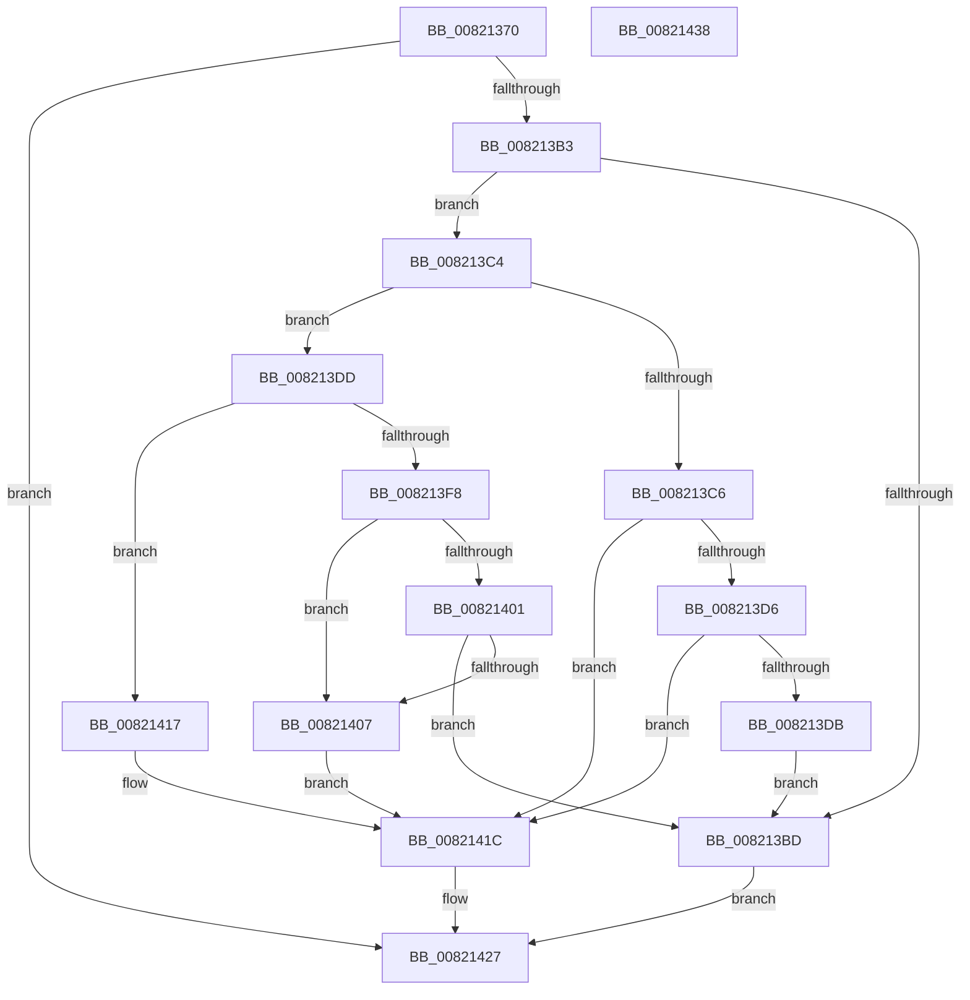

# AslpFileVerStringBlockGetValue

- RVA: `0x00821370`–`0x00821439` (길이 `201` bytes)
- VA: `0x0000000140821370`
- 실행 섹션: `PAGE`
- PDB 이름 있음: `예`; PDB Function 태그: `아니요`
- unwind 정보 RVA: `0x000DA04C`
- 디코드: `70`개 명령, `201/201` bytes 표시
- 미해석 바이트: `0` (있으면 어셈블리에 `.byte`로 보존)

> 이 문서는 커널 이미지의 기계어와 PDB 기호를 분석해 생성했습니다. 4번과 5번은 함수 원형과 자료형을 바이너리 사용 방식에서 추정한 C 해석이며 원본 소스 복구 결과는 아닙니다.

## 1. Dependencies

- 직접 호출 지점: **4**; 고유 호출 대상: **3**
- 직접 호출자로 확인된 함수: **1**
- RIP 상대 이미지 참조: **0**

### Outgoing calls
- `0x008213AA` → [AslpFileVerBlockGetValueOffset](../../text/4B/AslpFileVerBlockGetValueOffset_function_004B47D8.md) (function, `0x004B47D8`)
- `0x008213CD` → [Feature_261863737__private_IsEnabledDeviceUsageNoInline](../../text/69/Feature_261863737__private_IsEnabledDeviceUsageNoInline_function_0069D46C.md) (function, `0x0069D46C`)
- `0x008213EF` → [RtlStringCbLengthW](../../text/45/RtlStringCbLengthW_function_004575EC.md) (function, `0x004575EC`)
- `0x008213F8` → [Feature_261863737__private_IsEnabledDeviceUsageNoInline](../../text/69/Feature_261863737__private_IsEnabledDeviceUsageNoInline_function_0069D46C.md) (function, `0x0069D46C`)

### Direct callers
- [AslpFileQueryVersionString](AslpFileQueryVersionString_function_0082113C.md) at `0x00821239`
- [AslpFileQueryVersionString](AslpFileQueryVersionString_function_0082113C.md) at `0x00821318`

### Static image references
- 디코드된 RIP-relative 메모리 참조가 없습니다.

## 2. Other-region calls and transfers

- 다른 실행 섹션으로 향하는 call: **4**
  - `0x008213AA` → [AslpFileVerBlockGetValueOffset](../../text/4B/AslpFileVerBlockGetValueOffset_function_004B47D8.md) (`PAGE` → `.text`)
  - `0x008213CD` → [Feature_261863737__private_IsEnabledDeviceUsageNoInline](../../text/69/Feature_261863737__private_IsEnabledDeviceUsageNoInline_function_0069D46C.md) (`PAGE` → `.text`)
  - `0x008213EF` → [RtlStringCbLengthW](../../text/45/RtlStringCbLengthW_function_004575EC.md) (`PAGE` → `.text`)
  - `0x008213F8` → [Feature_261863737__private_IsEnabledDeviceUsageNoInline](../../text/69/Feature_261863737__private_IsEnabledDeviceUsageNoInline_function_0069D46C.md) (`PAGE` → `.text`)
- 별도 외부 분기/꼬리 이동을 확인하지 못했습니다.

## 3. Assembly (complete function range)

```asm
00821370  48 8B C4                        mov rax, rsp
00821373  48 89 58 18                     mov qword ptr [rax + 0x18], rbx
00821377  55                              push rbp
00821378  56                              push rsi
00821379  57                              push rdi
0082137A  41 56                           push r14
0082137C  41 57                           push r15
0082137E  48 83 EC 20                     sub rsp, 0x20
00821382  33 ED                           xor ebp, ebp
00821384  4D 8B D8                        mov r11, r8
00821387  48 89 29                        mov qword ptr [rcx], rbp
0082138A  4C 8B F2                        mov r14, rdx
0082138D  48 89 2A                        mov qword ptr [rdx], rbp
00821390  4C 8B F9                        mov r15, rcx
00821393  8B DD                           mov ebx, ebp
00821395  48 89 68 08                     mov qword ptr [rax + 8], rbp
00821399  49 8B D3                        mov rdx, r11
0082139C  48 89 58 10                     mov qword ptr [rax + 0x10], rbx
008213A0  48 8D 48 08                     lea rcx, [rax + 8]
008213A4  4D 8B C1                        mov r8, r9
008213A7  49 8B F9                        mov rdi, r9
008213AA  E8 29 34 C9 FF                  call 0x1404b47d8
008213AF  85 C0                           test eax, eax
008213B1  78 74                           js 0x140821427
008213B3  48 8B 44 24 50                  mov rax, qword ptr [rsp + 0x50]
008213B8  49 3B C0                        cmp rax, r8
008213BB  76 07                           jbe 0x1408213c4
008213BD  B8 0D 00 00 C0                  mov eax, 0xc000000d
008213C2  EB 63                           jmp 0x140821427
008213C4  75 17                           jne 0x1408213dd
008213C6  48 8D 70 FE                     lea rsi, [rax - 2]
008213CA  49 03 F3                        add rsi, r11
008213CD  E8 9A C0 E7 FF                  call 0x14069d46c
008213D2  85 C0                           test eax, eax
008213D4  74 46                           je 0x14082141c
008213D6  66 39 2E                        cmp word ptr [rsi], bp
008213D9  74 41                           je 0x14082141c
008213DB  EB E0                           jmp 0x1408213bd
008213DD  4A 8D 34 18                     lea rsi, [rax + r11]
008213E1  48 2B F8                        sub rdi, rax
008213E4  48 8B D7                        mov rdx, rdi
008213E7  4C 8D 44 24 58                  lea r8, [rsp + 0x58]
008213EC  48 8B CE                        mov rcx, rsi
008213EF  E8 F8 61 C3 FF                  call 0x1404575ec
008213F4  85 C0                           test eax, eax
008213F6  79 1F                           jns 0x140821417
008213F8  E8 6F C0 E7 FF                  call 0x14069d46c
008213FD  85 C0                           test eax, eax
008213FF  74 06                           je 0x140821407
00821401  48 83 FF 02                     cmp rdi, 2
00821405  72 B6                           jb 0x1408213bd
00821407  48 8D 5F FE                     lea rbx, [rdi - 2]
0082140B  48 8B C3                        mov rax, rbx
0082140E  48 D1 E8                        shr rax, 1
00821411  66 89 2C 46                     mov word ptr [rsi + rax*2], bp
00821415  EB 05                           jmp 0x14082141c
00821417  48 8B 5C 24 58                  mov rbx, qword ptr [rsp + 0x58]
0082141C  48 D1 EB                        shr rbx, 1
0082141F  8B C5                           mov eax, ebp
00821421  49 89 1E                        mov qword ptr [r14], rbx
00821424  49 89 37                        mov qword ptr [r15], rsi
00821427  48 8B 5C 24 60                  mov rbx, qword ptr [rsp + 0x60]
0082142C  48 83 C4 20                     add rsp, 0x20
00821430  41 5F                           pop r15
00821432  41 5E                           pop r14
00821434  5F                              pop rdi
00821435  5E                              pop rsi
00821436  5D                              pop rbp
00821437  C3                              ret
00821438  CC                              int3
```

## 4. C-style interpretation (structured pseudocode)

```c
__int64 __fastcall AslpFileVerStringBlockGetValue(__int64 a1, __int64 a2, __int64 a3, __int64 a4)
{
    __int64 result;
    __int64 v_rbp;
    __int64 v_rbx;
    __int64 v_rdi;
    __int64 v_rsi;
    __int64 v_rsp;
    unsigned __int64 v_stack_p10;
    unsigned __int64 v_stack_p18;
    unsigned __int64 v_stack_p8;

    *(unsigned __int64 *)(v_rsp + 24) = v_rbx;
    v_rsp = (v_rsp) - (32);
    v_rbp = 0;
    *(unsigned __int64 *)(a1) = 0;
    *(unsigned __int64 *)(a2) = 0;
    *(unsigned __int64 *)(v_rsp + 8) = 0;
    *(unsigned __int64 *)(v_rsp + 16) = 0;
    result = AslpFileVerBlockGetValueOffset(v_rsp + 8, a3, a4, a4);
    if (sign_flag) goto loc_00821427;
    if (v_stack_p8 <= a4) goto loc_008213C4;
loc_008213BD:
    goto loc_00821427;
loc_008213C4:
    if (v_stack_p8 != a4) goto loc_008213DD;
    v_rsi = ((unsigned int)(0xC000000DULL) - 2) + (a3);
    result = Feature_261863737__private_IsEnabledDeviceUsageNoInline(v_rsp + 8, a3, a4, a4);
    if ((unsigned int)(result) == 0) goto loc_0082141C;
    if ((*(unsigned __int16 *)(v_rsi)) == 0) goto loc_0082141C;
    goto loc_008213BD;
loc_008213DD:
    v_rdi = (a4) - (result);
    result = RtlStringCbLengthW(result + a3 * 1, v_rdi, v_stack_p10, a4);
    if (!sign_flag) goto loc_00821417;
    result = Feature_261863737__private_IsEnabledDeviceUsageNoInline(result + a3 * 1, v_rdi, v_stack_p10, a4);
    if ((unsigned int)(result) == 0) goto loc_00821407;
    if (v_rdi < 2) goto loc_008213BD;
loc_00821407:
    result = (v_rdi - 2) >> (1);
    *(unsigned __int16 *)(result + a3 * 1 + result * 2) = 0;
    goto loc_0082141C;
loc_00821417:
loc_0082141C:
    v_rbx = (v_stack_p10) >> (1);
    *(unsigned __int64 *)(a2) = v_rbx;
    *(unsigned __int64 *)(a1) = result + a3 * 1;
loc_00821427:
    v_rsp = (v_rsp) + (32);
    return 0;
}
```

## 5. (Beta) C Style

```c
int64_t AslpFileVerStringBlockGetValue(void *Arg1, void *Arg2, int64_t Arg3, int64_t Arg4)
{
    uint8_t *arg1 = (uint8_t *)Arg1;
    uint8_t *arg2 = (uint8_t *)Arg2;

    int64_t result;
    int64_t local_rbp;
    int64_t local_rbx;
    int64_t local_rdi;
    int64_t local_rsi;
    int64_t local_rsp;
    uint64_t v_stack_p10;
    uint64_t v_stack_p18;
    uint64_t v_stack_p8;

    *(uint64_t *)(local_rsp + 0x18) = local_rbx;
    local_rsp = (local_rsp) - (32);
    local_rbp = 0;
    *(uint64_t *)(arg1) = 0;
    *(uint64_t *)(arg2) = 0;
    *(uint64_t *)(local_rsp + 0x8) = 0;
    *(uint64_t *)(local_rsp + 0x10) = 0;
    result = AslpFileVerBlockGetValueOffset(local_rsp + 8, Arg3, Arg4, Arg4);
    if (sign_flag) goto loc_00821427;
    if (v_stack_p8 <= Arg4) goto loc_008213C4;
loc_008213BD:
    goto loc_00821427;
loc_008213C4:
    if (v_stack_p8 != Arg4) goto loc_008213DD;
    local_rsi = ((uint32_t)(0xC000000DULL) - 2) + (Arg3);
    result = Feature_261863737__private_IsEnabledDeviceUsageNoInline(local_rsp + 8, Arg3, Arg4, Arg4);
    if ((uint32_t)(result) == 0) goto loc_0082141C;
    if ((*(uint16_t *)(local_rsi)) == 0) goto loc_0082141C;
    goto loc_008213BD;
loc_008213DD:
    local_rdi = (Arg4) - (result);
    result = RtlStringCbLengthW(result + Arg3 * 1, local_rdi, v_stack_p10, Arg4);
    if (!sign_flag) goto loc_00821417;
    result = Feature_261863737__private_IsEnabledDeviceUsageNoInline(result + Arg3 * 1, local_rdi, v_stack_p10, Arg4);
    if ((uint32_t)(result) == 0) goto loc_00821407;
    if (local_rdi < 2) goto loc_008213BD;
loc_00821407:
    result = (local_rdi - 2) >> (1);
    *(uint16_t *)(result + Arg3 * 1 + result * 2) = 0;
    goto loc_0082141C;
loc_00821417:
loc_0082141C:
    local_rbx = (v_stack_p10) >> (1);
    *(uint64_t *)(arg2) = local_rbx;
    *(uint64_t *)(arg1) = result + Arg3 * 1;
loc_00821427:
    local_rsp = (local_rsp) + (32);
    return 0;
}
```

### 관측된 메모리 오프셋

구조체 형식이 확인되지 않은 접근은 인자 기준의 오프셋으로만 기록했습니다.

| 기준 인자 | 오프셋 표현 | 폭 (bit) | 접근 |
|---|---:|---:|---|
| `Arg1` | `+ 0x0` | `64` | `W` |
| `Arg2` | `+ 0x0` | `64` | `W` |

## 6. Execution-region graph

[열기: 2D/3D 그래프와 함수 탐색 컨트롤 패널](../../../control-panel.html?section=page&rva=0x00821370&view=graph)

- 2D 그래프는 위에서 아래로 흐르고, 3D 그래프는 빈 공간을 드래그해 회전합니다. Shift+드래그는 이동, 휠은 확대·축소, 함수 노드 선택은 대상 보고서 이동입니다.

### Static fallback


