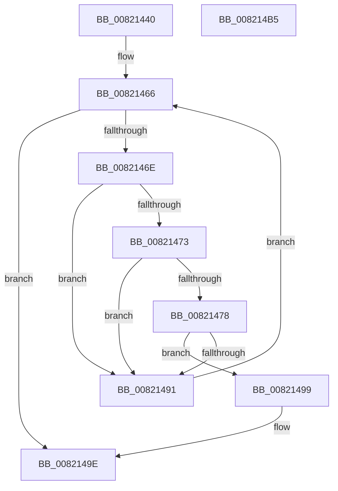

# AslpHasStarForceWrapper

- RVA: `0x00821440`–`0x008214B6` (길이 `118` bytes)
- VA: `0x0000000140821440`
- 실행 섹션: `PAGE`
- PDB 이름 있음: `예`; PDB Function 태그: `아니요`
- unwind 정보 RVA: `0x0005C954`
- 디코드: `36`개 명령, `118/118` bytes 표시
- 미해석 바이트: `0` (있으면 어셈블리에 `.byte`로 보존)

> 이 문서는 커널 이미지의 기계어와 PDB 기호를 분석해 생성했습니다. 4번과 5번은 함수 원형과 자료형을 바이너리 사용 방식에서 추정한 C 해석이며 원본 소스 복구 결과는 아닙니다.

## 1. Dependencies

- 직접 호출 지점: **1**; 고유 호출 대상: **1**
- 직접 호출자로 확인된 함수: **1**
- RIP 상대 이미지 참조: **1**

### Outgoing calls
- `0x00821488` → [strncmp](../../text/6C/strncmp_function_006C6720.md) (function, `0x006C6720`)

### Direct callers
- [AslpFileGetExeWrapper](../81/AslpFileGetExeWrapper_function_0081EAF4.md) at `0x0081EC28`

### Static image references
- `0x0082147E` → RVA `0x000400F8` (`.rdata`; read)

## 2. Other-region calls and transfers

- 다른 실행 섹션으로 향하는 call: **1**
  - `0x00821488` → [strncmp](../../text/6C/strncmp_function_006C6720.md) (`PAGE` → `.text`)
- 별도 외부 분기/꼬리 이동을 확인하지 못했습니다.

## 3. Assembly (complete function range)

```asm
00821440  48 89 5C 24 08                  mov qword ptr [rsp + 8], rbx
00821445  48 89 6C 24 10                  mov qword ptr [rsp + 0x10], rbp
0082144A  48 89 74 24 18                  mov qword ptr [rsp + 0x18], rsi
0082144F  57                              push rdi
00821450  48 83 EC 20                     sub rsp, 0x20
00821454  0F B7 41 14                     movzx eax, word ptr [rcx + 0x14]
00821458  48 8D 79 18                     lea rdi, [rcx + 0x18]
0082145C  48 03 F8                        add rdi, rax
0082145F  48 8B E9                        mov rbp, rcx
00821462  33 DB                           xor ebx, ebx
00821464  8B F3                           mov esi, ebx
00821466  0F B7 45 06                     movzx eax, word ptr [rbp + 6]
0082146A  3B F0                           cmp esi, eax
0082146C  73 30                           jae 0x14082149e
0082146E  39 5F 0C                        cmp dword ptr [rdi + 0xc], ebx
00821471  74 1E                           je 0x140821491
00821473  39 5F 08                        cmp dword ptr [rdi + 8], ebx
00821476  74 19                           je 0x140821491
00821478  41 B8 08 00 00 00               mov r8d, 8
0082147E  48 8D 15 73 EC 81 FF            lea rdx, [rip - 0x7e138d]
00821485  48 8B CF                        mov rcx, rdi
00821488  E8 93 52 EA FF                  call 0x1406c6720
0082148D  85 C0                           test eax, eax
0082148F  74 08                           je 0x140821499
00821491  FF C6                           inc esi
00821493  48 83 C7 28                     add rdi, 0x28
00821497  EB CD                           jmp 0x140821466
00821499  BB 01 00 00 00                  mov ebx, 1
0082149E  48 8B 6C 24 38                  mov rbp, qword ptr [rsp + 0x38]
008214A3  8B C3                           mov eax, ebx
008214A5  48 8B 5C 24 30                  mov rbx, qword ptr [rsp + 0x30]
008214AA  48 8B 74 24 40                  mov rsi, qword ptr [rsp + 0x40]
008214AF  48 83 C4 20                     add rsp, 0x20
008214B3  5F                              pop rdi
008214B4  C3                              ret
008214B5  CC                              int3
```

## 4. C-style interpretation (structured pseudocode)

```c
__int64 __fastcall AslpHasStarForceWrapper(__int64 a1)
{
    __int64 result;
    __int64 v_rbx;
    __int64 v_rdi;
    __int64 v_rsi;
    __int64 v_rsp;
    unsigned __int64 v_stack_p10;
    unsigned __int64 v_stack_p18;
    unsigned __int64 v_stack_p8;

    v_stack_p8 = v_rbx;
    v_stack_p10 = v_rbp;
    v_stack_p18 = v_rsi;
    v_rsp = (v_rsp) - (32);
    v_rdi = (a1 + 24) + (*(unsigned __int16 *)(a1 + 20));
    v_rbx = 0;
loc_00821466:
    if (0 >= ((unsigned int)(*(unsigned __int16 *)(a1 + 6)))) goto loc_0082149E;
    if ((*(unsigned int *)(v_rdi + 12)) == 0) goto loc_00821491;
    if ((*(unsigned int *)(v_rdi + 8)) == 0) goto loc_00821491;
    result = strncmp(v_rdi, v_rip - 8262541, 8, a4);
    if ((unsigned int)(result) == 0) goto loc_00821499;
loc_00821491:
    v_rsi = (unsigned int)((0) + 1);
    v_rdi = (v_rdi) + (40);
    goto loc_00821466;
loc_00821499:
loc_0082149E:
    v_rsp = (v_rsp) + (32);
    return 1;
}
```

## 5. (Beta) C Style

```c
int64_t AslpHasStarForceWrapper(void *Arg1)
{
    uint8_t *arg1 = (uint8_t *)Arg1;

    int64_t result;
    int64_t local_rbx;
    int64_t local_rdi;
    int64_t local_rsi;
    int64_t local_rsp;
    uint64_t v_stack_p10;
    uint64_t v_stack_p18;
    uint64_t v_stack_p8;

    v_stack_p8 = local_rbx;
    v_stack_p10 = local_rbp;
    v_stack_p18 = local_rsi;
    local_rsp = (local_rsp) - (32);
    local_rdi = (Arg1 + 24) + (*(uint16_t *)(arg1 + 0x14));
    local_rbx = 0;
loc_00821466:
    if (0 >= ((uint32_t)(*(uint16_t *)(arg1 + 0x6)))) goto loc_0082149E;
    if ((*(uint32_t *)(local_rdi + 0xC)) == 0) goto loc_00821491;
    if ((*(uint32_t *)(local_rdi + 0x8)) == 0) goto loc_00821491;
    result = strncmp(local_rdi, v_rip - 8262541, 8, a4);
    if ((uint32_t)(result) == 0) goto loc_00821499;
loc_00821491:
    local_rsi = (uint32_t)((0) + 1);
    local_rdi = (local_rdi) + (40);
    goto loc_00821466;
loc_00821499:
loc_0082149E:
    local_rsp = (local_rsp) + (32);
    return 1;
}
```

### 관측된 메모리 오프셋

구조체 형식이 확인되지 않은 접근은 인자 기준의 오프셋으로만 기록했습니다.

| 기준 인자 | 오프셋 표현 | 폭 (bit) | 접근 |
|---|---:|---:|---|
| `Arg1` | `+ 0x6` | `16` | `R` |
| `Arg1` | `+ 0x8` | `32` | `R` |
| `Arg1` | `+ 0xC` | `32` | `R` |
| `Arg1` | `+ 0x14` | `16` | `R` |
| `Arg1` | `+ 0x18` | `64` | `R` |

## 6. Execution-region graph

[열기: 2D/3D 그래프와 함수 탐색 컨트롤 패널](../../../control-panel.html?section=page&rva=0x00821440&view=graph)

- 2D 그래프는 위에서 아래로 흐르고, 3D 그래프는 빈 공간을 드래그해 회전합니다. Shift+드래그는 이동, 휠은 확대·축소, 함수 노드 선택은 대상 보고서 이동입니다.

### Static fallback


