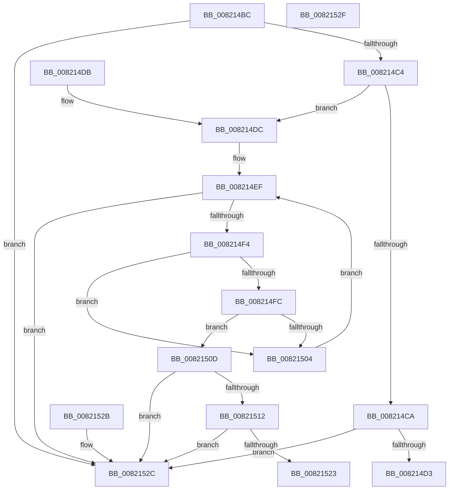

# AslpImageRvaToVa

- RVA: `0x008214BC`–`0x00821530` (길이 `116` bytes)
- VA: `0x00000001408214BC`
- 실행 섹션: `PAGE`
- PDB 이름 있음: `예`; PDB Function 태그: `아니요`
- unwind 정보 RVA: `0x000DB714`
- 디코드: `43`개 명령, `116/116` bytes 표시
- 미해석 바이트: `0` (있으면 어셈블리에 `.byte`로 보존)

> 이 문서는 커널 이미지의 기계어와 PDB 기호를 분석해 생성했습니다. 4번과 5번은 함수 원형과 자료형을 바이너리 사용 방식에서 추정한 C 해석이며 원본 소스 복구 결과는 아닙니다.

## 1. Dependencies

- 직접 호출 지점: **0**; 고유 호출 대상: **0**
- 직접 호출자로 확인된 함수: **7**
- RIP 상대 이미지 참조: **0**

### Outgoing calls
- 직접 디코드된 call 명령이 없습니다.

### Direct callers
- [AslFileMappingGetImageTypeEx](../81/AslFileMappingGetImageTypeEx_function_0081A950.md) at `0x0081AA8B`
- [AslpFileGetClrVersion](../81/AslpFileGetClrVersion_function_0081E388.md) at `0x0081E434`
- [AslpFileGetClrVersion](../81/AslpFileGetClrVersion_function_0081E388.md) at `0x0081E486`
- [AslpFileGetCrcChecksumBoot](../81/AslpFileGetCrcChecksumBoot_function_0081E7D4.md) at `0x0081E8B8`
- [AslpFileGetImageResourceDirectoryRoot](../81/AslpFileGetImageResourceDirectoryRoot_function_0081F53C.md) at `0x0081F688`
- [AslpFileGetVersionBlockFromResourceRoot](../81/AslpFileGetVersionBlockFromResourceRoot_function_0081FF98.md) at `0x00820178`
- [AslpFileIsArm64XBinary](AslpFileIsArm64XBinary_function_008206B0.md) at `0x008207E4`
- [AslpFileQueryExportName](AslpFileQueryExportName_function_00820EF8.md) at `0x00820FF6`
- [AslpFileQueryExportName](AslpFileQueryExportName_function_00820EF8.md) at `0x0082105D`

### Static image references
- 디코드된 RIP-relative 메모리 참조가 없습니다.

## 2. Other-region calls and transfers

- 다른 실행 섹션으로 향하는 call: **0**
- 별도 외부 분기/꼬리 이동을 확인하지 못했습니다.

## 3. Assembly (complete function range)

```asm
008214BC  4C 8B CA                        mov r9, rdx
008214BF  45 85 C0                        test r8d, r8d
008214C2  74 68                           je 0x14082152c
008214C4  80 7A 33 00                     cmp byte ptr [rdx + 0x33], 0
008214C8  74 12                           je 0x1408214dc
008214CA  41 8B C8                        mov ecx, r8d
008214CD  48 3B 4A 20                     cmp rcx, qword ptr [rdx + 0x20]
008214D1  73 59                           jae 0x14082152c
008214D3  48 8B 42 18                     mov rax, qword ptr [rdx + 0x18]
008214D7  48 03 C1                        add rax, rcx
008214DA  C3                              ret
008214DB  CC                              int3
008214DC  0F B7 51 14                     movzx edx, word ptr [rcx + 0x14]
008214E0  44 0F B7 59 06                  movzx r11d, word ptr [rcx + 6]
008214E5  48 83 C2 18                     add rdx, 0x18
008214E9  48 03 D1                        add rdx, rcx
008214EC  45 33 D2                        xor r10d, r10d
008214EF  45 3B D3                        cmp r10d, r11d
008214F2  73 38                           jae 0x14082152c
008214F4  8B 4A 0C                        mov ecx, dword ptr [rdx + 0xc]
008214F7  44 3B C1                        cmp r8d, ecx
008214FA  72 08                           jb 0x140821504
008214FC  03 4A 10                        add ecx, dword ptr [rdx + 0x10]
008214FF  44 3B C1                        cmp r8d, ecx
00821502  72 09                           jb 0x14082150d
00821504  48 83 C2 28                     add rdx, 0x28
00821508  41 FF C2                        inc r10d
0082150B  EB E2                           jmp 0x1408214ef
0082150D  48 85 D2                        test rdx, rdx
00821510  74 1A                           je 0x14082152c
00821512  8B 42 0C                        mov eax, dword ptr [rdx + 0xc]
00821515  8B 52 14                        mov edx, dword ptr [rdx + 0x14]
00821518  2B D0                           sub edx, eax
0082151A  41 03 D0                        add edx, r8d
0082151D  49 3B 51 10                     cmp rdx, qword ptr [r9 + 0x10]
00821521  73 09                           jae 0x14082152c
00821523  49 8B 41 18                     mov rax, qword ptr [r9 + 0x18]
00821527  48 03 C2                        add rax, rdx
0082152A  C3                              ret
0082152B  CC                              int3
0082152C  33 C0                           xor eax, eax
0082152E  C3                              ret
0082152F  CC                              int3
```

## 4. C-style interpretation (structured pseudocode)

```c
__int64 __fastcall AslpImageRvaToVa(__int64 a1, __int64 a2, int a3)
{
    __int64 result;
    __int64 v_r10;

    if (a3 == 0) goto loc_0082152C;
    if ((*(unsigned __int8 *)(a2 + 51)) == 0) goto loc_008214DC;
    if (((unsigned int)(a3)) >= (*(unsigned __int64 *)(a2 + 32))) goto loc_0082152C;
    result = (*(unsigned __int64 *)(a2 + 24)) + ((unsigned int)(a3));
    return result;
loc_008214DC:
    a2 = (*(unsigned __int16 *)((unsigned int)(a3) + 20)) + (24);
    a2 = (a2) + ((unsigned int)(a3));
    v_r10 = 0;
loc_008214EF:
    if (0 >= ((unsigned int)(*(unsigned __int16 *)((unsigned int)(a3) + 6)))) goto loc_0082152C;
    if (a3 < ((unsigned int)((unsigned int)(*(unsigned int *)(a2 + 12))))) goto loc_00821504;
    a1 = (unsigned int)(((unsigned int)(*(unsigned int *)(a2 + 12))) + (*(unsigned int *)(a2 + 16)));
    if (a3 < ((unsigned int)(a1))) goto loc_0082150D;
loc_00821504:
    a2 = (a2) + (40);
    v_r10 = (unsigned int)((v_r10) + 1);
    goto loc_008214EF;
loc_0082150D:
    if (a2 == 0) goto loc_0082152C;
    a2 = (unsigned int)(((unsigned int)(*(unsigned int *)(a2 + 20))) - ((unsigned int)((unsigned int)(*(unsigned int *)(a2 + 12)))));
    a2 = (unsigned int)((a2) + (a3));
    if (a2 >= (*(unsigned __int64 *)(a2 + 16))) goto loc_0082152C;
    result = (*(unsigned __int64 *)(a2 + 24)) + (a2);
    return result;
loc_0082152C:
    result = 0;
    return result;
}
```

## 5. (Beta) C Style

```c
int64_t AslpImageRvaToVa(void *Arg1, void *Arg2, int32_t Arg3)
{
    uint8_t *arg1 = (uint8_t *)Arg1;
    uint8_t *arg2 = (uint8_t *)Arg2;

    int64_t result;
    int64_t local_r10;

    if (Arg3 == 0) goto loc_0082152C;
    if ((*(uint8_t *)(arg2 + 0x33)) == 0) goto loc_008214DC;
    if (((uint32_t)(Arg3)) >= (*(uint64_t *)(arg2 + 0x20))) goto loc_0082152C;
    result = (*(uint64_t *)(arg2 + 0x18)) + ((uint32_t)(Arg3));
    return result;
loc_008214DC:
    Arg2 = (*(uint16_t *)((uint32_t)(Arg3) + 0x14)) + (24);
    Arg2 = (Arg2) + ((uint32_t)(Arg3));
    local_r10 = 0;
loc_008214EF:
    if (0 >= ((uint32_t)(*(uint16_t *)((uint32_t)(Arg3) + 0x6)))) goto loc_0082152C;
    if (Arg3 < ((uint32_t)((uint32_t)(*(uint32_t *)(arg2 + 0xC))))) goto loc_00821504;
    Arg1 = (uint32_t)(((uint32_t)(*(uint32_t *)(arg2 + 0xC))) + (*(uint32_t *)(arg2 + 0x10)));
    if (Arg3 < ((uint32_t)(Arg1))) goto loc_0082150D;
loc_00821504:
    Arg2 = (Arg2) + (40);
    local_r10 = (uint32_t)((local_r10) + 1);
    goto loc_008214EF;
loc_0082150D:
    if (Arg2 == NULL) goto loc_0082152C;
    Arg2 = (uint32_t)(((uint32_t)(*(uint32_t *)(arg2 + 0x14))) - ((uint32_t)((uint32_t)(*(uint32_t *)(arg2 + 0xC)))));
    Arg2 = (uint32_t)((Arg2) + (Arg3));
    if (Arg2 >= (*(uint64_t *)(arg2 + 0x10))) goto loc_0082152C;
    result = (*(uint64_t *)(arg2 + 0x18)) + (Arg2);
    return result;
loc_0082152C:
    result = 0;
    return result;
}
```

### 관측된 메모리 오프셋

구조체 형식이 확인되지 않은 접근은 인자 기준의 오프셋으로만 기록했습니다.

| 기준 인자 | 오프셋 표현 | 폭 (bit) | 접근 |
|---|---:|---:|---|
| `Arg1` | `+ 0x6` | `16` | `R` |
| `Arg1` | `+ 0x14` | `16` | `R` |
| `Arg2` | `+ 0x10` | `64` | `R` |
| `Arg2` | `+ 0x18` | `64` | `R` |
| `Arg2` | `+ 0x20` | `64` | `R` |
| `Arg2` | `+ 0x33` | `8` | `R` |

## 6. Execution-region graph

[열기: 2D/3D 그래프와 함수 탐색 컨트롤 패널](../../../control-panel.html?section=page&rva=0x008214BC&view=graph)

- 2D 그래프는 위에서 아래로 흐르고, 3D 그래프는 빈 공간을 드래그해 회전합니다. Shift+드래그는 이동, 휠은 확대·축소, 함수 노드 선택은 대상 보고서 이동입니다.

### Static fallback


