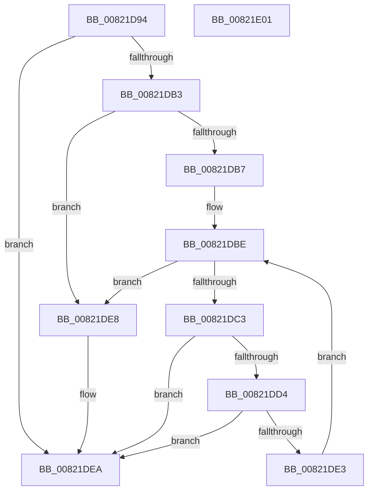

# AuthzBasepCompareSecurityAttributesInformation

- RVA: `0x00821D94`–`0x00821E02` (길이 `110` bytes)
- VA: `0x0000000140821D94`
- 실행 섹션: `PAGE`
- PDB 이름 있음: `예`; PDB Function 태그: `아니요`
- unwind 정보 RVA: `0x0005C954`
- 디코드: `37`개 명령, `110/110` bytes 표시
- 미해석 바이트: `0` (있으면 어셈블리에 `.byte`로 보존)

> 이 문서는 커널 이미지의 기계어와 PDB 기호를 분석해 생성했습니다. 4번과 5번은 함수 원형과 자료형을 바이너리 사용 방식에서 추정한 C 해석이며 원본 소스 복구 결과는 아닙니다.

## 1. Dependencies

- 직접 호출 지점: **2**; 고유 호출 대상: **2**
- 직접 호출자로 확인된 함수: **2**
- RIP 상대 이미지 참조: **0**

### Outgoing calls
- `0x00821DCA` → [AuthzBasepFindSecurityAttribute](../../text/3A/AuthzBasepFindSecurityAttribute_function_003A8980.md) (function, `0x003A8980`)
- `0x00821DDA` → [AuthzBasepCompareSecurityAttribute](../A6/AuthzBasepCompareSecurityAttribute_function_00A612A8.md) (function, `0x00A612A8`)

### Direct callers
- [SepCompareClaimAttributes](../8F/SepCompareClaimAttributes_function_008F7198.md) at `0x008F726B`
- [sub_00B1F008](../B1/Unknown_function_00B1F008.md) at `0x00B1F01B`

### Static image references
- 디코드된 RIP-relative 메모리 참조가 없습니다.

## 2. Other-region calls and transfers

- 다른 실행 섹션으로 향하는 call: **1**
  - `0x00821DCA` → [AuthzBasepFindSecurityAttribute](../../text/3A/AuthzBasepFindSecurityAttribute_function_003A8980.md) (`PAGE` → `.text`)
- 별도 외부 분기/꼬리 이동을 확인하지 못했습니다.

## 3. Assembly (complete function range)

```asm
00821D94  48 89 5C 24 08                  mov qword ptr [rsp + 8], rbx
00821D99  48 89 6C 24 10                  mov qword ptr [rsp + 0x10], rbp
00821D9E  48 89 74 24 18                  mov qword ptr [rsp + 0x18], rsi
00821DA3  57                              push rdi
00821DA4  48 83 EC 20                     sub rsp, 0x20
00821DA8  8B 01                           mov eax, dword ptr [rcx]
00821DAA  33 DB                           xor ebx, ebx
00821DAC  48 8B EA                        mov rbp, rdx
00821DAF  3B 02                           cmp eax, dword ptr [rdx]
00821DB1  75 37                           jne 0x140821dea
00821DB3  85 C0                           test eax, eax
00821DB5  74 31                           je 0x140821de8
00821DB7  48 8D 71 08                     lea rsi, [rcx + 8]
00821DBB  48 8B 3E                        mov rdi, qword ptr [rsi]
00821DBE  48 3B FE                        cmp rdi, rsi
00821DC1  74 25                           je 0x140821de8
00821DC3  48 8D 57 20                     lea rdx, [rdi + 0x20]
00821DC7  48 8B CD                        mov rcx, rbp
00821DCA  E8 B1 6B B8 FF                  call 0x1403a8980
00821DCF  48 85 C0                        test rax, rax
00821DD2  74 16                           je 0x140821dea
00821DD4  48 8B D0                        mov rdx, rax
00821DD7  48 8B CF                        mov rcx, rdi
00821DDA  E8 C9 F4 23 00                  call 0x140a612a8
00821DDF  84 C0                           test al, al
00821DE1  74 07                           je 0x140821dea
00821DE3  48 8B 3F                        mov rdi, qword ptr [rdi]
00821DE6  EB D6                           jmp 0x140821dbe
00821DE8  B3 01                           mov bl, 1
00821DEA  48 8B 6C 24 38                  mov rbp, qword ptr [rsp + 0x38]
00821DEF  8A C3                           mov al, bl
00821DF1  48 8B 5C 24 30                  mov rbx, qword ptr [rsp + 0x30]
00821DF6  48 8B 74 24 40                  mov rsi, qword ptr [rsp + 0x40]
00821DFB  48 83 C4 20                     add rsp, 0x20
00821DFF  5F                              pop rdi
00821E00  C3                              ret
00821E01  CC                              int3
```

## 4. C-style interpretation (structured pseudocode)

```c
__int64 __fastcall AuthzBasepCompareSecurityAttributesInformation(__int64 a1, __int64 a2)
{
    __int64 result;
    __int64 v_rbx;
    __int64 v_rsp;
    unsigned __int64 v_stack_p10;
    unsigned __int64 v_stack_p18;
    unsigned __int64 v_stack_p8;

    v_stack_p8 = v_rbx;
    v_stack_p10 = v_rbp;
    v_stack_p18 = v_rsi;
    v_rsp = (v_rsp) - (32);
    v_rbx = 0;
    if (((unsigned int)((unsigned int)(*(unsigned int *)(a1)))) != (*(unsigned int *)(a2))) goto loc_00821DEA;
    if ((unsigned int)((unsigned int)(*(unsigned int *)(a1))) == 0) goto loc_00821DE8;
loc_00821DBE:
    if ((*(unsigned __int64 *)(a1 + 8)) == (a1 + 8)) goto loc_00821DE8;
    result = AuthzBasepFindSecurityAttribute(a2, *(unsigned __int64 *)(a1 + 8) + 32, a3, a4);
    if (result == 0) goto loc_00821DEA;
    result = AuthzBasepCompareSecurityAttribute(*(unsigned __int64 *)(a1 + 8), result, a3, a4);
    if ((unsigned __int8)(result) == 0) goto loc_00821DEA;
    goto loc_00821DBE;
loc_00821DE8:
loc_00821DEA:
    v_rsp = (v_rsp) + (32);
    return 1;
}
```

## 5. (Beta) C Style

```c
int64_t AuthzBasepCompareSecurityAttributesInformation(void *Arg1, void *Arg2)
{
    uint8_t *arg1 = (uint8_t *)Arg1;
    uint8_t *arg2 = (uint8_t *)Arg2;

    int64_t result;
    int64_t local_rbx;
    int64_t local_rsp;
    uint64_t v_stack_p10;
    uint64_t v_stack_p18;
    uint64_t v_stack_p8;

    v_stack_p8 = local_rbx;
    v_stack_p10 = local_rbp;
    v_stack_p18 = local_rsi;
    local_rsp = (local_rsp) - (32);
    local_rbx = 0;
    if (((uint32_t)((uint32_t)(*(uint32_t *)(arg1)))) != (*(uint32_t *)(arg2))) goto loc_00821DEA;
    if ((uint32_t)((uint32_t)(*(uint32_t *)(arg1))) == 0) goto loc_00821DE8;
loc_00821DBE:
    if ((*(uint64_t *)(arg1 + 0x8)) == (Arg1 + 8)) goto loc_00821DE8;
    result = AuthzBasepFindSecurityAttribute(Arg2, *(uint64_t *)(arg1 + 0x8) + 32, a3, a4);
    if (result == 0) goto loc_00821DEA;
    result = AuthzBasepCompareSecurityAttribute(*(uint64_t *)(arg1 + 0x8), result, a3, a4);
    if ((uint8_t)(result) == 0) goto loc_00821DEA;
    goto loc_00821DBE;
loc_00821DE8:
loc_00821DEA:
    local_rsp = (local_rsp) + (32);
    return 1;
}
```

### 관측된 메모리 오프셋

구조체 형식이 확인되지 않은 접근은 인자 기준의 오프셋으로만 기록했습니다.

| 기준 인자 | 오프셋 표현 | 폭 (bit) | 접근 |
|---|---:|---:|---|
| `Arg1` | `+ 0x0` | `32` | `R` |
| `Arg1` | `+ 0x0` | `64` | `R` |
| `Arg1` | `+ 0x8` | `64` | `R` |
| `Arg2` | `+ 0x0` | `32` | `R` |

## 6. Execution-region graph

[열기: 2D/3D 그래프와 함수 탐색 컨트롤 패널](../../../control-panel.html?section=page&rva=0x00821D94&view=graph)

- 2D 그래프는 위에서 아래로 흐르고, 3D 그래프는 빈 공간을 드래그해 회전합니다. Shift+드래그는 이동, 휠은 확대·축소, 함수 노드 선택은 대상 보고서 이동입니다.

### Static fallback


