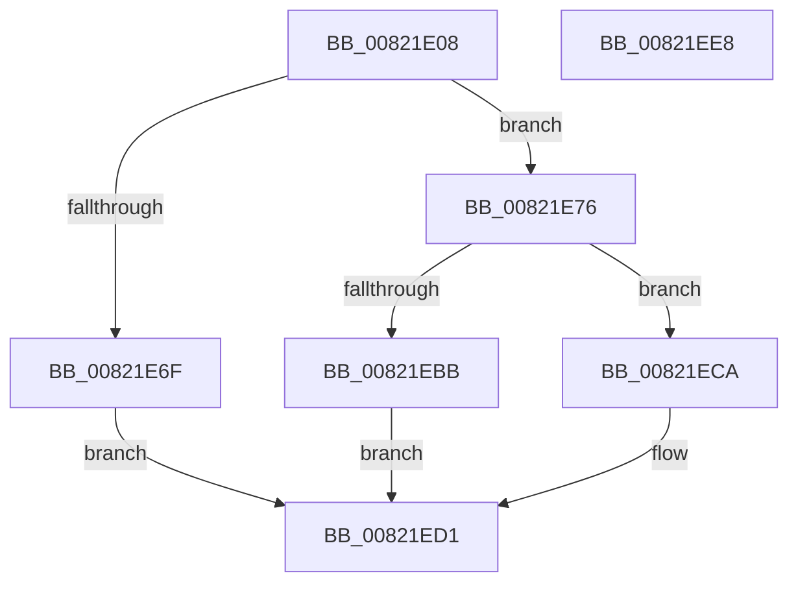

# AuthzBasepInitializeSystemSecurityAttributes

- RVA: `0x00821E08`–`0x00821EE9` (길이 `225` bytes)
- VA: `0x0000000140821E08`
- 실행 섹션: `PAGE`
- PDB 이름 있음: `예`; PDB Function 태그: `아니요`
- unwind 정보 RVA: `0x000DA168`
- 디코드: `61`개 명령, `225/225` bytes 표시
- 미해석 바이트: `0` (있으면 어셈블리에 `.byte`로 보존)

> 이 문서는 커널 이미지의 기계어와 PDB 기호를 분석해 생성했습니다. 4번과 5번은 함수 원형과 자료형을 바이너리 사용 방식에서 추정한 C 해석이며 원본 소스 복구 결과는 아닙니다.

## 1. Dependencies

- 직접 호출 지점: **4**; 고유 호출 대상: **4**
- 직접 호출자로 확인된 함수: **1**
- RIP 상대 이미지 참조: **3**

### Outgoing calls
- `0x00821E62` → [AuthzBasepAllocateSecurityAttributesList](../../text/30/AuthzBasepAllocateSecurityAttributesList_function_003013F4.md) (function, `0x003013F4`)
- `0x00821E76` → [RtlIsMultiSessionSku](../A2/RtlIsMultiSessionSku_function_00A20730.md) (function, `0x00A20730`)
- `0x00821EA7` → [AuthzBasepSetSecurityAttributesToken](../../text/3A/AuthzBasepSetSecurityAttributesToken_function_003A8D1C.md) (function, `0x003A8D1C`)
- `0x00821EC3` → [AuthzBasepFreeSecurityAttributesList](../../text/30/AuthzBasepFreeSecurityAttributesList_function_00301230.md) (function, `0x00301230`)

### Direct callers
- [SeRmInitPhase1](../../init/C7/SeRmInitPhase1_function_00C70B2C.md) at `0x00C70BE4`

### Static image references
- `0x00821E22` → RVA `0x00041148` (`.rdata`; read)
- `0x00821EB0` → RVA `0x00EEFE50` (`.data`; read)
- `0x00821ECA` → RVA `0x00E0CCB0` (`.data`; write)

## 2. Other-region calls and transfers

- 다른 실행 섹션으로 향하는 call: **3**
  - `0x00821E62` → [AuthzBasepAllocateSecurityAttributesList](../../text/30/AuthzBasepAllocateSecurityAttributesList_function_003013F4.md) (`PAGE` → `.text`)
  - `0x00821EA7` → [AuthzBasepSetSecurityAttributesToken](../../text/3A/AuthzBasepSetSecurityAttributesToken_function_003A8D1C.md) (`PAGE` → `.text`)
  - `0x00821EC3` → [AuthzBasepFreeSecurityAttributesList](../../text/30/AuthzBasepFreeSecurityAttributesList_function_00301230.md) (`PAGE` → `.text`)
- 별도 외부 분기/꼬리 이동을 확인하지 못했습니다.

## 3. Assembly (complete function range)

```asm
00821E08  48 89 5C 24 18                  mov qword ptr [rsp + 0x18], rbx
00821E0D  48 89 74 24 20                  mov qword ptr [rsp + 0x20], rsi
00821E12  48 89 4C 24 08                  mov qword ptr [rsp + 8], rcx
00821E17  55                              push rbp
00821E18  57                              push rdi
00821E19  41 56                           push r14
00821E1B  48 8B EC                        mov rbp, rsp
00821E1E  48 83 EC 60                     sub rsp, 0x60
00821E22  48 8D 05 1F F3 81 FF            lea rax, [rip - 0x7e0ce1]
00821E29  48 C7 45 D0 2E 00 30 00         mov qword ptr [rbp - 0x30], 0x30002e
00821E31  48 89 45 D8                     mov qword ptr [rbp - 0x28], rax
00821E35  0F 57 C0                        xorps xmm0, xmm0
00821E38  33 C0                           xor eax, eax
00821E3A  C7 45 C0 01 00 00 00            mov dword ptr [rbp - 0x40], 1
00821E41  48 89 45 F0                     mov qword ptr [rbp - 0x10], rax
00821E45  33 DB                           xor ebx, ebx
00821E47  0F 11 45 E0                     movups xmmword ptr [rbp - 0x20], xmm0
00821E4B  C7 45 20 02 00 00 00            mov dword ptr [rbp + 0x20], 2
00821E52  44 8D 70 01                     lea r14d, [rax + 1]
00821E56  48 8D 45 D0                     lea rax, [rbp - 0x30]
00821E5A  44 89 75 C4                     mov dword ptr [rbp - 0x3c], r14d
00821E5E  48 89 45 C8                     mov qword ptr [rbp - 0x38], rax
00821E62  E8 8D F5 AD FF                  call 0x1403013f4
00821E67  48 8B F8                        mov rdi, rax
00821E6A  48 85 C0                        test rax, rax
00821E6D  75 07                           jne 0x140821e76
00821E6F  BB 9A 00 00 C0                  mov ebx, 0xc000009a
00821E74  EB 5B                           jmp 0x140821ed1
00821E76  E8 B5 E8 1F 00                  call 0x140a20730
00821E7B  84 C0                           test al, al
00821E7D  44 89 75 E8                     mov dword ptr [rbp - 0x18], r14d
00821E81  40 8A F0                        mov sil, al
00821E84  4C 8D 45 C0                     lea r8, [rbp - 0x40]
00821E88  B8 06 00 00 00                  mov eax, 6
00821E8D  48 8D 55 20                     lea rdx, [rbp + 0x20]
00821E91  66 89 45 E0                     mov word ptr [rbp - 0x20], ax
00821E95  0F 95 C3                        setne bl
00821E98  48 8D 45 28                     lea rax, [rbp + 0x28]
00821E9C  48 89 5D 28                     mov qword ptr [rbp + 0x28], rbx
00821EA0  48 8B CF                        mov rcx, rdi
00821EA3  48 89 45 F0                     mov qword ptr [rbp - 0x10], rax
00821EA7  E8 70 6E B8 FF                  call 0x1403a8d1c
00821EAC  8B D8                           mov ebx, eax
00821EAE  33 C0                           xor eax, eax
00821EB0  F0 48 0F B1 3D 97 DF 6C 00      lock cmpxchg qword ptr [rip + 0x6cdf97], rdi
00821EB9  74 0F                           je 0x140821eca
00821EBB  48 8B CF                        mov rcx, rdi
00821EBE  BB 01 00 00 C0                  mov ebx, 0xc0000001
00821EC3  E8 68 F3 AD FF                  call 0x140301230
00821EC8  EB 07                           jmp 0x140821ed1
00821ECA  40 88 35 DF AD 5E 00            mov byte ptr [rip + 0x5eaddf], sil
00821ED1  4C 8D 5C 24 60                  lea r11, [rsp + 0x60]
00821ED6  8B C3                           mov eax, ebx
00821ED8  49 8B 5B 30                     mov rbx, qword ptr [r11 + 0x30]
00821EDC  49 8B 73 38                     mov rsi, qword ptr [r11 + 0x38]
00821EE0  49 8B E3                        mov rsp, r11
00821EE3  41 5E                           pop r14
00821EE5  5F                              pop rdi
00821EE6  5D                              pop rbp
00821EE7  C3                              ret
00821EE8  CC                              int3
```

## 4. C-style interpretation (structured pseudocode)

```c
__int64 __fastcall AuthzBasepInitializeSystemSecurityAttributes(__int64 a1)
{
    __int64 result;
    __int64 v_rbx;
    __int64 v_rsp;
    unsigned __int64 v_stack_m18;
    unsigned __int64 v_stack_m28;
    unsigned int v_stack_m30;
    unsigned __int64 v_stack_m38;
    unsigned __int64 v_stack_m40;
    unsigned __int64 v_stack_m48;
    unsigned __int64 v_stack_m50;
    unsigned int v_stack_m54;
    unsigned int v_stack_m58;
    unsigned __int64 v_stack_p10;
    unsigned __int64 v_stack_p18;
    unsigned __int64 v_stack_p20;
    unsigned __int64 v_stack_p8;

    v_stack_p18 = v_rbx;
    v_stack_p20 = v_rsi;
    v_stack_p8 = a1;
    v_rsp = (v_rsp) - (96);
    v_stack_m48 = 0x30002EULL;
    v_stack_m40 = v_rip - 8260833;
    result = 0;
    v_stack_m58 = 1;
    v_stack_m28 = 0;
    v_rbx = 0;
    v_stack_m38 = v_xmm0;
    v_stack_p8 = 2;
    v_stack_m54 = (unsigned int)(result + 1);
    v_stack_m50 = v_stack_m48;
    result = AuthzBasepAllocateSecurityAttributesList(a1, a2, a3, a4);
    if (result != 0) goto loc_00821E76;
    goto loc_00821ED1;
loc_00821E76:
    result = RtlIsMultiSessionSku(a1, a2, a3, a4);
    v_stack_m30 = (unsigned int)(result + 1);
    v_stack_m38 = 6;
    v_rbx = ((unsigned __int8)(result) != 0) ? 1 : 0;
    v_stack_p10 = v_rbx;
    v_stack_m28 = v_stack_p10;
    result = AuthzBasepSetSecurityAttributesToken(result, v_stack_p8, v_stack_m58, a4);
    result = 0;
    if (condition_is_equal) goto loc_00821ECA;
    result = AuthzBasepFreeSecurityAttributesList(0, v_stack_p8, v_stack_m58, a4);
    goto loc_00821ED1;
loc_00821ECA:
    *(unsigned __int8 *)(v_rip + 6204895) = (unsigned __int8)((unsigned __int8)(result));
loc_00821ED1:
    return (unsigned int)((unsigned int)((unsigned int)(0xC0000001ULL)));
}
```

## 5. (Beta) C Style

```c
int64_t AuthzBasepInitializeSystemSecurityAttributes(int64_t Arg1)
{
    int64_t result;
    int64_t local_rbx;
    int64_t local_rsp;
    uint64_t v_stack_m18;
    uint64_t v_stack_m28;
    uint32_t v_stack_m30;
    uint64_t v_stack_m38;
    uint64_t v_stack_m40;
    uint64_t v_stack_m48;
    uint64_t v_stack_m50;
    uint32_t v_stack_m54;
    uint32_t v_stack_m58;
    uint64_t v_stack_p10;
    uint64_t v_stack_p18;
    uint64_t v_stack_p20;
    uint64_t v_stack_p8;

    v_stack_p18 = local_rbx;
    v_stack_p20 = local_rsi;
    v_stack_p8 = Arg1;
    local_rsp = (local_rsp) - (96);
    v_stack_m48 = 0x30002EULL;
    v_stack_m40 = v_rip - 8260833;
    result = 0;
    v_stack_m58 = 1;
    v_stack_m28 = 0;
    local_rbx = 0;
    v_stack_m38 = v_xmm0;
    v_stack_p8 = 2;
    v_stack_m54 = (uint32_t)(result + 1);
    v_stack_m50 = v_stack_m48;
    result = AuthzBasepAllocateSecurityAttributesList(Arg1, a2, a3, a4);
    if (result != 0) goto loc_00821E76;
    goto loc_00821ED1;
loc_00821E76:
    result = RtlIsMultiSessionSku(Arg1, a2, a3, a4);
    v_stack_m30 = (uint32_t)(result + 1);
    v_stack_m38 = 6;
    local_rbx = ((uint8_t)(result) != 0) ? 1 : 0;
    v_stack_p10 = local_rbx;
    v_stack_m28 = v_stack_p10;
    result = AuthzBasepSetSecurityAttributesToken(result, v_stack_p8, v_stack_m58, a4);
    result = 0;
    if (condition_is_equal) goto loc_00821ECA;
    result = AuthzBasepFreeSecurityAttributesList(0, v_stack_p8, v_stack_m58, a4);
    goto loc_00821ED1;
loc_00821ECA:
    *(uint8_t *)(v_rip + 0x5EADDF) = (uint8_t)((uint8_t)(result));
loc_00821ED1:
    return (uint32_t)((uint32_t)((uint32_t)(0xC0000001ULL)));
}
```

## 6. Execution-region graph

[열기: 2D/3D 그래프와 함수 탐색 컨트롤 패널](../../../control-panel.html?section=page&rva=0x00821E08&view=graph)

- 2D 그래프는 위에서 아래로 흐르고, 3D 그래프는 빈 공간을 드래그해 회전합니다. Shift+드래그는 이동, 휠은 확대·축소, 함수 노드 선택은 대상 보고서 이동입니다.

### Static fallback


