# BcdEnumerateObjects

- RVA: `0x00823594`–`0x00823854` (길이 `704` bytes)
- VA: `0x0000000140823594`
- 실행 섹션: `PAGE`
- PDB 이름 있음: `예`; PDB Function 태그: `아니요`
- unwind 정보 RVA: `0x000DA2C8`
- 디코드: `199`개 명령, `704/704` bytes 표시
- 미해석 바이트: `0` (있으면 어셈블리에 `.byte`로 보존)

> 이 문서는 커널 이미지의 기계어와 PDB 기호를 분석해 생성했습니다. 4번과 5번은 함수 원형과 자료형을 바이너리 사용 방식에서 추정한 C 해석이며 원본 소스 복구 결과는 아닙니다.

## 1. Dependencies

- 직접 호출 지점: **17**; 고유 호출 대상: **11**
- 직접 호출자로 확인된 함수: **1**
- RIP 상대 이미지 참조: **1**

### Outgoing calls
- `0x008235F1` → [BiIsOfflineHandle](../../text/4B/BiIsOfflineHandle_function_004B4FA0.md) (function, `0x004B4FA0`)
- `0x008235FE` → [BiAcquireBcdSyncMutant](../91/BiAcquireBcdSyncMutant_function_00916898.md) (function, `0x00916898`)
- `0x0082362A` → [BiOpenKey](../A3/BiOpenKey_function_00A3F60C.md) (function, `0x00A3F60C`)
- `0x00823645` → [BiEnumerateSubKeys](../A3/BiEnumerateSubKeys_function_00A3FD24.md) (function, `0x00A3FD24`)
- `0x0082367C` → [BiOpenKey](../A3/BiOpenKey_function_00A3F60C.md) (function, `0x00A3F60C`)
- `0x0082368D` → [BiGetObjectDescription](../A3/BiGetObjectDescription_function_00A3F2FC.md) (function, `0x00A3F2FC`)
- `0x00823698` → [BiCloseKey](../91/BiCloseKey_function_00916A00.md) (function, `0x00916A00`)
- `0x008236A8` → [BiIsEnumerateMatch](BiIsEnumerateMatch_function_00823A20.md) (function, `0x00823A20`)
- `0x0082376B` → [BiOpenKey](../A3/BiOpenKey_function_00A3F60C.md) (function, `0x00A3F60C`)
- `0x0082377C` → [BiGetObjectDescription](../A3/BiGetObjectDescription_function_00A3F2FC.md) (function, `0x00A3F2FC`)
- `0x00823787` → [BiCloseKey](../91/BiCloseKey_function_00916A00.md) (function, `0x00916A00`)
- `0x00823796` → [BiIsEnumerateMatch](BiIsEnumerateMatch_function_00823A20.md) (function, `0x00823A20`)
- `0x008237AA` → [RtlInitUnicodeString](../../text/42/RtlInitUnicodeString_function_0042A780.md) (function, `0x0042A780`)
- `0x008237BA` → [RtlGUIDFromString](../8F/RtlGUIDFromString_function_008F1EF0.md) (function, `0x008F1EF0`)
- `0x0082381C` → [BiCloseKey](../91/BiCloseKey_function_00916A00.md) (function, `0x00916A00`)
- `0x0082382E` → [ExFreePoolWithTag](../../poolcode/B8/ExFreePoolWithTag_function_00B82870.md) (function, `0x00B82870`)
- `0x00823836` → [BiReleaseBcdSyncMutant](../91/BiReleaseBcdSyncMutant_function_0091695C.md) (function, `0x0091695C`)

### Direct callers
- [SepSecureBootCorrectBcd](../7A/SepSecureBootCorrectBcd_function_007A2174.md) at `0x007A2215`
- [SepSecureBootCorrectBcd](../7A/SepSecureBootCorrectBcd_function_007A2174.md) at `0x007A2264`

### Static image references
- `0x0082361D` → RVA `0x00B0A540` (` ?? ::NNGAKEGL::`string'`; read)

## 2. Other-region calls and transfers

- 다른 실행 섹션으로 향하는 call: **3**
  - `0x008235F1` → [BiIsOfflineHandle](../../text/4B/BiIsOfflineHandle_function_004B4FA0.md) (`PAGE` → `.text`)
  - `0x008237AA` → [RtlInitUnicodeString](../../text/42/RtlInitUnicodeString_function_0042A780.md) (`PAGE` → `.text`)
  - `0x0082382E` → [ExFreePoolWithTag](../../poolcode/B8/ExFreePoolWithTag_function_00B82870.md) (`PAGE` → `POOLCODE`)
- 별도 외부 분기/꼬리 이동을 확인하지 못했습니다.

## 3. Assembly (complete function range)

```asm
00823594  4C 89 4C 24 20                  mov qword ptr [rsp + 0x20], r9
00823599  4C 89 44 24 18                  mov qword ptr [rsp + 0x18], r8
0082359E  48 89 54 24 10                  mov qword ptr [rsp + 0x10], rdx
008235A3  55                              push rbp
008235A4  53                              push rbx
008235A5  56                              push rsi
008235A6  57                              push rdi
008235A7  41 54                           push r12
008235A9  41 56                           push r14
008235AB  41 57                           push r15
008235AD  48 8B EC                        mov rbp, rsp
008235B0  48 83 EC 70                     sub rsp, 0x70
008235B4  33 F6                           xor esi, esi
008235B6  0F 57 C0                        xorps xmm0, xmm0
008235B9  48 89 75 D0                     mov qword ptr [rbp - 0x30], rsi
008235BD  4D 8B E1                        mov r12, r9
008235C0  48 89 75 B8                     mov qword ptr [rbp - 0x48], rsi
008235C4  4D 8B F0                        mov r14, r8
008235C7  89 75 B4                        mov dword ptr [rbp - 0x4c], esi
008235CA  48 8B D9                        mov rbx, rcx
008235CD  0F 11 45 E8                     movups xmmword ptr [rbp - 0x18], xmm0
008235D1  4D 85 C0                        test r8, r8
008235D4  75 09                           jne 0x1408235df
008235D6  41 39 31                        cmp dword ptr [r9], esi
008235D9  0F 85 60 02 00 00               jne 0x14082383f
008235DF  48 39 75 60                     cmp qword ptr [rbp + 0x60], rsi
008235E3  0F 84 56 02 00 00               je 0x14082383f
008235E9  39 32                           cmp dword ptr [rdx], esi
008235EB  0F 84 4E 02 00 00               je 0x14082383f
008235F1  E8 AA 19 C9 FF                  call 0x1404b4fa0
008235F6  8A C8                           mov cl, al
008235F8  88 45 B0                        mov byte ptr [rbp - 0x50], al
008235FB  44 8A F8                        mov r15b, al
008235FE  E8 95 32 0F 00                  call 0x140916898
00823603  85 C0                           test eax, eax
00823605  0F 88 39 02 00 00               js 0x140823844
0082360B  4C 8D 4D C0                     lea r9, [rbp - 0x40]
0082360F  48 89 75 C0                     mov qword ptr [rbp - 0x40], rsi
00823613  41 B8 19 00 02 00               mov r8d, 0x20019
00823619  48 89 75 C8                     mov qword ptr [rbp - 0x38], rsi
0082361D  48 8D 15 1C 6F 2E 00            lea rdx, [rip + 0x2e6f1c]
00823624  48 8B CB                        mov rcx, rbx
00823627  48 8B FE                        mov rdi, rsi
0082362A  E8 DD BF 21 00                  call 0x140a3f60c
0082362F  8B D8                           mov ebx, eax
00823631  85 C0                           test eax, eax
00823633  0F 88 D8 01 00 00               js 0x140823811
00823639  48 8B 4D C0                     mov rcx, qword ptr [rbp - 0x40]
0082363D  4C 8D 45 B4                     lea r8, [rbp - 0x4c]
00823641  48 8D 55 C8                     lea rdx, [rbp - 0x38]
00823645  E8 DA C6 21 00                  call 0x140a3fd24
0082364A  48 8B 7D C8                     mov rdi, qword ptr [rbp - 0x38]
0082364E  8B D8                           mov ebx, eax
00823650  85 C0                           test eax, eax
00823652  0F 88 B9 01 00 00               js 0x140823811
00823658  44 8B FE                        mov r15d, esi
0082365B  39 75 B4                        cmp dword ptr [rbp - 0x4c], esi
0082365E  76 66                           jbe 0x1408236c6
00823660  44 8B 65 B4                     mov r12d, dword ptr [rbp - 0x4c]
00823664  48 8B F7                        mov rsi, rdi
00823667  4C 8B 75 48                     mov r14, qword ptr [rbp + 0x48]
0082366B  48 8B 16                        mov rdx, qword ptr [rsi]
0082366E  4C 8D 4D B8                     lea r9, [rbp - 0x48]
00823672  48 8B 4D C0                     mov rcx, qword ptr [rbp - 0x40]
00823676  41 B8 19 00 02 00               mov r8d, 0x20019
0082367C  E8 8B BF 21 00                  call 0x140a3f60c
00823681  85 C0                           test eax, eax
00823683  78 2F                           js 0x1408236b4
00823685  48 8B 4D B8                     mov rcx, qword ptr [rbp - 0x48]
00823689  48 8D 55 D0                     lea rdx, [rbp - 0x30]
0082368D  E8 6A BC 21 00                  call 0x140a3f2fc
00823692  48 8B 4D B8                     mov rcx, qword ptr [rbp - 0x48]
00823696  8B D8                           mov ebx, eax
00823698  E8 63 33 0F 00                  call 0x140916a00
0082369D  85 DB                           test ebx, ebx
0082369F  78 13                           js 0x1408236b4
008236A1  8B 55 D4                        mov edx, dword ptr [rbp - 0x2c]
008236A4  41 8B 4E 04                     mov ecx, dword ptr [r14 + 4]
008236A8  E8 73 03 00 00                  call 0x140823a20
008236AD  84 C0                           test al, al
008236AF  74 03                           je 0x1408236b4
008236B1  41 FF C7                        inc r15d
008236B4  48 83 C6 08                     add rsi, 8
008236B8  49 83 EC 01                     sub r12, 1
008236BC  75 AD                           jne 0x14082366b
008236BE  4C 8B 65 58                     mov r12, qword ptr [rbp + 0x58]
008236C2  4C 8B 75 50                     mov r14, qword ptr [rbp + 0x50]
008236C6  41 8B D7                        mov edx, r15d
008236C9  41 B8 FF FF FF FF               mov r8d, 0xffffffff
008236CF  48 8D 04 52                     lea rax, [rdx + rdx*2]
008236D3  48 C1 E0 03                     shl rax, 3
008236D7  49 3B C0                        cmp rax, r8
008236DA  0F 87 28 01 00 00               ja 0x140823808
008236E0  8D 48 07                        lea ecx, [rax + 7]
008236E3  41 B9 F8 FF FF FF               mov r9d, 0xfffffff8
008236E9  41 23 C9                        and ecx, r9d
008236EC  8B C1                           mov eax, ecx
008236EE  49 03 C6                        add rax, r14
008236F1  48 89 45 E0                     mov qword ptr [rbp - 0x20], rax
008236F5  48 8D 04 D5 00 00 00 00         lea rax, [rdx*8]
008236FD  49 3B C0                        cmp rax, r8
00823700  0F 87 02 01 00 00               ja 0x140823808
00823706  8D 70 07                        lea esi, [rax + 7]
00823709  41 23 F1                        and esi, r9d
0082370C  03 F1                           add esi, ecx
0082370E  3B F1                           cmp esi, ecx
00823710  0F 82 F2 00 00 00               jb 0x140823808
00823716  41 3B 34 24                     cmp esi, dword ptr [r12]
0082371A  76 15                           jbe 0x140823731
0082371C  48 8B 45 60                     mov rax, qword ptr [rbp + 0x60]
00823720  BB 23 00 00 C0                  mov ebx, 0xc0000023
00823725  41 89 34 24                     mov dword ptr [r12], esi
00823729  44 89 38                        mov dword ptr [rax], r15d
0082372C  E9 DC 00 00 00                  jmp 0x14082380d
00823731  83 65 D8 00                     and dword ptr [rbp - 0x28], 0
00823735  45 33 F6                        xor r14d, r14d
00823738  44 39 75 B4                     cmp dword ptr [rbp - 0x4c], r14d
0082373C  0F 86 B7 00 00 00               jbe 0x1408237f9
00823742  44 8B 65 D8                     mov r12d, dword ptr [rbp - 0x28]
00823746  89 75 C8                        mov dword ptr [rbp - 0x38], esi
00823749  48 8B 75 48                     mov rsi, qword ptr [rbp + 0x48]
0082374D  45 3B F7                        cmp r14d, r15d
00823750  0F 83 9C 00 00 00               jae 0x1408237f2
00823756  48 8B 4D C0                     mov rcx, qword ptr [rbp - 0x40]
0082375A  4C 8D 4D B8                     lea r9, [rbp - 0x48]
0082375E  41 8B C4                        mov eax, r12d
00823761  41 B8 19 00 02 00               mov r8d, 0x20019
00823767  48 8B 14 C7                     mov rdx, qword ptr [rdi + rax*8]
0082376B  E8 9C BE 21 00                  call 0x140a3f60c
00823770  85 C0                           test eax, eax
00823772  78 71                           js 0x1408237e5
00823774  48 8B 4D B8                     mov rcx, qword ptr [rbp - 0x48]
00823778  48 8D 55 D0                     lea rdx, [rbp - 0x30]
0082377C  E8 7B BB 21 00                  call 0x140a3f2fc
00823781  48 8B 4D B8                     mov rcx, qword ptr [rbp - 0x48]
00823785  8B D8                           mov ebx, eax
00823787  E8 74 32 0F 00                  call 0x140916a00
0082378C  85 DB                           test ebx, ebx
0082378E  78 55                           js 0x1408237e5
00823790  8B 55 D4                        mov edx, dword ptr [rbp - 0x2c]
00823793  8B 4E 04                        mov ecx, dword ptr [rsi + 4]
00823796  E8 85 02 00 00                  call 0x140823a20
0082379B  84 C0                           test al, al
0082379D  74 46                           je 0x1408237e5
0082379F  41 8B D4                        mov edx, r12d
008237A2  48 8D 4D E8                     lea rcx, [rbp - 0x18]
008237A6  48 8B 14 D7                     mov rdx, qword ptr [rdi + rdx*8]
008237AA  E8 D1 6F C0 FF                  call 0x14042a780
008237AF  48 8B 5D 50                     mov rbx, qword ptr [rbp + 0x50]
008237B3  48 8D 4D E8                     lea rcx, [rbp - 0x18]
008237B7  48 8B D3                        mov rdx, rbx
008237BA  E8 31 E7 0C 00                  call 0x1408f1ef0
008237BF  85 C0                           test eax, eax
008237C1  78 22                           js 0x1408237e5
008237C3  4C 8B 45 E0                     mov r8, qword ptr [rbp - 0x20]
008237C7  48 8B 45 D0                     mov rax, qword ptr [rbp - 0x30]
008237CB  4C 89 43 10                     mov qword ptr [rbx + 0x10], r8
008237CF  48 83 C3 18                     add rbx, 0x18
008237D3  48 89 5D 50                     mov qword ptr [rbp + 0x50], rbx
008237D7  49 89 00                        mov qword ptr [r8], rax
008237DA  49 83 C0 08                     add r8, 8
008237DE  4C 89 45 E0                     mov qword ptr [rbp - 0x20], r8
008237E2  41 FF C6                        inc r14d
008237E5  41 FF C4                        inc r12d
008237E8  44 3B 65 B4                     cmp r12d, dword ptr [rbp - 0x4c]
008237EC  0F 82 5B FF FF FF               jb 0x14082374d
008237F2  8B 75 C8                        mov esi, dword ptr [rbp - 0x38]
008237F5  4C 8B 65 58                     mov r12, qword ptr [rbp + 0x58]
008237F9  48 8B 45 60                     mov rax, qword ptr [rbp + 0x60]
008237FD  33 DB                           xor ebx, ebx
008237FF  41 89 34 24                     mov dword ptr [r12], esi
00823803  44 89 30                        mov dword ptr [rax], r14d
00823806  EB 05                           jmp 0x14082380d
00823808  BB 95 00 00 C0                  mov ebx, 0xc0000095
0082380D  44 8A 7D B0                     mov r15b, byte ptr [rbp - 0x50]
00823811  48 83 7D C0 00                  cmp qword ptr [rbp - 0x40], 0
00823816  74 09                           je 0x140823821
00823818  48 8B 4D C0                     mov rcx, qword ptr [rbp - 0x40]
0082381C  E8 DF 31 0F 00                  call 0x140916a00
00823821  48 85 FF                        test rdi, rdi
00823824  74 0D                           je 0x140823833
00823826  BA 42 43 44 4B                  mov edx, 0x4b444342
0082382B  48 8B CF                        mov rcx, rdi
0082382E  E8 3D F0 35 00                  call 0x140b82870
00823833  41 8A CF                        mov cl, r15b
00823836  E8 21 31 0F 00                  call 0x14091695c
0082383B  8B C3                           mov eax, ebx
0082383D  EB 05                           jmp 0x140823844
0082383F  B8 0D 00 00 C0                  mov eax, 0xc000000d
00823844  48 83 C4 70                     add rsp, 0x70
00823848  41 5F                           pop r15
0082384A  41 5E                           pop r14
0082384C  41 5C                           pop r12
0082384E  5F                              pop rdi
0082384F  5E                              pop rsi
00823850  5B                              pop rbx
00823851  5D                              pop rbp
00823852  C3                              ret
00823853  CC                              int3
```

## 4. C-style interpretation (structured pseudocode)

```c
__int64 __fastcall BcdEnumerateObjects(__int64 a1, __int64 a2, __int64 a3, __int64 a4, __int64 a5)
{
    __int64 result;
    __int64 v_r12;
    __int64 v_r14;
    __int64 v_r15;
    __int64 v_rbx;
    __int64 v_rsi;
    __int64 v_rsp;
    unsigned __int64 v_stack_m50;
    unsigned __int64 v_stack_m58;
    unsigned int v_stack_m60;
    unsigned int v_stack_m64;
    unsigned __int64 v_stack_m68;
    unsigned __int64 v_stack_m70;
    unsigned __int64 v_stack_m78;
    unsigned __int64 v_stack_m80;
    unsigned int v_stack_m84;
    unsigned __int8 v_stack_m88;
    unsigned __int64 v_stack_p10;
    unsigned __int64 v_stack_p18;
    unsigned __int64 v_stack_p20;

    v_stack_p20 = a4;
    v_stack_p18 = a3;
    v_stack_p10 = a2;
    v_rsp = (v_rsp) - (112);
    v_rsi = 0;
    v_stack_m68 = 0;
    v_stack_m80 = 0;
    v_stack_m84 = 0;
    v_stack_m50 = v_xmm0;
    if (a3 != 0) goto loc_008235DF;
    if ((*(unsigned int *)(a4)) != 0) goto loc_0082383F;
loc_008235DF:
    if (a5 == 0) goto loc_0082383F;
    if ((*(unsigned int *)(a2)) == 0) goto loc_0082383F;
    result = BiIsOfflineHandle(a1, a2, a3, a4);
    v_stack_m88 = (unsigned __int8)(result);
    result = BiAcquireBcdSyncMutant((unsigned __int8)(result), a2, a3, a4);
    if (sign_flag) goto loc_00823844;
    v_stack_m78 = 0;
    v_stack_m70 = 0;
    result = BiOpenKey(a1, v_rip + 3043100, (unsigned int)(0x20019ULL), v_stack_m78);
    if (sign_flag) goto loc_00823811;
    result = BiEnumerateSubKeys(v_stack_m78, v_stack_m70, v_stack_m84, v_stack_m78);
    if (sign_flag) goto loc_00823811;
    if (v_stack_m84 <= 0) goto loc_008236C6;
loc_0082366B:
    result = BiOpenKey(v_stack_m78, *(unsigned __int64 *)(v_stack_m70), (unsigned int)(0x20019ULL), v_stack_m80);
    if (sign_flag) goto loc_008236B4;
    result = BiGetObjectDescription(v_stack_m80, v_stack_m68, (unsigned int)(0x20019ULL), v_stack_m80);
    result = BiCloseKey(v_stack_m80, v_stack_m68, (unsigned int)(0x20019ULL), v_stack_m80);
    if (sign_flag) goto loc_008236B4;
    result = BiIsEnumerateMatch((unsigned int)(*(unsigned int *)(v_stack_p10 + 4)), (unsigned int)(v_stack_m64), (unsigned int)(0x20019ULL), v_stack_m80);
    v_r15 = 0;
    if ((unsigned __int8)(result) != 0) {
        v_r15 = (unsigned int)((0) + 1);
    }
    v_rsi = (v_stack_m70) + (8);
    v_r12 = ((unsigned int)(v_stack_m84)) - (1);
    if (condition_is_not_equal) goto loc_0082366B;
loc_008236C6:
    result = ((unsigned int)((unsigned int)(v_r15)) + (unsigned int)((unsigned int)(v_r15)) * 2) << (3);
    if (result > ((unsigned int)(0xFFFFFFFFULL))) goto loc_00823808;
    a1 = (unsigned int)((result + 7) & ((unsigned int)((unsigned int)(0xFFFFFFF8ULL))));
    result = ((unsigned int)((unsigned int)(a1))) + (v_stack_p18);
    v_stack_m58 = result;
    if (((unsigned int)((unsigned int)(v_r15)) * 8) > ((unsigned int)(0xFFFFFFFFULL))) goto loc_00823808;
    v_rsi = (unsigned int)(((unsigned int)((unsigned int)(v_r15)) * 8 + 7) & ((unsigned int)((unsigned int)(0xFFFFFFF8ULL))));
    v_rsi = (unsigned int)((v_rsi) + ((unsigned int)(a1)));
    if (((unsigned int)(v_rsi)) < ((unsigned int)(a1))) goto loc_00823808;
    if (((unsigned int)(v_rsi)) <= (*(unsigned int *)(v_stack_p20))) goto loc_00823731;
    *(unsigned int *)(v_stack_p20) = (unsigned int)(v_rsi);
    *(unsigned int *)(a5) = (unsigned int)(v_r15);
    goto loc_0082380D;
loc_00823731:
    v_r14 = 0;
    if (v_stack_m84 <= 0) goto loc_008237F9;
    v_stack_m70 = (unsigned int)(v_rsi);
loc_0082374D:
    if (0 >= ((unsigned int)(v_r15))) goto loc_008237F2;
    result = BiOpenKey(v_stack_m78, *(unsigned __int64 *)(v_stack_m70 + (unsigned int)((unsigned int)((unsigned int)(v_stack_m60))) * 8), (unsigned int)(0x20019ULL), v_stack_m80);
    if (sign_flag) goto loc_008237E5;
    result = BiGetObjectDescription(v_stack_m80, v_stack_m68, (unsigned int)(0x20019ULL), v_stack_m80);
    result = BiCloseKey(v_stack_m80, v_stack_m68, (unsigned int)(0x20019ULL), v_stack_m80);
    if (sign_flag) goto loc_008237E5;
    result = BiIsEnumerateMatch((unsigned int)(*(unsigned int *)(v_stack_p10 + 4)), (unsigned int)(v_stack_m64), (unsigned int)(0x20019ULL), v_stack_m80);
    if ((unsigned __int8)(result) == 0) goto loc_008237E5;
    result = RtlInitUnicodeString(v_stack_m50, *(unsigned __int64 *)(v_stack_m70 + (unsigned int)((unsigned int)((unsigned int)(v_stack_m60))) * 8), (unsigned int)(0x20019ULL), v_stack_m80);
    result = RtlGUIDFromString(v_stack_m50, v_stack_p18, (unsigned int)(0x20019ULL), v_stack_m80);
    v_rbx = v_stack_p18;
    if (!(sign_flag)) {
        a3 = v_stack_m58;
        result = v_stack_m68;
        *(unsigned __int64 *)(v_stack_p18 + 16) = a3;
        v_rbx = (v_stack_p18) + (24);
        v_stack_p18 = v_rbx;
        *(unsigned __int64 *)(a3) = result;
        a3 = (a3) + (8);
        v_stack_m58 = a3;
        v_r14 = (unsigned int)((v_r14) + 1);
    }
    v_r12 = (unsigned int)(((unsigned int)(v_stack_m60)) + 1);
    if (((unsigned int)(v_r12)) < v_stack_m84) goto loc_0082374D;
loc_008237F2:
loc_008237F9:
    v_rbx = 0;
    *(unsigned int *)(v_stack_p20) = (unsigned int)((unsigned int)(v_stack_m70));
    *(unsigned int *)(a5) = (unsigned int)(v_r14);
    goto loc_0082380D;
loc_00823808:
loc_0082380D:
loc_00823811:
    result = a5;
    if (v_stack_m78 != 0) {
        a1 = v_stack_m78;
        result = BiCloseKey(a1, v_stack_p18, a3, v_stack_m80);
    }
    if (v_stack_m70 != 0) {
        a2 = 0x4B444342ULL;
        a1 = v_stack_m70;
        result = ExFreePoolWithTag(a1, a2, a3, v_stack_m80);
    }
    result = BiReleaseBcdSyncMutant((unsigned __int8)(v_stack_m88), a2, a3, v_stack_m80);
    goto loc_00823844;
loc_0082383F:
loc_00823844:
    v_rsp = (v_rsp) + (112);
    return (unsigned int)(0xC000000DULL);
}
```

## 5. (Beta) C Style

```c
int64_t BcdEnumerateObjects(int64_t Arg1, void *Arg2, int64_t Arg3, void *Arg4, void *Arg5)
{
    uint8_t *arg2 = (uint8_t *)Arg2;
    uint8_t *arg4 = (uint8_t *)Arg4;
    uint8_t *arg5 = (uint8_t *)Arg5;

    int64_t result;
    int64_t local_r12;
    int64_t local_r14;
    int64_t local_r15;
    int64_t local_rbx;
    int64_t local_rsi;
    int64_t local_rsp;
    uint64_t v_stack_m50;
    uint64_t v_stack_m58;
    uint32_t v_stack_m60;
    uint32_t v_stack_m64;
    uint64_t v_stack_m68;
    uint64_t v_stack_m70;
    uint64_t v_stack_m78;
    uint64_t v_stack_m80;
    uint32_t v_stack_m84;
    uint8_t v_stack_m88;
    uint64_t v_stack_p10;
    uint64_t v_stack_p18;
    uint64_t v_stack_p20;

    v_stack_p20 = Arg4;
    v_stack_p18 = Arg3;
    v_stack_p10 = Arg2;
    local_rsp = (local_rsp) - (112);
    local_rsi = 0;
    v_stack_m68 = 0;
    v_stack_m80 = 0;
    v_stack_m84 = 0;
    v_stack_m50 = v_xmm0;
    if (Arg3 != 0) goto loc_008235DF;
    if ((*(uint32_t *)(arg4)) != 0) goto loc_0082383F;
loc_008235DF:
    if (Arg5 == NULL) goto loc_0082383F;
    if ((*(uint32_t *)(arg2)) == 0) goto loc_0082383F;
    result = BiIsOfflineHandle(Arg1, Arg2, Arg3, Arg4);
    v_stack_m88 = (uint8_t)(result);
    result = BiAcquireBcdSyncMutant((uint8_t)(result), Arg2, Arg3, Arg4);
    if (sign_flag) goto loc_00823844;
    v_stack_m78 = 0;
    v_stack_m70 = 0;
    result = BiOpenKey(Arg1, v_rip + 3043100, (uint32_t)(0x20019ULL), v_stack_m78);
    if (sign_flag) goto loc_00823811;
    result = BiEnumerateSubKeys(v_stack_m78, v_stack_m70, v_stack_m84, v_stack_m78);
    if (sign_flag) goto loc_00823811;
    if (v_stack_m84 <= 0) goto loc_008236C6;
loc_0082366B:
    result = BiOpenKey(v_stack_m78, *(uint64_t *)(v_stack_m70), (uint32_t)(0x20019ULL), v_stack_m80);
    if (sign_flag) goto loc_008236B4;
    result = BiGetObjectDescription(v_stack_m80, v_stack_m68, (uint32_t)(0x20019ULL), v_stack_m80);
    result = BiCloseKey(v_stack_m80, v_stack_m68, (uint32_t)(0x20019ULL), v_stack_m80);
    if (sign_flag) goto loc_008236B4;
    result = BiIsEnumerateMatch((uint32_t)(*(uint32_t *)(v_stack_p10 + 0x4)), (uint32_t)(v_stack_m64), (uint32_t)(0x20019ULL), v_stack_m80);
    local_r15 = 0;
    if ((uint8_t)(result) != 0) {
        local_r15 = (uint32_t)((0) + 1);
    }
    local_rsi = (v_stack_m70) + (8);
    local_r12 = ((uint32_t)(v_stack_m84)) - (1);
    if (condition_is_not_equal) goto loc_0082366B;
loc_008236C6:
    result = ((uint32_t)((uint32_t)(local_r15)) + (uint32_t)((uint32_t)(local_r15)) * 2) << (3);
    if (result > ((uint32_t)(0xFFFFFFFFULL))) goto loc_00823808;
    Arg1 = (uint32_t)((result + 7) & ((uint32_t)((uint32_t)(0xFFFFFFF8ULL))));
    result = ((uint32_t)((uint32_t)(Arg1))) + (v_stack_p18);
    v_stack_m58 = result;
    if (((uint32_t)((uint32_t)(local_r15)) * 8) > ((uint32_t)(0xFFFFFFFFULL))) goto loc_00823808;
    local_rsi = (uint32_t)(((uint32_t)((uint32_t)(local_r15)) * 8 + 7) & ((uint32_t)((uint32_t)(0xFFFFFFF8ULL))));
    local_rsi = (uint32_t)((local_rsi) + ((uint32_t)(Arg1)));
    if (((uint32_t)(local_rsi)) < ((uint32_t)(Arg1))) goto loc_00823808;
    if (((uint32_t)(local_rsi)) <= (*(uint32_t *)(v_stack_p20))) goto loc_00823731;
    *(uint32_t *)(v_stack_p20) = (uint32_t)(local_rsi);
    *(uint32_t *)(arg5) = (uint32_t)(local_r15);
    goto loc_0082380D;
loc_00823731:
    local_r14 = 0;
    if (v_stack_m84 <= 0) goto loc_008237F9;
    v_stack_m70 = (uint32_t)(local_rsi);
loc_0082374D:
    if (0 >= ((uint32_t)(local_r15))) goto loc_008237F2;
    result = BiOpenKey(v_stack_m78, *(uint64_t *)(v_stack_m70 + (uint32_t)((uint32_t)((uint32_t)(v_stack_m60))) * 8), (uint32_t)(0x20019ULL), v_stack_m80);
    if (sign_flag) goto loc_008237E5;
    result = BiGetObjectDescription(v_stack_m80, v_stack_m68, (uint32_t)(0x20019ULL), v_stack_m80);
    result = BiCloseKey(v_stack_m80, v_stack_m68, (uint32_t)(0x20019ULL), v_stack_m80);
    if (sign_flag) goto loc_008237E5;
    result = BiIsEnumerateMatch((uint32_t)(*(uint32_t *)(v_stack_p10 + 0x4)), (uint32_t)(v_stack_m64), (uint32_t)(0x20019ULL), v_stack_m80);
    if ((uint8_t)(result) == 0) goto loc_008237E5;
    result = RtlInitUnicodeString(v_stack_m50, *(uint64_t *)(v_stack_m70 + (uint32_t)((uint32_t)((uint32_t)(v_stack_m60))) * 8), (uint32_t)(0x20019ULL), v_stack_m80);
    result = RtlGUIDFromString(v_stack_m50, v_stack_p18, (uint32_t)(0x20019ULL), v_stack_m80);
    local_rbx = v_stack_p18;
    if (!(sign_flag)) {
        Arg3 = v_stack_m58;
        result = v_stack_m68;
        *(uint64_t *)(v_stack_p18 + 0x10) = Arg3;
        local_rbx = (v_stack_p18) + (24);
        v_stack_p18 = local_rbx;
        *(uint64_t *)(Arg3) = result;
        Arg3 = (Arg3) + (8);
        v_stack_m58 = Arg3;
        local_r14 = (uint32_t)((local_r14) + 1);
    }
    local_r12 = (uint32_t)(((uint32_t)(v_stack_m60)) + 1);
    if (((uint32_t)(local_r12)) < v_stack_m84) goto loc_0082374D;
loc_008237F2:
loc_008237F9:
    local_rbx = 0;
    *(uint32_t *)(v_stack_p20) = (uint32_t)((uint32_t)(v_stack_m70));
    *(uint32_t *)(arg5) = (uint32_t)(local_r14);
    goto loc_0082380D;
loc_00823808:
loc_0082380D:
loc_00823811:
    result = Arg5;
    if (v_stack_m78 != 0) {
        Arg1 = v_stack_m78;
        result = BiCloseKey(Arg1, v_stack_p18, Arg3, v_stack_m80);
    }
    if (v_stack_m70 != 0) {
        Arg2 = 0x4B444342ULL;
        Arg1 = v_stack_m70;
        result = ExFreePoolWithTag(Arg1, Arg2, Arg3, v_stack_m80);
    }
    result = BiReleaseBcdSyncMutant((uint8_t)(v_stack_m88), Arg2, Arg3, v_stack_m80);
    goto loc_00823844;
loc_0082383F:
loc_00823844:
    local_rsp = (local_rsp) + (112);
    return (uint32_t)(0xC000000DULL);
}
```

### 관측된 메모리 오프셋

구조체 형식이 확인되지 않은 접근은 인자 기준의 오프셋으로만 기록했습니다.

| 기준 인자 | 오프셋 표현 | 폭 (bit) | 접근 |
|---|---:|---:|---|
| `Arg2` | `+ 0x0` | `32` | `R` |
| `Arg4` | `+ 0x0` | `32` | `R` |
| `Arg5` | `+ 0x0` | `32` | `W` |

## 6. Execution-region graph

[열기: 2D/3D 그래프와 함수 탐색 컨트롤 패널](../../../control-panel.html?section=page&rva=0x00823594&view=graph)

- 2D 그래프는 위에서 아래로 흐르고, 3D 그래프는 빈 공간을 드래그해 회전합니다. Shift+드래그는 이동, 휠은 확대·축소, 함수 노드 선택은 대상 보고서 이동입니다.

### Static fallback

```mermaid
flowchart TD
  bb_00823594[BB_00823594]
  bb_008235D6[BB_008235D6]
  bb_008235DF[BB_008235DF]
  bb_008235E9[BB_008235E9]
  bb_008235F1[BB_008235F1]
  bb_0082360B[BB_0082360B]
  bb_00823639[BB_00823639]
  bb_00823658[BB_00823658]
  bb_00823660[BB_00823660]
  bb_0082366B[BB_0082366B]
  bb_00823685[BB_00823685]
  bb_008236A1[BB_008236A1]
  bb_008236B1[BB_008236B1]
  bb_008236B4[BB_008236B4]
  bb_008236BE[BB_008236BE]
  bb_008236C6[BB_008236C6]
  bb_008236E0[BB_008236E0]
  bb_00823706[BB_00823706]
  bb_00823716[BB_00823716]
  bb_0082371C[BB_0082371C]
  bb_00823731[BB_00823731]
  bb_00823742[BB_00823742]
  bb_0082374D[BB_0082374D]
  bb_00823756[BB_00823756]
  bb_00823774[BB_00823774]
  bb_00823790[BB_00823790]
  bb_0082379F[BB_0082379F]
  bb_008237C3[BB_008237C3]
  bb_008237E5[BB_008237E5]
  bb_008237F2[BB_008237F2]
  bb_008237F9[BB_008237F9]
  bb_00823808[BB_00823808]
  bb_0082380D[BB_0082380D]
  bb_00823811[BB_00823811]
  bb_00823818[BB_00823818]
  bb_00823821[BB_00823821]
  bb_00823826[BB_00823826]
  bb_00823833[BB_00823833]
  bb_0082383F[BB_0082383F]
  bb_00823844[BB_00823844]
  bb_00823853[BB_00823853]
  bb_00823594 -->|branch| bb_008235DF
  bb_00823594 -->|fallthrough| bb_008235D6
  bb_008235D6 -->|branch| bb_0082383F
  bb_008235D6 -->|fallthrough| bb_008235DF
  bb_008235DF -->|branch| bb_0082383F
  bb_008235DF -->|fallthrough| bb_008235E9
  bb_008235E9 -->|branch| bb_0082383F
  bb_008235E9 -->|fallthrough| bb_008235F1
  bb_008235F1 -->|branch| bb_00823844
  bb_008235F1 -->|fallthrough| bb_0082360B
  bb_0082360B -->|branch| bb_00823811
  bb_0082360B -->|fallthrough| bb_00823639
  bb_00823639 -->|branch| bb_00823811
  bb_00823639 -->|fallthrough| bb_00823658
  bb_00823658 -->|branch| bb_008236C6
  bb_00823658 -->|fallthrough| bb_00823660
  bb_00823660 -->|flow| bb_0082366B
  bb_0082366B -->|branch| bb_008236B4
  bb_0082366B -->|fallthrough| bb_00823685
  bb_00823685 -->|branch| bb_008236B4
  bb_00823685 -->|fallthrough| bb_008236A1
  bb_008236A1 -->|branch| bb_008236B4
  bb_008236A1 -->|fallthrough| bb_008236B1
  bb_008236B1 -->|flow| bb_008236B4
  bb_008236B4 -->|branch| bb_0082366B
  bb_008236B4 -->|fallthrough| bb_008236BE
  bb_008236BE -->|flow| bb_008236C6
  bb_008236C6 -->|branch| bb_00823808
  bb_008236C6 -->|fallthrough| bb_008236E0
  bb_008236E0 -->|branch| bb_00823808
  bb_008236E0 -->|fallthrough| bb_00823706
  bb_00823706 -->|branch| bb_00823808
  bb_00823706 -->|fallthrough| bb_00823716
  bb_00823716 -->|branch| bb_00823731
  bb_00823716 -->|fallthrough| bb_0082371C
  bb_0082371C -->|branch| bb_0082380D
  bb_00823731 -->|branch| bb_008237F9
  bb_00823731 -->|fallthrough| bb_00823742
  bb_00823742 -->|flow| bb_0082374D
  bb_0082374D -->|branch| bb_008237F2
  bb_0082374D -->|fallthrough| bb_00823756
  bb_00823756 -->|branch| bb_008237E5
  bb_00823756 -->|fallthrough| bb_00823774
  bb_00823774 -->|branch| bb_008237E5
  bb_00823774 -->|fallthrough| bb_00823790
  bb_00823790 -->|branch| bb_008237E5
  bb_00823790 -->|fallthrough| bb_0082379F
  bb_0082379F -->|branch| bb_008237E5
  bb_0082379F -->|fallthrough| bb_008237C3
  bb_008237C3 -->|flow| bb_008237E5
  bb_008237E5 -->|branch| bb_0082374D
  bb_008237E5 -->|fallthrough| bb_008237F2
  bb_008237F2 -->|flow| bb_008237F9
  bb_008237F9 -->|branch| bb_0082380D
  bb_00823808 -->|flow| bb_0082380D
  bb_0082380D -->|flow| bb_00823811
  bb_00823811 -->|branch| bb_00823821
  bb_00823811 -->|fallthrough| bb_00823818
  bb_00823818 -->|flow| bb_00823821
  bb_00823821 -->|branch| bb_00823833
  bb_00823821 -->|fallthrough| bb_00823826
  bb_00823826 -->|flow| bb_00823833
  bb_00823833 -->|branch| bb_00823844
  bb_0082383F -->|flow| bb_00823844
```


