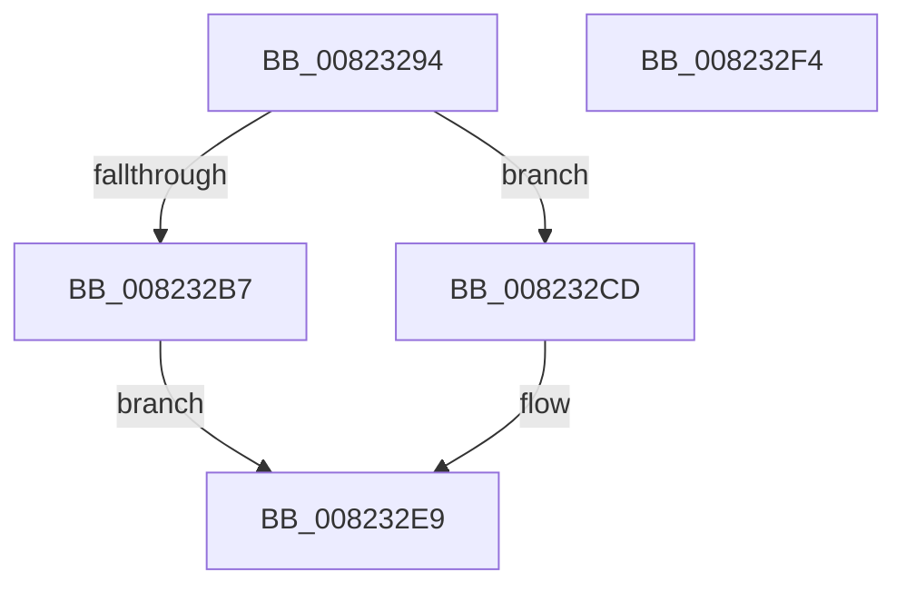

# BcdFlushStore

- RVA: `0x00823294`–`0x008232F5` (길이 `97` bytes)
- VA: `0x0000000140823294`
- 실행 섹션: `PAGE`
- PDB 이름 있음: `예`; PDB Function 태그: `아니요`
- unwind 정보 RVA: `0x0005CAAC`
- 디코드: `29`개 명령, `97/97` bytes 표시
- 미해석 바이트: `0` (있으면 어셈블리에 `.byte`로 보존)

> 이 문서는 커널 이미지의 기계어와 PDB 기호를 분석해 생성했습니다. 4번과 5번은 함수 원형과 자료형을 바이너리 사용 방식에서 추정한 C 해석이며 원본 소스 복구 결과는 아닙니다.

## 1. Dependencies

- 직접 호출 지점: **6**; 고유 호출 대상: **6**
- 직접 호출자로 확인된 함수: **2**
- RIP 상대 이미지 참조: **1**

### Outgoing calls
- `0x008232A1` → [BiIsOfflineHandle](../../text/4B/BiIsOfflineHandle_function_004B4FA0.md) (function, `0x004B4FA0`)
- `0x008232AB` → [BiAcquireBcdSyncMutant](../91/BiAcquireBcdSyncMutant_function_00916898.md) (function, `0x00916898`)
- `0x008232C3` → [BiLogMessage](../A3/BiLogMessage_function_00A3D3A8.md) (function, `0x00A3D3A8`)
- `0x008232D0` → [BiSanitizeHandle](../../text/4B/BiSanitizeHandle_function_004B0E4C.md) (function, `0x004B0E4C`)
- `0x008232D8` → [ZwFlushKey](../../text/6A/ZwFlushKey_function_006AEF10.md) (function, `0x006AEF10`)
- `0x008232E2` → [BiReleaseBcdSyncMutant](../91/BiReleaseBcdSyncMutant_function_0091695C.md) (function, `0x0091695C`)

### Direct callers
- [PopAdaptiveClearInitialSystemPowerState](../76/PopAdaptiveClearInitialSystemPowerState_function_0076B55C.md) at `0x0076B5B6`
- [PopBcdClearPendingResume](../A3/PopBcdClearPendingResume_function_00A3E07C.md) at `0x00A3E0E9`

### Static image references
- `0x008232B7` → RVA `0x00B0B020` (` ?? ::NNGAKEGL::`string'`; read)

## 2. Other-region calls and transfers

- 다른 실행 섹션으로 향하는 call: **3**
  - `0x008232A1` → [BiIsOfflineHandle](../../text/4B/BiIsOfflineHandle_function_004B4FA0.md) (`PAGE` → `.text`)
  - `0x008232D0` → [BiSanitizeHandle](../../text/4B/BiSanitizeHandle_function_004B0E4C.md) (`PAGE` → `.text`)
  - `0x008232D8` → [ZwFlushKey](../../text/6A/ZwFlushKey_function_006AEF10.md) (`PAGE` → `.text`)
- 별도 외부 분기/꼬리 이동을 확인하지 못했습니다.

## 3. Assembly (complete function range)

```asm
00823294  48 89 5C 24 08                  mov qword ptr [rsp + 8], rbx
00823299  57                              push rdi
0082329A  48 83 EC 20                     sub rsp, 0x20
0082329E  48 8B D9                        mov rbx, rcx
008232A1  E8 FA 1C C9 FF                  call 0x1404b4fa0
008232A6  8A C8                           mov cl, al
008232A8  40 8A F8                        mov dil, al
008232AB  E8 E8 35 0F 00                  call 0x140916898
008232B0  44 8B C0                        mov r8d, eax
008232B3  85 C0                           test eax, eax
008232B5  79 16                           jns 0x1408232cd
008232B7  48 8D 15 62 7D 2E 00            lea rdx, [rip + 0x2e7d62]
008232BE  B9 04 00 00 00                  mov ecx, 4
008232C3  E8 E0 A0 21 00                  call 0x140a3d3a8
008232C8  41 8B C0                        mov eax, r8d
008232CB  EB 1C                           jmp 0x1408232e9
008232CD  48 8B CB                        mov rcx, rbx
008232D0  E8 77 DB C8 FF                  call 0x1404b0e4c
008232D5  48 8B C8                        mov rcx, rax
008232D8  E8 33 BC E8 FF                  call 0x1406aef10
008232DD  40 8A CF                        mov cl, dil
008232E0  8B D8                           mov ebx, eax
008232E2  E8 75 36 0F 00                  call 0x14091695c
008232E7  8B C3                           mov eax, ebx
008232E9  48 8B 5C 24 30                  mov rbx, qword ptr [rsp + 0x30]
008232EE  48 83 C4 20                     add rsp, 0x20
008232F2  5F                              pop rdi
008232F3  C3                              ret
008232F4  CC                              int3
```

## 4. C-style interpretation (structured pseudocode)

```c
__int64 __fastcall BcdFlushStore(__int64 a1)
{
    __int64 result;
    __int64 v_rsp;
    unsigned __int64 v_stack_p8;

    v_stack_p8 = v_rbx;
    v_rsp = (v_rsp) - (32);
    result = BiIsOfflineHandle(a1, a2, a3, a4);
    result = BiAcquireBcdSyncMutant((unsigned __int8)(result), a2, a3, a4);
    if (!sign_flag) goto loc_008232CD;
    result = BiLogMessage(4, v_rip + 3046754, (unsigned int)((unsigned int)(result)), a4);
    goto loc_008232E9;
loc_008232CD:
    result = BiSanitizeHandle(a1, v_rip + 3046754, (unsigned int)((unsigned int)(result)), a4);
    result = ZwFlushKey(result, v_rip + 3046754, (unsigned int)((unsigned int)(result)), a4);
    result = BiReleaseBcdSyncMutant((unsigned __int8)((unsigned __int8)(result)), v_rip + 3046754, (unsigned int)((unsigned int)(result)), a4);
loc_008232E9:
    v_rsp = (v_rsp) + (32);
    return (unsigned int)((unsigned int)((unsigned int)((unsigned int)(result))));
}
```

## 5. (Beta) C Style

```c
int64_t BcdFlushStore(int64_t Arg1)
{
    int64_t result;
    int64_t local_rsp;
    uint64_t v_stack_p8;

    v_stack_p8 = local_rbx;
    local_rsp = (local_rsp) - (32);
    result = BiIsOfflineHandle(Arg1, a2, a3, a4);
    result = BiAcquireBcdSyncMutant((uint8_t)(result), a2, a3, a4);
    if (!sign_flag) goto loc_008232CD;
    result = BiLogMessage(4, v_rip + 3046754, (uint32_t)((uint32_t)(result)), a4);
    goto loc_008232E9;
loc_008232CD:
    result = BiSanitizeHandle(Arg1, v_rip + 3046754, (uint32_t)((uint32_t)(result)), a4);
    result = ZwFlushKey(result, v_rip + 3046754, (uint32_t)((uint32_t)(result)), a4);
    result = BiReleaseBcdSyncMutant((uint8_t)((uint8_t)(result)), v_rip + 3046754, (uint32_t)((uint32_t)(result)), a4);
loc_008232E9:
    local_rsp = (local_rsp) + (32);
    return (uint32_t)((uint32_t)((uint32_t)((uint32_t)(result))));
}
```

## 6. Execution-region graph

[열기: 2D/3D 그래프와 함수 탐색 컨트롤 패널](../../../control-panel.html?section=page&rva=0x00823294&view=graph)

- 2D 그래프는 위에서 아래로 흐르고, 3D 그래프는 빈 공간을 드래그해 회전합니다. Shift+드래그는 이동, 휠은 확대·축소, 함수 노드 선택은 대상 보고서 이동입니다.

### Static fallback


